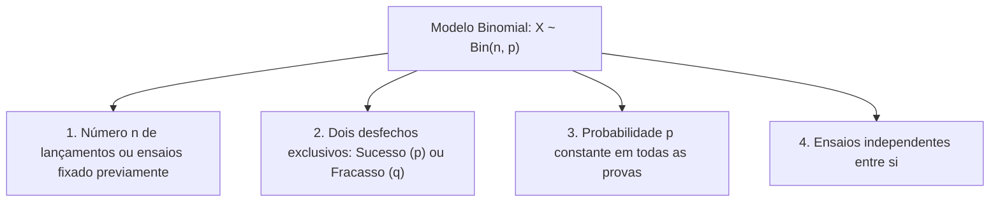
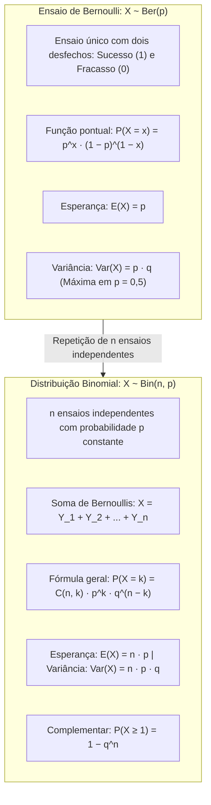

> [!objetivos]
> - Compreender a estrutura do ensaio de Bernoulli e seus parâmetros fundamentais de média e variância.
> - Dominar os pressupostos teóricos e a construção da distribuição Binomial a partir de ensaios repetidos.
> - Aplicar o termo geral binomial, coeficientes combinatórios e a regra do evento complementar.
> - Calcular a esperança matemática, a variância e o desvio padrão de variáveis discretas binomiais.

O estudo das distribuições discretas de probabilidade fundamenta a tomada de decisão na segurança pública e no gerenciamento de riscos operacionais. Na rotina dos bombeiros e policiais militares, muitos eventos apresentam natureza dicotômica. Uma viatura de resgate está operacional ou necessita de manutenção. Um alarme predial de incêndio é verdadeiro ou falso. Um teste de bafômetro acusa presença ou ausência de álcool. A modelagem estatística desses fenômenos começa no modelo mais elementar: o ensaio de Bernoulli.

## O Ensaio de Bernoulli

O ensaio de Bernoulli é um experimento aleatório que admite apenas dois desfechos possíveis. Esses resultados são mutuamente exclusivos e cobrem todo o espaço amostral. Eles são formalmente classificados como sucesso ou fracasso.

O termo sucesso não expressa valor moral ou positivo. Ele apenas indica a ocorrência da característica de interesse investigada. Se inspecionamos um lote de suprimentos à procura de peças defeituosas, a identificação de uma peça com falha representa o sucesso do ensaio. De forma análoga, em um lançamento de moeda honesta, o surgimento de uma face específica (como cara) constitui o sucesso.

Indicamos uma variável de Bernoulli por X ~ Ber(p). A probabilidade de sucesso é indicada por p, com 0 < p < 1. A probabilidade de fracasso é q = 1 − p.

A variável aleatória X assume valor 1 no sucesso e valor 0 no fracasso. Sua função de probabilidade é escrita como:

P(X = x) = p^x · (1 − p)^(1 − x), para x ∈ {0, 1}

Quando fazemos x = 1, encontramos P(X = 1) = p. Quando fazemos x = 0, obtemos P(X = 0) = 1 − p = q. A soma das probabilidades de todas as faces ou desfechos do espaço amostral é sempre igual a 1.

| Desfecho do Experimento | Valor de x | Função de Probabilidade | Probabilidade |
|---|---|---|---|
| Ocorrência do atributo (Sucesso) | 1 | p¹ · (1 − p)⁰ | p |
| Não ocorrência do atributo (Fracasso) | 0 | p⁰ · (1 − p)¹ | q = 1 − p |
| **Soma Total** | **{0, 1}** | **p + q** | **1,00** |

### Parâmetros Matemáticos de Bernoulli

O valor esperado de X, denotado por E(X), é a média ponderada dos valores possíveis pelos seus pesos:

E(X) = 0 · (1 − p) + 1 · p = p

A esperança matemática da variável de Bernoulli coincide diretamente com a probabilidade p. Para obter a variância, calculamos primeiro o momento de segunda ordem:

E(X²) = 0² · (1 − p) + 1² · p = p

Aplicando a relação da variância Var(X) = E(X²) − [E(X)]²:

Var(X) = p − p² = p · (1 − p) = p · q

O desvio padrão é a raiz quadrada positiva da variância: DP(X) = √(p · q).

> [!bizu] Ponto de Máxima Variância no Ensaio de Bernoulli
> A função Var(p) = p · (1 − p) atinge seu valor máximo no ponto médio p = 0,5. Nesse ponto de maior incerteza (como no lançamento de moeda equilibrada), temos Var(X) = 0,25 e DP(X) = 0,50. Quando p se aproxima de 0 ou de 1, o desfecho torna-se previsível e a dispersão se reduz até zero.

## A Gênese da Distribuição Binomial

O ensaio de Bernoulli analisa um único evento isolado. Na gestão corporativa e em controle de qualidade, avaliamos conjuntos sucessivos de ensaios. Analisamos amostras de equipamentos, turmas de novos cadetes em treinamentos ou séries de lançamentos e inspeções.

A distribuição Binomial surge da repetição de n ensaios de Bernoulli independentes. Generalizando o processo, a variável X conta o número total de sucessos obtidos nas n provas. Indicamos esse modelo por X ~ Bin(n, p).

O modelo binomial exige quatro condições indispensáveis:

Primeiro, o número n de ensaios ou lançamentos é fixado previamente. Segundo, cada ensaio admite apenas dois resultados dicotômicos: sucesso ou fracasso. Terceiro, a probabilidade p de sucesso permanece rigorosamente constante ao longo de todas as provas. Quarto, os ensaios são independentes entre si. O resultado obtido em um lançamento anterior não exerce influência sobre o ensaio seguinte.

Essas premissas são observadas em populações muito grandes ou em amostragens com reposição. O suporte da variável aleatória X é o conjunto discreto {0, 1, 2, ..., n}.

### A Binomial como Soma de Variáveis de Bernoulli

A distribuição Binomial pode ser compreendida como a soma de n variáveis de Bernoulli independentes. Seja Y_i a variável que indica o resultado do i-ésimo ensaio (onde Y_i ~ Ber(p)):

X = Y_1 + Y_2 + ... + Y_n

Pela propriedade de linearidade da média, a esperança da soma é igual à soma das esperanças:

E(X) = E(Y_1) + ... + E(Y_n) = p + ... + p = n · p

Pela independência mútua dos ensaios, a variância da soma é a soma das variâncias de cada ensaio:

Var(X) = Var(Y_1) + ... + Var(Y_n) = p·q + ... + p·q = n · p · q

O desvio padrão da binomial é dado por DP(X) = √(n · p · q).

| Propriedade Estatística | Ensaio de Bernoulli: Y ~ Ber(p) | Distribuição Binomial: X ~ Bin(n, p) |
|---|---|---|
| Parâmetros requeridos | p | n e p |
| Suporte da variável | {0, 1} | {0, 1, 2, ..., n} |
| Esperança E(X) | p | n · p |
| Variância Var(X) | p · q | n · p · q |
| Desvio Padrão DP(X) | √(p · q) | √(n · p · q) |
| Relação interna de dispersão | Var(Y) ≤ 0,25 | Var(X) = E(X) · q < E(X) |

> [!atencao] A Variância da Binomial É Sempre Menor que a Média
> Em qualquer variável binomial autêntica com 0 < p < 1, temos q < 1. Como Var(X) = n · p · q = E(X) · q, a variância é sempre estritamente inferior à média. Em questões de prova, se um problema fornecer média 10 e variância 12 para uma contagem discreta, descarte a distribuição Binomial.

## A Função de Probabilidade Pontual da Binomial

Considere um experimento com n lançamentos independentes no qual desejamos obter exatamente k sucessos e n − k fracassos. Uma sequência particular com k sucessos seguidos de n − k fracassos possui probabilidade dada pela multiplicação direta:

P(Sequência) = p^k · q^(n − k)

Contudo, a ordem em que os sucessos ocorrem não altera o resultado total da contagem. A quantidade necessária de maneiras de distribuir k sucessos ao longo de n posições disponíveis corresponde ao coeficiente de combinação simples:

C(n, k) = n! / [k! · (n − k)!]

Como todas as configurações são eventos mutuamente exclusivos com idêntica probabilidade, somamos todas as possibilidades para encontrar a fórmula da probabilidade binomial:

P(X = k) = C(n, k) · p^k · q^(n − k)

### Exemplo Prático com Três Ensaios (n = 3)

Considere a inspeção de n = 3 peças metálicas em um lote de manutenção de viaturas. A probabilidade de encontrar uma peça defeituosa é p = 0,6 e de peça perfeita é q = 0,4. A tabela detalha o espaço amostral completo:

| Peças Defeituosas (k) | Sequências no Espaço Amostral | Coeficiente C(3, k) | Cálculo Numérico da Probabilidade | Probabilidade Final |
|---|---|---|---|---|
| k = 0 | {FFF} | C(3, 0) = 1 | 1 · (0,6)⁰ · (0,4)³ = 0,064 | 0,064 (6,4%) |
| k = 1 | {SFF, FSF, FFS} | C(3, 1) = 3 | 3 · (0,6)¹ · (0,4)² = 3 · 0,6 · 0,16 | 0,288 (28,8%) |
| k = 2 | {SSF, SFS, FSS} | C(3, 2) = 3 | 3 · (0,6)² · (0,4)¹ = 3 · 0,36 · 0,4 | 0,432 (43,2%) |
| k = 3 | {SSS} | C(3, 3) = 1 | 1 · (0,6)³ · (0,4)⁰ = 0,216 | 0,216 (21,6%) |
| **Total** | **8 sequências possíveis** | **2³ = 8 arranjos** | **(0,6 + 0,4)³ = 1³** | **1,000 (100%)** |

A soma de todas as probabilidades resulta exatamente em 1,000. Isso confirma a expansão pelo binômio de Newton (p + q)^n. Se a probabilidade de peça defeituosa fosse p = 0,5, como em faces de moeda, teríamos distribuição simétrica com P(X=1) = P(X=2) = 0,375 (37,5%).

## Casos Notáveis e a Regra do Complementar

A resolução célere de provas de concurso depende do domínio de casos notáveis que dispensam cálculos combinatórios longos. Dois cenários de fronteira merecem atenção imediata:

O primeiro caso extremo avalia a probabilidade de não observar nenhum sucesso em n tentativas consecutivas (X = 0). Como C(n, 0) = 1 e p⁰ = 1, todos os ensaios resultam obrigatoriamente em fracasso:

P(X = 0) = q^n = (1 − p)^n

O segundo caso extremo avalia a probabilidade de obter sucesso em todos os n lançamentos realizados (X = n). Como C(n, n) = 1 e q⁰ = 1, todos os ensaios resultam em êxito:

P(X = n) = p^n

Em problemas práticos, é muito comum o examinador indagar a probabilidade de ocorrer pelo menos um sucesso em n repetições do experimento. A expressão "pelo menos um" abrange todos os valores inteiros desde k = 1 até k = n. O cálculo direto exigiria computar n probabilidades pontuais distintas e efetuar a soma de todas elas.

O método mais inteligente e eficiente recorre à regra do evento complementar. O complemento lógico do evento "obter pelo menos um sucesso" é o evento "não obter nenhum sucesso" (X = 0). Como a soma de um evento com seu complementar é sempre 1, a probabilidade é calculada instantaneamente:

P(X ≥ 1) = 1 − P(X = 0) = 1 − q^n = 1 − (1 − p)^n

Esse atalho matemático é uma das ferramentas mais cobradas pelas bancas, reduzindo cálculos trabalhosos a uma simples subtração.

> [!pegadinha] Atenção ao Significado de Sucesso na Questão
> O conceito de sucesso deve estar estritamente alinhado com a pergunta do enunciado. Se o problema pede a probabilidade de encontrar viaturas sem defeito, a viatura perfeita é o sucesso. Se o examinador perguntar sobre peças defeituosas, a peça defeituosa passa a ser o sucesso. Inverter a atribuição de p e q conduz a um cálculo equivocado, gerando alternativas com gabaritos armadilha.

## Aplicações Práticas Resolvidas

Analise a resolução comentada de duas situações representativas no contexto das forças militares e de segurança.

> [!resolvido] Disponibilidade de Viaturas de Resgate do Corpo de Bombeiros
> Em um grupamento de bombeiros, o histórico operacional mostra que a probabilidade de uma viatura precisar de reparos mecânicos em um plantão de serviço é de 10% (p = 0,10). Cinco viaturas operam de maneira totalmente independente no setor urbano (n = 5).
> a) Qual a probabilidade de nenhuma viatura requerer manutenção corretiva?
> b) Qual a probabilidade de exatamente 2 viaturas precisarem de reparos?
> c) Qual o número médio esperado de viaturas com defeito e o respectivo desvio padrão?
>
> **Resolução passo a passo:**
> Os parâmetros do modelo são n = 5 ensaios, probabilidade de sucesso (necessidade de reparo) p = 0,10 e probabilidade de fracasso (viatura pronta) q = 0,90.
> Para o item a: P(X = 0) = q⁵ = (0,90)⁵. Multiplicando sucessivamente: 0,9 · 0,9 = 0,81; 0,81 · 0,9 = 0,729; 0,729 · 0,9 = 0,6561; 0,6561 · 0,9 = 0,5905 (59,05%).
> Para o item b: P(X = 2) = C(5, 2) · p² · q³. O coeficiente combinatório é C(5, 2) = (5 · 4) / (2 · 1) = 10. As potências são p² = (0,10)² = 0,01 e q³ = (0,90)³ = 0,729. Logo, P(X = 2) = 10 · 0,01 · 0,729 = 0,0729 (7,29%).
> Para o item c: A esperança matemática é E(X) = n · p = 5 · 0,10 = 0,50 viatura. A variância é Var(X) = n · p · q = 5 · 0,10 · 0,90 = 0,45. O desvio padrão é DP(X) = √0,45 ≈ 0,67 viatura.

> [!exemplo] Desempenho em Treinamento de Tiro com Armamento Policial
> Em uma sessão de treinamento prático de tiro, a probabilidade de um militar acertar o centro do alvo em cada disparo isolado é de 80% (p = 0,80). Suponha que o militar efetue uma série de 4 disparos consecutivos e independentes.
> Se a banca exigir a probabilidade de acertar pelo menos 3 disparos, somamos os eventos exclusivos P(X = 3) e P(X = 4):
> P(X = 3) = C(4, 3) · (0,80)³ · (0,20)¹ = 4 · 0,512 · 0,20 = 0,4096 (40,96%).
> P(X = 4) = C(4, 4) · (0,80)⁴ · (0,20)⁰ = 1 · 0,4096 · 1 = 0,4096 (40,96%).
> Somando as probabilidades parciais: P(X ≥ 3) = 0,4096 + 0,4096 = 0,8192 (81,92%).

## Mapa do capítulo

### Para fixar
- O ensaio de Bernoulli admite apenas dois desfechos: sucesso (1) e fracasso (0).
- O valor esperado de Bernoulli é E(X) = p e a variância é Var(X) = p · q.
- O ponto de máxima variância em Bernoulli ocorre quando p = 0,5, valendo 0,25.
- A distribuição Binomial modela o total de sucessos em n ensaios independentes.
- A média da Binomial é E(X) = n · p e a variância é Var(X) = n · p · q.
- A variância da Binomial é sempre estritamente menor do que a sua média.
- O termo C(n, k) conta as ordens possíveis de k sucessos e n − k fracassos.
- A probabilidade de pelo menos um sucesso é dada pelo complementar P(X ≥ 1) = 1 − q^n.
