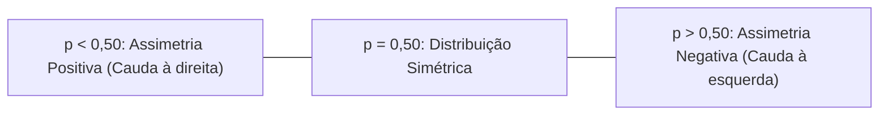
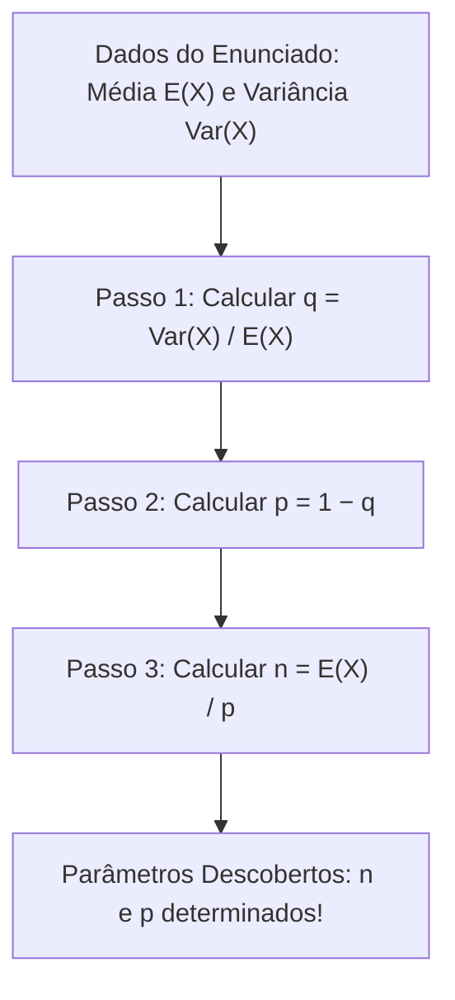
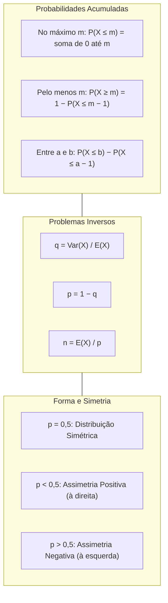

> [!objetivos]
> - Dominar a determinação de probabilidades acumuladas e intervalos de contagem na distribuição Binomial.
> - Compreender a leitura e o uso prático de tabelas da distribuição binomial em provas.
> - Analisar a simetria, a assimetria e a determinação da moda da variável binomial.
> - Resolver com agilidade problemas inversos para determinação dos parâmetros n e p a partir da média e variância.

A distribuição Binomial possui propriedades analíticas decisivas em provas de concurso. Frequentemente, as questões de prova não cobram apenas probabilidades pontuais isoladas. Elas solicitam probabilidades acumuladas em intervalos contínuos de contagem. Também exigem a leitura de tabelas estatísticas ou fornecem a média e a variância para que o candidato deduza os parâmetros n e p da distribuição.

## Probabilidades Acumuladas na Binomial

Em situações práticas, raramente analisamos um número único e isolado de eventos. No trabalho de um juiz ou tribunal, analisa-se a distribuição de processos cíveis e da vara criminal. Vários processos judiciais são decididos a cada semana por diferentes juízes. Alguns funcionários cometem equívocos em certidões. Servidores podem se ausentar (ausentarem-se) do plantão por licença de saúde. Um gerente operacional avalia se deve oferecer novos protocolos de atendimento. Em saúde pública, médicos e bombeiros monitoram o contágio de uma virose na população. Em pesquisas com eleitores, pesquisadores avaliam amostras de intenção de voto.

Esses cenários envolvem a probabilidade acumulada F(x) = P(X ≤ x). A variável aleatória X representa a soma de ensaios de Bernoulli, transitando de X ~ Bernoulli para X ~ Binomial. Como a variável X é discreta, somamos as probabilidades pontuais de cada valor no intervalo.

A correta interpretação dos termos verbais é essencial:

| Expressão Verbal no Enunciado | Notação Matemática | Soma de Probabilidades | Método de Resolução Ágil |
|---|---|---|---|
| "No máximo m sucessos" | P(X ≤ m) | P(X=0) + ... + P(X=m) | Soma direta de 0 até m |
| "Menos de m sucessos" | P(X < m) | P(X=0) + ... + P(X=m−1) | Equivale a P(X ≤ m − 1) |
| "Pelo menos m sucessos" | P(X ≥ m) | P(X=m) + ... + P(X=n) | Regra do complementar: 1 − P(X ≤ m − 1) |
| "Mais de m sucessos" | P(X > m) | P(X=m+1) + ... + P(X=n) | Regra do complementar: 1 − P(X ≤ m) |
| "Entre a e b sucessos" | P(a ≤ X ≤ b) | P(X=a) + ... + P(X=b) | Diferença: P(X ≤ b) − P(X ≤ a − 1) |

> [!bizu] Uso do Evento Complementar para Poupar Tempo
> Quando o intervalo pedido contiver muitos termos, use o evento complementar. Subtraia da unidade as probabilidades dos casos não desejados. Se n = 10 e o problema pede "pelo menos 2 sucessos", o caminho direto exige somar 9 termos. Pelo complementar, calculamos apenas dois termos: P(X ≥ 2) = 1 − [P(X = 0) + P(X = 1)].

## Leitura e Uso da Tabela da Distribuição Binomial

Provas de concursos avançados costumam trazer tabelas de probabilidade binomial. Essas tabelas organizam os valores de n nas linhas principais, k nas sublinhas e p nas colunas.

A tabela a seguir apresenta os valores pontuais P(X = k) para n = 5 ensaios de Bernoulli independentes, onde a variável X segue o modelo X ~ Bin(n, p):

| n | k | p = 0,10 | p = 0,20 | p = 0,50 | p = 0,80 | p = 0,90 |
|---|---|---|---|---|---|---|
| 5 | 0 | 0,5905 | 0,3277 | 0,0312 | 0,0003 | 0,0000 |
| 5 | 1 | 0,3281 | 0,4096 | 0,1562 | 0,0064 | 0,0005 |
| 5 | 2 | 0,0729 | 0,2048 | 0,3125 | 0,0512 | 0,0081 |
| 5 | 3 | 0,0081 | 0,0512 | 0,3125 | 0,2048 | 0,0729 |
| 5 | 4 | 0,0005 | 0,0064 | 0,1562 | 0,4096 | 0,3281 |
| 5 | 5 | 0,0000 | 0,0003 | 0,0312 | 0,3277 | 0,5905 |
| **Soma** | **Total** | **1,0000** | **1,0000** | **1,0000** | **1,0000** | **1,0000** |

Observe a simetria perfeita quando p = 0,50. A probabilidade de k = 0 é igual à de k = 5 (0,0312). A probabilidade de k = 1 é idêntica à de k = 4 (0,1562). Os valores centrais k = 2 e k = 3 coincidem em 0,3125.

Note também a relação de simetria complementar entre p = 0,20 e p = 0,80. Obter 1 sucesso com p = 0,20 tem probabilidade 0,4096. Esse valor é idêntico a obter 4 sucessos com p = 0,80. Isso ocorre porque P(X = k | p) = P(X = n − k | 1 − p).

Em experimentos com moedas, o lançamento para obter a face cara possui p = 0,50. Em uma sequência de n = 5 lançamentos, a probabilidade de obter 3 caras é C(5, 3) · (0,5)⁵ = 10 · 0,03125 = 0,3125. Já em experimentos com n = 6 ensaios e probabilidade p = 0,10, frações decimais como 0,729 geram valores tabelados típicos (como 0,648 ou 0,432 e 0,665). O conhecimento dessa tabela evita erros manuais.

## Forma, Simetria e Moda da Distribuição Binomial

O formato da distribuição Binomial varia conforme o valor do parâmetro p.

Se p = 0,50, a distribuição é perfeitamente simétrica. O centro de simetria coincide com a média μ = n · 0,50 = n/2. As duas caudas possuem comportamento idêntico.

Se p < 0,50, a distribuição exibe assimetria positiva ou à direita. As maiores probabilidades concentram-se nos valores baixos de k. Uma cauda longa estende-se para a direita.

Se p > 0,50, a distribuição exibe assimetria negativa ou à esquerda. As maiores probabilidades concentram-se nos valores elevados de k. A cauda longa estende-se para a esquerda.

| Valor de p | Tipo de Assimetria | Características da Distribuição | Exemplo Prático |
|---|---|---|---|
| p < 0,50 | Positiva (à direita) | Concentração em valores baixos; cauda à direita | Virose rara em triagem (p = 0,05) |
| p = 0,50 | Simétrica | Distribuição equilibrada em torno de n/2 | Lançamento de moeda (obtenção de cara) |
| p > 0,50 | Negativa (à esquerda) | Concentração em valores altos; cauda à esquerda | Eleitores favoráveis a uma medida popular |

### Determinação da Moda da Binomial

A moda é o valor de k com maior probabilidade pontual associada. Na distribuição Binomial, a moda é encontrada pelo produto (n + 1) · p:

Se (n + 1) · p não for inteiro, a distribuição é unimodal. A moda única é a parte inteira desse produto: Moda = ⌊(n + 1) · p⌋.

Se (n + 1) · p for um número inteiro m, a distribuição é bimodal. Existem duas modas consecutivas: k_1 = m − 1 e k_2 = m.

Se n · p for inteiro e p = 0,50, a distribuição é simétrica. A média, a mediana e a moda coincidem no mesmo valor central.

## Problemas Inversos: Determinação de n e p

Um formato clássico das bancas traz problemas inversos. O examinador não informa n nem p. Ele fornece a média E(X) e a variância Var(X) de uma variável X ~ Bin(n, p). O candidato deve calcular os parâmetros originais.

Lembramos que E(X) = n · p e Var(X) = n · p · q. Dividindo a variância pela média:

Var(X) / E(X) = (n · p · q) / (n · p) = q

Essa divisão direta calcula imediatamente a probabilidade de fracasso:

q = Var(X) / E(X)

Calculado o fracasso, a probabilidade de sucesso é obtida pelo complementar:

p = 1 − q

Em seguida, encontramos o número n de ensaios isolando-o na fórmula da média:

n = E(X) / p

Considere um exemplo numérico com valores acumulados. Se a média de sucessos for E(X) = 2,4 e a variância for Var(X) = 0,96, temos:

q = 0,96 / 2,4 = 0,40.

Logo, p = 1 − 0,40 = 0,60. O número de ensaios é n = 2,4 / 0,60 = 4. A partir daí, podemos calcular P(X = 3) = C(4, 3) · (0,60)³ · (0,40)¹ = 4 · 0,216 · 0,40 = 0,3456. Se calculamos potências maiores em problemas com n = 6 e p = 0,6, surgem coeficientes fracionários como 0,2772, 0,9422 ou 0,972 em distribuições acumuladas.

> [!pegadinha] Cuidado com a Troca entre Sucesso e Fracasso
> O quociente Var / E resulta em q, que é a probabilidade de FRACASSO. Para achar a probabilidade de sucesso p, calcule 1 − q. Em seguida, calcule n = E / p. Usar q no lugar de p é o erro mais frequente em concursos e gera distratores comuns.

## Aplicações Práticas Resolvidas

Analise a resolução de duas questões contextualizadas.

> [!resolvido] Auditoria de Processos na Vara Criminal e Cível
> Em um tribunal de justiça, um gerente operacional audita processos judiciais cíveis e da vara criminal distribuídos a juízes. Cada processo sorteado tem probabilidade p de apresentar pendências documentais. O número de processos com pendências segue uma distribuição Binomial X ~ Bin(n, p). A auditoria apurou que o número médio de processos pendentes é 20, com variância igual a 4.
> Determine:
> a) A probabilidade p de um processo conter pendências.
> b) O número total n de processos auditados.
> c) O desvio padrão da distribuição.
>
> **Resolução:**
> Temos E(X) = 20 e Var(X) = 4.
> Passo 1: calculamos q = Var(X) / E(X) = 4 / 20 = 0,20.
> Passo 2: a probabilidade de sucesso (processo pendente) é p = 1 − 0,20 = 0,80.
> Passo 3: o número total de processos é n = E(X) / p = 20 / 0,80 = 25 processos.
> O desvio padrão é DP(X) = √4 = 2 processos.
> A distribuição binomial tem parâmetros n = 25 e p = 0,80.

> [!exemplo] Triagem de Casos Suspeitos de Virose Respiratória
> Em uma triagem médica de emergência, a probabilidade de um paciente febril testar positivo para virose é de 20% (p = 0,20). Uma equipe de bombeiros socorristas avalia uma amostra de 4 pacientes independentes (n = 4).
> Qual a probabilidade de no máximo 1 paciente testar positivo para a virose?
>
> Somamos as probabilidades mutuamente exclusivas X = 0 e X = 1:
> P(X = 0) = C(4, 0) · (0,20)⁰ · (0,80)⁴ = 1 · 1 · 0,4096 = 0,4096.
> P(X = 1) = C(4, 1) · (0,20)¹ · (0,80)³ = 4 · 0,20 · 0,512 = 0,4096.
> Logo, P(X ≤ 1) = 0,4096 + 0,4096 = 0,8192 (81,92%).

## Mapa do capítulo

### Para fixar
- A probabilidade acumulada P(X ≤ m) soma as probabilidades pontuais de 0 até m.
- A expressão "pelo menos m sucessos" deve ser calculada pelo complementar: 1 − P(X ≤ m − 1).
- A tabela binomial exibe simetria complementar: P(X = k | p) = P(X = n − k | 1 − p).
- Quando p = 0,50, a distribuição Binomial é perfeitamente simétrica em torno de n/2.
- Se p < 0,50, a distribuição tem assimetria positiva; se p > 0,50, tem assimetria negativa.
- A moda da distribuição Binomial é dada pela parte inteira de (n + 1) · p quando não for inteiro.
- Em problemas inversos, o fracasso é obtido pela razão direta q = Var(X) / E(X).
- O número de ensaios n é obtido pela divisão da média pela probabilidade de sucesso: n = E(X) / p.
