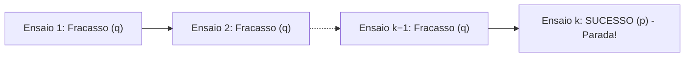
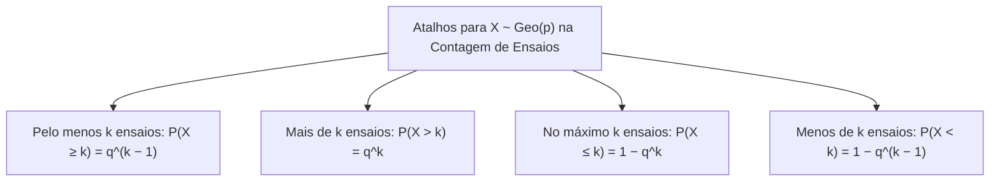
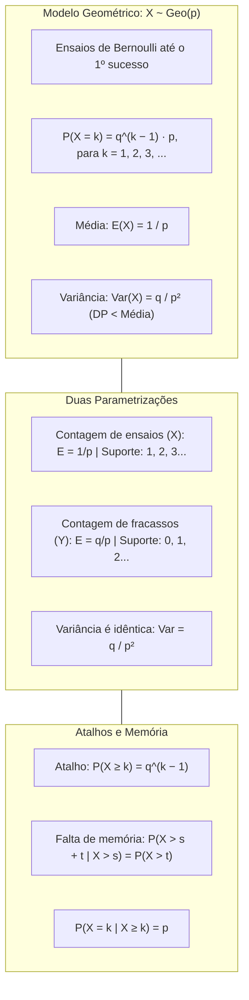

> [!objetivos]
> - Compreender a definição e a modelagem do tempo de espera na distribuição Geométrica.
> - Dominar o cálculo da função de probabilidade pontual e as duas parametrizações usuais da variável.
> - Aplicar os atalhos de cauda para probabilidades acumuladas do tipo "pelo menos k tentativas".
> - Analisar a propriedade da perda de memória e diferenciá-la dos demais modelos discretos.

O estudo das distribuições discretas avança para a análise do tempo de espera até a ocorrência de um evento de interesse. Em atividades de resgate, operações policiais e comunicações de emergência, uma pergunta frequente não é "quantos sucessos teremos em dez tentativas", mas sim "quantas tentativas serão necessárias até conseguirmos o primeiro sucesso". Quantos acionamentos de rádio serão necessários até estabelecer contato com a base? Quantas tentativas de partida serão feitas até um motor de gerador ligar? A resposta matemática para essa classe de problemas reside na distribuição Geométrica.

## Definição e Construção do Modelo

A distribuição Geométrica fundamenta-se na repetição sequencial de ensaios de Bernoulli independentes. Cada ensaio admite apenas dois desfechos possíveis: sucesso com probabilidade p ou fracasso com probabilidade q = 1 − p. A probabilidade de sucesso permanece rigorosamente constante ao longo de todas as provas.

A distinção fundamental em relação à distribuição Binomial situa-se no critério de parada. Na binomial, fixamos previamente o número n de repetições e observamos a contagem aleatória de sucessos. Na geométrica, o número de sucessos é fixado a priori em exatamente 1, enquanto o número de ensaios necessários para atingi-lo é a variável aleatória sob investigação.

Indicamos que uma variável X segue o modelo geométrico com parâmetro p pela notação X ~ Geo(p). Conhecido o parâmetro p, toda a estrutura probabilística da variável está perfeitamente determinada.

### O Suporte e a Função Pontual de Probabilidade

Considere que o primeiro sucesso ocorre exatamente na k-ésima tentativa. Por consequência lógica direta, todas as primeiras k − 1 tentativas foram fracassos. O sucesso ocorreu exclusivamente no ensaio de número k, encerrando imediatamente o experimento.

Como todos os ensaios de Bernoulli são mutuamente independentes, a probabilidade conjunta dessa sequência específica é dada pelo produto direto das probabilidades de cada evento:

P(X = k) = q · q · ... · q · p = q^(k − 1) · p, para k ∈ {1, 2, 3, ...}

Ao contrário da binomial, a distribuição Geométrica não exige coeficiente combinatório multiplicador. Isso decorre do fato de que a ordem dos eventos é estritamente rígida: os fracassos ocupam obrigatoriamente as primeiras k − 1 posições e o sucesso ocupa obrigatoriamente a última posição da sequência.

O suporte da variável X é o conjunto dos números inteiros estritamente positivos: X ∈ {1, 2, 3, ...}. Essa variável é discreta, mas possui suporte infinito enumerável, sem limite superior pré-fixado. É impossível que X assuma o valor 0 nessa parametrização, pois é necessário realizar ao menos um ensaio para que o primeiro sucesso possa se manifestar.

| Tentativa do 1º Sucesso (k) | Sequência Realizada | Expressão da Probabilidade | Probabilidade com p = 0,20 (q = 0,80) |
|---|---|---|---|
| k = 1 | {S} | q⁰ · p = 1 · p | 0,2000 (20,0%) |
| k = 2 | {FS} | q¹ · p = 0,8 · 0,2 | 0,1600 (16,0%) |
| k = 3 | {FFS} | q² · p = (0,8)² · 0,2 | 0,1280 (12,8%) |
| k = 4 | {FFFS} | q³ · p = (0,8)³ · 0,2 | 0,1024 (10,24%) |
| k = 5 | {FFFFS} | q⁴ · p = (0,8)⁴ · 0,2 | 0,0819 (8,19%) |
| **Soma Infinita** | **k = 1 até ∞** | **p · soma de q^(k−1)** | **p / (1 − q) = p / p = 1,000** |

A soma das probabilidades forma uma progressão geométrica infinita de razão q. Pela fórmula da PG infinita, S = p / (1 − q) = 1,000.

## Esperança Matemática, Variância e Desvio Padrão

A média de uma variável geométrica representa o número médio de tentativas que se espera realizar até que o primeiro sucesso seja observado. Sua dedução analítica resulta na elegante expressão:

E(X) = 1 / p

Se a probabilidade de acerto é p = 0,5, esperamos 1 / 0,5 = 2 tentativas até o primeiro sucesso. Se a chance for p = 0,20, esperamos 1 / 0,20 = 5 tentativas. Quanto menor a probabilidade de sucesso, maior é o tempo médio de espera.

A variância da distribuição Geométrica mede a dispersão em torno da média de ensaios e é dada por:

Var(X) = q / p² = (1 − p) / p²

O desvio padrão é a raiz quadrada positiva da variância:

DP(X) = √(q / p²) = (√q) / p

Como 0 < q < 1, temos √q < 1. Logo, (√q)/p < 1/p. O desvio padrão da distribuição Geométrica é sempre estritamente menor do que a média. Para p muito pequeno, ele se aproxima da média, mas nunca a supera.

| Parâmetro Estatístico | Fórmula da Geométrica (Ensaios X) | Exemplo Numérico (p = 0,20 e q = 0,80) |
|---|---|---|
| Suporte numérico | {1, 2, 3, ...} | Inicia em 1, sem limite superior |
| Probabilidade pontual | P(X = k) = q^(k − 1) · p | P(X = 3) = (0,80)² · 0,20 = 0,1280 |
| Esperança matemática E(X) | 1 / p | 1 / 0,20 = 5 tentativas |
| Variância populacional Var(X) | q / p² | 0,80 / (0,20)² = 0,80 / 0,04 = 20 |
| Desvio padrão DP(X) | (√q) / p | (√0,80) / 0,20 ≈ 0,8944 / 0,20 ≈ 4,47 |
| Relação de dispersão | DP(X) < E(X) | 4,47 < 5,00 (DP sempre menor que a média) |

> [!bizu] O Desvio Padrão da Geométrica Nunca Supera a Média
> Questões conceituais de bancas examinadoras costumam afirmar que em uma distribuição geométrica com probabilidade muito pequena o desvio padrão pode ser superior à média. Esse item está categoricamente errado. Como √q < 1 para qualquer q pertencente ao intervalo (0, 1), o desvio padrão (√q)/p é obrigatoriamente menor do que a média 1/p.

## A Parametrização Alternativa: Contagem de Fracassos

Uma das armadilhas mais comuns em concursos públicos decorre da existência de duas convenções distintas na literatura para a distribuição Geométrica. É imperativo que o candidato identifique com precisão qual das duas variáveis foi adotada no enunciado da questão:

Na primeira parametrização, que estudamos até aqui, a variável aleatória X representa o número total de ensaios necessários até o primeiro sucesso, incluindo o próprio sucesso. O suporte é X ∈ {1, 2, 3, ...}, a esperança é E(X) = 1/p e a probabilidade é P(X = k) = q^(k − 1) · p.

Na segunda parametrização, a variável aleatória Y conta exclusivamente o número de fracassos ocorridos ANTES do primeiro sucesso. O suporte dessa variável inclui o número zero: Y ∈ {0, 1, 2, ...}. O valor Y = 0 indica que o sucesso ocorreu logo na primeira tentativa, sem nenhum fracasso prévio. A função de probabilidade é dada por:

P(Y = y) = q^y · p, para y ∈ {0, 1, 2, ...}

Observe que as duas variáveis estão ligadas por uma translação rígida simples: Y = X − 1. Pela propriedade do operador de esperança matemática:

E(Y) = E(X − 1) = E(X) − 1 = (1 / p) − 1 = (1 − p) / p = q / p

Por outro lado, a subtração de uma constante não altera a variância da variável aleatória: Var(Y) = Var(X − 1) = Var(X). Portanto, a variância permanece idêntica nas duas parametrizações:

Var(Y) = q / p²

| Característica | Parametrização 1: Contagem de Ensaios (X) | Parametrização 2: Contagem de Fracassos (Y) |
|---|---|---|
| Significado físico | Total de ensaios até o 1º sucesso (inclusive) | Total de fracassos antes do 1º sucesso |
| Suporte da variável | {1, 2, 3, ...} | {0, 1, 2, ...} |
| Função de probabilidade | P(X = k) = q^(k − 1) · p | P(Y = y) = q^y · p |
| Esperança matemática | E(X) = 1 / p | E(Y) = q / p = E(X) − 1 |
| Variância populacional | Var(X) = q / p² | Var(Y) = q / p² |

> [!pegadinha] Como Identificar a Parametrização Adotada na Prova
> Leia com extrema cautela a definição da variável na questão. Se o texto perguntar "quantos lançamentos foram realizados até obter a primeira cara", a variável mede ensaios (X) e a média é 1/p. Se o enunciado indagar "quantas tentativas falhas ocorreram antes do primeiro acerto", a variável mede fracassos (Y) e a média é q/p. Essa distinção simples altera o cálculo e define a alternativa correta.

## Probabilidades Acumuladas e os Atalhos de Cauda

O cálculo de probabilidades acumuladas na distribuição Geométrica pode se tornar exaustivo se for feito termo a termo. Considere a probabilidade de necessitar de pelo menos k tentativas para alcançar o primeiro sucesso:

P(X ≥ k) = P(X = k) + P(X = k + 1) + P(X = k + 2) + ...

Pelo caminho tradicional do complementar, teríamos P(X ≥ k) = 1 − [P(X = 1) + P(X = 2) + ... + P(X = k − 1)]. Embora correto, esse cálculo exige somar k − 1 termos distintos.

Existe um atalho matemático imediato e muito elegante. O evento "necessitar de pelo menos k tentativas para obter o primeiro sucesso" significa exatamente que as primeiras k − 1 tentativas resultaram em fracasso. O resultado da k-ésima tentativa e dos ensaios seguintes não importa para essa condição.

Como a probabilidade de fracasso em cada ensaio independente é q, a probabilidade de fracassar k − 1 vezes consecutivas é simplesmente:

P(X ≥ k) = q^(k − 1)

De modo análogo, a probabilidade de necessitar de mais de k tentativas para obter o primeiro sucesso equivale a fracassar nas primeiras k tentativas completas:

P(X > k) = q^k

A partir desse resultado direto de cauda, encontramos a probabilidade de alcançar o primeiro sucesso em no máximo k tentativas pela regra do evento complementar:

P(X ≤ k) = 1 − P(X > k) = 1 − q^k

Para a parametrização por contagem de fracassos Y, as relações correspondentes assumem forma direta: a probabilidade de registrar pelo menos k fracassos é P(Y ≥ k) = q^k, e a chance de observar menos de k fracassos é P(Y < k) = 1 − q^k.

> [!atencao] Não Confunda P(X = k) com P(X ≥ k)
> Um dos erros conceituais mais graves consiste em usar a fórmula pontual q^(k − 1) · p quando a questão indaga a probabilidade de necessitar de k ou mais tentativas. A probabilidade de obter o sucesso exatamente na k-ésima tentativa é q^(k − 1) · p. A probabilidade de precisar de pelo menos k tentativas é q^(k − 1), sem multiplicar por p.

## A Propriedade da Falta de Memória

A propriedade mais notável e cobrada da distribuição Geométrica é a falta de memória (em inglês, *memoryless property*). A distribuição Geométrica é a única distribuição discreta de probabilidade que goza dessa característica analítica singular.

A propriedade afirma que a probabilidade condicional de necessitar de mais de t tentativas adicionais, dado que já se fracassou nas primeiras s tentativas, é rigorosamente igual à probabilidade incondicional de necessitar de mais de t tentativas desde o início. Matematicamente:

P(X > s + t | X > s) = P(X > t), para quaisquer inteiros positivos s e t.

A demonstração matemática decorre diretamente da fórmula da cauda:

P(X > s + t | X > s) = P(X > s + t e X > s) / P(X > s) = P(X > s + t) / P(X > s) = q^(s + t) / q^s = q^t = P(X > t)

A intuição prática dessa propriedade vincula-se à estrita independência dos ensaios de Bernoulli. A moeda, o motor mecânico ou o transmissor de rádio não possuem memória física de tentativas passadas. Se você já realizou dez tentativas sem sucesso, isso não aumenta nem diminui a probabilidade de acertar na tentativa seguinte. O processo estatístico reinicia do ponto zero a cada novo ensaio.

Uma segunda manifestação da falta de memória, frequente em provas, estabelece que:

P(X = k | X ≥ k) = p

Essa igualdade demonstra que, dado que o primeiro sucesso ainda não ocorreu nas primeiras k − 1 tentativas, a chance de ele se concretizar na k-ésima tentativa é simplesmente a probabilidade elementar p daquele ensaio individual.

## Jogos Alternados e Dimensionamento de Recintos

A distribuição Geométrica modela disputas em turnos alternados entre dois participantes. Suponha que Abel e Breno decidem lançar uma moeda honesta até que alguém obtenha a face cara. O primeiro a obter cara vence o jogo. Abel começa a disputa.

Para Abel vencer na sua k-ésima jogada, três condições ocorrem: Abel fracassa nas suas primeiras k − 1 tentativas; Breno fracassa nas suas primeiras k − 1 tentativas; e Abel obtém a face cara no seu k-ésimo lançamento. Se Abel possui probabilidade p_A = 1/2 e Breno p_B = 1/3, a probabilidade de Abel vencer no 3º lançamento é (1/2)² · (2/3)² · (1/2) = (1/4) · (4/9) · (1/2) = 1/18.

Outra aplicação clássica envolve o dimensionamento de um recinto ou sala de triagem de socorro. Suponha que o número de cidadãos até chegar o primeiro caso grave siga uma distribuição geométrica Geo(0,20). A média esperada é 1 / 0,20 = 5 pessoas. Se uma sala possui área de poucos metros quadrados, avalia-se a probabilidade de ela ficar subutilizada antes de chegarem mais pessoas. Esse cálculo evita superlotação em atendimentos de emergência, sendo o dimensionamento ideal para componentes produzidos e testados em fábricas de viaturas.

## Aplicações Práticas Resolvidas

Analise duas situações contextualizadas no ambiente de salvamento e segurança.

> [!resolvido] Tentativas de Conexão de Rádio em Área Remota
> Durante uma ocorrência de combate a incêndio florestal em área serrana, um oficial bombeiro tenta estabelecer contato com a central de operações via rádio transceptor. Devido a barreiras geográficas, a probabilidade de êxito na transmissão em cada chamada independente é de 25% (p = 0,25 e q = 0,75).
> a) Qual a probabilidade de o primeiro contato bem-sucedido ocorrer exatamente na 3ª tentativa?
> b) Qual a probabilidade de serem necessárias pelo menos 4 tentativas para falar com a base?
> c) Qual o número médio esperado de tentativas e o respectivo desvio padrão?
> d) Se o oficial já realizou 2 chamadas sem sucesso, qual a probabilidade de precisar de mais de 2 tentativas adicionais?
>
> **Resolução passo a passo:**
> Seja X o número de tentativas até o primeiro sucesso: X ~ Geo(0,25).
> Para o item a: P(X = 3) = q² · p = (0,75)² · 0,25 = 0,5625 · 0,25 = 0,1406 (14,06%).
> Para o item b: Aplicamos o atalho de cauda P(X ≥ 4) = q^(4 − 1) = q³ = (0,75)³ = 0,4219 (42,19%).
> Para o item c: A média é E(X) = 1 / p = 1 / 0,25 = 4 tentativas. A variância é Var(X) = q / p² = 0,75 / (0,25)² = 0,75 / 0,0625 = 12. O desvio padrão é DP(X) = √12 ≈ 3,46 tentativas (menor que a média 4).
> Para o item d: Pela falta de memória, o histórico de 2 falhas é esquecido: P(X > 2 + 2 | X > 2) = P(X > 2) = q² = (0,75)² = 0,5625 (56,25%).

> [!exemplo] Controle de Qualidade em Teclados de Terminais de Despacho
> Em um posto de inspeção de novos terminais de computador para o centro integrado de operações, sabe-se que cada teclado examinado apresenta defeito com probabilidade de 2% (p = 0,02 e q = 0,98).
> O inspetor examina os teclados até encontrar o primeiro com defeito.
> A probabilidade de achar o primeiro defeituoso na 3ª peça é P(X = 3) = (0,98)² · 0,02 = 0,9604 · 0,02 = 0,0192 (1,92%).
> O número médio de teclados examinados é E(X) = 1 / 0,02 = 50 peças. A variância é Var(X) = 0,98 / (0,02)² = 2.450, gerando um desvio padrão de √2.450 ≈ 49,50 peças, muito próximo de 50, confirmando que DP < E(X).

## Mapa do capítulo

### Para fixar
- A distribuição Geométrica modela o número de ensaios de Bernoulli independentes até o primeiro sucesso.
- A função de probabilidade pontual é P(X = k) = q^(k − 1) · p, com suporte nos inteiros estritamente positivos {1, 2, 3, ...}.
- A esperança matemática de ensaios é E(X) = 1/p e a variância é Var(X) = q/p².
- O desvio padrão da distribuição Geométrica é estritamente menor do que a sua média em qualquer probabilidade real.
- Na parametrização por contagem de fracassos anteriores, a média é E(Y) = q/p e a variância permanece q/p².
- A probabilidade de necessitar de pelo menos k tentativas é obtida pelo atalho direto de cauda P(X ≥ k) = q^(k − 1).
- A propriedade da falta de memória estabelece que o histórico de tentativas passadas não altera as probabilidades futuras.
- A distribuição Geométrica é a única distribuição discreta que possui a propriedade da falta de memória.
