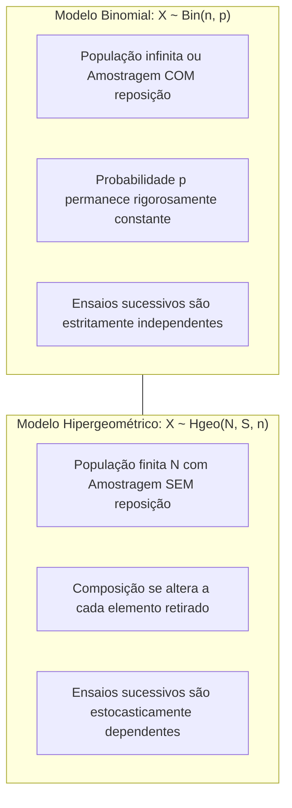
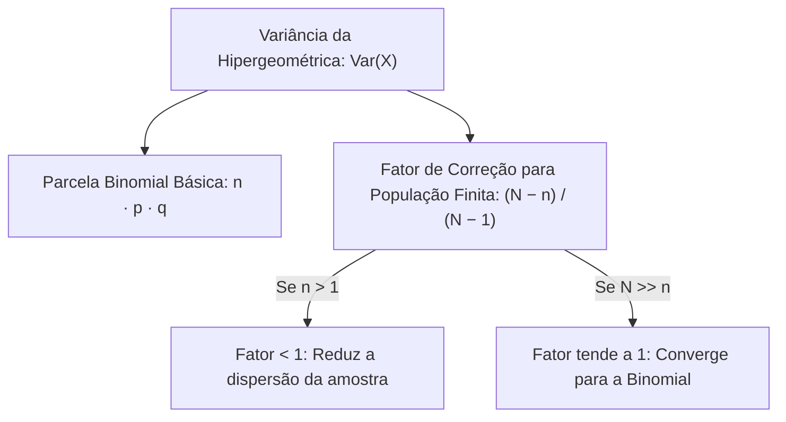
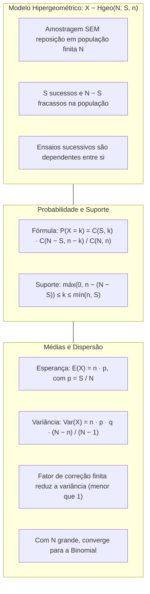

> [!objetivos]
> - Compreender a estrutura da amostragem sem reposição em populações finitas.
> - Aplicar a função de probabilidade da distribuição Hipergeométrica via análise combinatória.
> - Identificar o suporte restrito e os limites inferior e superior da variável hipergeométrica.
> - Calcular a esperança matemática, a variância e o fator de correção para população finita.

O estudo das distribuições discretas atinge uma bifurcação metodológica essencial quando consideramos a natureza da amostragem. Nos modelos anteriores, assumimos independência e probabilidades constantes. Na prática dos bombeiros e da polícia, muitos sorteios operam sobre lotes finitos. Isso ocorre na seleção de viaturas para blitz. Também ocorre na inspeção de armamentos. As retiradas acontecem sem reposição. Essa dependência entre ensaios define a distribuição Hipergeométrica.

## A Gênese do Modelo Hipergeométrico

Considere uma população finita com um total de N elementos individuais. Cada um desses elementos pertence a uma de duas categorias mutuamente exclusivas e exaustivas: a categoria de sucesso (com S elementos na população) ou a categoria de fracasso (com N − S elementos restantes).

Dessa população, extraímos aleatoriamente uma amostra de tamanho n sem reposição. A variável aleatória discreta X representa a contagem total de elementos portadores da característica de sucesso presentes na amostra selecionada. Indicamos esse modelo por X ~ Hgeo(N, S, n).

A distinção crucial em relação à distribuição Binomial reside na dependência entre os sorteios sucessivos. Como os elementos sorteados não retornam à população, a cada extração a composição do lote remanescente se altera. Isso modifica a probabilidade de sucesso para a retirada seguinte.

> [!pegadinha] Silêncio do Enunciado Indica Amostragem sem Reposição
> Quando uma questão de concurso descreve a extração de uma amostra de itens de um lote finito (como peças de uma caixa, viaturas de uma garagem ou processos de uma vara) sem especificar a modalidade de amostragem, a convenção padrão da estatística assume que a retirada é SEM reposição. A distribuição aplicável é a Hipergeométrica. Preste atenção para não confundir o nome "Hipergeométrica" com "Geométrica", erro comum em provas objetivas.

## A Função de Probabilidade da Hipergeométrica

A probabilidade de observar k sucessos segue a regra clássica de Laplace. Dividimos os casos favoráveis pelos casos possíveis.

O número total de amostras distintas de tamanho n que podem ser formadas a partir dos N elementos da população corresponde à combinação simples de N elementos tomados n a n:

Casos Possíveis = C(N, n) = N! / [n! · (N − n)!]

Para compor um caso favorável com exatamente k sucessos, a amostra precisa conter simultaneamente k elementos provenientes do grupo de sucessos (S) e n − k elementos provenientes do grupo de fracassos (N − S).

A escolha de k sucessos entre S disponíveis é feita por C(S, k). A escolha dos n − k fracassos entre N − S disponíveis é feita por C(N − S, n − k). Multiplicamos os dois termos para achar os casos favoráveis:

Casos Favoráveis = C(S, k) · C(N − S, n − k)

Dividindo os casos favoráveis pelos casos possíveis, estabelecemos a função de probabilidade pontual da distribuição Hipergeométrica:

P(X = k) = [C(S, k) · C(N − S, n − k)] / C(N, n)

| Elemento da Fórmula | Expressão Combinatória | Significado Físico no Experimento |
|---|---|---|
| Denominador | C(N, n) | Total de amostras possíveis de tamanho n formadas a partir de N elementos |
| 1º Fator do Numerador | C(S, k) | Maneiras de selecionar os k sucessos entre os S sucessos existentes |
| 2º Fator do Numerador | C(N − S, n − k) | Maneiras de selecionar os n − k fracassos entre os N − S fracassos existentes |
| Numerador Completo | C(S, k) · C(N − S, n − k) | Total de amostras favoráveis contendo exatamente k sucessos e n − k fracassos |

### Método Alternativo: Produto de Probabilidades Condicionais

Para amostras pequenas (como n = 2 ou n = 3), existe um caminho alternativo muito prático em provas sem calculadora. Calculamos a probabilidade de uma sequência ordenada específica ajustando os denominadores a cada retirada e, em seguida, multiplicamos pelo número de permutações possíveis dos desfechos.

Considere uma urna com N = 12 bolas, das quais S = 5 são vermelhas (sucessos) e N − S = 7 são pretas (fracassos). Extraímos n = 4 bolas sem reposição e queremos a probabilidade de obter exatamente k = 2 bolas vermelhas.

A probabilidade da sequência específica (Vermelha, Vermelha, Preta, Preta) é:

P(V, V, P, P) = (5/12) · (4/11) · (7/10) · (6/9) = 840 / 11.880

Como a ordem das cores não importa, multiplicamos esse valor pelo número de arranjos distintos de 2 vermelhas e 2 pretas, dado por C(4, 2) = 6:

P(X = 2) = 6 · (840 / 11.880) = 5.040 / 11.880 = 14 / 33 ≈ 0,4242 (42,42%)

Pela fórmula direta com combinações simples, obtemos exatamente o mesmo resultado:

P(X = 2) = [C(5, 2) · C(7, 2)] / C(12, 4) = (10 · 21) / 495 = 210 / 495 = 14 / 33 ≈ 42,42%

## O Suporte Efetivo da Variável Aleatória

Na distribuição Binomial, k varia livremente de 0 até n. Na Hipergeométrica, o suporte respeita os limites da população finita.

A amostra não pode conter mais sucessos do que os existentes na população (k ≤ S). Também não pode superar o tamanho da amostra (k ≤ n). O teto de k é o menor desses valores:

Limite Superior: k ≤ mín{n, S}

Se a amostra n superar os fracassos disponíveis (N − S), alguns sucessos sairão obrigatoriamente: k ≥ n − (N − S). Caso contrário, o piso é 0.

Limite Inferior: k ≥ máx{0, n − (N − S)}

Unindo as duas restrições, o suporte da variável hipergeométrica é o intervalo inteiro delimitado por:

máx{0, n − (N − S)} ≤ k ≤ mín{n, S}

Considere uma população com N = 12 elementos e S = 5 sucessos (logo, N − S = 7 fracassos). Se extrairmos uma amostra de n = 4 elementos, temos máx{0, 4 − 7} = 0 e mín{4, 5} = 4, admitindo k ∈ {0, 1, 2, 3, 4}. Mas se extrairmos uma amostra de n = 9 elementos, o limite inferior passa a ser máx{0, 9 − 7} = 2 e o superior mín{9, 5} = 5. Nesse caso, a variável X só admite valores no conjunto {2, 3, 4, 5}.

## Esperança Matemática, Variância e Fator de Correção

Seja p = S / N a proporção de sucessos presentes na população original e q = 1 − p a proporção correspondente de fracassos.

A esperança matemática da distribuição Hipergeométrica é calculada de forma surpreendentemente simples:

E(X) = n · p = n · (S / N)

A média hipergeométrica é idêntica à da Binomial. Espera-se que a amostra reproduza a proporção da população.

A variância da distribuição Hipergeométrica, por sua vez, incorpora a dependência entre os ensaios decorrente da ausência de reposição:

Var(X) = n · p · q · [(N − n) / (N − 1)]

O desvio padrão é a raiz quadrada positiva da variância:

DP(X) = √{n · p · q · [(N − n) / (N − 1)]}

O termo multiplicador (N − n) / (N − 1) é consagrado na teoria estatística como o Fator de Correção para População Finita (FCPF).

### Propriedades do Fator de Correção e Convergência

O fator de correção apresenta características estruturais que merecem atenção rigorosa:

Sempre que n > 1, temos N − n < N − 1. O numerador é menor que o denominador. O quociente fica abaixo de 1:

[(N − n) / (N − 1)] < 1

Por isso, a variância hipergeométrica é sempre menor que a binomial. Sem reposição, a incerteza diminui a cada retirada. A dispersão amostral se reduz.

Segundo, se o tamanho da população N for substancialmente maior do que o tamanho da amostra n (N >> n), a razão (N − n) / (N − 1) aproxima-se do valor 1.

Em populações grandes, a dependência entre sorteios torna-se desprezível. A Hipergeométrica aproxima-se da Binomial com p = S/N. Na prática, se n / N ≤ 0,05 (5%), usa-se a Binomial diretamente.

| Característica | Distribuição Binomial | Distribuição Hipergeométrica |
|---|---|---|
| Modalidade de Amostragem | Amostragem COM reposição ou População infinita | Amostragem SEM reposição em População finita |
| Independência dos ensaios | Ensaios mutuamente independentes | Ensaios estocasticamente dependentes |
| Probabilidade de sucesso | Rigorosamente constante (p) | Varia a cada extração sequencial |
| Esperança matemática | E(X) = n · p | E(X) = n · p = n · (S / N) |
| Variância populacional | Var(X) = n · p · q | Var(X) = n · p · q · [(N − n) / (N − 1)] |
| Relação de dispersão | Variância de referência | Variância reduzida pelo fator de correção |

> [!bizu] Resolução Ágil da Média em Questões de Concurso
> Para calcular a média da distribuição Hipergeométrica, você só precisa de duas grandezas: a proporção de sucessos na população p = S / N e o tamanho da amostra n. Se um batalhão possui N = 200 militares, dos quais S = 120 são do serviço de salvamento (p = 0,60), e selecionamos uma equipe de n = 80 militares sem reposição, a média é simplesmente E(X) = n · p = 80 · 0,60 = 48 militares. Não é necessário efetuar nenhum cálculo combinatório complexo para responder à média.

## Aplicações Práticas Resolvidas

Analise a resolução de problemas representativos de concursos públicos militares e civis.

> [!resolvido] Auditoria de Equipamentos de Proteção em Lote Finito
> Um lote de N = 30 aparelhos de proteção respiratória autônoma recebidos pelo almoxarifado do Corpo de Bombeiros contém exatamente S = 5 unidades com defeito na válvula de demanda. Uma comissão de oficiais seleciona aleatoriamente n = 3 aparelhos sem reposição para inspeção pericial detalhada.
> a) Qual a probabilidade de exatamente 2 aparelhos selecionados apresentarem defeito?
> b) Qual o valor esperado de aparelhos defeituosos na amostra?
> c) Qual a variância do número de aparelhos defeituosos?
>
> **Resolução passo a passo:**
> Temos N = 30, S = 5, n = 3 e k = 2. A quantidade de itens sem defeito na população é N − S = 25.
> Para o item a: P(X = 2) = [C(5, 2) · C(25, 1)] / C(30, 3).
> Calculamos as combinações:
> C(5, 2) = (5 · 4) / 2 = 10.
> C(25, 1) = 25.
> C(30, 3) = (30 · 29 · 28) / (3 · 2 · 1) = 5 · 29 · 28 = 4.060.
> Multiplicamos os casos favoráveis: 10 · 25 = 250.
> Logo, P(X = 2) = 250 / 4.060 = 25 / 406 ≈ 0,0616 (6,16%).
> Para o item b: A proporção na população é p = 5 / 30 = 1/6. A esperança é E(X) = n · p = 3 · (1/6) = 0,50 aparelho com defeito.
> Para o item c: Temos q = 1 − p = 5/6. O fator de correção é (30 − 3) / (30 − 1) = 27 / 29.
> A variância é Var(X) = 3 · (1/6) · (5/6) · (27/29) = (15 / 36) · (27 / 29) = (5 / 12) · (27 / 29) = 135 / 348 ≈ 0,3879.

> [!exemplo] Sorteio de Regiões para Operação Integrada
> Em uma cidade com N = 20 setores de policiamento, exatamente 5 setores possuem altos índices de ocorrências noturnas. A coordenação de operações sorteia n = 2 setores para reforço ostensivo sem reposição.
> A probabilidade de nenhum setor crítico ser sorteado é P(X = 0) = [C(5, 0) · C(15, 2)] / C(20, 2) = (1 · 105) / 190 = 105 / 190 = 21 / 38 ≈ 0,5526 (55,26%).
> A variância é calculada com p = 5/20 = 1/4, q = 3/4 e fator (20 − 2)/(20 − 1) = 18/19:
> Var(X) = 2 · (1/4) · (3/4) · (18/19) = (6/16) · (18/19) = (3/8) · (18/19) = 27 / 76 ≈ 0,3553.

## Mapa do capítulo

### Para fixar
- A distribuição Hipergeométrica quantifica elementos favoráveis presentes em uma amostra de n indivíduos, extraída sem reposição de uma população finita N.
- A função de probabilidade é dada por P(X = k) = [C(S, k) · C(N − S, n − k)] / C(N, n).
- Quando o enunciado não declara a modalidade de amostragem em lotes finitos, presume-se que ela é realizada sem reposição.
- O suporte de k é delimitado por máx{0, n − (N − S)} ≤ k ≤ mín{n, S}.
- A esperança matemática da Hipergeométrica é E(X) = n · p, sendo rigorosamente idêntica à da distribuição Binomial.
- A variância da Hipergeométrica é a variância binomial multiplicada pelo fator de correção para população finita: (N − n) / (N − 1).
- O fator de correção para população finita é estritamente menor do que 1 para n > 1, reduzindo a dispersão da amostra.
- Quando o tamanho da população N é muito grande em relação a n, o modelo hipergeométrico aproxima-se da distribuição Binomial.
