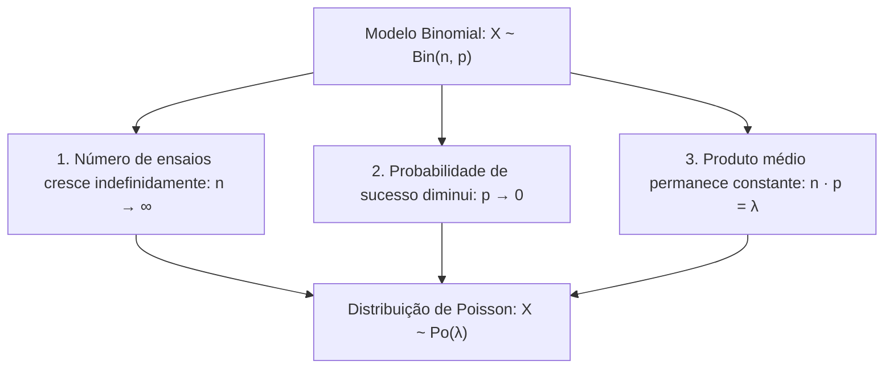
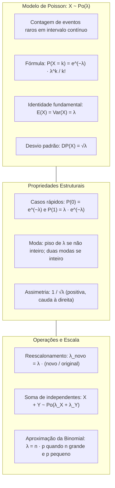

> [!objetivos]
> - Compreender a gênese da distribuição de Poisson a partir do limite da distribuição Binomial.
> - Aplicar a função de probabilidade pontual e identificar a igualdade estrutural entre média e variância.
> - Executar a mudança de escala temporal ou espacial da taxa média λ em problemas operacionais.
> - Dominar a propriedade reprodutiva da soma de variáveis de Poisson independentes e o cálculo por complementares.

O planejamento de recursos operacionais exige modelar contagens contínuas. Nos bombeiros, estimamos chamadas de resgate por turno. Na polícia, analisamos acidentes em rodovias. Também monitoramos denúncias em fins de semana. O evento individual é raro em cada instante. Porém, ocorrem contagens expressivas em intervalos consolidados. A distribuição de Poisson rege esses fenômenos.

## Gênese e Pressupostos do Processo de Poisson

A distribuição de Poisson foi formulada pelo matemático francês Siméon Denis Poisson como o caso limite da distribuição Binomial. Imagine um experimento no qual um intervalo contínuo de tempo (como uma hora) é subdividido em um número n gigantesco de subintervalos minúsculos de fração de segundo.

Em cada um desses instantes, a probabilidade p de ocorrência do evento é extremamente baixa (tende a zero). Contudo, o produto n · p permanece finito e constante, convergindo para uma taxa média esperada designada pela letra grega λ (λ).

A distribuição de Poisson aplica-se a contagens que satisfazem quatro condições básicas:

Primeiro, a variável X conta eventos inteiros (0, 1, 2, ...). Ela atua em intervalo contínuo (tempo, área ou volume). Não há teto numérico superior fixo.

Segundo, eventos em subintervalos disjuntos são independentes. Uma ocorrência agora não altera a chance de novos eventos depois.

Terceiro, a taxa média de ocorrências por unidade de medida é estritamente homogênea e constante ao longo de todo o intervalo observado.

Quarto, a probabilidade de ocorrer mais de um evento em um instante infinitesimalmente pequeno é nula. Dois eventos nunca acontecem de forma rigorosamente simultânea no mesmo ponto.

## A Função de Probabilidade Pontual de Poisson

A função de probabilidade da variável aleatória discreta X ~ Po(λ) expressa a chance de observar exatamente k ocorrências no intervalo de referência:

P(X = k) = [e^(−λ) · λ^k] / k!, para k ∈ {0, 1, 2, ...}

Nessa expressão, e é a base dos logaritmos naturais (número de Euler, constante irracional aproximadamente igual a 2,71828). O termo λ representa a taxa média de ocorrências no intervalo, e k! é o fatorial do número inteiro k.

A fórmula tem três partes. Temos e elevado ao oposto da taxa (−λ). Multiplicamos pela taxa elevada a k (λ^k). Por fim, dividimos por k!.

Dois casos particulares imediatos facilitam a resolução de provas:

Quando k = 0 (probabilidade de nenhuma ocorrência), como λ⁰ = 1 e 0! = 1:

P(X = 0) = e^(−λ)

Quando k = 1 (probabilidade de exatamente uma ocorrência), como λ¹ = λ e 1! = 1:

P(X = 1) = λ · e^(−λ)

| Número de Eventos (k) | Expressão Funcional | Valor com Taxa λ = 2 (e⁻² ≈ 0,1353) | Interpretação Prática |
|---|---|---|---|
| k = 0 | e^(−λ) | e⁻² ≈ 0,1353 | Probabilidade de nenhuma ocorrência (13,53%) |
| k = 1 | λ · e^(−λ) | 2 · 0,1353 = 0,2707 | Probabilidade de exatamente 1 ocorrência (27,07%) |
| k = 2 | (λ² / 2!) · e^(−λ) | (4 / 2) · 0,1353 = 0,2707 | Probabilidade de exatamente 2 ocorrências (27,07%) |
| k = 3 | (λ³ / 3!) · e^(−λ) | (8 / 6) · 0,1353 = 0,1804 | Probabilidade de exatamente 3 ocorrências (18,04%) |
| k = 4 | (λ⁴ / 4!) · e^(−λ) | (16 / 24) · 0,1353 = 0,0902 | Probabilidade de exatamente 4 ocorrências (9,02%) |

> [!bizu] A Relação Recorrente entre Probabilidades Consecutivas
> A razão entre duas probabilidades consecutivas na distribuição de Poisson obedece à equação direta:
> P(X = k) / P(X = k − 1) = λ / k.
> Essa razão demonstra a dinâmica da distribuição: enquanto k < λ, a probabilidade pontual cresce; quando k > λ, a probabilidade decresce. Se k = λ (para λ inteiro), as probabilidades P(X = λ) e P(X = λ − 1) são rigorosamente iguais.

## Parâmetros Matemáticos: Média, Variância e Moda

A distribuição de Poisson possui apenas um único parâmetro populacional: a taxa média λ.

A esperança matemática da variável é diretamente a taxa λ:

E(X) = λ

A variância da distribuição de Poisson também coincide rigorosamente com λ:

Var(X) = λ

O desvio padrão é a raiz quadrada positiva da taxa: DP(X) = √λ.

A igualdade estrita entre o valor esperado e a variância constitui a identidade marcante da distribuição de Poisson na estatística (propriedade de equidispersão):

E(X) = Var(X) = λ

Se uma questão de concurso apresentar uma variável de contagem com média 6 e variância 6, o candidato deve reconhecer imediatamente o modelo de Poisson com λ = 6. Se a variância for menor do que a média, o modelo tende a ser binomial; se a variância for maior do que a média (superdispersão), modelos como a Binomial Negativa são os indicados.

### Assimetria e Moda de Poisson

A distribuição de Poisson tem assimetria positiva (cauda à direita). Seu coeficiente vale 1 / √λ. Conforme λ cresce, a assimetria diminui. Pelo Teorema Central do Limite, a curva aproxima-se da Normal.

A moda (valor mais provável de ocorrências) depende da natureza aritmética de λ:

Se λ não for um número inteiro, a distribuição é estritamente unimodal. A moda única é a parte inteira de λ: Moda = ⌊λ⌋. Por exemplo, se λ = 2,7 chamadas por hora, a moda é 2 chamadas.

Se λ for exatamente um número inteiro positivo m, a distribuição é bimodal. Existem duas modas consecutivas com probabilidades idênticas: k_1 = m − 1 e k_2 = m. Para λ = 5, as modas são 4 e 5 ocorrências.

## Mudança de Escala do Intervalo de Referência

A taxa λ é intrinsecamente vinculada a uma unidade de medida temporal ou espacial definida no enunciado. Quando a pergunta exige a probabilidade em um intervalo de amplitude diferente, o candidato deve reescalar o parâmetro λ proporcionalmente antes de aplicar a fórmula:

λ_novo = λ_original · (Intervalo Novo / Intervalo Original)

Suponha que um posto de bombeiros receba em média 6 chamadas de emergência por hora. A taxa horária é λ = 6 chamadas / 60 minutos.

Se a questão solicitar a probabilidade em um período de 20 minutos, ajustamos a taxa:

λ_novo = 6 · (20 / 60) = 6 · (1/3) = 2 chamadas em 20 minutos.

Se o interesse for um turno operacional completo de 3 horas, a taxa passa a ser:

λ_novo = 6 · 3 = 18 chamadas em 3 horas.

O tempo médio entre chegadas consecutivas é o inverso da taxa temporal: tempo médio = 1 / λ. Com 6 chamadas por hora, o tempo médio entre ocorrências sucessivas é de 1/6 de hora, ou seja, exatamente 10 minutos.

> [!pegadinha] Atenção às Unidades de Tempo e Dias Úteis
> Ao converter taxas temporais em problemas de prova, preste atenção aos dias úteis. Se o enunciado disser que uma vara judicial recebe 10 processos por dia útil e indagar a taxa semanal, multiplique por 5 dias (semana útil de trabalho), obtendo λ = 50 processos por semana, e não por 7 dias. Leia com atenção as premissas do texto.

## Propriedade Reprodutiva: Soma de Variáveis de Poisson

A distribuição de Poisson desfruta de uma propriedade aditiva fundamental, denominada propriedade reprodutiva.

Se X_1, X_2, ..., X_m forem variáveis aleatórias independentes que seguem distribuições de Poisson com parâmetros respectivos λ_1, λ_2, ..., λ_m, então a soma total dessas variáveis também segue rigorosamente uma distribuição de Poisson:

S = X_1 + X_2 + ... + X_m ~ Po(λ_1 + λ_2 + ... + λ_m)

As taxas médias simplesmente se somam. Se o pelotão A atende em média 4 ocorrências por plantão e o pelotão B atende em média 7 ocorrências de forma independente, o total de ocorrências atendidas pela unidade segue uma distribuição de Poisson com parâmetro consolidado λ = 4 + 7 = 11 ocorrências por plantão.

A soma de n variáveis de Poisson independentes, cada uma com média 1 (como acidentes mensais por viatura), resulta em uma distribuição de Poisson com média total n.

Atenção conceitual: enquanto a soma de variáveis de Poisson independentes é sempre uma Poisson, a diferença entre duas variáveis de Poisson NÃO segue uma distribuição de Poisson (gera a distribuição de Skellam, que admite valores negativos). Contudo, a expressão "soma menos uma parcela" é permitida se representar a soma dos termos restantes: se S = X + Y + Z, a expressão S − X equivale à soma Y + Z, permanecendo uma distribuição de Poisson com parâmetro λ_Y + λ_Z.

| Operação com Variáveis de Poisson | Condição Requerida | Resultado Distribucional | Parâmetro Resultante |
|---|---|---|---|
| Soma de independentes: X + Y | X e Y independentes | Distribuição de Poisson | λ_total = λ_X + λ_Y |
| Soma de m variáveis com média 1 | Variáveis i.i.d. | Distribuição de Poisson | λ_total = m |
| Filtro proporcional de fluxo: p · X | Eventos retidos com prob. p | Distribuição de Poisson | λ_filtrado = p · λ_X |
| Diferença direta: X − Y | X e Y independentes | NÃO é distribuição de Poisson | Admite suporte com valores negativos |

## A Aproximação da Binomial pela Poisson

A distribuição de Poisson funciona como uma aproximação de alta precisão para a distribuição Binomial quando o número de ensaios n é muito grande e a probabilidade de sucesso p é muito pequena (regra dos eventos raros).

Na prática de concursos, utiliza-se a aproximação de Poisson quando n ≥ 50 e p ≤ 0,10, ou quando n · p < 10. O parâmetro da Poisson correspondente é simplesmente o produto médio:

λ = n · p

Considere a fiscalização de um lote de n = 500 medicamentos apreendidos, no qual a probabilidade de um frasco estar adulterado é de p = 0,4% (p = 0,004). O cálculo exato pela binomial exigiria o termo C(500, 3) · (0,004)³ · (0,996)⁴⁹⁷, inviável em prova sem recursos computacionais.

Pela aproximação de Poisson, calculamos a taxa média:

λ = n · p = 500 · 0,004 = 2 frascos adulterados.

A probabilidade de encontrar exatamente 3 frascos adulterados é calculada instantaneamente:

P(X = 3) = [e⁻² · 2³] / 3! = [e⁻² · 8] / 6 = (4/3) · e⁻² ≈ 1,333 · 0,1353 ≈ 0,1804 (18,04%)

Em problemas de provas anteriores, examinadores utilizam diversos contextos práticos. Uma editora analisa erros de impressão em páginas de livros. Uma indústria farmacêutica inspeciona ampolas de medicamentos com probabilidade de defeito p = 0,018 ou valor exponencial 0,0183. Um posto de trânsito monitora quantos carros chegam a uma blitz por minuto. Em um estabelecimento comercial ou bancário, monitora-se quantos clientes chegam por hora. Em todos esses cenários, assegura-se que a contagem siga ou seguirá rigorosamente o modelo de Poisson com frações como 0,225.

## Aplicações Práticas Resolvidas

Analise a resolução comentada de duas situações de relevância para a atuação policial e de socorro.

> [!resolvido] Chamados de Resgate em Batalhão de Bombeiros Militar
> Uma central de atendimento de emergência do Corpo de Bombeiros recebe, em média, 3 chamados de salvamento por hora, segundo um processo de Poisson (λ = 3).
> Sabe-se que e⁻³ ≈ 0,0498.
> a) Qual a probabilidade de a central receber exatamente 2 chamados em uma hora?
> b) Qual a probabilidade de receber pelo menos 1 chamado em uma hora?
> c) Qual a probabilidade de receber no máximo 1 chamado em um período de 40 minutos?
>
> **Resolução passo a passo:**
> Para o item a: Taxa horária λ = 3.
> P(X = 2) = [e⁻³ · 3²] / 2! = (9 / 2) · e⁻³ = 4,5 · 0,0498 = 0,2241 (22,41%).
> Para o item b: Aplicamos o evento complementar para "pelo menos 1":
> P(X ≥ 1) = 1 − P(X = 0) = 1 − e⁻³ = 1 − 0,0498 = 0,9502 (95,02%).
> Para o item c: Ajustamos a taxa para o intervalo de 40 minutos:
> λ_novo = 3 · (40 / 60) = 3 · (2/3) = 2 chamados em 40 minutos.
> Como a nova taxa é λ = 2, usamos e⁻² ≈ 0,1353.
> O evento "no máximo 1 chamado" é a união dos casos X = 0 e X = 1:
> P(X ≤ 1) = P(X = 0) + P(X = 1) = e⁻² + 2 · e⁻² = 3 · e⁻² = 3 · 0,1353 = 0,4059 (40,59%).

> [!exemplo] Registro de Falhas em Sistema de Rádio Digital
> Um sistema repetidor de rádio da segurança pública apresenta, em média, 4 falhas de transmissão por semana de serviço contínuo (λ = 4).
> A variância do número de falhas semanais é igual a 4 falhas², e o desvio padrão é DP(X) = √4 = 2 falhas por semana.
> Se o operador monitora duas repetidoras independentes A e B (com taxas semanais λ_A = 4 e λ_B = 3), o total semanal de falhas do sistema conjunto segue uma distribuição de Poisson com parâmetro consolidado λ = 4 + 3 = 7 falhas por semana.

## Mapa do capítulo

### Para fixar
- A distribuição de Poisson modela a contagem de ocorrências independentes de um evento raro em um intervalo contínuo de tempo ou espaço.
- A função de probabilidade pontual é dada pela expressão P(X = k) = [e^(−λ) · λ^k] / k!, com suporte nos inteiros não negativos {0, 1, 2, ...}.
- A distribuição de Poisson possui a propriedade marcante da equidispersão: a média e a variância são rigorosamente iguais à taxa λ.
- A probabilidade de nenhuma ocorrência no intervalo é simplesmente P(X = 0) = e^(−λ).
- A probabilidade de pelo menos uma ocorrência é obtida pelo atalho do complementar: P(X ≥ 1) = 1 − e^(−λ).
- Ao mudar a extensão do intervalo de observação, a taxa λ deve ser multiplicada pela razão entre o novo intervalo e o intervalo original.
- A soma de variáveis aleatórias de Poisson independentes resulta em uma nova distribuição de Poisson com taxa igual à soma das taxas individuais.
- A distribuição de Poisson aproxima a distribuição Binomial quando n é elevado e p é muito pequeno, mantendo-se λ = n · p.
