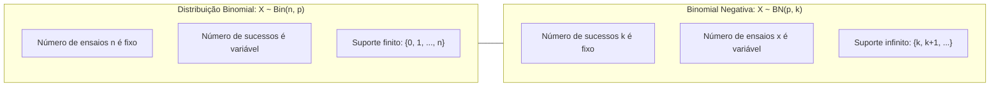
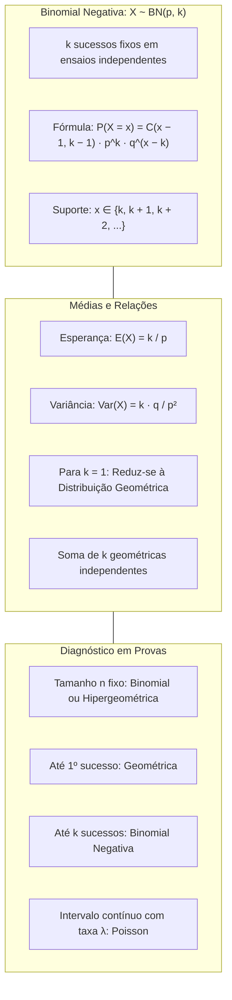

> [!objetivos]
> - Compreender a formulação combinatória da distribuição Binomial Negativa.
> - Dominar o cálculo da probabilidade pontual, da média e da variância do modelo.
> - Relacionar a Binomial Negativa com a soma de variáveis Geométricas independentes.
> - Diferenciar os cinco modelos discretos de probabilidade cobrados em provas.

O estudo das distribuições discretas de probabilidade conclui-se com o tempo de espera generalizado. Na distribuição Geométrica, investigamos ensaios até o primeiro sucesso isolado. Em muitas operações militares e de controle de processos, o objetivo exige múltiplos sucessos. Quantos disparos são necessários até obter 3 acertos? Quantos equipamentos uma fábrica examina até achar 2 peças defeituosas? A resposta está na distribuição Binomial Negativa, também chamada modelo de Pascal.

## O Modelo da Binomial Negativa

A distribuição Binomial Negativa baseia-se em ensaios de Bernoulli independentes e identicamente distribuídos. Cada ensaio admite apenas dois resultados dicotômicos: sucesso ou fracasso. A probabilidade de sucesso é constante e denotada por p, enquanto a probabilidade de fracasso é q = 1 − p. Em extrações sucessivas de uma população, a validade do modelo exige população infinita ou amostragem com reposição.

A distinção essencial para a Binomial comum reside na inversão do que é fixo e do que é aleatório no experimento:

Na Binomial comum, fixamos previamente o número n de ensaios e observamos a contagem aleatória de sucessos.

Na Binomial Negativa, fixamos previamente o número k de sucessos desejados (k ≥ 1). A variável aleatória discreta X representa o número total de ensaios necessários até alcançar o k-ésimo sucesso.

Indicamos o modelo por X ~ BN(p, k). O suporte da variável é X ∈ {k, k + 1, k + 2, ...}. É impossível obter k sucessos em menos de k ensaios. A variável pode crescer indefinidamente sem teto fixo.

## A Função de Probabilidade da Binomial Negativa

Desejamos achar a chance de precisar de exatamente x ensaios para obter k sucessos (x ≥ k).

A lógica combinatória tem uma regra central. O último ensaio (de número x) é obrigatoriamente um sucesso. Se o k-ésimo sucesso ocorresse antes, o processo teria parado antes.

Portanto, nos x − 1 ensaios iniciais, ocorrem k − 1 sucessos e x − k fracassos. O número de maneiras de posicionar esses k − 1 sucessos é C(x − 1, k − 1).

Multiplicando pelas probabilidades dos ensaios independentes:

P(X = x) = C(x − 1, k − 1) · p^k · q^(x − k), para x = k, k + 1, ...

O coeficiente combinatório é C(x − 1, k − 1), e não C(x, k). O último ensaio fica fixo com o sucesso terminal.

> [!atencao] Coeficiente Combinatório Específico
> Nas provas, não use a combinação da binomial C(x, k). O ensaio final é sempre um sucesso fixado. Apenas os k − 1 sucessos anteriores são combinados entre os x − 1 primeiros ensaios.

| Ensaios (x) | Ensaios Anteriores (1 a x − 1) | Último Ensaio (x) | Combinação | Probabilidade |
|---|---|---|---|---|
| x = k | k − 1 sucessos e 0 fracassos | k-ésimo sucesso | C(k − 1, k − 1) = 1 | p^k · q⁰ = p^k |
| x = k + 1 | k − 1 sucessos e 1 fracasso | k-ésimo sucesso | C(k, k − 1) = k | k · p^k · q¹ |
| x genérico | k − 1 sucessos e x − k fracassos | k-ésimo sucesso | C(x − 1, k − 1) | C(x − 1, k − 1) · p^k · q^(x − k) |

## Parâmetros e Relação com a Geométrica

A média da variável X representa a quantidade esperada de ensaios até k sucessos:

E(X) = k / p

A variância mede a dispersão em torno da média:

Var(X) = (k · q) / p²

Quando k = 1, a Binomial Negativa coincide com a distribuição Geométrica: P(X = x) = q^(x − 1) · p, com E(X) = 1/p e Var(X) = q/p².

A variável Binomial Negativa pode ser vista como a soma de k variáveis geométricas independentes com mesmo parâmetro p:

X = G_1 + G_2 + ... + G_k, onde cada G_i ~ Geo(p)

Cada G_i mede o tempo de espera entre sucessos consecutivos. Pela linearidade da média: E(X) = k · (1/p) = k/p. Pela independência: Var(X) = k · (q/p²) = (k · q) / p².

## Parametrização pela Contagem de Fracassos

Se definirmos a variável aleatória Y como o número de fracassos antes do k-ésimo sucesso, temos Y = X − k. O aluno que estuda estatística para concursos deve dominar essa versão alternativa.

O suporte dessa variável começa em zero: Y ∈ {0, 1, 2, ...}. O valor zero ocorre quando todos os primeiros ensaios resultam em sucesso. A probabilidade pontual é dada por:

P(Y = y) = C(k + y − 1, k − 1) · p^k · q^y, para y = 0, 1, 2, ...

A esperança do número de fracassos é E(Y) = (k · q) / p. A variância permanece idêntica à do modelo original: Var(Y) = (k · q) / p².

Essa formulação é muito usada em controle de qualidade. Um empregado de fábrica avalia quantos clientes ou peças com defeito surgem em extrações sucessivas antes de atingir a cota estabelecida.

> [!bizu] Distinção de Parametrização na Binomial Negativa
> Se a fórmula trouxer q^y com y começando em 0, a variável conta fracassos (média kq/p). Se a fórmula trouxer q^(x − k) com x iniciando em k, a variável conta ensaios totais (média k/p).

## Síntese Diagnóstica das Distribuições Discretas

Utilize a tabela comparativa para escolher o modelo correto na prova:

| Distribuição | Elemento Fixo | Variável Aleatória | Condição do Experimento | Relação Média e Variância |
|---|---|---|---|---|
| **Bernoulli** | 1 ensaio único | Sucesso (1) ou Fracasso (0) | Ensaio isolado | Var = p · q ≤ 0,25 |
| **Binomial** | Total de ensaios n | Total de sucessos | Amostragem com reposição | Var(X) < E(X) |
| **Geométrica** | 1 sucesso fixo | Ensaios até o 1º sucesso | Ensaios independentes | Falta de memória; DP < Média |
| **Hipergeométrica** | População N e Amostra n | Sucessos na amostra | Amostragem sem reposição | Var reduzida por (N−n)/(N−1) |
| **Poisson** | Intervalo contínuo | Contagem de eventos raros | Taxa média λ constante | Var(X) = E(X) = λ |
| **Binomial Negativa** | k sucessos fixos | Ensaios até o k-ésimo sucesso | Ensaios independentes | Soma de k geométricas |

> [!pegadinha] Tamanho de Amostra Fixo versus Critério de Parada
> Amostra de tamanho fixo n indica Binomial ou Hipergeométrica. A Binomial Negativa exige parar no momento exato em que se atinge o k-ésimo sucesso.

## Aplicações Práticas Resolvidas

Acompanhe duas situações resolvidas passo a passo.

> [!resolvido] Teste de Equipamentos de Emergência
> Em uma fábrica, um empregado testa geradores de socorro. A chance de partida imediata é de 60% (p = 0,60 e q = 0,40). O protocolo exige obter 3 partidas com sucesso (k = 3).
> Qual a probabilidade de realizar exatamente 5 testes (x = 5)?
>
> **Resolução:**
> Temos k = 3, p = 0,60, q = 0,40 e x = 5.
> P(X = 5) = C(4, 2) · (0,60)³ · (0,40)² = 6 · 0,216 · 0,16 = 0,2074 (20,74%).
> A média de testes é E(X) = 3 / 0,60 = 5 testes.
> A variância é Var(X) = (3 · 0,40) / (0,60)² = 1,20 / 0,36 ≈ 3,33.

> [!exemplo] Atendimento de Clientes em Balcão de Emergência
> Em um balcão de atendimento, clientes chegam a cada minuto. A probabilidade de um cliente necessitar de perícia é p = 0,20. O atendente precisa identificar 2 casos de perícia (k = 2).
> O número médio de clientes atendidos até achar 2 casos é E(X) = 2 / 0,20 = 10 clientes.
> No lançamento de uma moeda honesta (p = 0,5) até obter 5 caras, o total médio de lançamentos é 5 / 0,5 = 10 tentativas, seguindo o modelo de Pascal.

## Mapa do capítulo

### Para fixar
- A Binomial Negativa modela o total de ensaios independentes até obter k sucessos.
- A função de probabilidade é P(X = x) = C(x − 1, k − 1) · p^k · q^(x − k), para x ≥ k.
- O último ensaio é o k-ésimo sucesso, o que justifica a combinação C(x − 1, k − 1).
- A esperança matemática é E(X) = k / p e a variância é Var(X) = (k · q) / p².
- Para k = 1, a distribuição reduz-se à distribuição Geométrica.
- A Binomial Negativa equivale à soma de k variáveis geométricas independentes.
- Na contagem de fracassos, a média é E(Y) = (k · q) / p e a variância não muda.
- Se a amostra tem tamanho fixo, use Binomial; se o critério é parar no k-ésimo sucesso, use Binomial Negativa.
