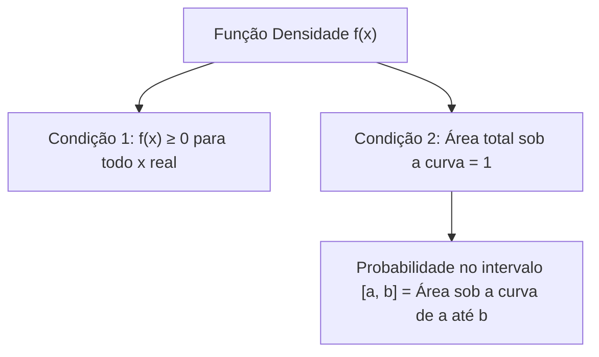
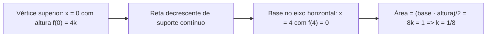

A teoria das probabilidades divide as variáveis aleatórias em duas grandes famílias: discretas e contínuas. Os modelos discretos associam probabilidades a valores isolados. Por outro lado, as variáveis contínuas descrevem grandezas mensuráveis ao longo de intervalos da reta real. Neste capítulo, estudamos os fundamentos conceituais das variáveis aleatórias contínuas. Abordamos a função densidade de probabilidade (f.d.p.), o cálculo de áreas por geometria plana e integração, bem como a determinação de constantes de normalização.

> [!objetivos]
> Ao concluir este capítulo, você será capaz de:
> - Diferenciar formalmente variáveis aleatórias discretas de variáveis contínuas.
> - Compreender por que a probabilidade pontual de uma variável contínua é rigorosamente nula.
> - Verificar se uma função satisfaz as duas condições de existência de uma f.d.p. válida.
> - Calcular probabilidades intervalares utilizando geometria elementar e o Teorema Fundamental do Cálculo.
> - Determinar constantes algébricas de normalização em funções densidade contínuas.

## Variáveis Aleatórias Discretas versus Contínuas

A distinção entre fenômenos discretos e contínuos é basilar na modelagem estatística. Uma variável aleatória é classificada como discreta quando seu conjunto de resultados possíveis é finito ou enumerável. Os valores de uma variável discreta decorrem de processos de contagem. Exemplos típicos são o número de chamados atendidos em um quartel ou a quantidade de viaturas em serviço.

Por outro lado, uma variável aleatória é classificada como contínua quando assume valores dentro de intervalos reais contínuos. Os valores contínuos são obtidos por medições com instrumentos específicos. Abrangem grandezas como tempo de resposta em salvamentos, massa corporal, temperatura ambiente, altura de combatentes e pressão arterial.

| Critério de Comparação | Variável Aleatória Discreta | Variável Aleatória Contínua |
| :--- | :--- | :--- |
| Natureza dos valores | Contáveis (números inteiros ou enumeráveis) | Mensuráveis (números reais contínuos) |
| Exemplos usuais | Número de acidentes, peças com defeito | Tempo de atendimento, distância percorrida |
| Função matemática básica | Função de probabilidade pontual P(X = x) | Função densidade de probabilidade f(x) |
| Probabilidade pontual | Pode ser estritamente positiva: P(X = x) > 0 | Rigorosamente nula para qualquer ponto: P(X = x) = 0 |
| Cálculo de probabilidade | Somatório de probabilidades pontuais | Área sob a curva por integral ou geometria |
*Tabela 1: Síntese comparativa entre variáveis aleatórias discretas e contínuas.*

Como o conjunto dos números reais em qualquer intervalo contém infinitos pontos não enumeráveis, a probabilidade de uma variável contínua assumir exatamente um valor real específico é igual a zero: P(X = c) = 0 para qualquer constante c real. Desse modo, na análise contínua não se calculam probabilidades para pontos isolados, mas sim probabilidades associadas a intervalos numéricos.

Uma consequência matemática direta dessa propriedade é que a inclusão ou exclusão dos extremos em uma desigualdade intervalar não altera o resultado numérico da probabilidade calculada:

P(a < X < b) = P(a ≤ X ≤ b) = P(a ≤ X < b) = P(a < X ≤ b)

Essa equivalência é exclusiva das variáveis contínuas e não se aplica aos modelos discretos, onde a inclusão do extremo altera a soma de probabilidades pontuais.

## Função Densidade de Probabilidade e Condições de Existência

Nos modelos contínuos, a ferramenta analítica fundamental é a Função Densidade de Probabilidade (f.d.p.), simbolizada por f(x). A f.d.p. não informa a probabilidade direta de um ponto isolado. Ela estabelece como a massa de probabilidade distribui-se ao longo da reta real. A probabilidade de a variável pertencer a um intervalo entre a e b corresponde à área sob a curva de f(x) delimitada por esses limites.


*Figura 1: Postulados de existência e interpretação geométrica da f.d.p.*

Para que uma função matemática qualquer f(x) seja admitida como uma f.d.p. legítima, ela deve satisfazer impreterivelmente a dois axiomas de probabilidade:
1. Não negatividade: a função f(x) deve ser maior ou igual a zero em todos os pontos do domínio real, isto é, f(x) ≥ 0 para todo x. Não existem probabilidades negativas.
2. Normalização total: a área total sob a curva de f(x) ao longo de todo o espaço amostral deve ser rigorosamente igual a 1 (cem por cento da probabilidade).

> [!atencao]
> A função f(x) representa uma densidade linear e não uma probabilidade pontual. Portanto, o valor de f(x) pode ser estritamente maior do que 1 em certos pontos ou intervalos estreitos. A única exigência matemática obrigatória é que a área total sob o gráfico seja igual a 1 e que a função nunca assuma valores negativos.

## Cálculo de Probabilidades por Geometria Plana

Quando o traçado gráfico da f.d.p. é composto por segmentos de reta horizontais ou inclinados, o cálculo da probabilidade pode ser efetuado de forma rápida e segura aplicando fórmulas elementares de geometria plana. Esse procedimento dispensa o uso de cálculo integral formal e agiliza a resolução de provas de concurso.

As três figuras geométricas fundamentais mais recorrentes em questões são:
- Retângulo (distribuição uniforme): Área = base · altura.
- Triângulo (distribuição triangular): Área = (base · altura) / 2.
- Trapézio (funções lineares por partes): Área = [(base maior + base menor) · altura] / 2.


*Figura 2: Determinação geométrica da área sob função densidade triangular.*

Se uma f.d.p. tem suporte triangular definido entre x = 0 e x = 4 com altura máxima f(0) = 4k, a área total do triângulo vale (4 · 4k) / 2 = 8k. Igualando a área total a 1 pela condição de normalização, obtém-se diretamente k = 1/8. A partir dessa constante, qualquer probabilidade intervalar é obtida calculando a área correspondente da figura geométrica truncada.

## Cálculo de Probabilidades por Integração

Quando a função densidade de probabilidade apresenta curvatura descrita por polinômios de grau dois ou superior, funções exponenciais ou logarítmicas, o cálculo da área exige a aplicação da integral definida:

P(a ≤ X ≤ b) = ∫ f(x) dx calculado de a até b

Pelo Teorema Fundamental do Cálculo, se F(x) representa a primitiva contínua de f(x) tal que F'(x) = f(x), o valor numérico da probabilidade no intervalo fechado [a, b] é obtido avaliando a primitiva nos extremos:

P(a ≤ X ≤ b) = F(b) − F(a)

| Tipo de Função | Função Densidade f(x) | Primitiva Indefinida F(x) | Regra Operatória |
| :--- | :--- | :--- | :--- |
| Potência simples (n ≠ −1) | f(x) = x^n | F(x) = x^(n+1) / (n+1) | Soma 1 ao expoente e divide pelo novo valor |
| Constante pura | f(x) = c | F(x) = c · x | Multiplica a constante pela variável x |
| Constante multiplicativa | f(x) = c · x^n | F(x) = c · x^(n+1) / (n+1) | Preserva a constante e integra a potência |
| Inverso simples (n = −1) | f(x) = 1/x | F(x) = ln(x) | Aplica a função logarítmica natural |
| Exponencial padrão | f(x) = e^x | F(x) = e^x | A derivada e a integral coincidem |
| Exponencial com coeficiente | f(x) = e^(k·x) | F(x) = (1/k) · e^(k·x) | Divide pelo coeficiente linear k do expoente |
*Tabela 2: Tabela de integrais imediatas mais frequentes em provas de variáveis contínuas.*

> [!bizu] Cuidado com a Diferença de Argumentos
> Um equívoco recorrente em cálculos de probabilidade contínua consiste em avaliar F(b − a) em vez de calcular F(b) − F(a). Lembre-se: primeiro avalia-se a primitiva no limite superior b, depois avalia-se no limite inferior a, e em seguida efetua-se a subtração dos dois resultados numéricos obtidos.

## Determinação de Constantes de Normalização e Funções por Partes

É muito comum que as bancas examinadoras forneçam uma expressão algébrica contendo uma constante indeterminada (habitualmente representada por k, C ou α) e solicitem a probabilidade de um determinado intervalo. O método canônico de resolução estrutura-se em duas etapas sucessivas:
1. Impor a condição de normalização integral total = 1 para encontrar o valor da constante.
2. Com a constante determinada, integrar a f.d.p. no intervalo específico solicitado pela questão.

Em diversas aplicações práticas, a variável aleatória apresenta comportamentos diferenciados em faixas distintas do domínio, caracterizando uma f.d.p. definida por partes. Nessas situações, o cálculo da área total ou de um intervalo que cruze duas faixas exige particionar a integral em parcelas independentes e somar os valores resultantes.

> [!resolvido] Determinação de Constante e Cálculo de Probabilidade
> Seja X uma variável aleatória contínua cuja função densidade de probabilidade é dada por:
> f(x) = k · x² para 0 ≤ x ≤ 3, e f(x) = 0 para os demais valores de x.
> Determine o valor da constante k e calcule a probabilidade P(1 ≤ X ≤ 2).
>
> **Resolução passo a passo:**
> 1. Determinação da constante de normalização k:
>    A área total sob a curva entre x = 0 e x = 3 deve ser igual a 1:
>    ∫ (k · x²) dx de 0 até 3 = 1
>    Primitiva: F(x) = k · (x³ / 3)
>    Aplicando os limites:
>    k · [(3)³ / 3 − (0)³ / 3] = k · (27 / 3) = 9k
>    9k = 1 => k = 1/9
>    Assim, a f.d.p. completa é: f(x) = (1/9) · x² para x em [0, 3].
>
> 2. Cálculo da probabilidade P(1 ≤ X ≤ 2):
>    P(1 ≤ X ≤ 2) = ∫ [(1/9) · x²] dx de 1 até 2
>    Primitiva: F(x) = (1/9) · (x³ / 3) = x³ / 27
>    Aplicando os limites:
>    P(1 ≤ X ≤ 2) = F(2) − F(1) = (2)³ / 27 − (1)³ / 27 = 8/27 − 1/27 = 7/27
>    Em termos decimais: 7 / 27 ≈ 0,2593 (ou 25,93%).

## Mapa do capítulo

```mermaid Síntese estrutural do capítulo sobre conceitos fundamentais de variáveis contínuas
flowchart TD
    VAR["Variáveis Aleatórias Contínuas"] --> FDP["Função Densidade de Probabilidade f(x)"]
    VAR --> PROB["Probabilidades Intervalares"]
    
    FDP --> CON1["Não negatividade: f(x) ≥ 0"]
    FDP --> CON2["Área total sob a curva = 1"]
    
    PROB --> GEO["Geometria Plana: Retângulos, Triângulos e Trapézios"]
    PROB --> INT["Integração Definida: P(a ≤ X ≤ b) = F(b) - F(a)"]
    
    INT --> PAR["Constante k: Impor integral total = 1"]
    INT --> SEC["Partição de Integrais em Funções por Partes"]
```
*Figura 3: Fluxograma conceitual dos fundamentos de variáveis contínuas e cálculo de densidades.*

### Para fixar

1. **Probabilidade pontual**: Por que P(X = c) = 0 em qualquer ponto isolado de uma variável contínua?
   - Porque a probabilidade é dada pela área sob a curva; sobre um ponto isolado a largura da base é nula, resultando em área estritamente nula.

2. **Condições da f.d.p.**: Quais as duas exigências matemáticas para que f(x) seja uma densidade válida?
   - A função deve ser não negativa em todo o domínio real, f(x) ≥ 0, e a área total sob a curva ao longo de todo o espaço amostral deve ser igual a 1.

3. **Inclusão de extremos**: O que diferencia P(a < X < b) de P(a ≤ X ≤ b) em variáveis contínuas?
   - Em variáveis contínuas não há nenhuma diferença numérica, pois a probabilidade nos pontos extremos isolados é rigorosamente igual a zero.

4. **Cálculo da constante k**: Como se determina uma constante indeterminada presente na expressão da f.d.p.?
   - Integra-se a função em todo o seu intervalo de definição e iguala-se o resultado da área a 1, resolvendo a equação algébrica para k.

5. **Regra de subtração**: Qual a forma correta de calcular a probabilidade P(a ≤ X ≤ b) a partir da primitiva F(x)?
   - Calcula-se a diferença F(b) − F(a), avaliando a função primitiva no limite superior e subtraindo o valor obtido no limite inferior.
