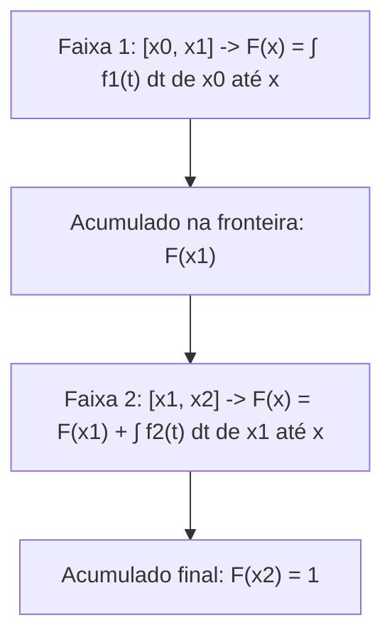

O estudo das variáveis aleatórias contínuas exige ferramentas analíticas consistentes. Elas permitem acumular probabilidades e identificar parâmetros de posição representativos. A função de distribuição acumulada desempenha esse papel integrador. Ela conecta a densidade local à probabilidade global acumulada. Neste capítulo, examinamos a definição e as propriedades da função de distribuição acumulada (f.d.a.). Analisamos o procedimento para sua obtenção em distribuições contínuas e por partes. Estudamos também o cálculo da mediana e de separatrizes, além dos métodos de derivação para a localização da moda.

> [!objetivos]
> Ao concluir este capítulo, você será capaz de:
> - Definir formalmente a função de distribuição acumulada F(x) para variáveis contínuas.
> - Aplicar o Teorema Fundamental do Cálculo para alternar entre f.d.p. e f.d.a.
> - Construir a f.d.a. de variáveis com densidade definida por partes garantindo a continuidade nos nós.
> - Determinar a mediana e quartis igualando a f.d.a. às probabilidades acumuladas correspondentes.
> - Localizar a moda contínua através do ponto de máximo global da função densidade.

## Conceito e Propriedades da Função de Distribuição Acumulada

A Função de Distribuição Acumulada representa uma probabilidade acumulada. Ela indica a chance de a variável assumir valores menores ou iguais a um número fixado x. Habitualmente, é simbolizada por F(x) ou f.d.a.:

F(x) = P(X ≤ x)

Para uma variável contínua com densidade f(t), a f.d.a. é calculada por integração definida. Ela acumula a área desde o limite inferior do espaço amostral até o ponto considerado x. Se o limite inferior do suporte for xI, temos a relação fundamental:

F(x) = ∫ f(t) dt calculado de xI até x

Seja P(x) uma primitiva de f(x). Pelo cálculo fundamental, a acumulada é expressa por F(x) = P(x) − P(xI). Quando o valor numérico da primitiva no limite inferior é nulo, a f.d.a. coincide diretamente com a primitiva P(x). Caso P(xI) seja diferente de zero, a constante deve ser subtraída. Isso garante rigorosamente que F(xI) = 0.


*Figura 1: Operações de cálculo diferencial e integral que conectam f.d.p. e f.d.a.*

> [!exemplo] Exemplo de Cálculo com a F.D.A.
> Considere a densidade f(x) = 4x³ definida para x no intervalo [0, 1].
> A primitiva é P(x) = x⁴, com P(0) = 0.
> Logo, a função de distribuição acumulada é F(x) = x⁴.
> Para calcular a probabilidade P(X ≤ 0,5), avaliamos diretamente F(0,5) = (0,5)⁴ = 0,0625 (ou 6,25%).
> Para calcular P(0,2 ≤ X ≤ 0,8), fazemos F(0,8) − F(0,2) = 0,8⁴ − 0,2⁴ = 0,4096 − 0,0016 = 0,4080.

A função de distribuição acumulada possui propriedades analíticas universais que devem ser rigorosamente observadas:
1. Monotonicidade não decrescente: se x1 < x2, então F(x1) ≤ F(x2). As probabilidades acumulam-se continuamente à medida que avançamos para a direita no eixo real.
2. Limites assintóticos: F(x) vale 0 para qualquer ponto situado à esquerda do suporte mínimo da distribuição, e vale 1 para qualquer ponto situado à direita do suporte máximo.
3. Continuidade perfeita: para variáveis contínuas, F(x) é uma função estritamente contínua em toda a reta real, não apresentando saltos verticais ou descontinuidades de degrau.
4. Cálculo intervalar: a probabilidade de a variável pertencer ao intervalo entre a e b é dada diretamente pela diferença das acumuladas: P(a < X ≤ b) = F(b) − F(a).

Pelo Teorema Fundamental do Cálculo, nos pontos em que f(x) é contínua, a função densidade de probabilidade é exatamente a derivada primeira da função de distribuição acumulada:

f(x) = F'(x) = dF(x) / dx

| Propriedade Matemática | Expressão Formal | Significado Prático |
| :--- | :--- | :--- |
| Definição básica | F(x) = P(X ≤ x) | Probabilidade acumulada até o ponto x |
| Relação diferencial | f(x) = dF(x) / dx | A densidade é a taxa instantânea de variação da acumulada |
| Intervalo entre a e b | P(a ≤ X ≤ b) = F(b) − F(a) | Probabilidade obtida pela subtração direta das acumuladas |
| Complementar à direita | P(X > a) = 1 − F(a) | Probabilidade da cauda superior obtida pelo complementar |
| Limite inferior | Limite de F(x) quando x tende a −∞ = 0 | Antes do suporte inicial não há probabilidade acumulada |
| Limite superior | Limite de F(x) quando x tende a +∞ = 1 | Ao final do suporte toda a probabilidade está acumulada |
*Tabela 1: Síntese das propriedades centrais da função de distribuição acumulada.*

## F.D.A. em Distribuições Definidas por Partes

Muitos modelos probabilísticos práticos apresentam funções densidade expressas por sentenças distintas em diferentes intervalos. A obtenção da f.d.a. completa nesses casos exige a montagem por faixas consecutivas, respeitando o princípio da acumulação histórica da probabilidade.

Na primeira faixa do domínio, a acumulada é calculada integrando a densidade desde o extremo inicial inferior até x. Para as faixas subsequentes, não se pode integrar simplesmente a partir do início da faixa atual. Deve-se somar a probabilidade total já acumulada ao final da faixa anterior à integral da densidade da faixa presente:

F(x) = F(x_anterior) + ∫ f(t) dt calculado do início da faixa atual até x


*Figura 2: Processo de acumulação contínua em funções densidade partidas.*

Esse procedimento garante a continuidade matemática da curva F(x) em todos os nós de transição. Se a acumulada resultante apresentar qualquer salto numérico entre duas faixas adjacentes, ocorreu um erro de cálculo algébrico na integração. A expressão global de F(x) deve ser formalizada incluindo o valor 0 antes do suporte e o valor 1 após o término do intervalo final.

> [!atencao]
> Ao determinar a f.d.a. de uma função por partes, nunca calcule a integral de uma faixa intermediária isoladamente sem somar o valor acumulado nas etapas anteriores. A função acumulada F(x) deve ser contínua em todos os pontos divisores de intervalos.

## Medidas de Tendência Central: A Mediana Contínua

A mediana de uma variável aleatória contínua, indicada por Md ou x_0,5, representa o valor da reta real que particiona a área total sob a curva da f.d.p. exatamente em duas metades equivalentes. Em termos probabilísticos, cinquenta por cento da massa de probabilidade localiza-se à esquerda da mediana e cinquenta por cento à direita.

A definição formal da mediana fundamenta-se diretamente na função de distribuição acumulada:

F(Md) = P(X ≤ Md) = 0,5

Para encontrar o valor numérico da mediana, basta igualar a expressão da f.d.a. a 0,5 e resolver a equação algébrica em relação à incógnita x. Caso a densidade seja definida por partes, deve-se inicialmente verificar em qual dos intervalos a acumulada atinge a marca de 0,5. Compara-se o valor de 0,5 com os totais acumulados nas fronteiras de cada faixa, resolvendo a equação estritamente na faixa pertinente.

O mesmo raciocínio estende-se ao cálculo de qualquer separatriz da distribuição contínua:
- Primeiro Quartil (Q1): valor onde F(Q1) = 0,25.
- Segundo Quartil (Q2): coincide rigorosamente com a mediana, F(Q2) = 0,50.
- Terceiro Quartil (Q3): valor onde F(Q3) = 0,75.
- Percentil p (Pp): valor onde F(Pp) = p / 100.


*Figura 3: Determinação gráfica da mediana a partir da função de distribuição acumulada.*

Uma propriedade algébrica notável da mediana reside em seu comportamento sob transformações lineares. Se multiplicarmos uma variável aleatória X por uma constante 'a' e somarmos uma constante 'b', definindo Y = a·X + b, a nova mediana sofrerá exatamente a mesma transformação:

Md(a·X + b) = a · Md(X) + b

Essa propriedade preserva a ordem relativa dos dados e é amplamente explorada em enunciados de concursos.

> [!bizu] Efeito de Transformações na Mediana
> Ao contrário da variância, que não se altera com a soma de constantes, a mediana acompanha rigorosamente tanto somas quanto multiplicações. Se a mediana de X é 10, a mediana de Y = 3X + 5 será necessariamente 3(10) + 5 = 35.

## A Moda em Variáveis Aleatórias Contínuas

A moda de uma variável aleatória contínua, simbolizada por Mo, corresponde ao valor da variável no qual a função densidade de probabilidade f(x) atinge o seu valor máximo global. Em termos geométricos, a moda identifica a abscissa do ponto mais elevado do gráfico da f.d.p. É fundamental não confundir o ponto mais alto de f(x) com o gráfico de F(x), que atinge valor 1 no final de seu domínio.

O procedimento para identificação da moda depende da estrutura analítica da função f(x):

| Configuração Gráfica da f.d.p. | Comportamento da Função | Método de Obtenção da Moda |
| :--- | :--- | :--- |
| Função estritamente decrescente | f'(x) < 0 em todo o intervalo | A moda coincide com o extremo inferior do suporte |
| Função estritamente crescente | f'(x) > 0 em todo o intervalo | A moda coincide com o extremo superior do suporte |
| Parábola com concavidade para baixo | Coeficiente quadrático negativo | Vértice da parábola ou média aritmética das raízes reais |
| Parábola com concavidade para cima | Coeficiente quadrático positivo | Testar os dois extremos do intervalo e escolher o maior f(x) |
| Curvas suaves diferenciáveis | Apresenta pontos de inflexão | Derivar, igualar a zero, f'(x) = 0, e conferir f''(x) < 0 |
*Tabela 2: Métodos de localização da moda conforme a geometria da função densidade.*

Para funções diferenciáveis gerais em intervalos abertos, a localização de candidatos a pontos de máximo envolve o cálculo da derivada primeira de f(x). Igualando a derivada a zero, f'(x) = 0, obtêm-se os pontos críticos da função. Para certificar-se de que o ponto crítico localizado trata-se de um ponto de máximo relativo e não de mínimo, aplica-se o teste da derivada segunda: se f''(x) < 0 no ponto crítico, a concavidade é voltada para baixo e o ponto representa um máximo local.

> [!resolvido] Determinação de F.D.A., Mediana e Moda
> Uma variável aleatória contínua X tem função densidade dada por:
> f(x) = 6 · x · (1 − x) = 6x − 6x² para 0 ≤ x ≤ 1, e f(x) = 0 fora desse intervalo.
> Obtenha a função de distribuição acumulada F(x), determine a moda e calcule a mediana de X.
>
> **Resolução passo a passo:**
> 1. Obtenção da Função de Distribuição Acumulada F(x):
>    Integrando f(t) a partir do limite inferior xI = 0 até x:
>    F(x) = ∫ (6t − 6t²) dt de 0 até x
>    Primitiva: P(t) = 6 · (t² / 2) − 6 · (t³ / 3) = 3t² − 2t³
>    Como P(0) = 0, a f.d.a. no intervalo [0, 1] é:
>    F(x) = 3x² − 2x³
>    A f.d.a. completa é: F(x) = 0 para x < 0; F(x) = 3x² − 2x³ para 0 ≤ x ≤ 1; e F(x) = 1 para x > 1.
>
> 2. Determinação da Moda (Mo):
>    A função f(x) = 6x − 6x² é uma parábola com concavidade para baixo (coeficiente de x² é negativo).
>    Derivando em relação a x e igualando a zero:
>    f'(x) = 6 − 12x = 0 => 12x = 6 => x = 6/12 = 0,5
>    Teste da derivada segunda: f''(x) = −12 < 0 (confirmação de ponto de máximo).
>    Portanto, a moda da distribuição vale Mo = 0,5.
>
> 3. Cálculo da Mediana (Md):
>    Igualando a f.d.a. a 0,5:
>    F(Md) = 0,5 => 3(Md)² − 2(Md)³ = 0,5
>    Multiplicando por 2 para eliminar a fração:
>    6(Md)² − 4(Md)³ = 1 => 4(Md)³ − 6(Md)² + 1 = 0
>    Pela simetria da parábola em torno de x = 0,5, testamos x = 0,5:
>    F(0,5) = 3(0,5)² − 2(0,5)³ = 3(0,25) − 2(0,125) = 0,75 − 0,25 = 0,50.
>    A equação é satisfeita com precisão exata. Portanto, a mediana vale Md = 0,5.
>    Nesta distribuição simétrica, a média, a mediana e a moda coincidem no valor central 0,5.

## Mapa do capítulo

```mermaid Síntese estrutural do capítulo sobre fda mediana e moda contínua
flowchart TD
    ACU["Análise de Variáveis Contínuas"] --> FDA["Função Acumulada F(x) = P(X ≤ x)"]
    ACU --> MED["Mediana: F(Md) = 0,50"]
    ACU --> MOD["Moda: Máximo da Densidade f(x)"]
    
    FDA --> DER["Relação Inversa: f(x) = F'(x)"]
    FDA --> PAR["Acumulação em Funções por Partes"]
    
    MED --> LIN["Propriedade Linear: Md(aX + b) = a·Md(X) + b"]
    MED --> SEP["Generalização para Quartis e Percentis"]
    
    MOD --> MAX["Cálculo Diferencial: f'(x) = 0 e f''(x) < 0"]
    MOD --> GEO["Análise de Extremos em Retas e Parábolas"]
```
*Figura 4: Estrutura integrada dos conceitos de função acumulada, mediana e moda.*

### Para fixar

1. **Definição de F.D.A.**: O que representa matematicamente a função de distribuição acumulada F(x)?
   - Representa a probabilidade de a variável aleatória contínua assumir valores menores ou iguais ao ponto x, calculada pela integral de f(t) desde o limite inferior até x.

2. **Cálculo da densidade a partir da acumulada**: Como obter a função densidade f(x) quando conhecemos a f.d.a. F(x)?
   - Pelo Teorema Fundamental do Cálculo, calcula-se a derivada primeira da função acumulada em relação a x: f(x) = dF(x) / dx.

3. **Cálculo da Mediana**: Qual equação algébrica define a mediana de uma variável contínua?
   - A equação F(Md) = 0,5, que localiza o ponto onde cinquenta por cento da probabilidade total encontra-se acumulada.

4. **Conceito de Moda Contínua**: Onde se localiza a moda no gráfico de uma variável contínua?
   - Localiza-se na abscissa x onde a função densidade f(x) atinge o seu valor máximo global, e não no gráfico da acumulada.

5. **Transformação Linear na Mediana**: Se a variável X tem mediana igual a 8, qual será a mediana da variável Y = 2X + 3?
   - A nova mediana será 2(8) + 3 = 19, pois a mediana acompanha linearmente as operações de escala e translação.
