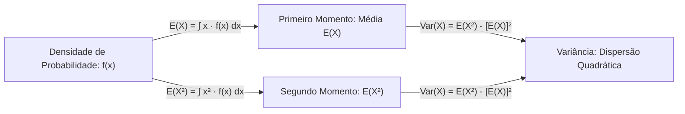
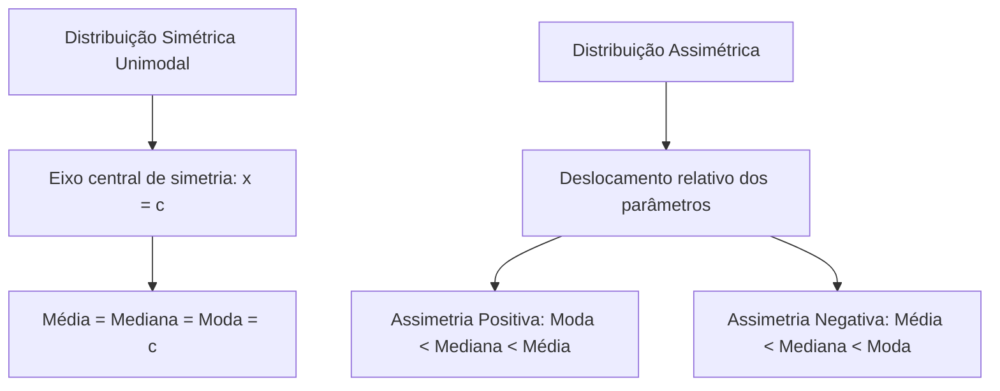
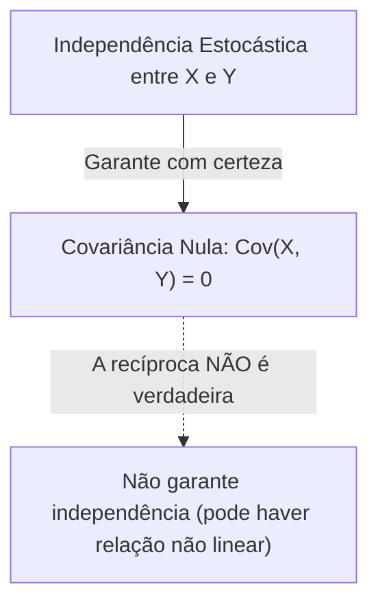

O estudo dos momentos probabilísticos permite sintetizar o comportamento estocástico de uma variável contínua. Esses momentos geram parâmetros precisos de locação e dispersão. Na transição do universo discreto para o contínuo, as somatórias são substituídas por integrais definidas ao longo do suporte da densidade. Neste capítulo, estudamos a esperança matemática, a variância e o desvio padrão. Analisamos também a covariância entre variáveis aleatórias e o coeficiente de correlação linear de Pearson. Apresentamos métodos práticos de cálculo e propriedades analíticas fundamentais.

> [!objetivos]
> Ao concluir este capítulo, você será capaz de:
> - Calcular a esperança matemática E(X) de variáveis contínuas por meio de integrais definidas.
> - Explorar a simetria de distribuições contínuas para deduzir a média sem necessidade de integração.
> - Calcular a variância e o desvio padrão aplicando a fórmula dos momentos computacionais.
> - Compreender o impacto de transformações lineares de escala e translação sobre média e variância.
> - Determinar a covariância e o coeficiente de correlação de Pearson entre variáveis aleatórias.

## Conceito e Propriedades da Esperança Matemática

A esperança matemática representa o centro de gravidade da massa de probabilidade. Ela também é denominada valor esperado ou média teórica da distribuição. No caso discreto, a média é obtida pela ponderação de cada valor pontual pela sua probabilidade. No caso contínuo, os valores são infinitos e mensuráveis. Desse modo, a soma é formalmente substituída pela integral do produto da variável x pela sua função densidade f(x):

E(X) = ∫ x · f(x) dx calculado em todo o suporte de x

Se a variável estiver definida em um intervalo finito entre xI e xS, os limites de integração reduzem-se a essa faixa. Fora desse suporte, f(x) anula-se. Quando a densidade for definida por partes em múltiplos intervalos, a integral deve ser particionada em cada segmento. Em seguida, somam-se as parcelas parciais correspondentes.


*Figura 1: Fluxo de cálculo do primeiro e segundo momentos para a variância.*

A esperança matemática obedece a propriedades de linearidade fundamentais que simplificam enormemente a resolução de questões de concurso:

| Propriedade Algébrica | Expressão Matemática | Condição de Validade |
| :--- | :--- | :--- |
| Esperança de constante | E(c) = c | Válida para qualquer constante c real |
| Multiplicação por constante | E(c · X) = c · E(X) | Válida para qualquer constante c real |
| Aditividade da soma | E(X + Y) = E(X) + E(Y) | Sempre válida, independentemente de X e Y serem dependentes |
| Subtração de variáveis | E(X − Y) = E(X) − E(Y) | Sempre válida, independentemente de dependência mútua |
| Transformação linear mista | E(a · X + b) = a · E(X) + b | Válida para quaisquer constantes a e b reais |
| Multiplicação de variáveis | E(X · Y) = E(X) · E(Y) | Válida exclusivamente se X e Y forem variáveis independentes |
*Tabela 1: Propriedades operatórias universais da esperança matemática.*

A linearidade da média permite avaliar transformações sem a necessidade de recalcular integrais complexas. Se conhecemos a esperança de uma variável aleatória V, expressa por E(V) = 5, e desejamos obter a média de uma nova grandeza W = 4V + 12, basta aplicar a relação direta: E(W) = 4 · E(V) + 12 = 4 · 5 + 12 = 32.

> [!pegadinha]
> A esperança da soma, E(X + Y) = E(X) + E(Y), é sempre verdadeira, mesmo quando X e Y são fortemente correlacionadas. Por outro lado, a esperança do produto só se decompõe no produto das esperanças, E(X · Y) = E(X) · E(Y), se as variáveis forem estritamente independentes. Em provas, jamais separe o produto sem antes confirmar a independência das variáveis.

## O Atalho da Simetria na Determinação da Média

Em diversas situações práticas, o traçado da função densidade de probabilidade apresenta simetria perfeita em relação a um eixo vertical central x = c. Se uma distribuição contínua é simétrica em relação ao ponto c e unimodal (possui um único ponto de máximo), a média teórica, a mediana e a moda coincidem rigorosamente no centro de simetria:

E(X) = Mediana(X) = Moda(X) = c

Essa propriedade geométrica permite obter a média instantaneamente sem calcular nenhuma integral. Consideremos os seguintes modelos clássicos:
1. Parábola simétrica voltada para baixo: se f(x) = (3/4) · (1 − x²) no intervalo entre −1 e +1, as raízes reais são x = −1 e x = +1. O ponto médio entre as raízes é zero. Como o intervalo é perfeitamente centrado em zero, temos diretamente E(X) = 0.
2. Densidade triangular simétrica: se a densidade sobe linearmente de 0 a 2 e desce linearmente de 2 a 4, o vértice central localiza-se em x = 2. A média vale imediatamente E(X) = 2.
3. Distribuição retangular uniforme: se a variável distribui-se uniformemente no intervalo [a, b], a simetria garante que a média é o ponto médio aritmético simples: E(X) = (a + b) / 2.


*Figura 2: Relação de ordem entre média, mediana e moda em curvas simétricas e assimétricas.*

O emprego do atalho da simetria exige que tanto a fórmula algébrica de f(x) quanto o intervalo de definição sejam perfeitamente simétricos. Se a expressão for simétrica mas o intervalo for truncado de forma desigual, a simetria do suporte é quebrada. Nesses casos assimétricos, a média deve ser calculada por integração formal.

## Ferramentas Matemáticas: Regra da Cadeia e Regra de L'Hôpital

Nas provas de estatística para oficiais, certas integrais e limites exigem recursos clássicos do cálculo diferencial. A regra da cadeia aplica-se na derivação de funções compostas. Para derivar uma função g(f(x)), multiplica-se a derivada da função externa g' pela derivada da função interna f'(x). Por exemplo, a derivada de e^(t·x) em relação a x é t · e^(t·x). Ao integrar essa expressão, divide-se pela constante interna t: a integral de e^(t·x) dx vale (1/t) · e^(t·x).

Outro recurso muito cobrado é a regra de L'Hôpital. Diante de uma indeterminação matemática do tipo 0/0 ou infinito sobre infinito no cálculo de limites de caudas, derivam-se o numerador e o denominador separadamente. Em problemas aplicados, como na avaliação de indenização de seguros ou sinistros expressos em milhares de reais, a variável financeira transformada V = 2X + 10 mantém a unidade monetária em milhares, permitindo calcular o valor esperado diretamente sem refazer integrais extensas.

## Variância e Desvio Padrão em Modelos Contínuos

A variância quantifica a dispersão quadrática média em torno da média esperada. Ela é indicada por Var(X) ou V(X). A definição teórica expressa o valor esperado do desvio quadrático:

Var(X) = E[(X − E(X))²] = ∫ (x − E(X))² · f(x) dx

Para fins computacionais e resolução rápida de exercícios, utiliza-se a fórmula alternativa dos momentos:

Var(X) = E(X²) − [E(X)]²

Nessa formulação, E(X) representa o primeiro momento ordinário (a média). Já E(X²) representa o segundo momento ordinário. Ele é obtido integrando x² multiplicado pela densidade f(x): E(X²) = ∫ x² · f(x) dx.


*Figura 3: Relação matemática entre momentos, variância e desvio padrão.*

O desvio padrão, simbolizado pela letra grega σ (σ), é definido como a raiz quadrada aritmética positiva da variância: σ = √Var(X). O desvio padrão possui a grande vantagem de expressar a dispersão na mesma unidade de medida da variável original, facilitando a interpretação prática.

A variância possui propriedades operatórias peculiares sob transformações lineares que diferem expressivamente daquelas aplicáveis à média:

| Operação Algébrica | Expressão da Variância | Comportamento Prático |
| :--- | :--- | :--- |
| Adição de constante | Var(X + c) = Var(X) | Somar constante apenas desloca a distribuição; a dispersão não muda |
| Subtração de constante | Var(X − c) = Var(X) | Subtrair constante não afeta o afastamento mútuo entre os dados |
| Multiplicação por constante | Var(c · X) = c² · Var(X) | A constante multiplicativa sai da variância elevada ao quadrado |
| Divisão por constante | Var(X / c) = Var(X) / c² | O divisor sai da variância elevado ao quadrado |
| Desvio padrão com constante | DP(c · X) = abs(c) · DP(X) | O desvio padrão é multiplicado pelo módulo de c |
| Soma de variáveis independentes | Var(X + Y) = Var(X) + Var(Y) | A variância da soma é a soma das variâncias apenas se independentes |
*Tabela 2: Efeito de operações lineares sobre a variância e o desvio padrão.*

> [!atencao]
> Observe com muita cautela: somar uma constante não altera a variância, mas multiplicar por uma constante multiplica a variância pelo quadrado da constante. Se Var(X) = 4, a variância de Y = 5X + 20 será Var(Y) = 5² · Var(X) = 25 · 4 = 100. O termo constante 20 é completamente eliminado no cálculo da dispersão.

## Covariância e Coeficiente de Correlação Linear

Quando analisamos simultaneamente duas variáveis aleatórias contínuas X e Y definidas sobre o mesmo espaço probabilístico, torna-se essencial quantificar o grau de associação linear existente entre elas. A medida básica dessa dependência linear conjunta é a covariância, denotada por Cov(X, Y).

A covariância é definida formalmente pela relação matemática:

Cov(X, Y) = E[(X − E(X)) · (Y − E(Y))] = E(X · Y) − E(X) · E(Y)

No caso de variáveis contínuas bidimensionais, a esperança do produto E(X · Y) é calculada por meio de uma integral dupla envolvendo a função densidade de probabilidade conjunta f(x, y):

E(X · Y) = ∬ x · y · f(x, y) dx dy

As propriedades algébricas da covariância estruturam-se da seguinte forma:
1. Simetria: Cov(X, Y) = Cov(Y, X).
2. Covariância de uma variável consigo mesma: Cov(X, X) = Var(X).
3. Covariância com constante pura: Cov(X, c) = 0 para qualquer constante c real.
4. Homogeneidade bilinear: Cov(a·X, b·Y) = a · b · Cov(X, Y).
5. Distributividade na soma: Cov(X + Y, Z) = Cov(X, Z) + Cov(Y, Z).
6. Independência estocástica: se X e Y são variáveis independentes, então Cov(X, Y) = 0. A recíproca não é necessariamente verdadeira: covariância nula indica ausência de relação linear, mas pode haver dependência não linear entre as variáveis.


*Figura 4: Implicação lógica estrita entre independência probabilística e covariância.*

A introdução da covariância permite calcular a variância de somas e diferenças lineares gerais sem pressupor a independência entre os termos:

Var(X + Y) = Var(X) + Var(Y) + 2 · Cov(X, Y)

Var(X − Y) = Var(X) + Var(Y) − 2 · Cov(X, Y)

Note que na variância da diferença Var(X − Y), as variâncias individuais continuam sendo somadas, alterando-se unicamente o sinal do termo do duplo produto da covariância.

O coeficiente de correlação linear de Pearson, simbolizado pela letra grega rô (ρ) ou por r, padroniza a covariância, tornando-a uma grandeza adimensional imune às unidades de medida das variáveis originais:

ρ(X, Y) = Cov(X, Y) / (σX · σY)

O coeficiente de correlação varia rigorosamente dentro do intervalo numérico fechado: −1 ≤ ρ(X, Y) ≤ +1.
- Se ρ = +1: indica correlação linear positiva perfeita.
- Se ρ = −1: indica correlação linear negativa perfeita.
- Se ρ = 0: indica ausência de correlação linear (variáveis descorrelacionadas).

> [!bizu] Denominador do Coeficiente de Correlação
> Atenção na aplicação da fórmula de Pearson: o denominador divide a covariância pelo produto dos desvios padrão (σX e σY), e não pelas variâncias. Se as variâncias forem 16 e 9, os desvios padrão são 4 e 3, e o denominador será 4 · 3 = 12.

> [!resolvido] Cálculo Completo de Média, Variância e Desvio Padrão
> Considere uma variável contínua X cuja função densidade assume a forma analítica:
> f(x) = (3/8) · x² para 0 ≤ x ≤ 2, e f(x) = 0 fora desse intervalo.
> Calcule a esperança matemática E(X), o segundo momento E(X²), a variância Var(X) e o desvio padrão de X.
>
> **Resolução passo a passo:**
> 1. Cálculo da Esperança Matemática E(X):
>    E(X) = ∫ x · f(x) dx de 0 até 2
>    E(X) = ∫ [x · (3/8) · x²] dx = ∫ (3/8) · x³ dx de 0 até 2
>    Primitiva: P(x) = (3/8) · (x⁴ / 4) = (3/32) · x⁴
>    Aplicando os limites de integração:
>    E(X) = (3/32) · [(2)⁴ − (0)⁴] = (3/32) · 16 = 48/32 = 3/2 = 1,5.
>
> 2. Cálculo do Segundo Momento Ordinário E(X²):
>    E(X²) = ∫ x² · f(x) dx de 0 até 2
>    E(X²) = ∫ [x² · (3/8) · x²] dx = ∫ (3/8) · x⁴ dx de 0 até 2
>    Primitiva: Q(x) = (3/8) · (x⁵ / 5) = (3/40) · x⁵
>    Aplicando os limites de integração:
>    E(X²) = (3/40) · [(2)⁵ − (0)⁵] = (3/40) · 32 = 96/40 = 12/5 = 2,4.
>
> 3. Cálculo da Variância Var(X):
>    Aplicando a fórmula dos momentos:
>    Var(X) = E(X²) − [E(X)]²
>    Substituindo os valores calculados:
>    Var(X) = 2,4 − (1,5)² = 2,40 − 2,25 = 0,15.
>    Na forma fracionária ordinária: Var(X) = 12/5 − 9/4 = (48 − 45) / 20 = 3/20.
>
> 4. Cálculo do Desvio Padrão:
>    σ = √Var(X) = √(0,15) ≈ 0,3873.
>    Todos os parâmetros da distribuição encontram-se rigorosamente determinados.

## Mapa do capítulo

```mermaid Síntese estrutural do capítulo sobre esperança variância e covariância
flowchart TD
    MOM["Momentos e Dispersão Contínua"] --> ESP["Esperança Matemática: E(X) = ∫ x·f(x) dx"]
    MOM --> VAR["Variância: Var(X) = E(X²) - [E(X)]²"]
    MOM --> COV["Covariância e Correlação de Pearson"]
    
    ESP --> LIN["Propriedades: E(aX + b) = a·E(X) + b"]
    ESP --> SIM["Atalho da Simetria: Curva Unimodal => Média = Centro"]
    
    VAR --> SCA["Regra de Escala: Var(aX + b) = a²·Var(X)"]
    VAR --> DESV["Desvio Padrão: σ = √Var(X)"]
    
    COV --> SOMA["Variância da Soma: Var(X + Y) = Var(X) + Var(Y) + 2·Cov(X, Y)"]
    COV --> COR["Correlação: ρ = Cov(X, Y) / (σX · σY)"]
```
*Figura 5: Mapa conceitual integrado de esperança, variância, covariância e correlação.*

### Para fixar

1. **Definição de Esperança**: Como se calcula a média teórica E(X) de uma variável contínua?
   - Integra-se o produto da variável x pela sua função densidade f(x) em todo o suporte em que a densidade é positiva.

2. **Atalho da Simetria**: Em quais condições a média coincide diretamente com o centro de simetria?
   - Quando a função densidade f(x) e seu intervalo de definição forem simultaneamente simétricos e a distribuição for unimodal.

3. **Cálculo da Variância pelos Momentos**: Qual a expressão prática computacional da variância?
   - A diferença entre o segundo momento ordinário e o quadrado da média: Var(X) = E(X²) − [E(X)]².

4. **Multiplicação por Constante na Variância**: Se a variável X tem variância igual a 6, qual a variância de Y = 3X?
   - A nova variância será 3² · 6 = 9 · 6 = 54, pois a constante sai da variância elevada ao quadrado.

5. **Independência e Covariância**: Se duas variáveis são independentes, quanto vale sua covariância?
   - A covariância é estritamente nula: Cov(X, Y) = 0. Todavia, covariância nula não assegura reciprocamente que as variáveis sejam independentes.
