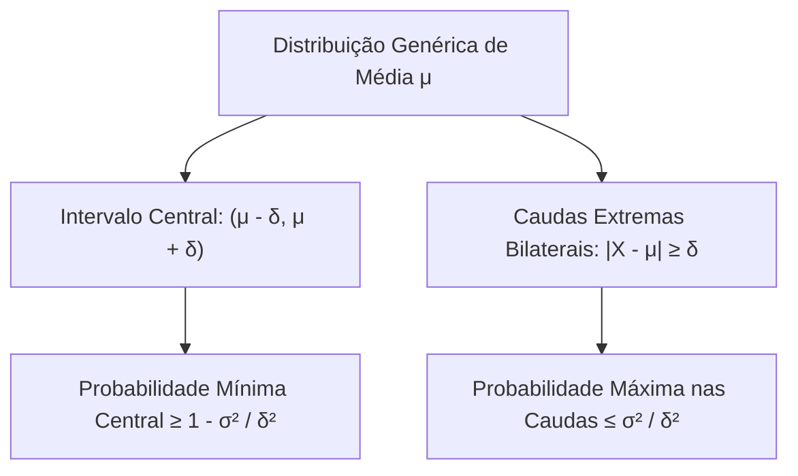
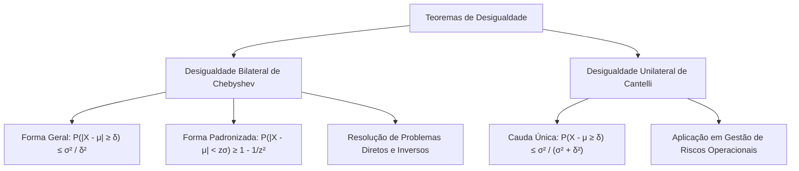

Em muitas situações práticas da estatística e das operações de socorro, a forma funcional da distribuição é desconhecida. Nesses cenários, os teoremas de desigualdade fornecem limites para probabilidades conhecendo apenas média e variância. Neste capítulo, estudamos a Desigualdade de Chebyshev em suas formas bilateral e padronizada. Analisamos também a resolução de problemas diretos e inversos e a Desigualdade Unilateral de Cantelli.

> [!objetivos]
> Ao concluir este capítulo, você será capaz de:
> - Compreender a fundamentação não paramétrica da Desigualdade de Chebyshev.
> - Calcular limites superiores para caudas bilaterais e limites inferiores para intervalos centrais.
> - Resolver problemas inversos determinando a variância máxima permitida por uma cota probabilística.
> - Aplicar a Desigualdade Unilateral de Cantelli para estimar probabilidades de cauda única.

## A Desigualdade Bilateral de Chebyshev

A Desigualdade de Chebyshev é um resultado universal da teoria das probabilidades. Sua principal virtude é o caráter não paramétrico. Ela é válida para qualquer variável aleatória X, seja ela discreta ou contínua. Aplica-se a qualquer formato de distribuição. A única exigência matemática é que a variável possua esperança finita μ e variância finita σ². O nome do matemático russo apresenta diversas grafias em provas de concurso, como Chebyshev, Tchebyshev e Tschebyscheff.

Para qualquer constante real positiva delta (δ > 0), a desigualdade estabelece um limite superior para o afastamento bilateral:

P(abs(X − μ) ≥ δ) ≤ σ² / δ²

O evento indicado por abs(X − μ) ≥ δ descreve o afastamento conjunto nas duas caudas da distribuição:

X ≤ μ − δ   ou   X ≥ μ + δ

*Figura 1: Partição do espaço probabilístico entre intervalo central e caudas bilaterais.*

Aplicando o princípio da probabilidade do evento complementar, obtemos diretamente o limite inferior para a probabilidade de a variável permanecer contida dentro do intervalo simétrico em torno da média:

P(|X − μ| < δ) ≥ 1 − (σ² / δ²)

A desigualdade fornece cotas delimitadoras (um teto máximo para as caudas ou um piso mínimo para a região central), mas não calcula o valor exato da probabilidade.

## Formulação em Múltiplos de Desvios Padrão

Uma das formas mais frequentes de cobrança em concursos públicos expressa o afastamento delta como um múltiplo inteiro ou fracionário z do desvio padrão: δ = z · σ, com z > 0. Substituindo essa relação na fórmula de Chebyshev, a variância cancela-se:

P(|X − μ| ≥ z · σ) ≤ σ² / (z · σ)² = σ² / (z² · σ²) = 1 / z²

Pelo complementar, a probabilidade de a variável afastar-se da média em menos de z desvios padrão satisfaz:

P(|X − μ| < z · σ) ≥ 1 − (1 / z²)

| Afastamento z (em desvios padrão) | Probabilidade Mínima Central | Probabilidade Máxima nas Caudas |
| :--- | :--- | :--- |
| z = 1 desvio padrão | Pelo menos 0% (cota trivial) | No máximo 100% (cota trivial) |
| z = 2 desvios padrão | Pelo menos 75,0% (1 − 1/4 = 0,75) | No máximo 25,0% (1/2² = 0,25) |
| z = 3 desvios padrão | Pelo menos 88,89% (1 − 1/9 ≈ 0,8889) | No máximo 11,11% (1/3² ≈ 0,1111) |
| z = 4 desvios padrão | Pelo menos 93,75% (1 − 1/16 = 0,9375) | No máximo 6,25% (1/4² = 0,0625) |
| z = 5 desvios padrão | Pelo menos 96,0% (1 − 1/25 = 0,96) | No máximo 4,0% (1/5² = 0,04) |
*Tabela 1: Cotas universais de probabilidade fornecidas pelo Teorema de Chebyshev.*

Para z = 1, o limite 1/1² resulta em 1 (cem por cento), o que não traz informação probabilística relevante. O teorema torna-se útil a partir de z > 1, revelando que para qualquer distribuição concebível, pelo menos setenta e cinco por cento de todos os dados concentram-se a menos de dois desvios padrão da média.

> [!atencao]
> As bancas costumam trocar as palavras "no mínimo" e "no máximo" para induzir o candidato ao erro. Grave a regra: a cota central é sempre um valor mínimo (pelo menos 1 − 1/z²), enquanto a cota de cauda externa é sempre um valor máximo (no máximo 1/z²).

## Resolução de Problemas Diretos, Inversos e Cenários Práticos

As questões de concurso envolvendo o Teorema de Chebyshev dividem-se em dois tipos fundamentais de enunciado: problemas diretos e problemas inversos. Nos problemas diretos, conhecemos média e variância e calculamos a cota do intervalo:
1. Obter média μ e variância σ². Se dados E(X) e E(X²), faz-se σ² = E(X²) − [E(X)]².
2. Determinar o afastamento delta em relação à média: δ = limite_superior − μ.
3. Para evento nas caudas externas, calcula-se a cota máxima: σ² / δ².
4. Para evento no intervalo central, calcula-se a cota mínima: 1 − (σ² / δ²).

Nos problemas inversos, o examinador fornece a cota de probabilidade e solicita a variância máxima permitida. Igualamos a fórmula de Chebyshev à probabilidade e isolamos algebricamente a variância σ².

A tabela a seguir sintetiza cenários clássicos de aplicação prática cobrados em concursos:

| Cenário de Aplicação | Parâmetros Fornecidos | Evento Probabilístico Avaliado | Cota Obtida |
| :--- | :--- | :--- | :--- |
| Produção de fábrica diária | Média 1000 unidades e variância 200 | Produzir menos de 900 ou mais de 1100 (afastamento δ = 100) | No máximo 200 / 100² = 0,02 (fora); no mínimo 0,98 (entre 900 e 1100) |
| Produção industrial unilateral | Média 1000 unidades e variância 200 | Produzir mais de 1100 peças (Cantelli com δ = 100) | No máximo 200 / (200 + 10000) = 0,0196 |
| Salários de empregados no judiciário | Média de 2000 reais e probabilidade mínima de 84% | Empregados ganharem entre 1600 e 2400 reais (fora: máximo 16%, δ = 400) | Variância máxima calculada: σ² = 25600 |
| Cota unilateral de sinistros | Média 0 e P(X ≥ 25) ≤ 0,25 | Cantelli: σ² / (σ² + 625) = 0,25 | Variância σ² = 208,33 |
*Tabela 2: Síntese de aplicações práticas clássicas dos teoremas de desigualdade.*

Esses modelos comprovam que não é necessário conhecer a curva analítica exata da variável para tomar decisões gerenciais com segurança probabilística estrita.

## A Desigualdade Unilateral de Cantelli

A Desigualdade de Chebyshev é bilateral e estima o afastamento para ambas as caudas simultaneamente. Em aplicações da gestão de riscos, interessa avaliar apenas um dos lados. Um exemplo típico é a chance de o tempo de atendimento superar um teto crítico.

Nessas situações de cauda única, aplica-se a Desigualdade Unilateral de Cantelli. Para qualquer delta positivo (δ > 0):

P(X − μ ≥ δ) ≤ σ² / (σ² + δ²)

Para a cauda inferior unilateral:

P(μ − X ≥ δ) ≤ σ² / (σ² + δ²)

A cota unilateral de Cantelli é mais precisa do que dividir a cota de Chebyshev por dois. Ela não requer hipótese de simetria da distribuição.

> [!bizu] Comparativo Chebyshev versus Cantelli
> Se a questão pedir a probabilidade de X afastar-se da média em ambas as direções, utilize Chebyshev: σ² / δ². Se o enunciado solicitar o afastamento para apenas um lado (apenas maior que determinado valor ou apenas menor), aplique Cantelli: σ² / (σ² + δ²).

> [!resolvido] Problema Direto e Inverso de Chebyshev
> O tempo de resposta T de uma unidade de resgate dos bombeiros apresenta média de 12 minutos e variância de 4 minutos².
> 1. Estime a probabilidade mínima de o tempo de atendimento situar-se entre 8 e 16 minutos.
> 2. Se a corporação exige que a probabilidade de o tempo situar-se fora do intervalo (12 − δ, 12 + δ) seja de no máximo 4%, qual deve ser a distância mínima δ adotada?
>
> **Resolução passo a passo:**
> 1. Cálculo da probabilidade central:
>    Identificamos os parâmetros: média μ = 12 e variância σ² = 4.
>    O intervalo é de 8 a 16 minutos.
>    Afastamento: δ = 16 − 12 = 4 minutos (e 12 − 8 = 4).
>    Aplicando a desigualdade central de Chebyshev:
>    P(|T − 12| < 4) ≥ 1 − (σ² / δ²)
>    Substituindo os valores:
>    P(8 < T < 16) ≥ 1 − (4 / 4²) = 1 − (4 / 16) = 1 − 0,25 = 0,75.
>    Portanto, a probabilidade mínima é de 75% (ou 0,75).
>
> 2. Resolução do problema inverso:
>    A cota máxima nas caudas é fixada em 4% (0,04).
>    Pela desigualdade de Chebyshev:
>    σ² / δ² ≤ 0,04
>    Substituindo a variância σ² = 4:
>    4 / δ² = 0,04
>    δ² = 4 / 0,04 = 100
>    δ = √100 = 10 minutos.
>    A distância mínima requerida é de 10 minutos, delimitando o intervalo entre 2 e 22 minutos.

## Mapa do capítulo

*Figura 3: Visão integrada das desigualdades de Chebyshev e Cantelli.*

### Para fixar

1. **Premissas de Chebyshev**: Quais parâmetros de uma distribuição são indispensáveis para aplicar a desigualdade de Chebyshev?
   - Apenas a média teórica μ e a variância σ², sendo válida para qualquer formato de distribuição discreta ou contínua.

2. **Cota para 3 desvios padrão**: Qual a probabilidade mínima de uma variável situar-se a menos de três desvios padrão da média?
   - Pelo menos 1 − 1/3² = 1 − 1/9 = 8/9, o que equivale a aproximadamente 88,89%.

3. **Cota de cauda versus cota central**: Qual o sentido das desigualdades nas caudas e no centro?
   - A probabilidade nas caudas externas é delimitada por um valor máximo; a probabilidade no intervalo central é delimitada por um valor mínimo.

4. **Problema inverso**: Se a variância é 9 e a probabilidade de cauda fora de (μ − δ, μ + δ) é no máximo 0,25, quanto vale delta?
   - Aplicando σ² / δ² = 0,25, temos 9 / δ² = 0,25, logo δ² = 36 e δ = 6.

5. **Uso da fórmula de Cantelli**: Em qual situação prática deve-se preferir a fórmula de Cantelli à de Chebyshev?
   - Quando o interesse probabilístico restringe-se a apenas uma cauda unilateral (apenas valores superiores à média ou apenas inferiores).
