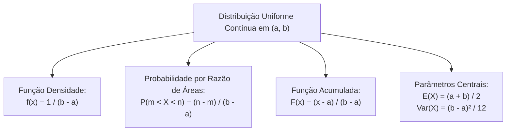

A distribuição uniforme contínua é o modelo teórico fundamental para variáveis contínuas em que todos os subintervalos de mesmo comprimento possuem densidade idêntica. Todos os pontos de um mesmo intervalo apresentam a mesma concentração de probabilidade teórica. O cálculo geométrico por áreas de retângulos torna este conteúdo recorrente nas provas. Compreender suas propriedades assegura pontos decisivos na classificação final.

> [!objetivos]
> - Compreender a função densidade de probabilidade retangular da distribuição uniforme.
> - Calcular probabilidades de subintervalos pela razão entre comprimentos geométricos.
> - Determinar a função de distribuição acumulada nos limites da variável contínua.
> - Aplicar as fórmulas canônicas da esperança matemática e da variância da distribuição uniforme.
> - Recuperar os limites do intervalo a partir de dados amostrais de média e variância.

## Função Densidade de Probabilidade

Na distribuição uniforme contínua, a densidade é constante no intervalo entre a e b. Fora desse intervalo, ela se anula. A função densidade de probabilidade assume a seguinte forma analítica:

f(x) = k, para todo x situado entre os limites a e b, com f(x) = 0 para valores externos ao intervalo.

A área total sob a curva de densidade equivale a 1. Esse valor representa todo o espaço amostral. O gráfico forma um retângulo com base (b - a) e altura k. A área é o produto da base pela altura:

(b - a) × k = 1, o que resulta diretamente em:

k = 1 / (b - a).

Assim, os únicos parâmetros da distribuição uniforme são os extremos a e b. Ao conhecer esses extremos, o aluno acha a altura da densidade de imediato.

```mermaid Representação geométrica da função densidade uniforme retangular
flowchart TD
    EXT["Limites do Intervalo: a e b"] --> BASE["Base do Retângulo: (b - a)"]
    BASE --> ALT["Altura Constante: k = 1 / (b - a)"]
    ALT --> AREA["Área Total: Base x Altura = 1"]
    AREA --> PROB["Probabilidade no Subintervalo: Área = (n - m) / (b - a)"]
```

> [!pegadinha]
> O valor da função densidade k não representa uma probabilidade pontual. Em intervalos estreitos com comprimento inferior a uma unidade, o valor de k pode ser superior a 1. A probabilidade em variáveis contínuas corresponde sempre à área geométrica sob a curva no intervalo considerado, nunca ao valor pontual da ordenada.

## Cálculo de Probabilidades por Razão Geométrica

A probabilidade de a variável aleatória contínua X assumir um valor situado no subintervalo entre m e n, com m e n situados entre a e b, é calculada pela área do retângulo compreendido entre essas duas abscissas:

P(m < X < n) = (n - m) × k = (n - m) / (b - a).

Essa relação expressa uma regra intuitiva. A probabilidade é a razão entre o trecho pedido e o suporte total da variável.

| Intervalo de Interesse | Fórmula de Cálculo da Probabilidade | Interpretação Geométrica |
|---|---|---|
| P(m < X < n) | (n - m) / (b - a) | Razão do segmento intermediário pelo comprimento total |
| P(X > c) | (b - c) / (b - a) | Comprimento da cauda superior até o limite b |
| P(X < c) | (c - a) / (b - a) | Comprimento da cauda inferior a partir do limite a |
| P(X = c) | Igual a 0 | Ponto isolado possui base nula e área zero |

Em variáveis contínuas, a probabilidade em um ponto isolado é zero. Por essa razão, os sinais de menor ou menor ou igual geram o mesmo valor:

P(m < X < n) = P(m <= X < n) = P(m < X <= n) = P(m <= X <= n).

> [!exemplo]
> Uma viatura de patrulhamento da Polícia Militar realiza rondas com tempo de resposta distribuído uniformemente entre 10 e 30 minutos. O comprimento total do intervalo é 30 - 10 = 20 minutos. A probabilidade de o atendimento ocorrer em menos de 18 minutos é dada por (18 - 10) / (30 - 10) = 8 / 20 = 0,40, o que equivale a 40% de probabilidade.


> [!resolvido]
> Uma variável aleatória contínua X segue distribuição uniforme no intervalo entre 2 e 10. Determine a esperança de X, a variância e a probabilidade de X assumir valores entre 4 e 7.
>
> **Passo 1: Identificação dos extremos.**
> Os limites do suporte são a = 2 e b = 10. O comprimento total é 10 - 2 = 8.
>
> **Passo 2: Cálculo da média.**
> A esperança é o ponto médio do intervalo.
> E(X) = (2 + 10) / 2 = 6.
>
> **Passo 3: Cálculo da variância.**
> Aplicamos a fórmula com divisor 12.
> Var(X) = (10 - 2)² / 12 = 64 / 12 = 16 / 3, que equivale a 5,33.
>
> **Passo 4: Cálculo da probabilidade.**
> O comprimento do trecho pedido é 7 - 4 = 3.
> P(4 < X < 7) = 3 / 8 = 0,375, ou seja, 37,5%.

## Função de Distribuição Acumulada

A função de distribuição acumulada F(x) fornece a probabilidade acumulada de a variável X assumir valores menores ou iguais a uma abscissa x qualquer:

F(x) = P(X <= x).

Para a distribuição uniforme contínua com parâmetros a e b, a função acumulada F(x) apresenta o seguinte comportamento em três trechos:

1. F(x) = 0, para todo x menor ou igual ao limite inferior a.
2. F(x) = (x - a) / (b - a), para qualquer valor de x situado entre os limites a e b.
3. F(x) = 1, para todo x maior ou igual ao limite superior b.

```mermaid Curva da função de distribuição acumulada da distribuição uniforme
flowchart LR
    A1["x ≤ a\nF(x) = 0"] --> B1["a < x < b\nF(x) cresce linearmente de 0 a 1\nF(x) = (x - a) / (b - a)"]
    B1 --> C1["x ≥ b\nF(x) = 1"]
```

O crescimento da função acumulada entre a e b é rigorosamente linear. A inclinação da reta acumulada corresponde exatamente à altura k da função densidade de probabilidade.

## Esperança Matemática e Variância

Os dois momentos centrais mais importantes da distribuição uniforme contínua decorrem diretamente da simetria do retângulo:

- **Esperança Matemática (Média)**: situa-se exatamente no ponto médio do intervalo. A fórmula analítica da média é expressa por: E(X) = (a + b) / 2.
- **Variância**: expressa a dispersão dos valores ao redor da média central. A fórmula da variância da distribuição uniforme contínua é dada por: Var(X) = (b - a)² / 12.

O desvio padrão da distribuição é obtido extraindo-se a raiz quadrada aritmética da variância, resultando em (b - a) dividido pela raiz quadrada de 12.

| Parâmetro Estatístico | Expressão Algébrica | Exemplo para Intervalo de 4 a 16 |
|---|---|---|
| Esperança E(X) | (a + b) / 2 | (4 + 16) / 2 = 10 |
| Variância Var(X) | (b - a)² / 12 | (16 - 4)² / 12 = 144 / 12 = 12 |
| Desvio Padrão DP(X) | Raiz quadrada de Var(X) | Raiz de 12 = 2 vezes raiz de 3 |

> [!bizu]
> Grave com precisão o denominador da variância da distribuição uniforme contínua: o divisor é sempre 12. As bancas de concurso tentam induzir o candidato ao erro colocando denominadores falsos nas alternativas, como 2, 4 ou 6.

Quando a questão do certame informa previamente os valores da média e da variância e solicita a identificação dos limites a e b, o candidato resolve um sistema simples de equações:

1. Da média temos: a + b = 2 × a média.
2. Da variância temos: (b - a)² = 12 × a variância, logo: b - a = raiz quadrada de (12 × a variância).
3. Somando as duas expressões, obtém-se o valor de 2b, determinando b. Subtraindo as expressões, determina-se o valor de a.

A distribuição uniforme contínua possui uma particularidade teórica relevante: ao contrário da distribuição normal, exponencial e gama, a distribuição uniforme não pertence à família exponencial de distribuições.

## Mapa do capítulo



### Para fixar

- A distribuição uniforme contínua possui densidade constante f(x) = 1 / (b - a) entre os extremos a e b.
- A probabilidade em qualquer subintervalo é calculada pela razão entre o comprimento do subintervalo e o comprimento total (b - a).
- A probabilidade pontual P(X = c) em qualquer distribuição contínua é rigorosamente igual a zero.
- Os operadores de desigualdade estrita (<) ou ampla (<=) resultam em probabilidades idênticas em variáveis contínuas.
- A função de distribuição acumulada cresce linearmente de 0 até 1 entre os limites a e b da distribuição.
- A esperança matemática ou média da distribuição uniforme situa-se no ponto médio do suporte: E(X) = (a + b) / 2.
- A variância da distribuição uniforme contínua é calculada exclusivamente por Var(X) = (b - a)² / 12.
- Conhecendo média e variância, os extremos a e b são determinados pelo sistema formado por a + b = 2m e b - a = raiz de (12V).
