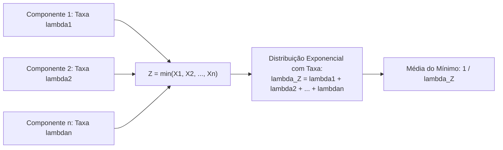

A distribuição exponencial modela o tempo transcorrido até a ocorrência de um evento aleatório contínuo quando a taxa média de manifestação permanece constante no tempo. Na atividade policial e de bombeiro militar, este modelo descreve o intervalo entre chamadas de emergência, a vida útil de equipamentos operacionais e o tempo de resposta em operações de socorro.

> [!objetivos]
> - Compreender a função densidade de probabilidade e o parâmetro de taxa da distribuição exponencial.
> - Calcular probabilidades de sobrevivência e falha por meio da função exponencial decrescente.
> - Determinar a média, a variância e o coeficiente de variação unitário do modelo exponencial.
> - Aplicar a propriedade de falta de memória no cálculo de probabilidades condicionadas.
> - Analisar a distribuição do tempo mínimo entre múltiplas variáveis exponenciais independentes.

## Função Densidade de Probabilidade e Parâmetros

Uma variável aleatória contínua X segue distribuição exponencial com parâmetro de taxa λ maior que zero quando sua função densidade de probabilidade assume a seguinte lei matemática:

f(x) = λ × e^(-λ × x), para todo x maior ou igual a zero, com f(x) = 0 para valores negativos de x.

O símbolo e representa a base dos logaritmos naturais, cujo valor aproximado é 2,718. Como a grandeza tempo não assume valores negativos no mundo físico, a densidade de probabilidade concentra-se exclusivamente no semi-eixo positivo. O gráfico da densidade exponencial é estritamente decrescente. O ponto de maior altura ocorre exatamente em x = 0, no qual f(0) = λ. A partir daí, a curva declina suavemente em direção ao infinito positivo.

O parâmetro λ expressa a taxa de ocorrência de eventos por unidade temporal. Se uma viatura de resgate atende, em média, uma ocorrência a cada quatro horas, a taxa λ equivale a 1/4 = 0,25 ocorrência por hora. A distribuição fica integralmente definida por este único parâmetro.

```mermaid Curva decrescente da função densidade de probabilidade exponencial
flowchart LR
    P0["x = 0\nDensidade Máxima: f(0) = λ"] --> P1["x > 0\nQueda Exponencial Contínua:\nf(x) = λ . exp(-λ . x)"]
    P1 --> PINF["x -> infinito\nDensidade tende assintoticamente a zero"]
```

Algumas bancas de concurso parametrizam o modelo pela escala beta, definida pelo inverso da taxa, de modo que beta = 1 / λ. Sob essa notação alternativa, a densidade é expressa por:

f(x) = (1 / beta) × e^(-x / beta), para x maior ou igual a zero.

Nessa formulação por escala, o parâmetro beta possui a mesma unidade física da variável e coincide numericamente com a média aritmética da distribuição. O candidato deve identificar com cuidado qual das duas convenções é adotada no enunciado da questão.

## Cálculo de Probabilidades e Função Acumulada

A integração da função densidade no intervalo entre 0 e x fornece a função de distribuição acumulada F(x). Esta função mede a probabilidade de o evento ocorrer antes ou até o instante x:

F(x) = P(X <= x) = 1 - e^(-λ × x), para x maior ou igual a zero.

Por sua vez, a probabilidade de o evento não ocorrer até o instante x, ou seja, de a variável superar o patamar temporal x, é chamada de função de sobrevivência ou confiabilidade:

R(x) = P(X > x) = 1 - F(x) = e^(-λ × x).

| Probabilidade Desejada | Expressão Algébrica Fechada | Significado Prático |
|---|---|---|
| P(X <= x) ou P(X < x) | 1 - e^(-λ × x) | Probabilidade de o evento ocorrer até o instante x |
| P(X > x) ou P(X >= x) | e^(-λ × x) | Confiabilidade de o sistema sobreviver além de x |
| P(a < X < b) | e^(-λ × a) - e^(-λ × b) | Probabilidade de o evento ocorrer na janela entre a e b |

Na fórmula de probabilidade entre dois limites, o termo e^(-λ × a) antecede o termo e^(-λ × b). Essa ordem ocorre porque a função e^(-y) é decrescente. Para a menor do que b, a quantidade e^(-λ × a) é maior do que e^(-λ × b), assegurando resultado estritamente positivo.

> [!pegadinha]
> O parâmetro de taxa λ e o tempo x devem estar rigorosamente na mesma unidade de medida temporal. Se a taxa de chamadas for informada por hora e a pergunta exigir a probabilidade para um intervalo de quinze minutos, o candidato deve converter quinze minutos para 0,25 hora antes de aplicar o expoente. Esquecer essa conversão de unidades gera erro grosseiro nas contas.

## Esperança Matemática, Variância e Dispersão

As propriedades de dispersão e tendência central da distribuição exponencial apresentam uma relação direta com o parâmetro de taxa:

- **Esperança Matemática (Média)**: expressa o tempo médio de espera até a ocorrência do primeiro evento. É dada pelo inverso da taxa: E(X) = 1 / λ.
- **Variância**: mede a dispersão quadrática em torno da média de espera. É calculada pelo inverso do quadrado da taxa: Var(X) = 1 / λ^2.
- **Desvio Padrão**: extraindo a raiz quadrada da variância, obtém-se exatamente o mesmo valor da média: DP(X) = 1 / λ.
- **Coeficiente de Variação**: o quociente entre o desvio padrão e a média resulta em um valor constante: CV = (1 / λ) / (1 / λ) = 1.

O coeficiente de variação de qualquer distribuição exponencial é sempre igual a 1, independentemente do valor assumido pelo parâmetro λ. Essa característica matemática invariante é frequentemente explorada em itens teóricos de provas de concurso.

| Medida Descritiva | Parametrização pela Taxa λ | Parametrização pela Escala beta |
|---|---|---|
| Média E(X) | 1 / λ | beta |
| Variância Var(X) | 1 / λ^2 | beta² |
| Desvio Padrão | 1 / λ | beta |
| Coeficiente de Variação | Igual a 1 | Igual a 1 |

> [!bizu]
> Na distribuição exponencial, a média e o desvio padrão são idênticos. Se uma questão de prova afirmar que uma variável exponencial tem média 20 minutos, a sua variância será obrigatoriamente 20 ao quadrado = 400 minutos ao quadrado, e o seu desvio padrão será 20 minutos.

## Relação entre o Processo de Poisson e a Distribuição Exponencial

Existe uma ligação teórica profunda entre a distribuição discreta de Poisson e a distribuição contínua exponencial. Ambos os modelos descrevem as duas faces de um mesmo processo estocástico homogêneo:

1. A distribuição de Poisson quantifica o número discreto de eventos que acontecem dentro de um intervalo fixo de tempo.
2. A distribuição exponencial mede a extensão contínua do tempo transcorrido entre dois eventos sucessivos de Poisson.

Se os chamados para uma central de emergência do Corpo de Bombeiros ocorrem segundo um processo de Poisson com taxa média de três chamadas por hora, o tempo de espera entre chamadas consecutivas segue distribuição exponencial com o mesmo parâmetro λ = 3 chamadas por hora. A espera média entre duas ocorrências consecutivas é de E(X) = 1/3 de hora, o que corresponde a vinte minutos.

```mermaid Dualidade conceitual entre os processos de Poisson e Exponencial
flowchart TD
    PROC["Processo Estocástico com Taxa Constante λ"] --> POISS["Distribuição de Poisson\n(Variável Discreta N)\nConta o número de eventos em tempo fixo"]
    PROC --> EXPON["Distribuição Exponencial\n(Variável Contínua T)\nMede o tempo contínuo entre dois eventos"]
    POISS --> REL["Média de Poisson = λ . t"]
    EXPON --> REL2["Média da Exponencial = 1 / λ"]
```

Essa dualidade matemática permite transitar livremente entre a contagem de sinistros e a previsão de intervalos temporais de prontidão das guarnições operacionais.

## Propriedades Fundamentais: Falta de Memória e Mínimo de Exponenciais

A distribuição exponencial destaca-se por propriedades analíticas únicas que simplificam a modelagem de filas e a teoria da confiabilidade:

### Propriedade de Falta de Memória

A distribuição exponencial é a única distribuição contínua que não possui memória temporal. Essa propriedade afirma que a probabilidade condicional de o evento ocorrer após um tempo adicional t, dado que já se passaram s unidades de tempo sem ocorrência, depende apenas do tempo suplementar t:

P(X > s + t | X > s) = P(X > t) = e^(-λ × t).

Em termos práticos, um componente eletrônico cuja vida útil segue modelo exponencial que já operou durante cinco anos sem queimar possui exatamente a mesma chance de sobreviver por mais dois anos do que um componente novo saído de fábrica. O sistema não envelhece por desgaste acumulado no modelo exponencial; as falhas ocorrem por choques aleatórios externos imprevisíveis.

> [!pegadinha]
> Na aplicação da falta de memória em questões de prova, o candidato deve calcular a probabilidade considerando apenas o tempo excedente pedido. O tempo que a vítima ou o aparelho já esperou no passado deve ser completamente desconsiderado no expoente da fórmula condicional.

### Mínimo de Exponenciais Independentes

Considere n variáveis aleatórias exponenciais independentes X1, X2 até Xn, com taxas respectivas lambda1, lambda2 até lambdan. A variável aleatória Z, definida pelo tempo até a primeira falha do grupo, representa o mínimo entre essas variáveis:

Z = min(X1, X2, ..., Xn).

A teoria estatística demonstra que Z também segue distribuição exponencial. A taxa resultante do mínimo equivale à soma direta das taxas individuais:

lambda_Z = lambda1 + lambda2 + ... + lambdan.

A esperança matemática do tempo mínimo é dada por E(Z) = 1 / (lambda1 + lambda2 + ... + lambdan). Essa propriedade reflete o princípio intuitivo de que, quanto maior for o número de dispositivos independentes em funcionamento simultâneo, menor será o tempo de espera até que o primeiro deles apresente pane.



### Mudança de Escala Linear

Se a variável X possui distribuição exponencial com parâmetro λ e multiplicamos essa variável por uma constante positiva c, a nova variável Y = c × X mantém a distribuição exponencial. O seu novo parâmetro de taxa é ajustado para λ / c, multiplicando a sua média original pelo fator c.

> [!exemplo]
> Um sistema de monitoramento de alarmes possui dois sensores autônomos e independentes. O tempo de falha do sensor A segue exponencial com média de 100 horas (taxa lambda_A = 0,01). O sensor B segue exponencial com média de 50 horas (taxa lambda_B = 0,02). O tempo até que o primeiro sensor falhe segue exponencial com taxa somada lambda_Z = 0,01 + 0,02 = 0,03 falha por hora. O tempo médio até a primeira falha é 1 / 0,03 = 100 / 3, aproximadamente 33,33 horas.

## Exercício Resolvido de Concurso

> [!resolvido]
> Em uma central de radiopatrulha da Polícia Militar, o tempo de atendimento telefônico de ocorrências de emergência segue distribuição exponencial com média de 5 minutos.
>
> **Item A**: Qual é a taxa λ de atendimento por minuto?
> Como a média E(X) = 1 / λ = 5 minutos, a taxa de atendimento é dada pelo inverso da média: λ = 1 / 5 = 0,20 chamada por minuto.
>
> **Item B**: Calcule a probabilidade de um atendimento demorar mais de 10 minutos.
> Aplicando a função de sobrevivência P(X > 10):
> P(X > 10) = e^(-λ × 10) = e^(-0,20 × 10) = e^(-2).
> Sabendo que e^(-2) equivale a aproximadamente 0,135, a probabilidade é de 13,5%.
>
> **Item C**: Se uma chamada já está em andamento há 8 minutos, qual é a probabilidade de ela durar pelo menos mais 5 minutos adicionais?
> Pela propriedade de falta de memória, o tempo já decorrido de 8 minutos não afeta o futuro:
> P(X > 8 + 5 | X > 8) = P(X > 5) = e^(-0,20 × 5) = e^(-1).
> Como e^(-1) equivale a aproximadamente 0,368, a probabilidade é de 36,8%.

## Sistemas Redundantes, Aplicações Práticas e Confiabilidade

Na engenharia de segurança contra incêndio, equipamentos vitais utilizam circuitos redundantes em paralelo para assegurar elevada confiabilidade. O modelo exponencial aplica-se amplamente na física e nas ciências biológicas. Ele descreve o tempo de decaimento radioativo de átomos instáveis, o ciclo de vida de uma lâmpada em um posto de bombeiros e a sobrevida celular em um organismo vivo.

No planejamento de comunicações para prestar assistência rápida em desastres públicos, os transmissores de rádio operam em regime ininterrupto. Em um sistema com n geradores de emergência independentes, o serviço permanece operacional enquanto pelo menos uma unidade continuar funcionando. Esse arranjo impede a paralisação do posto de comando militar em momentos de crise severa.

O sistema só entra em colapso total se todas as unidades falharem simultaneamente. Como as falhas são eventos independentes, a probabilidade de falha conjunta até o instante t equivale ao produto das probabilidades individuais de falha:

F_sistema(t) = F1(t) vezes F2(t) vezes ... vezes Fn(t).

Substituindo a função de distribuição acumulada da distribuição exponencial, a probabilidade de colapso total assume a forma analítica:

F_sistema(t) = [1 - e^(-λ × t)]^n.

A confiabilidade global do sistema redundante no instante t corresponde ao complemento dessa probabilidade:

R_sistema(t) = 1 - F_sistema(t) = 1 - [1 - e^(-λ × t)]^n.

Essa arquitetura de circuitos em paralelo eleva a segurança das comunicações na corporação militar. Mesmo que um gerador queime, os demais continuam operantes para prestar assistência contínua à sociedade.

## Mapa do capítulo

```mermaid Síntese estrutural da distribuição exponencial e suas propriedades
flowchart TD
    EXP["Distribuição Exponencial com Taxa λ"] --> FDP["Função Densidade:\nf(x) = λ . e^(-λ . x)"]
    EXP --> SOBR["Confiabilidade e Sobrevivência:\nP(X > x) = e^(-λ . x)"]
    EXP --> ACUM["Função Acumulada:\nP(X ≤ x) = 1 - e^(-λ . x)"]
    EXP --> PROP["Propriedades Críticas:\nMédia = 1/λ | Variância = 1/λ^2 | CV = 1\nFalta de Memória | Mínimo com Taxa Somada"]
```

### Para fixar

- A distribuição exponencial é o modelo contínuo padrão para tempos de espera e intervalos até a ocorrência de falhas.
- O parâmetro λ expressa a taxa de ocorrência por unidade de tempo e define integralmente a densidade f(x) = λ . exp(-λ . x).
- A probabilidade de sobrevivência além de um instante x é dada pela função e^(-λ . x).
- A função de distribuição acumulada que mede a probabilidade até x é dada por 1 - e^(-λ . x).
- A esperança matemática é o inverso da taxa (1 / λ) e o desvio padrão também equivale a 1 / λ.
- O coeficiente de variação de qualquer variável exponencial é rigorosamente igual a 1.
- A distribuição exponencial é a contrapartida contínua da distribuição discreta de Poisson com a mesma taxa λ.
- A falta de memória assegura que P(X > s + t | X > s) = P(X > t), dependendo exclusivamente do tempo adicional t.
- O mínimo entre variáveis exponenciais independentes é exponencial com parâmetro igual à soma das taxas individuais.
