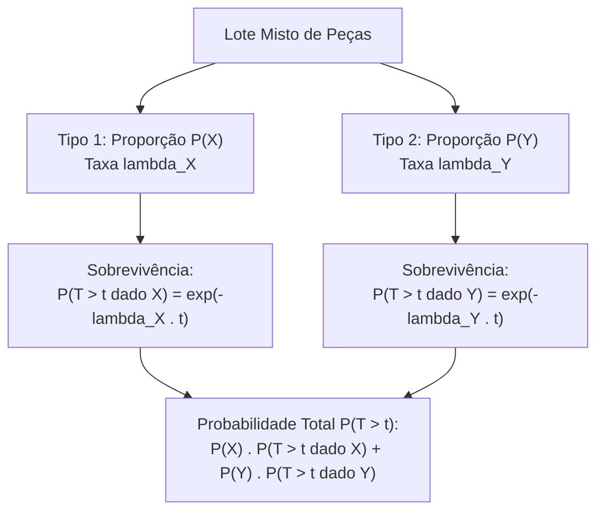

A modelagem de sistemas complexos de engenharia e operações militares frequentemente envolve combinações de múltiplas variáveis exponenciais com taxas distintas. O domínio da probabilidade total aplicada a lotes heterogêneos e o reconhecimento das famílias contínuas derivadas, como as distribuições gama, Erlang, Laplace e Weibull, constituem tópicos teóricos relevantes nas provas de concurso.

> [!objetivos]
> - Aplicar o Teorema da Probabilidade Total a misturas heterogêneas de variáveis exponenciais.
> - Compreender a distribuição gama e a distribuição de Erlang como soma de exponenciais.
> - Diferenciar os regimes hipoexponencial e hiperexponencial pelo coeficiente de variação.
> - Identificar a distribuição de Laplace como a diferença entre duas variáveis exponenciais independentes.
> - Reconhecer as características fundamentais das distribuições Weibull e beta.

## Mistura de Exponenciais e Probabilidade Total

Em cenários reais de logística militar, lotes de materiais reúnem componentes procedentes de fabricantes distintos. Cada fabricante fornece peças com taxas de falha particulares. Quando um componente é sorteado ao acaso desse lote misto, sua vida útil não segue um modelo exponencial puro.

A probabilidade de um evento A ocorrer é calculada pela média ponderada das probabilidades condicionadas de cada grupo, em estrita obediência ao Teorema da Probabilidade Total:

P(A) = P(A dado Tipo 1) × P(Tipo 1) + P(A dado Tipo 2) × P(Tipo 2).

Cada probabilidade condicional é calculada com base na distribuição exponencial do respectivo grupo. Utiliza-se a função de confiabilidade P(T > t) = e^(-λ × t) para eventos de sobrevivência e P(T < t) = 1 - e^(-λ × t) para ocorrência de falhas. A taxa λ de cada fabricante é obtida invertendo-se a sua média de vida útil: λ = 1 / média.



Se o enunciado apresentar as quantidades físicas de cada item em vez de porcentagens prévias, o candidato deve calcular as proporções dividindo a contagem parcial pelo total de elementos do lote.

> [!bizu]
> Na resolução de questões de probabilidade total com exponenciais, a ordem de cálculo é padronizada: primeiro determine as proporções de cada tipo; depois converta as médias em taxas λ; em seguida aplique a fórmula de probabilidade condicional para cada fabricante; por fim, some os produtos ponderados.


Considere uma remessa com 1000 objetos técnicos inspecionados pelo batalhão. Desses, 700 objetos são peças mecânicas com durabilidade média de 1400 horas, enquanto os 300 restantes são circuitos elétricos. Ao selecionar um único objeto ao acaso, mesmo que ambos sigam leis exponenciais, a mistura exige o cálculo ponderado da probabilidade. Esse mesmo raciocínio aplica-se quando se analisam cópias de segurança em servidores militares.

## A Distribuição Gama e a Soma de Exponenciais: Modelo de Erlang

A distribuição gama é uma família flexível de variáveis aleatórias contínuas definidas no semi-eixo positivo. Ela possui dois parâmetros fundamentais: o parâmetro de forma alfa maior que zero e o parâmetro de taxa beta maior que zero.

A média e a variância da distribuição gama dependem diretamente desses parâmetros:

- **Esperança E(X)**: alfa dividido por beta.
- **Variância Var(X)**: alfa dividido pelo quadrado de beta.

A distribuição exponencial nada mais é do que um caso especial da distribuição gama quando o parâmetro de forma alfa é fixado em 1. Substituindo alfa = 1 e beta = λ, reencontram-se a média 1 / λ e a variância 1 / λ^2.

Quando somamos n variáveis aleatórias exponenciais independentes e identicamente distribuídas, todas com a mesma taxa λ, a soma resultante segue uma distribuição de Erlang com parâmetros alfa = n e beta = λ. A distribuição de Erlang é a distribuição gama restrita a valores inteiros de alfa.

| Modelo Estatístico | Parâmetro de Forma | Parâmetro de Taxa | Média E(X) | Variância Var(X) | Coeficiente de Variação |
|---|---|---|---|---|---|
| Exponencial | alfa = 1 | beta = λ | 1 / λ | 1 / λ^2 | CV = 1 |
| Erlang (n parcelas) | alfa = n (inteiro) | beta = λ | n / λ | n / λ^2 | CV = 1 / √n < 1 |
| Gama Geral | alfa > 0 (real) | beta > 0 | alfa / beta | alfa / beta² | CV = 1 / √alfa |

A distribuição de Erlang também é denominada **hipoexponencial**. Essa denominação reflete o fato de o seu coeficiente de variação ser estritamente inferior a 1. Na exponencial simples, o desvio padrão iguala-se à média. Na soma de Erlang, o desvio padrão cresce com a raiz de n, enquanto a média cresce linearmente com n, tornando a dispersão relativa menor.

Em contrapartida, a mistura aleatória ponderada de diferentes exponenciais gera a distribuição **hiperexponencial**. Na hiperexponencial, a variabilidade conjunta entre populações distintas eleva a dispersão, fazendo com que o coeficiente de variação seja estritamente superior a 1.

```mermaid Relação entre os modelos exponencial, Erlang, gama e hiperexponencial
flowchart LR
    EXP["Exponencial (alfa = 1)\nCV = 1"] --> SOMA["Soma de n Exponenciais:\nErlang (Hipoexponencial)\nCV < 1"]
    SOMA --> GAMA["Gama Geral (alfa real)\nCV flexível"]
    EXP --> MIST["Mistura Ponderada de Populações:\nHiperexponencial\nCV > 1"]
```

## Diferença de Exponenciais Independentes: A Distribuição de Laplace

Ao subtrair duas variáveis aleatórias exponenciais independentes X1 e X2, com taxas respectivas lambda1 e lambda2, a nova variável Y = X1 - X2 pode assumir tanto valores positivos quanto valores negativos. Essa diferença não segue distribuição exponencial, mas sim a **distribuição de Laplace**, também conhecida como distribuição exponencial dupla.

As propriedades centrais da variável Y revelam a operação linear dos momentos:

- **Esperança E(Y)**: subtração das médias individuais, dada por 1 / lambda1 - 1 / lambda2.
- **Variância Var(Y)**: soma obrigatória das variâncias individuais, resultando em 1 / lambda1² + 1 / lambda2².

A variância de variáveis independentes é sempre somada, mesmo quando se calcula a diferença entre elas. A subtração de variáveis amplia a incerteza do sistema, nunca a reduz.

Quando as duas variáveis exponenciais possuem a mesma taxa λ, a distribuição de Laplace resultante é perfeitamente simétrica ao redor do ponto zero. O seu gráfico apresenta formato em tenda, com pico pontiagudo na média zero e caudas que decaem exponencialmente de forma mais lenta do que a distribuição normal.

> [!pegadinha]
> Em provas de concurso, a banca pode afirmar corretamente o valor da variância da diferença entre duas variáveis exponenciais, mas rotular erroneamente a nova variável como sendo exponencial. Lembre-se: a variável exponencial só admite valores positivos. A diferença X1 - X2 assume valores negativos e segue rigorosamente a distribuição de Laplace.

## Distribuições Weibull e Beta

Outras duas distribuições contínuas conectam-se analiticamente ao modelo exponencial e merecem atenção em provas técnicas:

### Distribuição Weibull

A distribuição de Weibull modela tempos de falha em materiais sujeitos a fadiga, desgaste mecânico ou queima inicial de componentes. Ela possui dois parâmetros: a forma k e a escala λ. Sua função de distribuição acumulada é expressa por:

F(x) = 1 - e^(-(x / λ)^k), para x maior ou igual a zero.

Quando o parâmetro de forma k assume valor igual a 1, a função de Weibull reduz-se exatamente à distribuição exponencial simples. Para valores de k superiores a 1, o modelo reflete peças que sofrem desgaste pelo tempo, perdendo a falta de memória.

### Distribuição Beta

A distribuição beta é uma família contínua definida restritamente no intervalo unitário entre 0 e 1. Ela é empregada para modelar proporções, porcentagens e probabilidades a priori na inferência bayesiana.

A densidade beta depende de dois parâmetros positivos alfa e beta. A esperança matemática da distribuição beta situa-se entre 0 e 1, sendo calculada de maneira direta pela seguinte fração:

E(X) = alfa / (alfa + beta).

Tanto a distribuição de Weibull quanto a distribuição beta integram a chamada família exponencial de distribuições, compartilhando propriedades de suficiência estatística com as distribuições normal e gama.

## Exercício Resolvido de Concurso

> [!resolvido]
> O almoxarifado de um batalhão militar recebeu um lote de 100 baterias para radiotransmissores. Sabe-se que 60 baterias são do Lote Alpha, cuja vida útil segue distribuição exponencial com média de 20 horas. As 40 baterias restantes pertencem ao Lote Bravo, com vida útil exponencial e média de 10 horas. Uma bateria é sorteada ao acaso desse lote.
>
> **Item A**: Determine as taxas λ de cada lote.
> Para o Lote Alpha, a taxa é lambda_A = 1 / 20 = 0,05 por hora. Para o Lote Bravo, a taxa é lambda_B = 1 / 10 = 0,10 por hora.
>
> **Item B**: Determine a probabilidade de a bateria sorteada durar mais de 20 horas.
> Aplicamos o Teorema da Probabilidade Total:
> As proporções são P(Alpha) = 60 / 100 = 0,60 e P(Bravo) = 40 / 100 = 0,40.
> Calculamos a probabilidade de durar mais de 20 horas em cada tipo:
> P(T > 20 dado Alpha) = e^(-0,05 × 20) = e^(-1) aproximadamente 0,368.
> P(T > 20 dado Bravo) = e^(-0,10 × 20) = e^(-2) aproximadamente 0,135.
> Ponderando os valores:
> P(T > 20) = 0,60 × 0,368 + 0,40 × 0,135 = 0,2208 + 0,0540 = 0,2748.
> A probabilidade total é de aproximadamente 27,48%.

## Mapa do capítulo

```mermaid Síntese estrutural das relações entre a distribuição exponencial e outras famílias
flowchart TD
    EXP["Distribuição Exponencial"] --> MIST["Mistura de Lotes:\nProbabilidade Total Ponderada"]
    EXP --> SOMA["Soma de n Exponenciais:\nDistribuição de Erlang (Hipoexponencial, CV < 1)"]
    EXP --> DIF["Diferença de Exponenciais:\nDistribuição de Laplace (Simétrica se lambdas iguais)"]
    EXP --> GEN["Generalizações:\nGama (alfa real) | Weibull (com k=1 vira exponencial) | Beta em (0, 1)"]
```

### Para fixar

- A mistura de componentes exponenciais é calculada pelo Teorema da Probabilidade Total ponderando as proporções dos grupos.
- Na probabilidade total, a taxa λ de cada grupo é obtida pelo inverso da média específica de vida útil.
- A distribuição gama possui esperança alfa / beta e variância alfa / beta ao quadrado.
- A distribuição exponencial é um caso particular da gama com alfa = 1 e beta = λ.
- A soma de n exponenciais independentes com taxa λ segue a distribuição de Erlang, com alfa = n e coeficiente de variação menor que 1.
- A diferença entre duas variáveis exponenciais independentes segue a distribuição de Laplace, admitindo valores positivos e negativos.
- A variância da diferença entre variáveis independentes é sempre igual à soma das variâncias individuais.
- A distribuição de Weibull reduz-se à exponencial quando o parâmetro de forma k é igual a 1.
- A distribuição beta é definida no intervalo unitário de 0 a 1 e possui esperança calculada por alfa / (alfa + beta).
