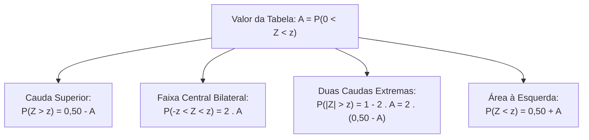
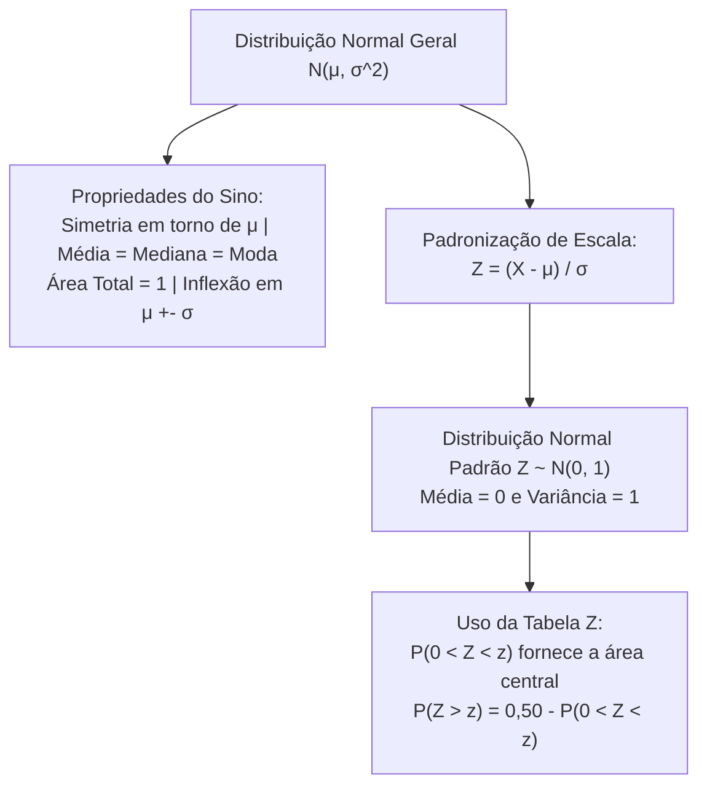

A distribuição normal, também denominada distribuição gaussiana, representa o modelo de probabilidade contínuo mais célebre e aplicado em toda a ciência estatística. Nos concursos públicos de diversas áreas, o conhecimento da curva em formato de sino, suas simetrias axiais e o manuseio da tabela da normal padrão Z são exigidos sistematicamente nas provas.

> [!objetivos]
> - Compreender a geometria da curva normal e o papel dos parâmetros média e variância.
> - Reconhecer as propriedades de simetria e os pontos de inflexão a um desvio padrão da média.
> - Identificar a distribuição normal padrão Z com média zero e variância unitária.
> - Consultar e interpretar a tabela estatística de áreas da normal padronizada.
> - Calcular probabilidades de caudas unilaterais, bilaterais e intervalos centrais simétricos.

## Características Estruturais da Curva Normal

A variável aleatória contínua X segue distribuição normal com média μ e variância σ ao quadrado, denotada simbolicamente por X ~ N(μ, σ^2), quando sua densidade estende-se ao longo de toda a reta real, de menos infinito até mais infinito. A curva teórica exibe uma silhueta contínua em formato de sino com as seguintes propriedades universais:

- **Simetria Axial**: o gráfico é rigorosamente simétrico em torno da média vertical μ. Essa simetria acarreta a coincidência exata das três medidas de tendência central: média = mediana = moda = μ. O ponto de altura máxima da ordenada situa-se precisamente sobre a média.
- **Parâmetro de Posição (μ)**: a média governa a localização horizontal do sino ao longo do eixo das abscissas. A alteração de μ apenas translada a curva para a direita ou para a esquerda, preservando sua largura e seu formato original.
- **Parâmetro de Dispersão (σ^2)**: a variância determina o grau de achatamento do sino. Variâncias elevadas produzem curvas achatadas (platicúrticas), com pico baixo e caudas volumosas. Variâncias pequenas geram curvas afiladas (leptocúrticas), com pico elevado e alta concentração de probabilidade ao redor da média.
- **Área Total Unitária**: a área geométrica total confinada sob a curva normal equivale a 1, o que representa cem por cento do espaço amostral.
- **Assíntotas Horizontais**: a curva é duplamente assintótica. Suas extremidades aproximam-se continuamente do eixo horizontal tanto para x tendendo a mais infinito quanto para x tendendo a menos infinito, sem nunca interceptar o eixo.
- **Pontos de Inflexão**: a concavidade da curva muda de sentido exatamente a uma distância de um desvio padrão σ em relação à média. Os pontos de inflexão situam-se em μ - σ e em μ + σ.

```mermaid Representação esquemática da geometria da curva normal gaussiana
flowchart TD
    CURVA["Curva Normal N(μ, σ^2)"] --> SIM["Simetria Central em torno de μ\nMédia = Mediana = Moda = μ"]
    CURVA --> INF["Pontos de Inflexão em:\nmi - σ e μ + σ"]
    CURVA --> ASS["Assintótica nas Duas Pontas:\nTende a zero sem tocar o eixo"]
    CURVA --> AREA["Área Total = 1 (100% da probabilidade)"]
    SIM --> MET["50% da área à esquerda de μ\n50% da área à direita de μ"]
```

## Consequências Fundamentais da Simetria

Como a média μ divide a distribuição em duas metades perfeitamente espelhadas, a probabilidade acumulada à esquerda da média equivale exatamente à probabilidade à direita:

P(X < μ) = P(X > μ) = 0,50 ou 50%.

Da mesma forma, regiões e intervalos equidistantes da média apresentam áreas rigorosamente idênticas:

1. **Caudas Equidistantes**: para qualquer constante positiva k, a cauda superior P(X > μ + k) possui área exatamente igual à cauda inferior P(X < μ - k).
2. **Intervalos Centrais Equidistantes**: a área compreendida entre a média e o ponto superior P(μ < X < μ + k) equivale à área entre o ponto inferior e a média P(μ - k < X < μ).

| Propriedade de Simetria | Expressão Algébrica Equivalente | Exemplo Numérico para μ = 100 e k = 15 |
|---|---|---|
| Metades Simétricas | P(X < μ) = P(X > μ) = 0,50 | P(X < 100) = P(X > 100) = 0,50 |
| Caudas Espelhadas | P(X > μ + k) = P(X < μ - k) | P(X > 115) = P(X < 85) |
| Faixas Simétricas | P(μ < X < μ + k) = P(μ - k < X < μ) | P(100 < X < 115) = P(85 < X < 100) |
| Faixa Central Dupla | P(μ - k < X < μ + k) = 2 × P(μ < X < μ + k) | P(85 < X < 115) = 2 × P(100 < X < 115) |

> [!pegadinha]
> A banca examinadora costuma afirmar em itens falsos que o aumento da variância σ ao quadrado aumenta a área sob a curva. Isso é um erro conceitual absoluto. A área total sob a curva normal é sempre igual a 1 para qualquer valor de média ou variância. O aumento da variância apenas espalha essa mesma área unitária ao longo de uma base horizontal mais larga.

## A Distribuição Normal Padrão Z

Como existem infinitas combinações possíveis de média μ e desvio padrão σ, seria inviável tabular probabilidades para cada par de parâmetros. A inferência estatística resolveu esse obstáculo criando a **distribuição normal padrão Z**, também chamada de normal reduzida.

A normal padrão Z caracteriza-se por possuir média nula e variância unitária:

Z ~ N(0, 1), com média μ = 0 e desvio padrão σ = 1.

Para transformar qualquer variável aleatória X com distribuição normal geral em uma variável na escala padronizada Z, aplica-se a fórmula canônica de padronização:

Z = (X - μ) / σ.

A grandeza Z mede a distância entre o valor X e a média populacional μ, expressa em unidades de desvios padrões σ. Um escore Z = +2,0 indica que o valor X encontra-se dois desvios padrões acima da média. Um escore Z = -1,5 indica que o valor situa-se um desvio e meio abaixo da média.

```mermaid Fluxo de padronização entre a distribuição normal geral e a escala Z
flowchart LR
    XVAR["Variável Normal X\nX ~ N(μ, σ^2)"] --> FORM["Padronização:\nZ = (X - μ) / σ"]
    FORM --> ZVAR["Normal Padrão Z\nZ ~ N(0, 1)\nMédia = 0 e Desvio Padrão = 1"]
    ZVAR --> TAB["Consulta Direta à Tabela Z"]
```

## Como Consultar a Tabela da Normal Padrão

A tabela estatística mais empregada em concursos públicos fornece a área acumulada central **P(0 < Z < z)**, correspondente à probabilidade entre o centro zero e o escore positivo z.

A leitura do escore na tabela ocorre mediante o cruzamento de duas coordenadas:

1. **Linha da Tabela**: indica a parte inteira e o primeiro dígito decimal do escore z (por exemplo, 1,9).
2. **Coluna da Tabela**: indica o segundo dígito decimal correspondente aos centésimos (por exemplo, 0,06).

O cruzamento entre a linha 1,9 e a coluna 0,06 fornece o valor 0,4750, significando que P(0 < Z < 1,96) = 0,4750.

| Escore z Padronizado | Área P(0 < Z < z) na Tabela | Cauda Superior P(Z > z) = 0,50 - Área | Faixa Central P(-z < Z < z) = 2 vezes Área |
|---|---|---|---|
| z = 1,00 | 0,3413 | 0,1587 (15,87%) | 0,6826 (68,26%) |
| z = 1,28 | 0,3997 | 0,1003 (10,03%) | 0,7994 (79,94%) |
| z = 1,64 | 0,4495 | 0,0505 (5,05%) | 0,8990 (89,90%) |
| z = 1,96 | 0,4750 | 0,0250 (2,50%) | 0,9500 (95,00%) |
| z = 2,00 | 0,4772 | 0,0228 (2,28%) | 0,9544 (95,44%) |
| z = 2,58 | 0,4951 | 0,0049 (0,49%) | 0,9902 (99,02%) |
| z = 3,00 | 0,4987 | 0,0013 (0,13%) | 0,9974 (99,74%) |

A tabela satura rapidamente conforme z ultrapassa o patamar de 3 desvios padrões. Em z = 3,00, a probabilidade central atinge 0,4987. A partir de z = 3,60, a área aproxima-se de 0,4999, alcançando 0,5000 na linha 3,90. Na prática, valores situados a mais de 3 desvios padrões da média compreendem caudas residuais insignificantes.




### Detalhamento da Cauda Superior e Saturação da Tabela

Para compreender como a curva normal se aproxima do eixo assintótico, examinamos os centésimos das linhas superiores da tabela central P(0 < Z < z):

| Escore z | Centésimo 0,00 | Centésimo 0,02 | Centésimo 0,04 | Centésimo 0,06 | Centésimo 0,08 |
|---|---|---|---|---|---|
| z = 1,2 | 0,3849 | 0,3888 | 0,3925 | 0,3962 | 0,3997 (vizinho 0,4015) |
| z = 3,0 | 0,4987 | 0,4987 | 0,4988 | 0,4989 | 0,4990 |
| z = 3,1 | 0,4990 | 0,4991 | 0,4992 | 0,4992 | 0,4993 |
| z = 3,2 | 0,4993 | 0,4994 | 0,4994 | 0,4995 | 0,4995 |
| z = 3,3 | 0,4995 | 0,4996 | 0,4996 | 0,4997 | 0,4997 |
| z = 3,4 | 0,4997 | 0,4997 | 0,4997 | 0,4998 | 0,4998 |
| z = 3,5 | 0,4998 | 0,4998 | 0,4998 | 0,4998 | 0,4998 |

Observa-se que a probabilidade central cresce de forma rápida entre z = 0 e z = 2. A partir de z = 3,0, os acréscimos tornam-se diminutos: o valor 0,4987 na linha 3,0 avança para 0,4990, atinge 0,4993 na linha 3,1 e estabiliza-se em 0,4998 na linha 3,5. Em z = 1,96 temos a área canônica 0,475 ou 0,4750.

## Operações com Probabilidades Simétricas

A partir do valor tabelado A = P(0 < Z < z), o estudante calcula qualquer intervalo de interesse na distribuição normal padrão aplicando regras aritméticas elementares:

- **Cauda Superior Unilateral**: como toda a metade direita mede 0,50, a área acima de z é dada por: P(Z > z) = 0,50 - P(0 < Z < z).
- **Cauda Inferior Negativa**: por reflexão simétrica, a cauda à esquerda de -z é idêntica à cauda à direita de +z: P(Z < -z) = P(Z > z) = 0,50 - P(0 < Z < z).
- **Intervalo Central Bilateral**: a área simétrica compreendida entre -z e +z duplica o valor tabelado: P(-z < Z < z) = P(|Z| < z) = 2 × P(0 < Z < z).
- **Duas Caudas Extremas Conjuntas**: a probabilidade de a variável afastar-se da média por mais de z desvios em qualquer sentido corresponde ao complemento do intervalo central: P(|Z| > z) = 1 - 2 × P(0 < Z < z).

> [!bizu]
> O valor crítico z = 1,96 é o mais famoso de toda a estatística. Como P(0 < Z < 1,96) = 0,4750, a faixa central P(-1,96 < Z < 1,96) encerra exatamente 2 × 0,4750 = 0,9500 (95% de confiança). As duas caudas extremas somadas encerram exatamente os 5% restantes, cabendo 2,5% para cada lado.

## Exercício Resolvido de Concurso

> [!resolvido]
> O tempo de corrida de 2400 metros no Teste de Aptidão Física (TAF) da Polícia Militar segue distribuição normal com média μ = 12 minutos e desvio padrão σ = 1,5 minuto. Um candidato é aprovado se concluir a prova em menos de 10,5 minutos. Consultando a tabela da normal padrão, sabe-se que P(0 < Z < 1,00) = 0,3413.
>
> **Passo 1: Padronização do valor limite.**
> Convertemos o tempo limite de 10,5 minutos para o escore Z:
> Z = (X - μ) / σ = (10,5 - 12) / 1,5 = -1,5 / 1,5 = -1,00.
>
> **Passo 2: Interpretação geométrica da probabilidade.**
> O evento pedido corresponde a P(X < 10,5) = P(Z < -1,00).
> Pela simetria da curva, a área à esquerda de -1,00 é idêntica à área à direita de +1,00:
> P(Z < -1,00) = P(Z > 1,00).
>
> **Passo 3: Aplicação da área complementar.**
> Como a metade direita total possui área 0,50:
> P(Z > 1,00) = 0,50 - P(0 < Z < 1,00) = 0,50 - 0,3413 = 0,1587.
>
> A probabilidade de um candidato completar a corrida em menos de 10,5 minutos é de 15,87%.

## Tabelas de Distribuição Acumulada Ampla

Alguns editais e bancas de concurso fornecem a tabela da função de distribuição acumulada ampla, indicada por Phi(z) = P(Z <= z). Essa tabela integra a área sob a curva normal desde menos infinito até o escore z desejado. Quando o valor de z é positivo, essa tabela já inclui integralmente os 0,50 da metade esquerda da distribuição gaussiana.

Nesse formato alternativo de tabela estatística, a probabilidade central entre a média zero e o ponto z é obtida subtraindo-se 0,50 do número tabelado: P(0 < Z < z) = Phi(z) - 0,50. Por exemplo, se a tabela acumulada indica Phi(1,96) = 0,9750, a área central é 0,9750 - 0,50 = 0,4750. Para escores negativos, aplica-se a relação de simetria complementar Phi(-z) = 1 - Phi(z). O candidato deve sempre examinar o cabeçalho no anexo da prova. Ele deve checar se os valores se iniciam em 0,0000 para a tabela central ou em 0,5000 para z = 0,00 na tabela acumulada ampla.

> [!exemplo]
> Em uma avaliação de desempenho físico, um policial obtém escore z = 1,50. Em uma tabela acumulada ampla, o valor indicado para z = 1,50 é 0,9332. Isso significa que 93,32% dos candidatos obtiveram rendimento inferior ou igual ao dele. Apenas 6,68% dos avaliados alcançaram marcas superiores.

## Mapa do capítulo



### Para fixar

- A distribuição normal é simétrica em torno da média μ, implicando igualdade exata entre média, mediana e moda.
- A curva é duplamente assintótica em relação ao eixo horizontal e possui área total sob a densidade igual a 1.
- Os pontos de inflexão da concavidade do sino situam-se rigorosamente em μ - σ e em μ + σ.
- A probabilidade em qualquer ponto isolado de uma variável contínua normal é estritamente igual a zero.
- A distribuição normal padrão Z possui média igual a 0 e desvio padrão igual a 1, sendo denotada por Z ~ N(0, 1).
- A transformação de qualquer normal em normal padrão opera-se pela fórmula Z = (X - μ) / σ.
- A tabela central fornece P(0 < Z < z), calculando-se a cauda superior por P(Z > z) = 0,50 - P(0 < Z < z).
- O intervalo central bilateral P(-1,96 < Z < 1,96) encerra 95% de probabilidade, restando 2,5% em cada cauda.
- A partir de z = 3,00, a área acumulada atinge 0,4987, tornando as caudas superiores a três desvios praticamente desprezíveis.
