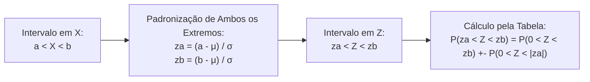
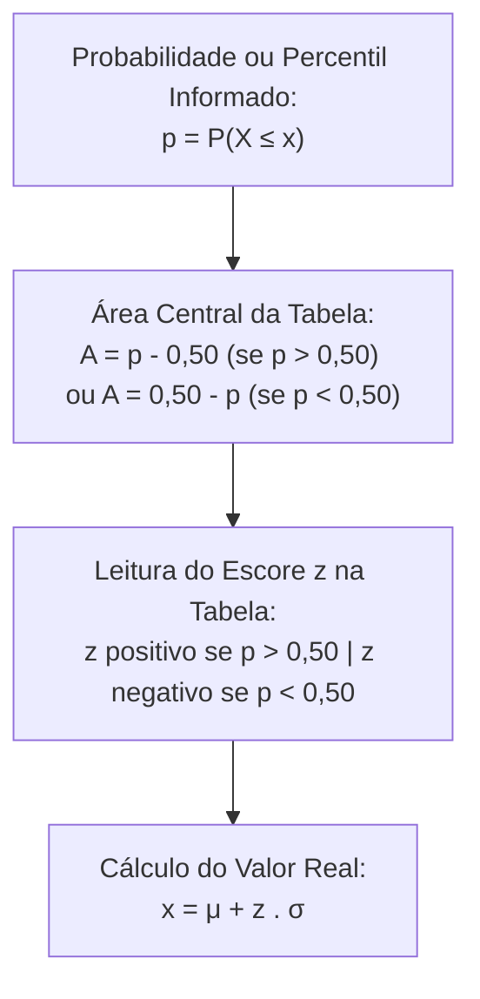

A transformação de variáveis aleatórias normais para a escala padronizada permite calcular probabilidades de qualquer distribuição gaussiana com o auxílio de uma única tabela de referência. Nos concursos, a aplicação direta da fórmula de padronização, a reversão de escores padronizados e o domínio prático da Regra Empírica constituem ferramentas operacionais indispensáveis para a resolução célere de questões analíticas.

> [!objetivos]
> - Aplicar a fórmula de padronização z = (x - μ) / σ a variáveis normais gerais.
> - Executar a operação inversa x = μ + z × σ para determinar valores de corte e percentis.
> - Compreender a Regra Empírica 68-95-99,7 nos intervalos simétricos em torno da média.
> - Calcular probabilidades de caudas laterais combinando simetria e áreas complementares.
> - Distinguir o manuseio de tabelas centrais de 0 a z e tabelas de distribuição acumulada ampla.

## A Mecânica da Padronização

Seja X uma variável aleatória contínua com distribuição normal de média μ e desvio padrão σ, indicada por X ~ N(μ, σ^2). Para qualquer valor x pertencente ao domínio real, o escore padronizado z é obtido pela subtração da média seguida da divisão pelo desvio padrão:

z = (x - μ) / σ.

A grandeza z expressa a distância geométrica entre o ponto x e a média central μ, medida na unidade fundamental de desvios padrões σ. Quando x supera a média, o escore z resulta positivo. Quando x situa-se abaixo da média, o escore z resulta negativo. Se x coincide perfeitamente com a média, z assume o valor zero.

A propriedade basilar da transformação reside na preservação rigorosa da probabilidade de intervalos equivalentes:

P(X > x) = P(Z > z), P(X < x) = P(Z < z) e P(a < X < b) = P(za < Z < zb).

Para calcular a probabilidade de uma faixa entre os limites a e b, padronizam-se ambos os extremos: za = (a - μ) / σ e zb = (b - μ) / σ.



Na combinação de áreas com a tabela central P(0 < Z < z):

1. **Extremos em Lados Opostos da Média (za < 0 e zb > 0)**: somam-se as áreas centrais correspondentes aos dois módulos: P(za < Z < zb) = P(0 < Z < |za|) + P(0 < Z < zb).
2. **Extremos no Mesmo Lado da Média (ambos positivos ou ambos negativos)**: subtrai-se a área menor da área maior: P(za < Z < zb) = P(0 < Z < zb) - P(0 < Z < za).

## O Caminho Inverso: Determinação de Percentis e Valores de Corte

Em muitas questões de concurso, a probabilidade ou porcentagem de corte é fornecida previamente pelo enunciado, exigindo-se que o candidato encontre o valor numérico original x na escala da variável.

O procedimento analítico inverso desenvolve-se em três etapas sucessivas:

1. **Identificação da Área Central**: a partir da probabilidade acumulada p, determina-se a área correspondente entre zero e z. Se a probabilidade acumulada à esquerda for p = 0,90, a área central procurada na tabela é 0,90 - 0,50 = 0,40.
2. **Localização do Escore z na Tabela**: busca-se o número mais próximo de 0,4000 no corpo da tabela, localizando-se o escore z aproximado de 1,28. Se a probabilidade p for inferior a 0,50, o escore z adotado será negativo por simetria.
3. **Despadronização Algébrica**: isola-se x na fórmula de padronização, multiplicando z pelo desvio padrão e somando a média: x = μ + z × σ.



> [!bizu]
> Quando o enunciado da prova já fornecer explicitamente o escore crítico em uma nota explicativa, por exemplo P(Z <= 1,64) = 0,95, o candidato não deve perder tempo procurando na tabela. Aplica-se diretamente a expressão x = μ + 1,64 × σ.

## Intervalos Simétricos e a Regra Empírica 68-95-99,7

A **Regra Empírica**, também conhecida como regra dos três σs, descreve a concentração percentual de probabilidade em intervalos simétricos centrados na média para qualquer distribuição normal:

- **Intervalo de 1 Desvio Padrão (μ - σ até μ + σ)**: encerra aproximadamente **68%** (exatamente 68,26%) da área total sob a curva.
- **Intervalo de 2 Desvios Padrões (μ - 2 σ até μ + 2 σ)**: encerra aproximadamente **95%** (exatamente 95,44%) da área sob a curva.
- **Intervalo de 3 Desvios Padrões (μ - 3 σ até μ + 3 σ)**: encerra aproximadamente **99,7%** (exatamente 99,74%) da probabilidade total.

| Intervalo Simétrico Central | Escore Padronizado z | Probabilidade Exata Tabelada | Percentual Aproximado (Regra Empírica) |
|---|---|---|---|
| μ +- 1 σ | z = +-1,00 | 2 × 0,3413 = 0,6826 | Cerca de 68% (ou dois terços) |
| μ +- 2 σ | z = +-2,00 | 2 × 0,4772 = 0,9544 | Cerca de 95% |
| μ +- 3 σ | z = +-3,00 | 2 × 0,4987 = 0,9974 | Cerca de 99,7% |

Valores que se distanciam por mais de três desvios padrões da média ocorrem em menos de 0,3% dos casos. Esse resultado fundamenta os limites de controle de qualidade na indústria e os testes estatísticos de outliers.

```mermaid Distribuição de percentuais na Regra Empírica e suas caudas laterais
flowchart LR
    C1["Cauda Inferior:\n16% abaixo de μ - 1s"] --> M1["Faixa Central:\n68% entre μ - 1s e μ + 1s"]
    M1 --> C2["Cauda Superior:\n16% acima de μ + 1s"]
```

Como a curva gaussiana é simétrica, o complemento de cada intervalo reparte-se em duas metades estritamente iguais nas caudas:

- Fora de μ +- 1 σ restam 32%, cabendo cerca de **16%** para a cauda inferior e **16%** para a cauda superior.
- Fora de μ +- 2 σ restam 5%, cabendo cerca de **2,5%** para cada cauda lateral.
- Fora de μ +- 3 σ restam 0,3%, cabendo cerca de **0,15%** para cada extremidade.

> [!pegadinha]
> A Regra Empírica aplica-se a qualquer distribuição com formato aproximadamente normal, e não exclusivamente à normal padrão com média zero. Contudo, ela só é válida para intervalos simétricos localizados a 1, 2 ou 3 desvios da média. Para intervalos assimétricos ou afastamentos fracionários, o candidato deve obrigatoriamente padronizar a variável e consultar a tabela estatística.

## Exercício Resolvido de Concurso

> [!resolvido]
> O peso corporal dos soldados recém-incorporados a um batalhão de choque segue distribuição normal com média μ = 80 quilos e desvio padrão σ = 6 quilos.
>
> **Item A: Aplicação da Regra Empírica.**
> Entre quais limites de peso corporal concentram-se aproximadamente 95% dos soldados da tropa?
> Pela Regra Empírica, 95% dos dados encontram-se no intervalo de dois desvios padrões ao redor da média:
> Limite inferior: μ - 2 × σ = 80 - 2 × 6 = 80 - 12 = 68 quilos.
> Limite superior: μ + 2 × σ = 80 + 2 × 6 = 80 + 12 = 92 quilos.
> O intervalo procurado situa-se entre 68 e 92 quilos.
>
> **Item B: Cálculo de Probabilidade com a Tabela Z.**
> Qual é a porcentagem de soldados com peso superior a 89 quilos, sabendo que P(0 < Z < 1,50) = 0,4332?
> Padronizamos o valor x = 89 quilos:
> z = (89 - 80) / 6 = 9 / 6 = 1,50.
> A probabilidade de superar 89 quilos equivale à cauda superior:
> P(X > 89) = P(Z > 1,50) = 0,50 - P(0 < Z < 1,50) = 0,50 - 0,4332 = 0,0668.
> Isso corresponde a 6,68% do efetivo.


### Estudos de Caso Clássicos em Concursos

A análise de certames recentes revela padrões recorrentes de contextualização de variáveis normais:

- **Peso de Recém-Nascido em Maternidade Militar**: O peso de um recém-nascido segue distribuição normal com média μ = 3600 gramas e desvio padrão σ = 300 gramas. Para uma criança com 3475 gramas, temos z = (3475 - 3600) / 300 = -125 / 300 = -0,42. Se a tabela acumulada fornece P(Z < -0,42) = 0,338 e sabendo que P(Z < 0) = 0,50, a probabilidade entre esses valores é 0,50 - 0,338 = 0,162.
- **Rendimento em Concurso Público de Soldado**: As notas de uma prova com média μ = 2500 pontos e desvio padrão σ = 1500 pontos exigem nota de corte para os 5% melhores candidatos. O enunciado informa P(Z <= 1,64) = 0,95. Aplicando a fórmula inversa: x = 2500 + 1,64 × 1500 = 2500 + 2460 = 4960 pontos.
- **Cálculo de Cauda Unilateral**: Para uma variável com média μ = 100 e desvio padrão σ = 10, a probabilidade de assumir valor superior a 110 corresponde a z = 1,00. Pela Regra Empírica, como 68% concentram-se entre 90 e 110, os 32% restantes dividem-se em 16% para cada cauda, resultando P(X > 110) aproximadamente 16%.
- **Probabilidades Acumuladas em z = 2**: Para z = 2,00, a probabilidade central é 0,4772 e a cauda superior é 0,0228. A área total acumulada à esquerda corresponde a 0,50 + 0,4772 = 0,9772, restando apenas 2,28% na extremidade superior.

## Mapa do capítulo

```mermaid Síntese estrutural da transformação e propriedades da distribuição normal
flowchart TD
    TRANSF["Transformação de Variáveis Normais"] --> PADR["Fórmula de Padronização:\nz = (x - μ) / σ"]
    TRANSF --> DESP["Fórmula Inversa (Percentis):\nx = μ + z . σ"]
    TRANSF --> REGM["Regra Empírica dos 3 Sigmas:\nmi +- 1 σ = 68% (caudas de 16%)\nmi +- 2 σ = 95% (caudas de 2,5%)\nmi +- 3 σ = 99,7% (caudas de 0,15%)"]
    TRANSF --> CALC["Cálculo de Faixas:\nLados opostos somam áreas\nMesmo lado subtraem áreas"]
```

### Para fixar

- O escore padronizado z = (x - μ) / σ mede a distância de x até a média em unidades de desvios padrões.
- A probabilidade em intervalos de X transfere-se integralmente para a distribuição normal padrão Z após a padronização dos limites.
- Para obter o valor real x a partir de uma probabilidade conhecida, utiliza-se a relação inversa x = μ + z × σ.
- Se o intervalo compreende extremos em lados opostos da média, somam-se as duas áreas centrais da tabela.
- Se os dois extremos situam-se do mesmo lado da média, subtrai-se a área menor da área maior.
- A Regra Empírica estabelece que cerca de 68% dos dados concentram-se a 1 desvio da média, 95% a 2 desvios e 99,7% a 3 desvios.
- Pela simetria da curva normal, a cauda superior a μ + 1 σ encerra aproximadamente 16% da probabilidade total.
- A cauda bilateral extrema fora de μ +- 2 σ encerra os 5% restantes, correspondendo a 2,5% em cada lado.
