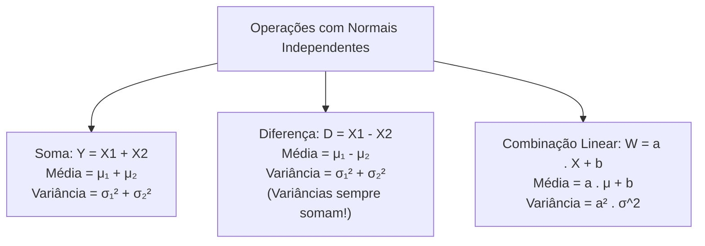
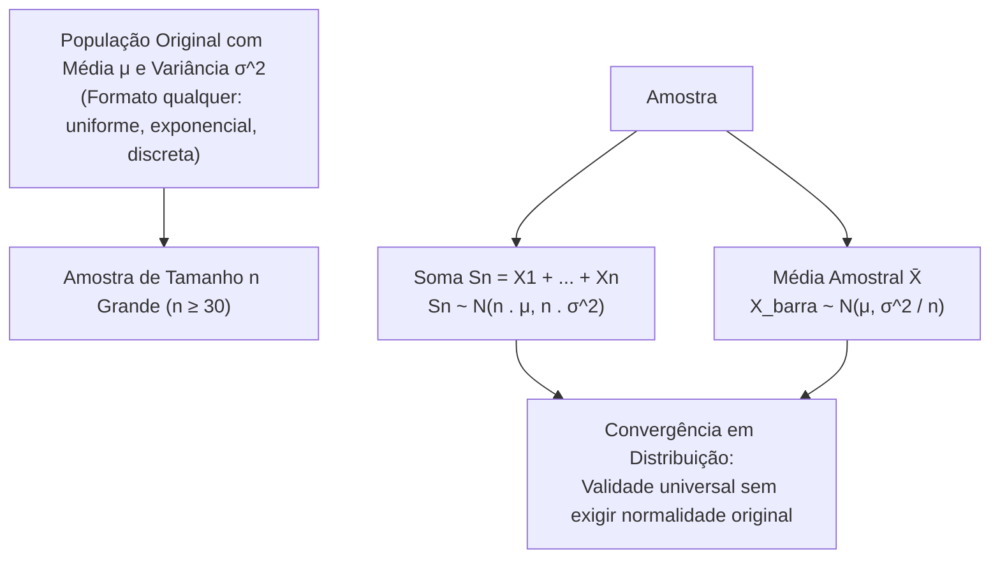

A soma e a combinação linear de variáveis aleatórias constituem o pilar da inferência estatística moderna e da amostragem probabilística. O Teorema Central do Limite demonstra que a agregação de múltiplas variáveis independentes tende assintoticamente a uma distribuição normal, viabilizando a aproximação de distribuições discretas complexas, como a binomial, mediante a aplicação técnica da correção de continuidade.

> [!objetivos]
> - Calcular a média e a variância de somas, diferenças e transformações lineares de variáveis normais.
> - Compreender o enunciado analítico e as condições de validade do Teorema Central do Limite.
> - Aplicar o Teorema Central do Limite na determinação da distribuição amostral da média e da soma.
> - Executar a aproximação da distribuição binomial pela distribuição normal contínua.
> - Dominar as regras práticas de ajuste de intervalos discretos pela correção de continuidade de meia unidade.

## Soma, Diferença e Combinações Lineares de Variáveis Normais

Quando manipulamos variáveis aleatórias que seguem distribuição normal, a propriedade de estabilidade reprodutiva assegura que qualquer combinação linear dessas variáveis também resultará em uma nova variável estritamente normal.

Sejam X1, X2 até Xn variáveis aleatórias normais independentes, com médias μ₁, μ₂ até min e variâncias σ₁², σ₂² até σn². A soma Y = X1 + X2 + ... + Xn segue rigorosamente uma distribuição normal:

Y ~ N(mi_Y, σ_Y²).

Os parâmetros da soma calculam-se diretamente pelas propriedades dos operadores de esperança e variância:

- **Média da Soma E(Y)**: soma aritmética de todas as médias individuais, de modo que E(Y) = μ₁ + μ₂ + ... + min.
- **Variância da Soma Var(Y)**: soma aritmética de todas as variâncias individuais, de modo que Var(Y) = σ₁² + σ₂² + ... + σn².

Para a diferença entre duas variáveis normais independentes D = X1 - X2, a média equivale à subtração das médias E(D) = μ₁ - μ₂. Todavia, a variância da diferença continua sendo a **soma** das variâncias individuais: Var(D) = σ₁² + σ₂². Cada nova variável acrescentada ao modelo adiciona incerteza estocástica ao sistema, sendo impossível subtrair variâncias no cálculo de dispersão.



Na transformação linear simples W = a × X + b, onde a e b são constantes reais fixas:

1. A média sofre a ação completa dos coeficientes: E(W) = a × E(X) + b.
2. A constante aditiva b não altera a dispersão e é eliminada na variância.
3. O fator multiplicativo a sai elevado ao quadrado: Var(W) = a² vezes Var(X).

| Operação Algébrica | Expressão da Média Resultante | Expressão da Variância Resultante | Comentário Importante |
|---|---|---|---|
| Soma: X1 + X2 | E(X1) + E(X2) | Var(X1) + Var(X2) | Exige independência entre X1 e X2 |
| Diferença: X1 - X2 | E(X1) - E(X2) | Var(X1) + Var(X2) | A variância nunca é subtraída |
| Escalar: a × X | a × E(X) | a² vezes Var(X) | O fator entra quadrático na variância |
| Deslocamento: X + b | E(X) + b | Var(X) | Constante aditiva não altera dispersão |
| Linear Geral: aX + b | a × E(X) + b | a² vezes Var(X) | A normalidade é plenamente preservada |

> [!pegadinha]
> Nunca some desvios padrões diretamente. Se X1 tem desvio 3 (variância 9) e X2 tem desvio 4 (variância 16), o desvio da soma X1 + X2 não é 3 + 4 = 7. A variância da soma é 9 + 16 = 25, resultando em desvio padrão igual à raiz quadrada de 25, que vale 5. Além disso, a soma de variâncias requer independência estrita. A expressão X + X é idêntica a 2X, cuja variância é 2² vezes Var(X) = 4 vezes Var(X), e não 2 vezes Var(X).

## O Teorema Central do Limite (TCL)

O Teorema Central do Limite é a proposição mais poderosa da teoria probabilística. Ele estabelece o comportamento assintótico da soma e da média de um conjunto numeroso de variáveis aleatórias independentes e identicamente distribuídas (i.i.d.).

Considere uma amostra aleatória composta por n variáveis aleatórias X1, X2 até Xn, independentes e identicamente distribuídas, extraídas de uma população qualquer que possua média μ finita e variância σ ao quadrado finita. A soma Sn = X1 + X2 + ... + Xn apresenta:

- Média da Soma: E(Sn) = n × μ.
- Variância da Soma: Var(Sn) = n × σ^2.
- Desvio Padrão da Soma: DP(Sn) = raiz quadrada de n × σ.

Conforme o número de parcelas n cresce em direção ao infinito, a distribuição de probabilidade da soma Sn converge assintoticamente para uma distribuição normal:

Sn aproxima-se de N(n × μ, n × σ^2).

Da mesma forma, a média amostral X̄ = Sn / n converge para uma distribuição normal com média μ e variância reduzida σ^2 / n:

X̄ aproxima-se de N(μ, σ^2 / n).



> [!atencao]
> Um princípio vital do Teorema Central do Limite: a distribuição populacional original de onde provêm os dados não precisa ser normal. As variáveis iniciais podem ser discretas, uniformes, exponenciais ou assimétricas. Desde que a média e a variância sejam grandezas finitas e o tamanho amostral n seja suficientemente grande (convencionando-se na prática n maior ou igual a trinta observações), a soma e a média comportam-se como variáveis gaussianas normais. A convergência estabelecida pelo teorema ocorre em distribuição, o que significa que a função acumulada da soma aproxima-se da função acumulada normal.

Essa universalidade explica por que a distribuição normal surge espontaneamente em fenômenos biológicos, físicos e operacionais de segurança pública. Variáveis do mundo real resultam habitualmente da superposição aditiva de milhares de microfatores aleatórios independentes.

## Aproximação da Distribuição Binomial pela Normal

A distribuição binomial modela a contagem de sucessos k obtidos em n ensaios independentes de Bernoulli com probabilidade constante de sucesso p. Cada ensaio unitário possui média p e variância p × (1 - p). Como a variável binomial X nada mais é do que a soma direta de n ensaios binários independentes, o Teorema Central do Limite garante que, para valores elevados de n, a distribuição binomial aproxima-se de uma curva normal contínua.

Os parâmetros da normal aproximadora Y refletem os momentos clássicos da binomial:

- Média: E(Y) = n × p.
- Variância: Var(Y) = n × p × (1 - p) = n × p × q, onde q = 1 - p.
- Desvio Padrão: DP(Y) = raiz quadrada de (n × p × q).

A qualidade da aproximação normal melhora sensivelmente à medida que o número de ensaios n cresce e a probabilidade de sucesso p aproxima-se de 0,50 (distribuição simétrica). Quando p afasta-se de 0,50, a binomial manifesta assimetria que demanda valores maiores de n para atingir aderência satisfatória.

O critério clássico de aceitabilidade da aproximação normal exige que a quantidade esperada de sucessos e de fracassos supere cinco unidades:

n × p > 5 e n × q > 5 (ou n × o menor entre p e q > 5).

| Tamanho Amostral e Parâmetros | Média n × p | Variância n × p × q | Desvio Padrão | Validade da Aproximação |
|---|---|---|---|---|
| n = 100, p = 0,50 | 50 | 100 × 0,5 × 0,5 = 25 | Raiz de 25 = 5 | Excelente (perfeitamente simétrica) |
| n = 200, p = 0,20 | 40 | 200 × 0,2 × 0,8 = 32 | Raiz de 32 = 5,66 | Muito boa (n × p = 40 > 5) |
| n = 400, p = 0,25 | 100 | 400 × 0,25 × 0,75 = 75 | Raiz de 75 = 8,66 | Excelente aproximação assintótica |

## Correção de Continuidade de Meia Unidade

A distribuição binomial é estritamente discreta, assumindo apenas números inteiros isolados (0, 1, 2, ..., n). No histograma de probabilidades, cada número inteiro k é representado por uma barra retangular unitária de largura 1, estendendo-se no eixo contínuo desde k - 0,5 até k + 0,5.

Por outro lado, a distribuição normal é contínua e suave, na qual a probabilidade de um ponto exato P(Y = k) é rigorosamente nula. Para aproximar a área discreta da barra de altura k pela integral da curva normal contínua, devemos expandir os limites da integração em meia unidade (0,5) para fora. Essa técnica matemática é denominada **correção de continuidade**.

```mermaid Princípio geométrico da barra discreta e correção de continuidade
flowchart LR
    DISC["Barra Discreta do Ponto k\n(Largura unitária de base 1)"] --> CONT["Intervalo Contínuo da Normal:\nDe k - 0,5 até k + 0,5"]
    CONT --> AREA["Probabilidade Pontual Discreta P(X = k)\nAproxima-se pela área:\nP(k - 0,5 < Y < k + 0,5)"]
```

Para aplicar a correção de continuidade sem cometer erros em provas, o candidato deve seguir duas regras sequenciais rigorosas:

1. Converta a desigualdade do enunciado para a forma fechada que indique claramente quais números inteiros estão incluídos no evento.
2. Expanda o intervalo contínuo em 0,5 unidade para fora, subtraindo 0,5 do limite inferior e somando 0,5 ao limite superior.

| Expressão na Binomial Discreta | Conjunto de Valores Inteiros | Conversão Contínua com Correção de Continuidade |
|---|---|---|
| P(X = k) | Ponto único k | P(k - 0,5 < Y < k + 0,5) |
| P(X >= k) | k, k+1, k+2, ... | P(Y > k - 0,5) |
| P(X > k) | Equivale a P(X >= k + 1) | P(Y > k + 0,5) |
| P(X <= k) | ..., k-2, k-1, k | P(Y < k + 0,5) |
| P(X < k) | Equivale a P(X <= k - 1) | P(Y < k - 0,5) |
| P(a <= X <= b) | Todos os inteiros de a até b | P(a - 0,5 < Y < b + 0,5) |
| P(a < X < b) | Inteiros de a+1 até b-1 | P(a + 0,5 < Y < b - 0,5) |

> [!pegadinha]
> A correção de continuidade não consiste em somar 0,5 aleatoriamente. O sinal da correção depende de qual extremo do intervalo está sendo manipulado. Se você quer P(X >= 20), você precisa incluir a barra do número 20, logo deve recuar para 19,5: P(Y > 19,5). Se você quer P(X <= 20), você deve englobar a barra do 20 até o seu término superior, avançando para 20,5: P(Y < 20,5).

## Exercício Resolvido de Concurso

> [!resolvido]
> Em uma blitz de trânsito realizada pelo Batalhão de Polícia Rodoviária da PMPE, 400 veículos são abordados aleatoriamente. A probabilidade histórica de um condutor apresentar irregularidades na documentação é p = 0,20. Utilizando a aproximação da distribuição normal com correção de continuidade, determine a probabilidade de serem autuados pelo menos 90 veículos irregulares. Sabe-se que P(0 < Z < 1,19) = 0,3830.
>
> **Passo 1: Verificação da viabilidade da aproximação.**
> Temos n = 400 e p = 0,20. O produto n × p = 400 × 0,20 = 80 e n × q = 400 × 0,80 = 320. Como ambos superam 5 com folga, a aproximação normal é plenamente válida.
>
> **Passo 2: Determinação da média e do desvio padrão.**
> Média da normal: μ = n × p = 400 × 0,20 = 80 veículos.
> Variância: σ^2 = n × p × q = 400 × 0,20 × 0,80 = 64.
> Desvio padrão: σ = raiz quadrada de 64 = 8 veículos.
>
> **Passo 3: Aplicação da correção de continuidade.**
> O evento discreto desejado é "pelo menos 90 autuações", correspondente a P(X >= 90).
> Para abranger a barra do 90 na variável contínua Y, recuamos meia unidade:
> P(X >= 90) aproxima-se por P(Y > 89,5).
>
> **Passo 4: Padronização para a escala Z.**
> Calculamos o escore padronizado para o valor corrigido y = 89,5:
> z = (89,5 - 80) / 8 = 9,5 / 8 = 1,1875, que arredondamos para z = 1,19.
>
> **Passo 5: Consulta da probabilidade de cauda.**
> A probabilidade da cauda superior é dada pelo complemento da metade direita:
> P(Z > 1,19) = 0,50 - P(0 < Z < 1,19) = 0,50 - 0,3830 = 0,1170.
> A probabilidade de autuar pelo menos 90 veículos é de 11,70%.

## Procedimento Sequencial para Resolução em Provas

Ao se deparar com problemas de aproximação normal nas provas, o candidato deve estruturar a sua resolução em um roteiro lógico de quatro etapas:

1. **Cálculo dos Momentos**: calcule de pronto a média μ = n × p e a variância σ ao quadrado = n × p × (1 - p). Extraia a raiz quadrada para encontrar o desvio padrão σ.
2. **Correção de Continuidade**: identifique os números inteiros válidos do evento e expanda os extremos do intervalo contínuo em 0,5 unidade (subtraia 0,5 do limite inferior e some 0,5 ao limite superior).
3. **Padronização na Escala Z**: aplique a transformação z = (y_corrigido - μ) / σ a cada um dos limites ajustados.
4. **Consulta da Tabela e Operação de Áreas**: desenhe mentalmente o sino gaussiano, localize as áreas centrais tabeladas e calcule a probabilidade final aplicando simetrias e áreas complementares.

> [!bizu]
> Caso a questão de prova pergunte a probabilidade de uma soma de 100 variáveis uniformes independentes no intervalo entre 0 e 1, aplique o Teorema Central do Limite direto: cada uniforme possui média 0,5 e variância 1/12. A soma das 100 variáveis terá média 100 × 0,5 = 50 e variância 100 / 12 = 8,33, seguindo distribuição aproximadamente normal sem necessidade de correção de continuidade, visto que a variável original já é contínua.


### Exemplo Complementar: Soma de Binomiais Independentes

Considere uma bateria de testes com 64 variáveis binomiais independentes, cada uma com n = 12 ensaios e probabilidade de sucesso p = 0,25. Cada variável isolada possui média 3 e variância 12 × 0,25 × 0,75 = 2,25. Pelo Teorema Central do Limite, a soma das 64 variáveis possui média 64 × 3 = 192 e variância total igual a 64 × 2,25 = 144, gerando desvio padrão igual a 12.

Para calcular a probabilidade de a soma exceder 207, padronizamos a variável: z = (207 - 192) / 12 = 15 / 12 = 1,25. A probabilidade pedida é P(Z > 1,25) = 1 - Phi(1,25). Consultando a tabela acumulada que indica Phi(1,25) = 0,894, encontramos 1 - 0,894 = 0,106. Em testes com sinais auditivos e taxas de remissão clínica com probabilidades dadas na tabela como 0,9846, 0,9664 e 0,9222, o mesmo raciocínio de aproximação assintótica é aplicado com total consistência teórica.

## Mapa do capítulo

```mermaid Síntese estrutural do Teorema Central do Limite e aproximação normal
flowchart TD
    TCL["Soma de Variáveis e Teorema Central do Limite"] --> SOMA["Propriedades Lineares:\nE(X1 + X2) = μ₁ + μ₂ | Var(X1 +- X2) = σ₁² + σ₂²\n(Variâncias sempre somam para independentes)"]
    TCL --> CONV["Teorema Central do Limite:\nSoma de n variáveis i.i.d. converge para normal\nSn ~ N(n . μ, n . σ^2)"]
    TCL --> APROX["Aproximação da Binomial pela Normal:\nmi = n . p | σ^2 = n . p . q (Válido para n . min(p, q) > 5)"]
    APROX --> CORR["Correção de Continuidade:\nP(a ≤ X ≤ b) ≅ P(a - 0,5 < Y < b + 0,5)\nRecuar 0,5 no limite inferior e avançar 0,5 no superior"]
```

### Para fixar

- A soma de variáveis normais independentes é rigorosamente normal, com média igual à soma das médias e variância igual à soma das variâncias.
- Na diferença entre duas variáveis normais independentes, as médias são subtraídas, mas as variâncias continuam sendo somadas.
- Em transformações lineares Y = aX + b, a média é a × μ + b e a variância resulta em a ao quadrado vezes σ ao quadrado.
- O Teorema Central do Limite assegura que a soma de n variáveis i.i.d. converge em distribuição para a normal para qualquer formato populacional inicial.
- A distribuição original não precisa ser normal; basta ter média e variância finitas com tamanho amostral suficiente.
- A distribuição binomial X ~ Bin(n, p) é aproximada pela normal com média n × p e variância n × p × q quando n vezes min(p, q) > 5.
- A correção de continuidade ajusta a variável discreta para o modelo contínuo expandindo os limites inteiros em meia unidade (0,5).
- Para probabilidades no formato P(X >= k), a correção de continuidade exige recuar o limite contínuo para k - 0,5: P(Y > k - 0,5).
- Para probabilidades no formato P(X <= k), a correção de continuidade avança o limite contínuo para k + 0,5: P(Y < k + 0,5).
