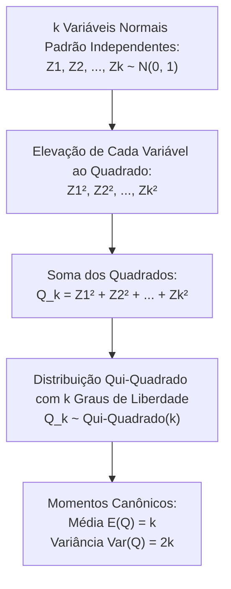
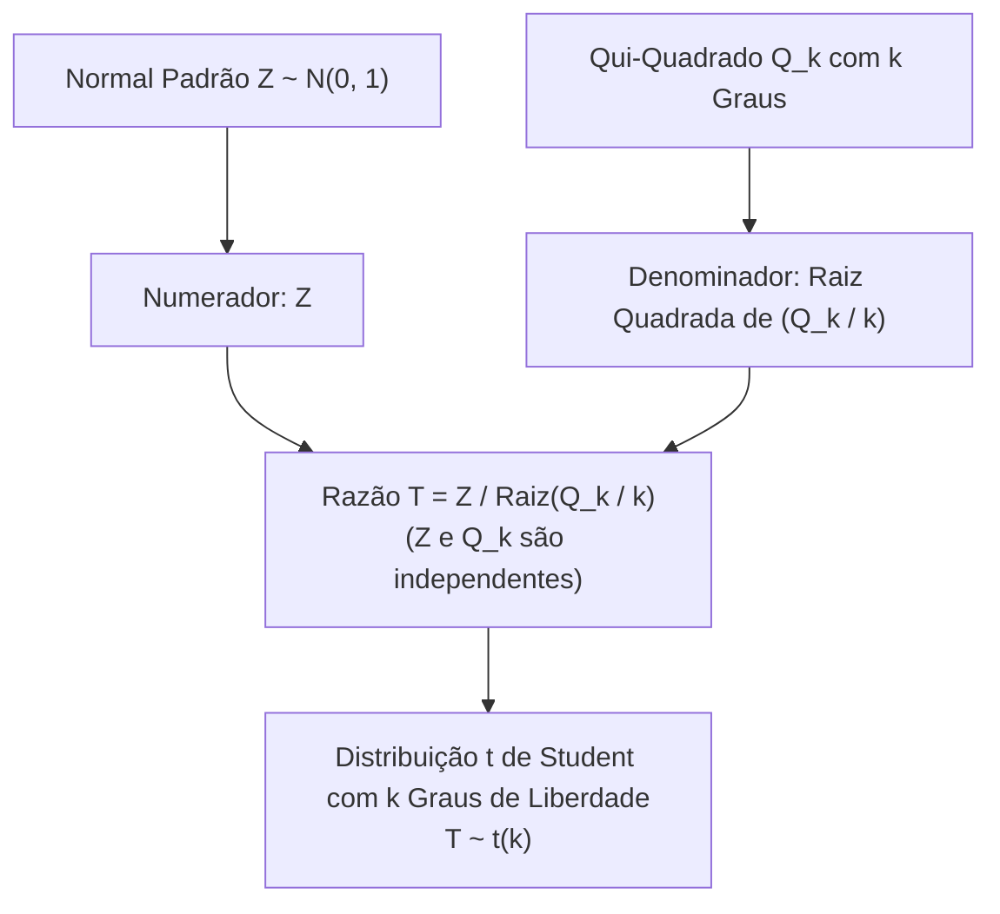
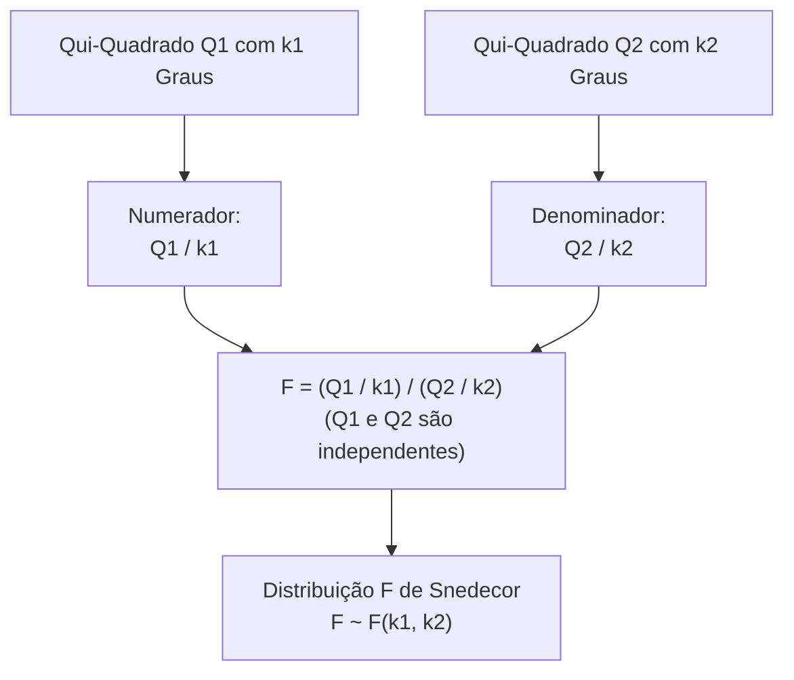

As distribuições amostrais contínuas qui-quadrado, t de Student e F de Snedecor constituem a estrutura matemática sobre a qual se apoia toda a inferência estatística paramétrica. Nos concursos, a construção algébrica a partir de variáveis normais padronizadas, o cálculo de médias e variâncias e o domínio dos graus de liberdade são cobrados com rigor analítico pelas bancas.

> [!objetivos]
> - Definir a distribuição qui-quadrado como soma de quadrados de normais padrão independentes.
> - Compreender a distribuição t de Student e a sua convergência assintótica para a normal padrão.
> - Dominar a distribuição F de Snedecor como a razão ponderada entre duas qui-quadrados independentes.
> - Calcular a média e a variância teórica de cada modelo em função dos graus de liberdade.
> - Aplicar as relações de reciprocidade da distribuição F e a equivalência entre o quadrado da t e a F(1, k).

## A Distribuição Qui-Quadrado

A distribuição qui-quadrado com k graus de liberdade, indicada simbolicamente por χ²ₖ ou Qₖ, resulta da soma dos quadrados de k variáveis aleatórias normais padrão Z1, Z2 até Zk que sejam independentes entre si:

Q_k = Z1² + Z2² + ... + Zk². Cada variável Zi segue distribuição normal padrão N(0, 1).

O único parâmetro que caracteriza essa distribuição é o número inteiro positivo k. Esse parâmetro é denominado **graus de liberdade**. Esse parâmetro quantifica exatamente quantas variáveis normais padronizadas independentes foram elevadas ao quadrado e somadas para compor a variável.

Se as variáveis normais originais X1, X2 até Xk não forem padronizadas (isto é, possuírem médias mi_i e desvios padrões σ_i diferentes de 0 e 1). O estudante deve padronizar cada parcela antes de somar os quadrados:

Q_k = [(X1 - μ₁) / σ₁]² + [(X2 - μ₂) / σ₂]² + ... + [(Xk - μk) / σk]².

Se a padronização não for realizada com a subtração da média verdadeira, a variável resultante deixará de ser uma qui-quadrado central comum. Ela se torna uma qui-quadrado não central com deslocamento paramétrico.



### Propriedades Analíticas da Qui-Quadrado

A distribuição qui-quadrado exibe propriedades fundamentais que orientam os testes de hipóteses de aderência e independência:

- **Domínio Positivo**: como consiste em uma soma de termos elevados ao quadrado, a variável qui-quadrado assume exclusivamente valores reais não negativos (x maior ou igual a zero).
- **Assimetria Positiva**: a curva de densidade é estritamente assimétrica à direita para pequenos valores de k. Sua cauda se alonga em direção ao infinito positivo.
- **Convergência Normal**: à medida que os graus de liberdade k aumentam, a curva torna-se gradativamente mais simétrica. Pelo Teorema Central do Limite, para valores elevados de k (tipicamente k > 30). A qui-quadrado aproxima-se de uma normal com média k e variância 2k.
- **Esperança e Variância**: a média coincide exatamente com os graus de liberdade: E(Q_k) = k. A variância é igual ao dobro dos graus de liberdade: Var(Q_k) = 2k.
- **Propriedade da Aditividade**: se Q1 e Q2 são variáveis qui-quadrados independentes com k1 e k2 graus de liberdade, a soma Q = Q1 + Q2 é uma nova qui-quadrado com k1 + k2 graus de liberdade.
- **Vínculo com a Família Gama e Exponencial**: a qui-quadrado é um caso especial da distribuição gama com parâmetros alfa = k / 2 e beta = 1 / 2. Para k = 2 graus de liberdade, a qui-quadrado reduz-se exatamente a uma distribuição exponencial com média 2 (taxa λ = 1/2). A soma de n exponenciais independentes com média 2 segue qui-quadrado com 2n graus de liberdade.

| Graus de Liberdade k | Média Teórica E(X) | Variância Teórica Var(X) | Desvio Padrão | Formato da Densidade |
|---|---|---|---|---|
| k = 1 | 1 | 2 | Raiz de 2 = 1,41 | Extremamente assimétrica com pico em zero |
| k = 2 | 2 | 4 | Raiz de 4 = 2,00 | Exponencial decrescente com média 2 |
| k = 5 | 5 | 10 | Raiz de 10 = 3,16 | Assimétrica à direita com moda em k - 2 = 3 |
| k = 10 | 10 | 20 | Raiz de 20 = 4,47 | Assimetria moderada à direita |
| k = 30 | 30 | 60 | Raiz de 60 = 7,75 | Aproximadamente normal gaussiana |

## A Distribuição t de Student

A distribuição t de Student surge da modelagem da média amostral quando a variância populacional é desconhecida e substituída pela variância amostral s² em pequenas amostras.

Algebricamente, a variável t com k graus de liberdade é construída pelo quociente entre uma variável normal padrão Z e a raiz quadrada de uma qui-quadrado independente dividida pelos seus respectivos graus de liberdade:

T = Z / raiz quadrada de (Q_k / k), onde Z ~ N(0, 1), Q_k ~ Qui-Quadrado(k), e Z e Q_k são independentes.

O único parâmetro da distribuição é o número inteiro k de graus de liberdade da qui-quadrado do denominador.



### Propriedades da Distribuição t de Student

- **Simetria em Torno de Zero**: o gráfico tem formato de sino perfeitamente simétrico ao redor de zero. A média, a mediana e a moda coincidem em zero: E(T) = 0 (definida para k > 1).
- **Caudas Mais Pesadas (Leptocurtose)**: comparada à normal padrão Z, a distribuição t de Student apresenta pico mais baixo no centro e caudas laterais mais largas e pesadas. Essa maior dispersão reflete a incerteza adicional introduzida pela estimativa amostral do desvio padrão.
- **Variância da t**: a variância teórica é dada por Var(T) = k / (k - 2). Essa variância é definida exclusivamente para k > 2. Como k / (k - 2) é sempre estritamente maior do que 1, a variância da t supera a variância unitária da normal padrão. Para k = 4, Var(T) = 4 / 2 = 2. Para k = 10, Var(T) = 10 / 8 = 1,25.
- **Convergência para a Normal Padrão**: conforme os graus de liberdade k aumentam, a variância k / (k - 2) tende ao valor 1. Para tamanhos amostrais elevados (k > 30). A t de Student converge para a normal padrão Z.

> [!pegadinha]
> O caso particular com 1 grau de liberdade (k = 1) configura uma distribuição patológica célebre: a **distribuição de Cauchy**. A variável T = Z1 / Z2, formada pela razão direta entre duas normais padrão independentes, é uma t de Student com 1 grau de liberdade. A distribuição de Cauchy não possui média nem variância definidas, pois suas caudas pesadas decaem tão lentamente que a integral de esperança não converge. Se uma questão de prova perguntar a média da razão entre duas normais padrão independentes, a resposta correta é que a média não existe.

| Modelo Estatístico | Parâmetro | Média E(X) | Variância Var(X) | Formato Geométrico |
|---|---|---|---|---|
| Normal Padrão Z | Nenhum (fixos) | 0 | 1 | Sino simétrico perfeito |
| t de Student (k > 2) | k graus de liberdade | 0 | k / (k - 2) > 1 | Sino simétrico com caudas pesadas |
| t com 1 grau (Cauchy) | k = 1 | Não definida | Não definida | Razão de normais padrão independentes |

## A Distribuição F de Snedecor (Fisher-Snedecor)

A distribuição F de Snedecor é o modelo teórico empregado nos testes de comparação de variâncias populacionais e na Análise de Variância (ANOVA).

A variável F é definida formalmente como a **razão entre duas variáveis qui-quadrados independentes, cada uma dividida pelos seus respectivos graus de liberdade**:

F = (Q1 / k1) / (Q2 / k2), onde Q1 ~ Qui-Quadrado(k1), Q2 ~ Qui-Quadrado(k2), com Q1 e Q2 independentes.

A distribuição F é caracterizada por um par ordenado de parâmetros:

1. **k1 (ou v1)**: graus de liberdade do numerador.
2. **k2 (ou v2)**: graus de liberdade do denominador.

A ordem dos parâmetros importa decisivamente: a distribuição F(k1, k2) é diferente da distribuição F(k2, k1).



### Propriedades da Distribuição F

- **Domínio Positivo**: como se trata da razão de duas somas de quadrados divididas por constantes positivas, a variável F assume unicamente valores estritamente positivos (x maior que zero).
- **Assimetria Positiva**: a curva de densidade é assimétrica à direita. O seu formato depende de ambos os graus de liberdade k1 e k2.
- **Média Teórica**: a esperança matemática da distribuição F depende exclusivamente dos graus de liberdade do **denominador** k2: E(F) = k2 / (k2 - 2), definida para k2 > 2. Os graus de liberdade do numerador k1 não entram na fórmula da média. Como k2 / (k2 - 2) é sempre maior do que 1, a média de qualquer variável F é sempre superior a 1, aproximando-se de 1 conforme o denominador cresce.

> [!atencao]
> Guarde a **propriedade da reciprocidade da distribuição F de Snedecor**. Se uma variável aleatória F segue distribuição F(k1, k2), então o seu inverso multiplicativo 1 / F segue rigorosamente uma distribuição F com os graus de liberdade invertidos: 1 / F ~ F(k2, k1). Essa relação é indispensável para obter quantis da cauda esquerda inferior a partir de tabelas que registram apenas a cauda direita superior: F_alfa(k1, k2) = 1 / F_(1 - alfa)(k2, k1).

### Conexão Notável entre as Distribuições t de Student e F

Existe uma ponte matemática direta entre a distribuição t de Student e a distribuição F de Snedecor:

O quadrado de uma variável t de Student com k graus de liberdade segue rigorosamente uma distribuição F com 1 grau de liberdade no numerador e k graus de liberdade no denominador:

T² ~ F(1, k).

A demonstração é imediata: elevando ao quadrado a definição de T, obtemos T² = Z² / (Q_k / k). Como Z é uma normal padrão, o termo Z² é uma qui-quadrado com 1 grau de liberdade dividida por 1. O denominador é uma qui-quadrado com k graus dividida por k. Por definição, essa razão é uma F(1, k).

| Distribuição | Parâmetros | Média | Variância | Simetria |
|---|---|---|---|---|
| Qui-Quadrado | k | k | 2k | Assimétrica à direita |
| t de Student | k | 0 (para k > 1) | k / (k - 2) (para k > 2) | Simétrica em torno de zero |
| F de Snedecor | k1 (numerador), k2 (denominador) | k2 / (k2 - 2) (para k2 > 2) | Função complexa de k1 e k2 | Assimétrica à direita |

## Exercício Resolvido de Concurso

> [!resolvido]
> Considere três variáveis aleatórias independentes: Z1 ~ N(0, 1), Z2 ~ N(0, 1) e Z3 ~ N(0, 1). Considere ainda duas variáveis normais gerais independentes: X1 ~ N(10, 4) e X2 ~ N(20, 9).
>
> **Item A**: Identifique a distribuição e a média da variável Q = Z1² + Z2² + Z3².
> Q é a soma dos quadrados de três normais padrão independentes. Logo, Q segue distribuição qui-quadrado com 3 graus de liberdade: Q ~ Qui-Quadrado(3). Sua média é igual aos graus de liberdade: E(Q) = 3.
>
> **Item B**: Determine a distribuição da variável W = [(X1 - 10) / 2]² + [(X2 - 20) / 3]².
> Padronizando as parcelas: (X1 - 10) / 2 = Z_A e (X2 - 20) / 3 = Z_B, ambas normais padrão independentes. W é a soma de dois quadrados de normais padrão independentes. Portanto, W segue distribuição qui-quadrado com 2 graus de liberdade: W ~ Qui-Quadrado(2). Sua média é 2 e sua variância é 2 × 2 = 4. Por equivalência, W também é uma variável exponencial de média 2.
>
> **Item C**: Seja T = Z1 / raiz quadrada de (W / 2). Qual é a sua distribuição e variância?
> T é a razão entre uma normal padrão Z1 e a raiz de uma qui-quadrado W com 2 graus dividida por 2. Por definição, T segue distribuição t de Student com 2 graus de liberdade: T ~ t(2). Sua média é zero. A variância não está definida, pois a variância da t exige k > 2.
>
> **Item D**: Se F segue F(4, 10), qual é a sua média teórica?
> A média da distribuição F depende exclusivamente dos graus de liberdade do denominador k2 = 10:
> E(F) = k2 / (k2 - 2) = 10 / (10 - 2) = 10 / 8 = 1,25.


## Aplicações Inferenciais: O Teste t de Student e o Teste F

As distribuições amostrais ganham relevância operacional nos testes de hipóteses estatísticos cobrados nos editais militares:

### O Teste t para Comparação de Médias

O **Teste t** de Student avalia se a média de uma população difere de um valor de referência ou se duas médias populacionais são estatisticamente distintas. Ele é aplicado quando o desvio padrão populacional é desconhecido e o tamanho da amostra é pequeno.

No **Teste t** para uma amostra, formulamos a hipótese nula de que a média populacional é igual a um valor fixo. A estatística calculada no **Teste t** segue a fórmula:

t_calculado = (X̄ - mi_0) / (s / raiz de n).

Essa estatística calculada segue distribuição t de Student com n - 1 graus de liberdade. Se o valor de t_calculado cair na região crítica determinada pelo nível de significância alfa, rejeitamos a hipótese nula no **Teste t**. Quando comparamos dois grupos independentes, o **Teste t** bicaudal avalia a diferença entre duas médias amostrais com variâncias combinadas.

### O Teste F para Comparação de Variâncias e ANOVA

O **Teste F** de Snedecor verifica se duas variâncias populacionais independentes são homogêneas ou estatisticamente diferentes. No **Teste F**, a estatística de teste é a razão direta entre as duas variâncias amostrais:

F_calculado = s₁² / s₂².

Por convenção no **Teste F**, posiciona-se a maior variância amostral no numerador para que o valor de F_calculado seja sempre maior ou igual a 1. Essa razão segue distribuição F com n₁ - 1 graus de liberdade no numerador e n₂ - 1 graus no denominador. Se a razão for significativamente maior que 1, o **Teste F** rejeita a hipótese de igualdade de variâncias.

Além disso, o **Teste F** é o instrumento central da Análise de Variância (ANOVA). Na ANOVA, o **Teste F** compara a variabilidade entre tratamentos com a variabilidade dentro dos tratamentos para testar a igualdade de três ou mais médias populacionais simultaneamente.

## Uso Prático de Tabelas Amostrais

Nas provas de estatística aplicada, as tabelas das distribuições amostrais apresentam particularidades de formato que o candidato deve dominar:

- **Tabela da Qui-Quadrado**: as linhas indicam os graus de liberdade k (1, 2, 3...) e as colunas trazem as probabilidades acumuladas P(Q_k < x) ou probabilidades de cauda superior P(Q_k > x). Como a curva é assimétrica e positiva, a tabela não se apoia em simetrias espelhadas em zero.
- **Tabela da t de Student**: as linhas indicam os graus de liberdade k e as colunas trazem probabilidades acumuladas unilaterais ou bicaudais. Por causa da simetria perfeita ao redor de zero, a tabela só apresenta quantis positivos com probabilidade superior a 50%, obtendo-se quantis negativos pela troca direta de sinal: t_alfa = -t_(1 - alfa).
- **Tabela da F de Snedecor**: como a distribuição possui dois graus de liberdade distintos, cada tabela impressa na prova dedica-se a um único nível de significância fixo (por exemplo, tabela de cauda direita a 5% ou a 1%). As colunas indicam os graus do numerador k1 e as linhas indicam os graus do denominador k2.

> [!bizu]
> Na leitura de tabelas F em provas, confira com atenção redobrada qual parâmetro está nas colunas e qual está nas linhas. O grau de liberdade do numerador k1 situa-se no topo horizontal das colunas. O grau do denominador k2 situa-se na margem vertical das linhas. Inverter essa ordem conduz à escolha de um quantil incorreto nas alternativas.

## Mapa do capítulo

```mermaid Síntese estrutural das distribuições amostrais derivadas da normal
flowchart TD
    NORM["Normais Padrão Z ~ N(0, 1)"] --> QUI["Soma de Quadrados:\nQui-Quadrado Q_k = Soma(Zi²)\nMédia = k | Variância = 2k"]
    NORM --> TSTUD["Razão Normal / Raiz(Qui / k):\nt de Student T ~ t(k)\nSimétrica, média = 0, Var = k/(k-2)"]
    QUI --> TSTUD
    QUI --> FSNED["Razão Ponderada de Qui-Quadrados:\nF de Snedecor F = (Q1/k1) / (Q2/k2)\nMédia = k2 / (k2 - 2)"]
    TSTUD --> TQUAD["Relação Notável:\nT² ~ F(1, k)"]
    FSNED --> TQUAD
```

### Para fixar

- A distribuição qui-quadrado com k graus de liberdade é a soma dos quadrados de k variáveis normais padrão independentes.
- A qui-quadrado assume apenas valores não negativos, possui média k e variância 2k, sendo assimétrica à direita.
- Para k = 2 graus de liberdade, a qui-quadrado coincide com a distribuição exponencial com média 2.
- A distribuição t de Student é formada por Z dividida pela raiz quadrada de (Q_k / k). A normal Z e a qui-quadrado Q_k são independentes entre si.
- A curva da t é simétrica em torno de zero, possui caudas mais pesadas do que a normal e tem variância k / (k - 2) para k > 2.
- A t com 1 grau de liberdade é a distribuição de Cauchy, formada pela razão de duas normais padrão, sem média nem variância.
- A distribuição F de Snedecor é a razão entre duas qui-quadrados independentes divididas pelos respectivos graus de liberdade.
- A média da distribuição F depende exclusivamente do grau de liberdade do denominador: E(F) = k2 / (k2 - 2) para k2 > 2.
- O quadrado de uma variável t de Student com k graus de liberdade segue distribuição F(1, k).
- Pela propriedade da reciprocidade, se F segue F(k1, k2), então o inverso 1 / F segue F(k2, k1).
