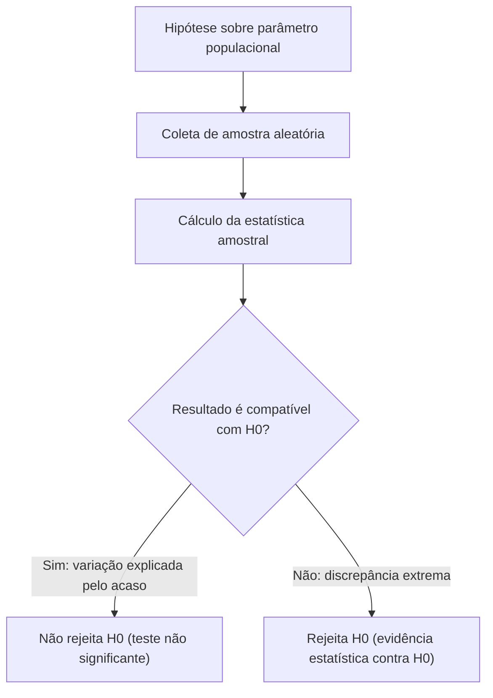
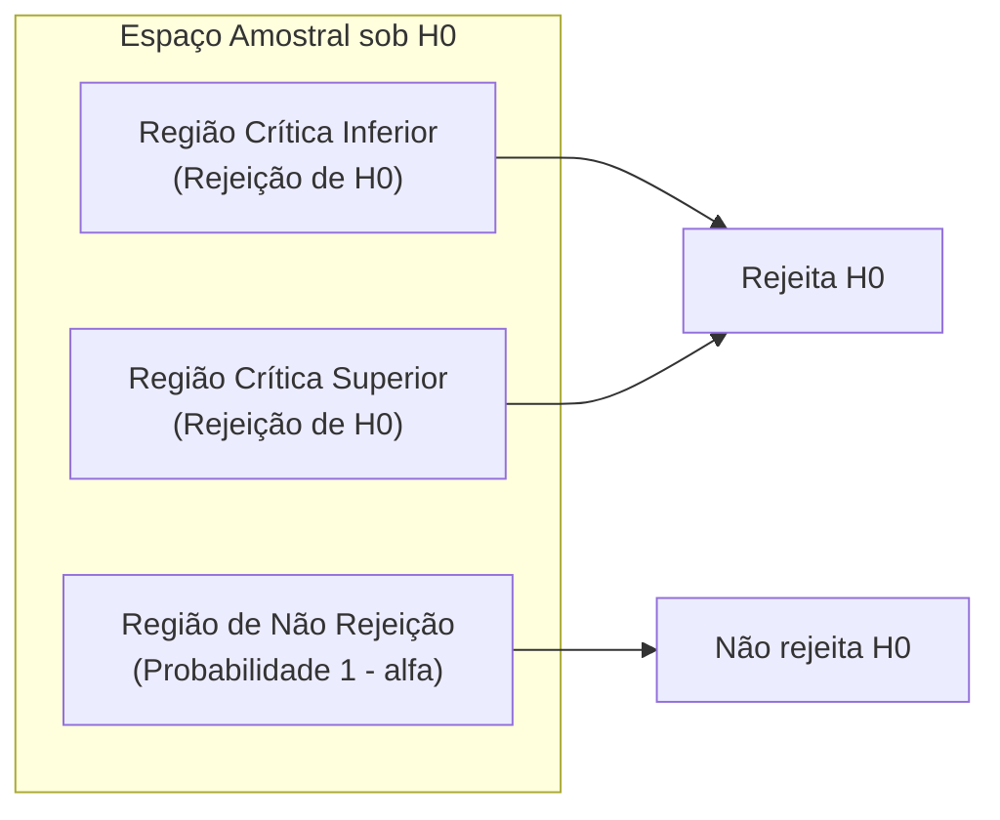
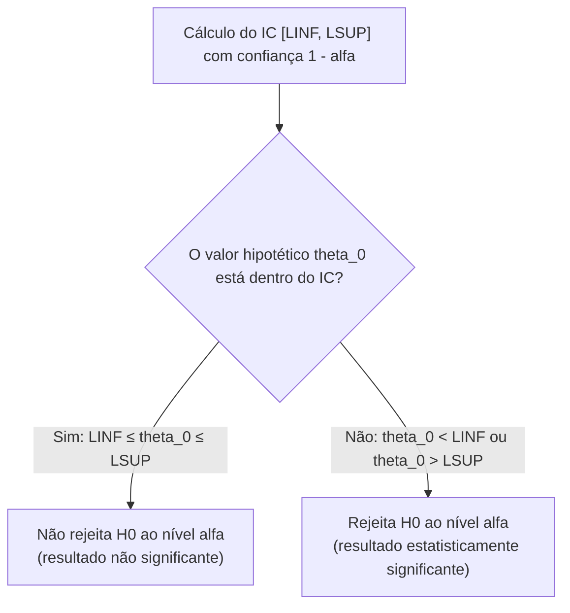
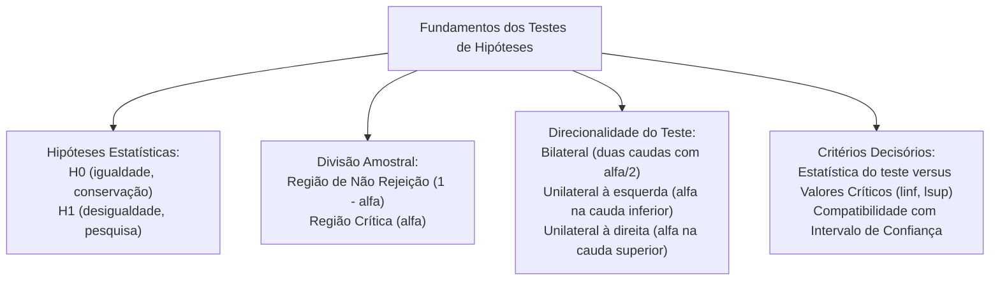

Os testes de hipóteses constituem a ferramenta primordial da inferência estatística indutiva para validar afirmações sobre populações com base em dados amostrais. Na administração pública e na segurança militar, decisões críticas de gestão dependem desse procedimento técnico estruturado. Avaliar se a renda média dos beneficiários de um programa de assistência social aumentou ou se a capacidade volumétrica de um recipiente de combustível atende aos padrões do fabricante exige critérios analíticos objetivos. O método estatístico estabelece regras de decisão que separam as oscilações aleatórias do acaso das diferenças reais e estatisticamente significantes.

> [!objetivos]
> - Compreender a formulação lógica da hipótese nula H0 e da hipótese alternativa H1.
> - Delimitar a região de não rejeição e a região crítica com base no nível de significância alfa.
> - Distinguir os testes bilaterais dos testes unilaterais à esquerda e à direita.
> - Classificar as hipóteses em simples e compostas segundo a fixação dos parâmetros.
> - Aplicar o critério do intervalo de confiança na tomada de decisão do teste bilateral.

## Lógica Geral e Tomada de Decisão

A formulação de um teste estatístico parte de uma declaração quantitativa sobre um parâmetro populacional desconhecido. Esse parâmetro pode representar a média aritmética populacional, a proporção de ocorrências de determinado evento ou a variância de um processo produtivo. Em auditorias governamentais de programas de assistência, pode-se postular que a renda média mensal dos beneficiários cadastrados equivale a um salário mínimo de referência. Como a avaliação de todos os indivíduos da população é inviável por custo ou tempo, extrai-se uma amostra aleatória representativa.

A média obtida na amostra quase nunca coincidirá exatamente com o valor postulado para a população inteira. Uma amostra com média ligeiramente discrepante não autoriza concluir que a afirmação inicial seja falsa. Pequenas divergências são perfeitamente explicadas pela variabilidade amostral inerente ao processo aleatório de coleta. No entanto, se a discrepância observada for substancialmente ampla, a probabilidade de tal resultado ocorrer por mero acaso torna-se desprezível. Nesse cenário, o pesquisador rejeita a declaração de nulidade, admitindo evidência empírica robusta contra a premissa inicial.

## Hipótese Nula e Hipótese Alternativa

A formalização do problema decisório exige a estruturação de duas proposições lógicas excludentes que esgotam o espaço de possibilidades do parâmetro avaliado.

A hipótese nula, denotada por H0, expressa a proposição de nulidade, ausência de efeito inovador ou manutenção do padrão estabelecido. Ela é admitida como premissa verdadeira no início do procedimento até que os dados amostrais apresentem prova contundente em contrário. Por convenção metodológica indispensável, a hipótese nula contém sempre o sinal de igualdade matemática. Ela pode manifestar-se na forma de igualdade exata, menor ou igual, ou maior ou igual.

A hipótese alternativa, grafada como H1 ou HA, expressa a tese contrária à hipótese nula. Ela traduz a conjectura de pesquisa que o investigador almeja comprovar mediante evidências empíricas. A hipótese alternativa expressa necessariamente relações de desigualdade estrita. Ela utiliza os conectivos matemáticos diferente de, menor que ou maior que, jamais admitindo a igualdade estrita.

| Propriedade Comparada | Hipótese Nula (H0) | Hipótese Alternativa (H1) |
|---|---|---|
| Princípio norteador | Manutenção do estado inicial ou ausência de efeito | Tese de mudança substancial ou efeito real |
| Condição no teste | Considerada verdadeira até prova em contrário | Objeto da suspeita ou da investigação empírica |
| Operadores admitidos | Contém necessariamente a igualdade (=, <= ou >=) | Exclusivamente desigualdades estritas (!=, < ou >) |
| Significado da decisão | Não rejeição traduz falta de evidência contrária | Rejeição de H0 estabelece decisão forte |

> [!bizu]
> Ao interpretar questões de concursos públicos, identifique a afirmação que o perito, o órgão fiscalizador ou a corporação quer comprovar. Essa declaração direciona-se diretamente para a hipótese alternativa H1. A hipótese nula H0 será o seu complemento lógico, retendo obrigatoriamente a relação de igualdade.

## Região de Não Rejeição e Região Crítica

A distribuição probabilística da estatística de teste, sob a premissa de que a hipótese nula é correta, divide os resultados possíveis em duas zonas decisórias mutuamente excludentes:

A região de não rejeição, tradicionalmente referida como região de aceitação, compreende o intervalo de valores da estatística amostral que guardam proximidade razoável com o parâmetro postulado sob H0. A probabilidade de a estatística recair nessa faixa quando H0 é verdadeira é fixada em 1 menos alfa. Se o valor observado estiver contido nesse domínio, o teste é classificado como não significante, concluindo-se pela retenção da hipótese nula por insuficiência de provas em contrário.

A região crítica, ou região de rejeição, compreende o conjunto de valores extremos e improváveis que contradizem de forma veemente a hipótese nula. A probabilidade de obter um resultado na região crítica quando a hipótese nula é de fato verdadeira define o nível de significância do teste, representado pela letra grega alfa. Os valores numéricos que separam o domínio de retenção da área de rejeição estatística são designados como valores críticos do teste. Em testes bilaterais, eles recebem a denominação de limite inferior (linf) e limite superior (lsup).

> [!atencao]
> A estatística moderna repudia a expressão provar H0. A decisão cabível quando o valor cai na região de não rejeição é simplesmente não rejeitar H0. A ausência de evidências contrárias na amostra coletada não assegura a veracidade intrínseca da hipótese nula; demonstra unicamente que a discrepância constatada pode ser creditada ao acaso. Rejeitar H0, por sua vez, constitui uma conclusão estatística afirmativa e vigorosa.

## Tipos de Testes: Bilateral e Unilaterais

A conformação geométrica da região crítica sobre a distribuição teórica é determinada diretamente pela formulação da hipótese alternativa H1.

No teste bilateral, também denominado teste bicaudal ou não direcional, a hipótese alternativa enuncia que o parâmetro é diferente do valor hipotético (H1: theta != theta_0). O interesse analítico consiste em captar desvios substanciais em ambos os sentidos, tanto para valores superiores quanto para inferiores. Em virtude dessa formulação simétrica, a região de rejeição reparte-se equitativamente entre as duas extremidades da curva probabilística. Aloca-se a probabilidade alfa sobre dois na cauda esquerda e alfa sobre dois na cauda direita. Os pontos de corte são o limite inferior linf e o limite superior lsup.

Nos testes unilaterais, também chamados de unicaudais ou direcionais, o interesse da investigação concentra-se estritamente em desvios ocorridos em uma direção preferencialmente definida.

No teste unilateral à esquerda, a hipótese alternativa afirma que o parâmetro é estritamente menor que o valor postulado (H1: theta < theta_0). A região crítica posiciona-se de forma compacta e concentrada na cauda esquerda da distribuição, congregando a área total correspondente ao nível de significância alfa abaixo do ponto crítico inferior linf.

No teste unilateral à direita, a hipótese alternativa estabelece que o parâmetro é estritamente maior que o valor de referência (H1: theta > theta_0). A região crítica localiza-se integralmente na extremidade superior da curva, acumulando a probabilidade total alfa acima do ponto crítico superior lsup.

| Natureza do Teste | Hipótese Nula (H0) | Hipótese Alternativa (H1) | Divisão da Região Crítica |
|---|---|---|---|
| Bilateral (bicaudal) | theta = theta_0 | theta != theta_0 | Duas caudas: alfa/2 à esquerda e alfa/2 à direita |
| Unilateral à esquerda | theta >= theta_0 (ou theta = theta_0) | theta < theta_0 | Cauda esquerda única com probabilidade total alfa |
| Unilateral à direita | theta <= theta_0 (ou theta = theta_0) | theta > theta_0 | Cauda direita única com probabilidade total alfa |

## Hipóteses Simples e Hipóteses Compostas

Sob a ótica da parametrização probabilística, as hipóteses dividem-se em duas categorias essenciais:

Uma hipótese é denominada simples quando fixa de forma pontual e unívoca o valor exato do parâmetro em avaliação. Sob uma hipótese simples, a distribuição probabilística da variável aleatória fica totalmente especificada, sem deixar parâmetros livres indeterminados. A afirmação H0: μ = 100 em uma população normalmente distribuída com desvio padrão conhecido constitui uma hipótese simples, pois determina completamente a função densidade gaussiana de probabilidade.

Uma hipótese é qualificada como composta quando especifica uma região ou intervalo de valores possíveis para o parâmetro populacional, de modo que a distribuição subjacente não fica restrita a uma curva única e isolada. As formulações H1: μ != 100, H1: μ > 100 ou H0: μ <= 100 configuram hipóteses compostas, visto que múltiplos estados da natureza atendem ao critério numérico formulado.

> [!pegadinha]
> Em enunciados de provas, preste atenção aos testes direcionais em que a hipótese nula é escrita com igualdade pontual (H0: μ = 100 versus H1: μ > 100). Embora H0 possa abranger conceitualmente todos os valores menores ou iguais a 100, a operacionalização matemática do teste utiliza estritamente o ponto de igualdade como limite de fronteira. Esse ponto de igualdade representa o cenário mais desfavorável que gera a probabilidade máxima de cometer o erro de decisão.

## Decisão por Intervalo de Confiança

Existe uma estrita correspondência matemática entre a construção de intervalos de confiança e a execução de testes de hipóteses bilaterais sob a mesma distribuição amostral.

Considere um intervalo de confiança com coeficiente de confiança igual a 1 menos alfa calculado para o parâmetro populacional a partir dos dados de uma amostra aleatória. Se o valor pontual postulado sob a hipótese nula H0 pertencer ao intervalo de confiança delimitado pelos extremos LINF e LSUP, a decisão estatística ao nível de significância alfa será a não rejeição de H0. O resultado amostral obtido é perfeitamente plausível com a hipótese de nulidade.

Por outro lado, se o valor hipotético postulado situar-se fora dos limites numéricos do intervalo de confiança, rejeita-se terminantemente a hipótese nula ao nível de significância alfa. A probabilidade de obter aquela estimativa pontual caso a hipótese nula fosse verdadeira é inferior a alfa, configurando evidência empírica contundente a favor da hipótese alternativa.

## Exercício Resolvido de Aplicação Prática

A compreensão dos conceitos teóricos consolida-se com a resolução comentada passo a passo de um problema representativo de controle de qualidade na segurança pública.

> [!resolvido]
> **Enunciado de Avaliação Operacional:**
> Um batalhão de bombeiros militares adquiriu um lote de recipientes de fibra para armazenamento de líquido gerador de espuma. As especificações técnicas do contrato afirmam que a capacidade média do recipiente é de cinquenta litros (μ = 50). Para verificar se o fabricante cumpriu a especificação, o oficial responsável retirou uma amostra de 64 recipientes, obtendo média amostral de 48,5 litros. Sabe-se por histórico fabril que o desvio padrão populacional é constante e igual a 4 litros. Construa as hipóteses estatísticas do teste bilateral e avalie a decisão pelo intervalo de confiança com 95% de confiança (adote z = 1,96).
>
> **Resolução Passo a Passo:**
> 1. **Formulação das hipóteses:**
> Como o interesse é verificar se a capacidade atende à especificação contratual sem preferência prévia por excesso ou falta, formula-se um teste bilateral:
> H0: μ = 50 litros (a capacidade média atende ao valor contratado)
> H1: μ != 50 litros (a capacidade média diverge do padrão estipulado)
>
> 2. **Cálculo do erro padrão da média amostral:**
> O erro padrão é obtido dividindo-se o desvio padrão populacional pela raiz quadrada do tamanho amostral:
> σ_x = 4 / √64 = 4 / 8 = 0,5 litros.
>
> 3. **Determinação da margem de erro:**
> Para 95% de confiança, o coeficiente crítico bicaudal é z = 1,96:
> Margem de erro (ME) = z × σ_x = 1,96 × 0,5 = 0,98 litros.
>
> 4. **Construção do intervalo de confiança de 95%:**
> Limite inferior (linf) = média amostral - ME = 48,5 - 0,98 = 47,52 litros.
> Limite superior (lsup) = média amostral + ME = 48,5 + 0,98 = 49,48 litros.
> Portanto, o intervalo de confiança calculado é [47,52 ; 49,48].
>
> 5. **Regra decisória e conclusão técnica:**
> O valor hipotético postulado em H0 é μ₀ = 50 litros. Observa-se que 50 situa-se acima do limite superior lsup (49,48 litros), ficando completamente fora do intervalo de confiança de 95%.
> Decisão formal: rejeita-se a hipótese nula H0 ao nível de significância de 5%.
> Conclusão: há evidências estatísticas convincentes de que o lote de recipientes apresenta capacidade média discrepante do valor contratado de 50 litros, autorizando a notificação do fornecedor.

## Mapa do capítulo

### Para fixar

- A hipótese nula H0 expressa a ausência de efeito e abriga obrigatoriamente a relação de igualdade matemática.
- A hipótese alternativa H1 representa a hipótese do pesquisador e expressa exclusivamente desigualdades estritas.
- O nível de significância alfa define a probabilidade de rejeitar erroneamente a hipótese nula quando ela é verdadeira.
- A região crítica reúne os resultados extremos da estatística amostral que determinam a rejeição de H0.
- Em testes bilaterais, a região de rejeição reparte-se em duas caudas simétricas com probabilidade alfa dividida por dois em cada extremidade.
- Em testes unilaterais, a probabilidade alfa concentra-se integralmente na cauda indicada pela desigualdade de H1.
- Hipóteses simples determinam unicamente a distribuição probabilística, ao passo que hipóteses compostas abrangem intervalos abertos de parâmetros.
- Um teste bilateral rejeita a hipótese nula ao nível alfa se o valor hipotético estiver fora do intervalo de confiança calculado de nível 1 menos alfa.
