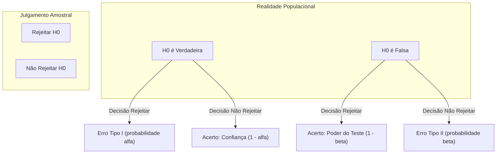
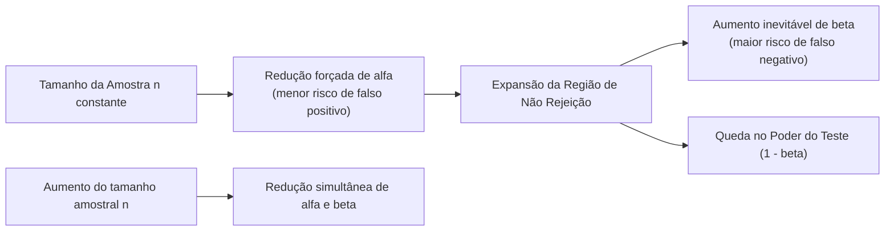
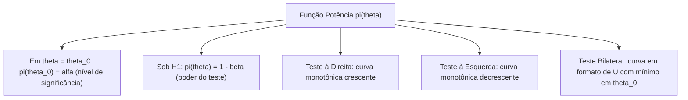
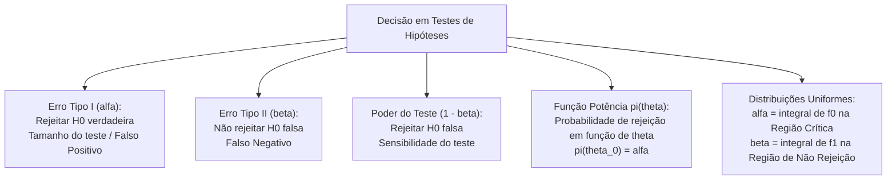

A tomada de decisão estatística fundamentada em amostras aleatórias envolve riscos inevitáveis de julgamento incorreto. Como a decisão decorre de um subconjunto restrito da população, mesmo procedimentos metodológicos estritos estão sujeitos a erros amostrais. Na atividade policial e no comando de bombeiros, decidir pela substituição de armamentos ou pela aquisição de novas viaturas operacionais requer conhecimento preciso das probabilidades de falha na inferência. A compreensão formal dos erros do Tipo I e Tipo II e da curva de potência assegura a minimização desses riscos.

> [!objetivos]
> - Definir com precisão técnica o Erro Tipo I e o Erro Tipo II, distinguindo o evento decisório da sua respectiva probabilidade.
> - Compreender a relação de compensação entre alfa e beta e interpretar o poder do teste estatístico (1 menos beta).
> - Analisar o comportamento matemático e a geometria gráfica da função potência nos testes unilaterais e bilaterais.
> - Conhecer o princípio da razão de verossimilhanças de Neyman-Pearson e o conceito de teste uniformemente mais poderoso.
> - Calcular algebricamente as probabilidades alfa e beta em testes aplicados a variáveis com distribuição uniforme contínua.

## Matriz de Decisão e Tipos de Erros

A dinâmica de um teste de hipóteses estrutura-se sobre uma matriz de contingência decisória que confronta a decisão tomada pelo pesquisador com a realidade fática da população. O estado verdadeiro da natureza é desconhecido, restando ao analista optar pela rejeição ou pela não rejeição da hipótese nula H0.

| Situação Decisória | Hipótese Nula (H0) é Realmente Verdadeira | Hipótese Nula (H0) é Realmente Falsa |
|---|---|---|
| Decisão de Rejeitar H0 | **Erro Tipo I** (falso positivo) Probabilidade = alfa (nível de significância) | **Decisão Correta** (acerto positivo) Probabilidade = 1 - beta (poder do teste) |
| Decisão de Não Rejeitar H0 | **Decisão Correta** (acerto negativo) Probabilidade = 1 - alfa (nível de confiança) | **Erro Tipo II** (falso negativo) Probabilidade = beta |

O Erro Tipo I ocorre quando o procedimento analítico rejeita a hipótese nula sendo ela rigorosamente verdadeira. No contexto jurídico e investigativo, equivale a condenar um réu inocente. Trata-se de um falso positivo, no qual se declara a existência de um efeito inexistente. A probabilidade de cometer o Erro Tipo I é expressa pela letra grega alfa, sendo denominada nível de significância ou tamanho do teste.

O Erro Tipo II ocorre quando o analista deixa de rejeitar a hipótese nula quando ela é na realidade falsa. No paralelo penal, corresponde a absolver um criminoso culpado por insuficiência de elementos probatórios. Trata-se de um falso negativo, no qual a pesquisa fracassa em detectar um efeito real. A probabilidade de cometer o Erro Tipo II é denotada pela letra grega beta.

> [!pegadinha]
> Distinga rigorosamente o erro da probabilidade do erro. O Erro Tipo I é o evento de rejeitar a declaração nula que é faticamente exata; alfa é a probabilidade matemática desse evento. O Erro Tipo II é a omissão de reter a proposição nula falha; beta é a probabilidade desse evento. Bancas examinadoras costumam explorar essa confusão linguística em enunciados teóricos.

> [!bizu]
> Guarde a analogia clássica do alarme de incêndio no quartel de bombeiros:
> - O Erro Tipo I é o alarme falso: o sensor dispara sem haver fogo real. Causa transtorno e deslocamento inútil da viatura.
> - O Erro Tipo II é o alarme inerte: o fogo consome o depósito, mas o equipamento não dispara. Trata-se da falha mais perigosa na operação.

## Relações Matemáticas entre Alfa e Beta

Uma propriedade epistemológica central da teoria estatística reside no fato de que os erros do Tipo I e Tipo II não são complementares entre si. A probabilidade alfa é uma probabilidade condicional calculada sob o pressuposto de que H0 é verdadeira, enquanto a probabilidade beta é condicionada ao fato de H0 ser falsa com determinado parâmetro sob H1.

Dessa natureza condicional independente decorre que a soma alfa mais beta não possui qualquer obrigação de resultar em 1. A soma alfa mais beta pode assumir valores estritamente menores que 1, rigorosamente iguais a 1 ou superiores a 1, a depender da configuração dos pontos críticos e do tamanho amostral.

Os verdadeiros pares complementares no teste de hipóteses são:
- Alfa e 1 menos alfa: o nível de significância alfa é complementar ao nível de confiança 1 menos alfa. Ambos são calculados sob a premissa de H0 verdadeira.
- Beta e 1 menos beta: a probabilidade de falha beta é complementar ao poder ou potência do teste 1 menos beta. Ambos são calculados sob um valor específico do parâmetro na hipótese alternativa H1.

Existe um dilema operacional inevitável entre alfa e beta para um tamanho de amostra fixo. Ao reduzir o nível de significância alfa para tornar o teste mais rigoroso contra falsos positivos, a região de não rejeição expande-se compulsoriamente. Como consequência direta dessa dilatação, aumenta-se a probabilidade beta de reter hipóteses falsas. A única maneira técnica de reduzir simultaneamente alfa e beta consiste no aumento do tamanho da amostra n.

> [!atencao]
> A probabilidade beta não pode ser calculada no vácuo abstrato. Enquanto alfa depende exclusivamente do valor de referência fixado pela hipótese nula H0, o cálculo de beta requer a especificação de um valor alternativo concreto para o parâmetro sob H1. Se dissermos apenas que μ é maior que 50, o erro beta varia continuamente conforme μ assuma 51, 55 ou 70 unidades.

## O Poder do Teste e a Função Potência

O poder do teste, também denominado potência do teste ou sensibilidade analítica, corresponde à probabilidade de rejeitar acertadamente a hipótese nula quando ela é de fato falsa. Representado matematicamente pela expressão 1 menos beta, o poder reflete a capacidade do teste estatístico de identificar diferenças reais existentes na população.

A função potência, comumente grafada como pi(theta), mapeia a probabilidade de rejeição da hipótese nula para cada possível valor real que o parâmetro theta pode assumir na natureza:

pi(theta) = Probabilidade de Rejeitar H0 dado que o parâmetro real vale theta.

Essa formulação analítica apresenta propriedades geométricas marcantes:
- No ponto exato do parâmetro postulado sob a hipótese nula (theta = theta_0), a rejeição de H0 constitui um Erro Tipo I. Logo, pi(theta_0) = alfa.
- Para qualquer valor alternativo de theta sob a vigência de H1, a rejeição constitui uma decisão correta. Portanto, pi(theta) = 1 - beta(theta).

| Tipo de Teste | Hipótese Alternativa (H1) | Comportamento da Função Potência pi(theta) | Ponto Mínimo |
|---|---|---|---|
| Unilateral à direita | theta > theta_0 | Função estritamente crescente à medida que theta cresce acima de theta_0 | Tende a zero para valores negativos |
| Unilateral à esquerda | theta < theta_0 | Função estritamente decrescente à medida que theta se distancia para a esquerda | Tende a zero para valores altos |
| Bilateral (bicaudal) | theta != theta_0 | Função não monótona com formato de U; atinge o mínimo alfa em theta_0 e cresce para ambos os lados | Mínimo local estrito em theta = theta_0 |

## Fatores Determinantes do Poder do Teste

O poder estatístico de um teste depende de quatro fatores operacionais cruciais que devem ser ponderados no planejamento experimental e na fiscalização:

1. Magnitude da diferença real: quanto maior for o distanciamento entre o parâmetro verdadeiro sob H1 e o valor hipotético sob H0, maior será a facilidade empírica de detectar a discrepância, elevando o poder do teste. Se a média verdadeira afastar-se cinco desvios padrão do centro nulo, o teste detectará essa variação com facilidade quase total.
2. Tamanho da amostra: a ampliação do número de observações amostrais reduz o erro padrão da estatística de teste. Isso estreita a dispersão da distribuição amostral e amplia substancialmente o poder para um mesmo nível alfa. Amostras volumosas tornam o teste sensível a desvios mínimos.
3. Nível de significância alfa: fixar um valor de alfa mais tolerante (como 10% em vez de 1%) desloca os pontos críticos em direção ao centro, facilitando a rejeição e elevando o poder 1 menos beta.
4. Variabilidade populacional: populações com menor variância interna apresentam dados mais concentrados, facilitando a identificação do sinal estatístico contra o ruído estocástico.

> [!bizu]
> Nas provas, memorize as três formas diretas de aumentar o poder de um teste de hipóteses: aumentar o tamanho da amostra n, aumentar o nível de significância alfa ou avaliar cenários com maior discrepância real em relação a H0.

## Princípio de Neyman-Pearson e Testes UMP

No âmbito da teoria matemática clássica formulada por Jerzy Neyman e Egon Pearson, busca-se identificar o teste estatístico ótimo para uma dada situação inferencial. O objetivo central consiste em construir uma regra de decisão que maximize o poder do teste para um nível de significância alfa pré-fixado.

O Lema de Neyman-Pearson estabelece que, para testar uma hipótese simples contra uma hipótese alternativa simples com nível de significância fixado em alfa, o teste mais poderoso é construído a partir da razão de verossimilhanças:

Razão = L(theta_0 | amostra) / L(theta_1 | amostra) <= k.

Rejeita-se a hipótese nula quando a plausibilidade dos dados sob H0 for substancialmente menor do que a verossimilhança dos dados sob H1, segundo uma constante crítica k determinada pelo nível alfa escolhido. Esse resultado prova que nenhum outro teste com o mesmo nível alfa pode atingir poder analítico superior.

Quando a hipótese alternativa é composta (como H1: theta > theta_0), surge o conceito de Teste Uniformemente Mais Poderoso (UMP). Um teste é dito UMP se ele maximiza a potência estatística para todo e qualquer valor do parâmetro dentro do domínio de H1, mantendo a probabilidade do Erro Tipo I controlada em alfa. A existência de testes UMP é garantida em famílias paramétricas que exibem a propriedade de razão de verossimilhança monótona, como os modelos da família exponencial unimodal.

| Conceito Analítico | Definição Teórica | Condição de Aplicação |
|---|---|---|
| Lema de Neyman-Pearson | Teste mais poderoso baseado na razão de verossimilhanças amostrais | Hipótese nula simples versus alternativa simples |
| Razão de Verossimilhanças | Quociente entre a densidade sob H0 e a densidade sob H1 | Base para determinação dos pontos críticos de corte |
| Teste UMP | Maximiza o poder para qualquer valor do parâmetro alternativo | Famílias exponenciais com razão monótona |

## Testes de Hipóteses para a Distribuição Uniforme Contínua

O cálculo das probabilidades dos erros em distribuições uniformes contínuas constitui um dos tópicos prediletos de bancas de concurso para verificar o domínio do cálculo integral básico e raciocínio geométrico.

Seja uma variável aleatória X com distribuição uniforme contínua no intervalo [a, b]. Sua função densidade de probabilidade é dada por:

f(x) = 1 / (b - a), para x pertencente a [a, b], e f(x) = 0 caso contrário.

A probabilidade de X assumir valores em qualquer subintervalo [m, n] contido em [a, b] equivale à área do retângulo correspondente:

P(m <= X <= n) = (n - m) / (b - a).

Para calcular os erros de inferência na distribuição uniforme, segue-se a regra canônica:
- Cálculo de alfa: integra-se a densidade sob a hipótese H0 dentro da região de rejeição (região crítica).
- Cálculo de beta: integra-se a densidade sob a hipótese verdadeira H1 dentro da região de não rejeição.

| Probabilidade | Hipótese Vigente | Região de Integração | Significado no Teste |
|---|---|---|---|
| Nível de significância (alfa) | H0 é verdadeira | Região Crítica (RC) | Área da densidade de H0 que invade a zona de rejeição |
| Probabilidade de erro (beta) | H1 é verdadeira | Região de Não Rejeição (RNR) | Área da densidade de H1 que cai na zona de aceitação |
| Poder do teste (1 - beta) | H1 é verdadeira | Região Crítica (RC) | Área da densidade de H1 que cai na zona de rejeição |

## Exercício Resolvido: Erros e Poder na Distribuição Uniforme

> [!resolvido]
> **Enunciado de Avaliação Pericial:**
> Um perito criminal examina uma única medição aleatória X de pureza química de uma substância apreendida. Sabe-se que X possui distribuição uniforme contínua. Formula-se o seguinte teste de hipóteses:
> Hipótese nula H0: X é uniforme no intervalo de 0 a 10 [0, 10].
> Hipótese alternativa H1: X é uniforme no intervalo de 4 a 14 [4, 14].
> A regra de decisão fixada pelo laboratório estabelece que a hipótese nula H0 será rejeitada se o valor observado de X for maior do que 8 (Região Crítica: X > 8).
> Determine:
> a) O nível de significância alfa do teste.
> b) A probabilidade beta de cometer o Erro Tipo II.
> c) O poder do teste estatístico.
>
> **Resolução Passo a Passo:**
> 
> 1. **Cálculo do nível de significância alfa:**
> Por definição, alfa é a probabilidade de rejeitar H0 quando H0 é verdadeira.
> Sob H0, X distribui-se uniformemente no intervalo de 0 a 10. A densidade é f0(x) = 1 / (10 - 0) = 1 / 10 = 0,10 para x entre 0 e 10.
> A regra rejeita H0 se X > 8. A região crítica sob o suporte de H0 corresponde ao intervalo de 8 a 10.
> Comprimento do intervalo de rejeição sob H0 = 10 - 8 = 2 unidades.
> Probabilidade alfa = (10 - 8) / (10 - 0) = 2 / 10 = 0,20 (ou 20%).
>
> 2. **Cálculo do Erro Tipo II beta:**
> Por definição, beta é a probabilidade de não rejeitar H0 quando H1 é a hipótese verdadeira.
> A região de não rejeição é o complemento da região crítica, ou seja, X <= 8.
> Sob a hipótese alternativa H1, a variável distribui-se uniformemente no intervalo de 4 a 14. A densidade real é f1(x) = 1 / (14 - 4) = 1 / 10 = 0,10 para x entre 4 e 14.
> O intervalo de não rejeição sob o suporte verdadeiro de H1 inicia em 4 e vai até 8.
> Comprimento do intervalo de não rejeição sob H1 = 8 - 4 = 4 unidades.
> Probabilidade beta = (8 - 4) / (14 - 4) = 4 / 10 = 0,40 (ou 40%).
>
> 3. **Cálculo do poder do teste:**
> O poder é a probabilidade de rejeitar H0 quando H1 é verdadeira, calculado como 1 menos beta.
> Poder = 1 - 0,40 = 0,60 (ou 60%).
> Alternativamente, calcula-se a área da região crítica (X > 8) sob a distribuição verdadeira H1 [4, 14]:
> Intervalo sob H1 acima de 8 = de 8 a 14, cujo comprimento é 14 - 8 = 6 unidades.
> Poder = (14 - 8) / (14 - 4) = 6 / 10 = 0,60.
>
> 4. **Conclusão Pericial:**
> O teste apresenta nível de significância de 20%, probabilidade de erro Tipo II de 40% e poder analítico de 60%. Note que alfa + beta = 0,20 + 0,40 = 0,60, ilustrando que a soma não precisa totalizar 1.

## Mapa do capítulo

### Para fixar

- O Erro Tipo I expressa a decisão de rejeitar a nulidade fática legítima, correspondendo à probabilidade alfa.
- O Erro Tipo II consiste na retenção equivocada de uma premissa nula inverídica, medida pela probabilidade beta.
- O nível de significância alfa representa o risco de falso positivo e recebe o nome de tamanho do teste.
- O poder ou potência estatística do procedimento analítico equivale a 1 menos beta.
- As probabilidades alfa e beta não formam grandezas complementares e operam sob hipóteses condicionais distintas.
- A expansão do número de observações amostrais n possibilita reduzir simultaneamente ambos os riscos de erro.
- A curva de potência atinge sua ordenada mínima igual a alfa exatamente no ponto nulo sob teste bilateral.
- Nas variáveis com densidade retangular uniforme, as probabilidades de erro resultam de razões geométricas de comprimentos.
