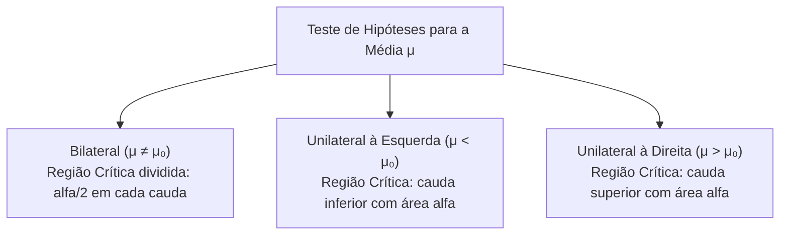
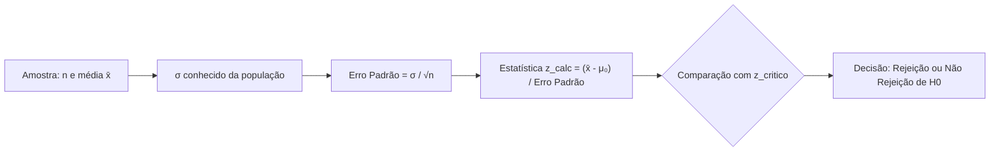
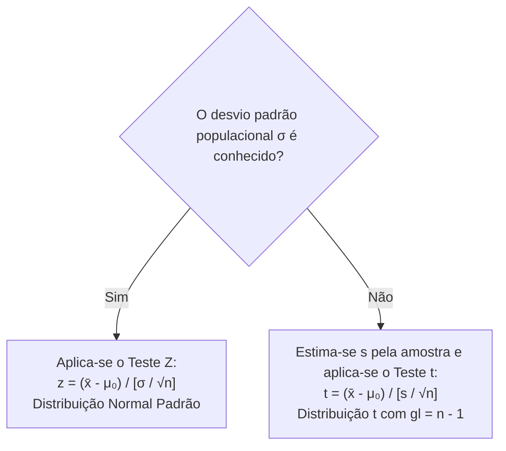
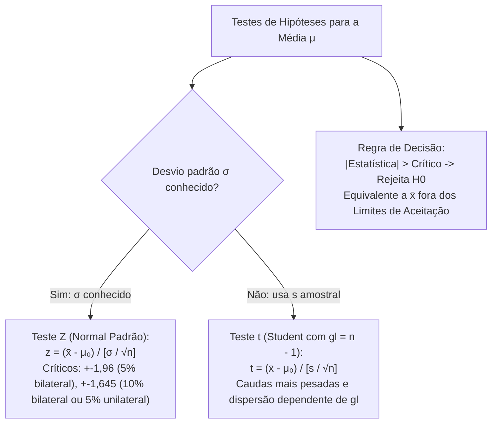

A avaliação inferencial da média aritmética de uma população representa o procedimento analítico mais demandado em perícias, auditorias e gestão da segurança pública. Seja para aferir a conformidade do tempo médio de resposta a sinistros operacionais ou checar a carga balística média de projéteis apreendidos, o pesquisador confronta os dados amostrais com um padrão pré-fixado. A escolha do modelo estatístico adequado depende criticamente do conhecimento prévio da variância populacional, alternando entre a distribuição normal padrão Z e a distribuição t de Student.

> [!objetivos]
> - Estruturar formalmente o teste de hipóteses para a média populacional em cenários bilaterais e unilaterais.
> - Aplicar o Teste Z quando a variância populacional for conhecida ou em grandes amostras via Teorema Central do Limite.
> - Manusear os valores críticos fundamentais da curva normal padrão associados aos níveis de significância usuais.
> - Empregar a distribuição t de Student com n menos um graus de liberdade quando a variância populacional for desconhecida.
> - Calcular analiticamente o poder do teste na detecção de desvios reais da média e interpretar decisões em múltiplos níveis alfa.

## Estrutura Básica do Teste para a Média

O teste de hipóteses para a média investiga se a média populacional μ coincide com um valor de referência constante, denotado por μ₀. A declaração de nulidade assume que qualquer diferença observada entre a média da amostra x̄ e o parâmetro μ₀ decorre unicamente de flutuações aleatórias da amostragem. Em linhas industriais, uma máquina de envase de garrafas de refrigerante ou de água mineral é calibrada para envasar cada unidade com volume médio de 500 mililitros. Desvios para mais geram desperdício de insumos, enquanto desvios para menos configuram lesão ao consumidor.

A formulação das hipóteses estatísticas admite três configurações conforme o objetivo do comando ou do perito:

1. Teste Bilateral (não direcional):
   - Hipótese nula H0: μ = μ₀.
   - Hipótese alternativa H1: μ != μ₀.
   - A região crítica reparte-se simetricamente em alfa sobre dois em cada extremidade da distribuição.

2. Teste Unilateral à Esquerda (direcional inferior):
   - Hipótese nula H0: μ >= μ₀ (ou μ = μ₀).
   - Hipótese alternativa H1: μ < μ₀.
   - A região crítica concentra a probabilidade total alfa exclusivamente na cauda esquerda. É o modelo empregado para testar se o tempo de resposta de uma guarnição militar foi reduzido ou se o gasto operacional médio diminuiu.

3. Teste Unilateral à Direita (direcional superior):
   - Hipótese nula H0: μ <= μ₀ (ou μ = μ₀).
   - Hipótese alternativa H1: μ > μ₀.
   - A região crítica posiciona a probabilidade total alfa integralmente na cauda direita. Esse desenho aplica-se para averiguar se um novo programa de treinamento aumentou o rendimento físico de um atleta militar ou a durabilidade média em horas de lâmpadas de emergência.



## O Teste Z com Variância Populacional Conhecida

Quando o desvio padrão populacional σ é previamente conhecido por histórico de produção, calibração industrial ou registros consolidados, a distribuição da média amostral x̄ é rigorosamente modelada pela distribuição normal. Essa propriedade aplica-se diretamente se a população de origem for normal. Se a população original apresentar distribuição desconhecida, a aproximação normal é plenamente assegurada pelo Teorema Central do Limite para amostras com tamanho n suficientemente grande (n >= 30).

Sob a premissa de que a hipótese nula H0 é verdadeira, a média amostral possui média populacional μ₀ e dispersão governada pelo erro padrão:

σ(x̄) = σ / √n.

A estatística calculada do teste, denotada por z_calc, resulta da padronização direta da média amostral, convertendo o resultado observado em um escore z padronizado:

z_calc = (x̄ - μ₀) / [σ / √n].

A estatística z_calc expressa a distância entre a média observada e a média hipotética em termos de desvios padrão amostrais. Um escore z de 2,0 indica que a média amostral observada situa-se dois desvios padrão inteiros acima do valor alegado sob a hipótese nula.



## Valores Críticos Clássicos da Distribuição Normal

A decisão do teste Z decorre da comparação direta entre o escore z_calc e os quantis críticos z_crit tabelados para a distribuição normal padrão Z.

| Nível de Significância (alfa) | Nível de Confiança (1 - alfa) | Teste Bilateral (z_crit) | Teste Unilateral à Direita (z_crit) | Teste Unilateral à Esquerda (z_crit) |
|---|---|---|---|---|
| 10% (0,10) | 90% (0,90) | +- 1,645 | + 1,282 | - 1,282 |
| 5% (0,05) | 95% (0,95) | +- 1,960 | + 1,645 | - 1,645 |
| 1% (0,01) | 99% (0,99) | +- 2,576 | + 2,326 | - 2,326 |

A regra decisória expressa-se com clareza matemática:
- No teste bilateral: rejeita-se H0 se o módulo da estatística calculada for estritamente superior ao quantil crítico (|z_calc| > z_crit).
- No teste à direita: rejeita-se H0 se z_calc for estritamente superior a +z_crit.
- No teste à esquerda: rejeita-se H0 se z_calc for estritamente inferior a -z_crit.

> [!bizu]
> Observe a simetria entre testes unilaterais e bilaterais. O quantil crítico do teste unilateral com significância de 5% (z = 1,645) é exatamente igual ao valor crítico do teste bilateral com significância de 10%. Isso ocorre porque, no bilateral a 10%, cada cauda individual abriga exatamente 5% da probabilidade total sob a curva.

## Decisão em Escala Original e Limites de Aceitação

A decisão estatística pode ser conduzida na escala padronizada do escore Z ou diretamente na unidade de medida original da variável estudada. Em contextos práticos de engenharia e fiscalização, como na inspeção de lâmpadas de iluminação tática cuja vida útil é expressa em horas de funcionamento contínuo ou no envase automatizado de garrafas de fluído hidráulico, os gestores preferem estabelecer limites físicos operacionais diretos.

Para o teste bilateral com variância populacional conhecida, a região de não rejeição na escala da média amostral x̄ é delimitada pelo intervalo de aceitabilidade centrado no parâmetro nulo μ₀:

Limite Inferior (LINF) = μ₀ - z_crit × [σ / √n].
Limite Superior (LSUP) = μ₀ + z_crit × [σ / √n].

Se a média amostral observada x̄ situar-se entre LINF e LSUP, a hipótese nula não é rejeitada, concluindo-se que o processo opera em conformidade com as tolerâncias normais de fabricação. Se x̄ ficar estritamente abaixo de LINF ou acima de LSUP, a hipótese nula é terminantemente rejeitada ao nível alfa, exigindo paralisação imediata da máquina para manutenção corretiva. Ambas as abordagens, por escore z ou por limites físicos de aceitação, produzem conclusões decisórias matematicamente idênticas.

```mermaid Regiões de decisão na escala original
flowchart LR
    subgraph Escala da Variável x̄
    direction LR
    R1["Rejeição de H0
x̄ < LINF"]
    NR["Não Rejeição de H0
LINF ≤ x̄ ≤ LSUP"]
    R2["Rejeição de H0
x̄ > LSUP"]
    end
```

> [!exemplo]
> Suponha que uma fábrica forneça lâmpadas especiais para viaturas do Corpo de Bombeiros. As especificações afirmam vida útil média de 1000 horas com desvio padrão conhecido de 80 horas. O batalhão testa uma amostra de 64 lâmpadas ao nível de significância de 5% (z_crit = 1,96).
> O erro padrão é σ(x̄) = 80 / √64 = 80 / 8 = 10 horas.
> Os limites de aceitação na escala original são:
> LINF = 1000 - 1,96 × 10 = 1000 - 19,6 = 980,4 horas.
> LSUP = 1000 + 1,96 × 10 = 1000 + 19,6 = 1019,6 horas.
> Se a amostra acusar média de 975 horas, o lote será prontamente rejeitado por situar-se abaixo de LINF.

## Controle de Qualidade em Embalagens e Empacotamento

Em auditorias de suprimentos de campanha e logística militar, o controle do peso líquido em processos automatizados de empacotar rações operacionais e suprimentos balísticos é essencial. Considere uma máquina industrial programada para empacotar embalagens de ração militar com peso nominal de 1000 gramas. A fiscalização pericial recolhe amostras periódicas para avaliar a calibração do maquinário.

Se o desvio padrão do processo for estável e conhecido por série histórica (por exemplo, σ = 20 gramas), o teste Z bilateral monitora tanto o sobrepeso quanto o subpeso. Uma média amostral de 1065 gramas em uma amostra de 25 embalagens geraria um desvio absoluto de 65 gramas em relação ao valor nominal. Ao padronizar essa diferença, o escore Z atingiria:

z_calc = (1065 - 1000) / [20 / √25] = 65 / [20 / 5] = 65 / 4 = 16,25.

Esse valor absoluto extraordinariamente elevado situa-se muito além de qualquer quantil crítico convencional da tabela normal padrão. O resultado implicaria a imediata rejeição da hipótese nula de calibração exata, denunciando desajuste severo no empacotamento automatizado das embalagens.

## Julgamento em Múltiplos Níveis de Significância

A sensibilidade do teste varia com a magnitude do nível de significância alfa selecionado pelo pesquisador. Fixar um alfa menor torna o teste mais conservador, exigindo discrepâncias amostrais mais acentuadas para autorizar a rejeição da hipótese nula.

Essa dinâmica gera uma hierarquia lógica fundamental para concursos públicos:
- Se um resultado amostral conduz à rejeição de H0 ao nível de 1%, esse mesmo resultado rejeitará compulsoriamente H0 para qualquer nível de significância mais brando, como 5% e 10%. A região crítica a 1% é um subconjunto estrito da região crítica a 5%.
- Por outro lado, se a estatística amostral não permite rejeitar H0 ao nível de 10%, ela jamais poderá ser rejeitada ao nível de 5% ou 1%.

> [!pegadinha]
> Se um candidato calcula z_calc = 1,80 em um teste bilateral, ele verifica que |1,80| é menor que 1,96 (valor crítico a 5%), logo não rejeita H0 a 5%. Contudo, |1,80| é maior que 1,645 (valor crítico a 10%), rejeitando H0 ao nível de 10%. Dizer que uma hipótese é rejeitada depende imperativamente da declaração do nível alfa adotado.

## O Teste t de Student para Variância Desconhecida

Na esmagadora maioria das investigações operacionais práticas, o desvio padrão populacional σ é uma grandeza desconhecida. Nesses casos reais, o analista deve estimar o desvio padrão populacional a partir dos próprios dados da amostra, calculando o desvio padrão amostral s.

A variância amostral corrigida sem viés é dada por:

s² = [1 / (n - 1)] × soma((x_i - x̄)²).

O erro padrão estimado da média amostral substitui σ por s:

s(x̄) = s / √n.

Ao substituir o parâmetro populacional constante σ pela variável aleatória s no quociente de padronização, a estatística resultante não segue mais a distribuição normal padrão Z. Quando a população de origem possui distribuição normal, a estatística obedece rigorosamente à distribuição t de Student com n menos um graus de liberdade (gl = n - 1):

t_calc = (x̄ - μ₀) / [s / √n].



## Propriedades da Distribuição t de Student

A distribuição t de Student, introduzida pelo químico e estatístico William Sealy Gosset sob o pseudônimo de Student, apresenta características matemáticas essenciais para a prova:

1. Simetria e formato: a curva t de Student é perfeitamente simétrica em torno de zero e possui formato clássico de sino, assemelhando-se visualmente à curva normal padrão.
2. Dispersão e caudas pesadas: por incorporar a incerteza adicional da estimativa amostral de s, a distribuição t exibe achatamento maior no pico central e caudas mais volumosas e pesadas do que a curva Z. Há maior concentração de probabilidade nas regiões extremas.
3. Dependência dos graus de liberdade: a distribuição t não é uma curva única, mas uma família contínua de distribuições indexadas pelo número de graus de liberdade (gl = n - 1).
4. Convergência assintótica: à medida que o tamanho da amostra n cresce e os graus de liberdade tendem ao infinito, o desvio padrão amostral s converge para o verdadeiro σ. Consequentemente, a curva t de Student converge suavemente para a distribuição normal padrão Z.

| Atributo Comparado | Distribuição Normal Padrão (Z) | Distribuição t de Student (t) |
|---|---|---|
| Parâmetro de dispersão | σ populacional conhecido | s amostral estimado com gl = n - 1 |
| Curtose e pico central | Curtose padrão (mesocúrtica) | Pico mais baixo e achatado |
| Espessura das caudas | Caudas mais finas e decaimento rápido | Caudas pesadas com maior probabilidade nos extremos |
| Valores críticos a 5% bilateral | z_crit = 1,960 constante | t_crit > 1,960 (depende de gl; ex.: gl=10 -> t=2,228) |
| Comportamento assintótico | Distribuição limite imutável | Converge para Z quando os graus de liberdade tendem a infinito |

> [!atencao]
> A leitura da tabela t de Student exige duas informações obrigatórias: os graus de liberdade (calculados como n menos um para o teste de uma média) e a área sob a cauda (alfa/2 no teste bilateral ou alfa no teste unilateral). Confundir a coluna unilateral com a bilateral é a causa mais frequente de erro de leitura em provas de concurso.

## Exercício Resolvido: Teste t para uma Média Populacional

> [!resolvido]
> **Enunciado de Investigação Balística:**
> Um laboratório de perícia de armamento da Polícia Militar avalia um novo lote de munições calibre 9 mm. O fabricante garante que a velocidade média dos projéteis na boca do cano atinge 360 metros por segundo. O perito recolhe uma amostra aleatória de 16 disparos de teste, obtendo média amostral de 354 metros por segundo e desvio padrão amostral corrigido de 12 metros por segundo. Admitindo que a velocidade dos projéteis segue uma distribuição normal, teste ao nível de significância de 5% se o lote apresenta velocidade inferior à especificada pelo fabricante.
> Dados complementares da tabela t de Student:
> - Para gl = 15: t_0,05 unilateral = 1,753; t_0,025 bilateral = 2,131.
> - Para gl = 16: t_0,05 unilateral = 1,746; t_0,025 bilateral = 2,120.
>
> **Resolução Passo a Passo:**
> 
> 1. **Definição das hipóteses estatísticas:**
> O teste busca averiguar se a velocidade é inferior ao padrão alegado de 360 m/s. Trata-se de um teste unilateral à esquerda:
> H0: μ >= 360 m/s (ou μ = 360 m/s).
> H1: μ < 360 m/s.
>
> 2. **Identificação dos parâmetros amostrais e graus de liberdade:**
> - Tamanho da amostra: n = 16 disparos.
> - Graus de liberdade: gl = n - 1 = 16 - 1 = 15 graus de liberdade.
> - Média amostral: x̄ = 354 m/s.
> - Desvio padrão amostral: s = 12 m/s.
> - Média postulada sob H0: μ₀ = 360 m/s.
>
> 3. **Cálculo do erro padrão amostral:**
> s(x̄) = s / √n = 12 / √16 = 12 / 4 = 3,0 m/s.
>
> 4. **Cálculo da estatística do teste t:**
> t_calc = (x̄ - μ₀) / s(x̄) = (354 - 360) / 3,0 = -6,0 / 3,0 = -2,00.
>
> 5. **Identificação do ponto crítico tabelado:**
> O teste é unilateral à esquerda com alfa = 0,05 e gl = 15.
> O valor crítico tabelado é t_crit = -1,753.
> A região crítica é definida por todos os valores de t estritamente inferiores a -1,753 (t < -1,753).
>
> 6. **Julgamento e conclusão pericial:**
> O valor calculado t_calc = -2,00 é menor do que o ponto crítico -1,753, situando-se dentro da região crítica de rejeição.
> Decisão: rejeita-se a hipótese nula H0 ao nível de significância de 5%.
> Conclusão técnica: há evidências amostrais estatisticamente significantes para refutar a declaração do fabricante, confirmando que a velocidade média dos projéteis do lote é inferior aos 360 m/s contratados.

## Mapa do capítulo



### Para fixar

- O teste de hipóteses para a média avalia a conformidade de μ com base na média amostral x̄.
- O Teste Z é empregado quando o desvio padrão populacional σ for previamente conhecido.
- A estatística z_calc resulta da divisão do desvio (x̄ - μ₀) pelo erro padrão σ sobre raiz de n.
- Os valores críticos clássicos de Z para 5% são mais ou menos 1,96 no bilateral e 1,645 no unilateral.
- O Teste t de Student é obrigatório quando o desvio padrão populacional for desconhecido e estimado por s.
- A distribuição t de Student depende exclusivamente dos graus de liberdade, dados por n menos um.
- A curva t possui caudas mais pesadas e achatamento maior do que a normal, convergindo para Z para grandes amostras.
- Rejeitar H0 ao nível de 1% assegura a rejeição matemática obrigatória aos níveis de 5% e 10%.
