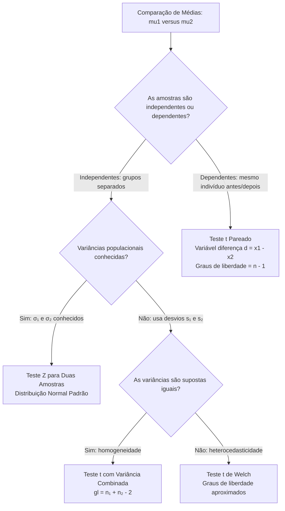
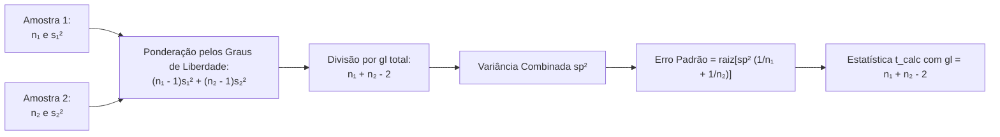
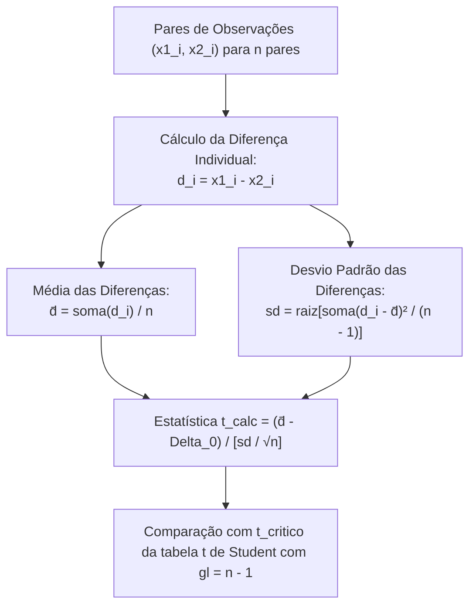
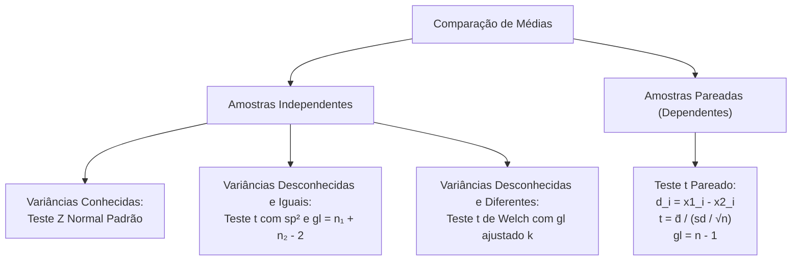

A comparação do desempenho médio entre dois grupos populacionais constitui tarefa analítica frequente na gestão pública. Ela também é rotineira na atividade pericial das corporações militares. Avaliar se um novo protocolo supera o método convencional exige testes bivariados. O mesmo ocorre ao confrontar a eficiência balística de munições ou medir tempos de resposta antes e depois de uma intervenção. A escolha da técnica correta demanda distinguir amostras independentes de amostras pareadas. É essencial também ponderar a homogeneidade das variâncias populacionais.

> [!objetivos]
> - Formular as hipóteses nula e alternativa para comparação de médias entre duas populações.
> - Aplicar o Teste Z para duas amostras independentes sob variâncias populacionais conhecidas.
> - Empregar a variância combinada (pooled variance) no Teste t com variâncias desconhecidas e supostamente iguais.
> - Compreender o procedimento de Welch para variâncias desconhecidas e heterogêneas.
> - Executar o Teste t pareado para dados dependentes, diferenciando-o analiticamente do delineamento independente.

## Formulação Geral das Hipóteses de Comparação

Ao comparar as médias mu1 e mu2 de duas populações, o analista investiga se existe diferença real entre elas. Ele verifica se a discrepância entre as médias amostrais x̄₁ e x̄₂ decorre apenas do erro amostral.

A hipótese nula H0 postula tradicionalmente a igualdade estrita entre as médias. Isso equivale a dizer que a diferença entre os parâmetros é nula:

H0: mu1 = mu2 (ou mu1 - mu2 = 0).

Em situações específicas, o comando pode fixar uma diferença mínima de referência Delta_0 diferente de zero (por exemplo, exigir que o novo método reduza o tempo em pelo menos dez minutos, postulando H0: mu1 - mu2 = 10).

A hipótese alternativa H1 define a direção da investigação:
- Bilateral: H1: mu1 != mu2 (ou mu1 - mu2 != Delta_0). Rejeita-se H0 se a diferença observada for excessivamente positiva ou excessivamente negativa.
- Unilateral à esquerda: H1: mu1 < mu2 (ou mu1 - mu2 < Delta_0). Rejeita-se H0 apenas se a primeira média for substancialmente inferior à segunda.
- Unilateral à direita: H1: mu1 > mu2 (ou mu1 - mu2 > Delta_0). Rejeita-se H0 quando a primeira média supera significativamente a segunda.

## Duas Amostras Independentes com Variâncias Conhecidas

Considere duas populações normais com desvios padrão σ₁ e σ₂ conhecidos por histórico. A distribuição amostral da diferença das médias (x̄₁ - x̄₂) é exatamente normal.

Pela propriedade de linearidade da esperança e aditividade das variâncias de variáveis aleatórias independentes, temos:
- Esperança da diferença: E(x̄₁ - x̄₂) = mu1 - mu2.
- Variância da diferença: Var(x̄₁ - x̄₂) = Var(x̄₁) + Var(x̄₂) = (σ₁² / n₁) + (σ₂² / n₂).

O erro padrão da diferença amostral corresponde à raiz quadrada da soma das variâncias amostrais:

Erro Padrão = raiz[(σ₁² / n₁) + (σ₂² / n₂)].

A estatística padronizada do Teste Z assume a seguinte forma analítica:

z_calc = [(x̄₁ - x̄₂) - Delta_0] / raiz[(σ₁² / n₁) + (σ₂² / n₂)].

> [!pegadinha]
> A variância da diferença entre duas variáveis aleatórias independentes é a SOMA das suas respectivas variâncias, nunca a subtração. Mesmo quando a operação é de subtração entre as médias (x̄₁ menos x̄₂), as incertezas estocásticas sempre se acumulam: Var(X1 - X2) = Var(X1) + Var(X2). Além disso, é erro grave somar diretamente os desvios padrão; deve-se somar as variâncias e depois extrair a raiz quadrada do conjunto.

| Parâmetro Estatístico | Grupo Populacional 1 | Grupo Populacional 2 | Diferença Amostral (Grupo 1 - Grupo 2) |
|---|---|---|---|
| Tamanho Amostral | n₁ observações | n₂ observações | Não requer tamanhos iguais (n₁ pode diferir de n₂) |
| Média Amostral | x̄₁ | x̄₂ | Diferença observada = x̄₁ - x̄₂ |
| Desvio Padrão Conhecido | σ₁ | σ₂ | Erro Padrão = raiz[(σ₁² / n₁) + (σ₂² / n₂)] |
| Distribuição da Estatística | Normal | Normal | Estatística z_calc com distribuição Normal Padrão Z |

## Duas Amostras Independentes com Variâncias Desconhecidas e Iguais

Em aplicações práticas de segurança pública, os parâmetros populacionais σ₁ e σ₂ são quase invariavelmente desconhecidos, sendo estimados a partir das amostras pelos desvios padrão amostrais s₁ e s₂.

Suponha que as duas populações compartilhem a mesma dispersão interna (homocedasticidade: σ₁² = σ₂² = σ²). A técnica recomendada combina as informações de ambas as amostras. Isso produz uma estimativa ponderada e precisa da variância comum.

Essa estimativa combinada denomina-se variância amostral agrupada ou variância combinada (pooled variance), denotada por sp²:

sp² = [(n₁ - 1) × s₁² + (n₂ - 1) × s₂²] / [n₁ + n₂ - 2].

O numerador representa a soma dos quadrados dos desvios de ambos os grupos. O denominador [n₁ + n₂ - 2] expressa a soma dos graus de liberdade de cada amostra: (n₁ - 1) + (n₂ - 1).

O erro padrão estimado da diferença das médias é dado por:

SE_pool = raiz[sp² × (1 / n₁ + 1 / n₂)].

A estatística de teste resultante segue rigorosamente a distribuição t de Student com gl = n₁ + n₂ - 2 graus de liberdade:

t_calc = [(x̄₁ - x̄₂) - Delta_0] / raiz[sp² × (1 / n₁ + 1 / n₂)].

> [!bizu]
> Observe a intuição matemática da variância combinada: se os dois tamanhos amostrais forem perfeitamente idênticos (n₁ = n₂), a variância combinada sp² reduz-se à média aritmética simples entre s₁² e s₂²: sp² = (s₁² + s₂²) / 2. Se os tamanhos forem diferentes, a amostra maior recebe peso proporcionalmente maior na estimativa.

> [!exemplo]
> Em uma auditoria de consumo veicular, o comandante compara duas marcas de viaturas operacionais. A marca Alfa roda com 10 viaturas e desvio amostral de 1,2 km/l. A marca Beta roda com 15 viaturas e desvio amostral de 1,5 km/l. Supondo variâncias populacionais homogêneas, a variância combinada pondera os graus de liberdade:
> sp² = [(10 - 1) × 1,2² + (15 - 1) × 1,5²] / [10 + 15 - 2].
> O cálculo resulta em sp² = [9 × 1,44 + 14 × 2,25] / 23 = [12,96 + 31,50] / 23 = 44,46 / 23 = 1,933.
> O desvio padrão combinado é a raiz de 1,933, equivalente a 1,39 km/l.

## Variâncias Desconhecidas e Diferentes: O Teste de Welch

Se as populações apresentarem variabilidades heterogêneas (σ₁² != σ₂²), a homocedasticidade não se sustenta. O emprego da variância agrupada sp² torna-se então inadequado.

Nessa conjuntura, utiliza-se a aproximação de Welch-Satterthwaite, também conhecida como Teste t de Welch. Cada variância amostral entra separadamente no cômputo do erro padrão:

SE_welch = raiz[(s₁² / n₁) + (s₂² / n₂)].

A estatística calculada assume a forma direta:

t_calc = [(x̄₁ - x̄₂) - Delta_0] / raiz[(s₁² / n₁) + (s₂² / n₂)].

A estatística calculada t_calc segue uma distribuição t de Student aproximada. O número de graus de liberdade da distribuição de referência não é mais n₁ + n₂ - 2, mas sim um valor ajustado k, calculado pela complexa equação de Welch-Satterthwaite:

k = [ (s₁² / n₁) + (s₂² / n₂) ]² / [ ((s₁² / n₁)² / (n₁ - 1)) + ((s₂² / n₂)² / (n₂ - 1)) ].

O valor numérico de k raramente resulta em um número inteiro. Ele costuma ser arredondado para o inteiro mais próximo ou truncado para baixo. Isso assegura decisões conservadoras no julgamento.

| Cenário de Variâncias | Estimador de Dispersão | Fórmula do Erro Padrão | Graus de Liberdade |
|---|---|---|---|
| Variâncias Conhecidas | σ₁ e σ₂ populacionais | raiz[(σ₁² / n₁) + (σ₂² / n₂)] | Normal Padrão Z (gl infinito) |
| Desconhecidas e Iguais | Variância combinada sp² | raiz[sp² × (1/n₁ + 1/n₂)] | gl = n₁ + n₂ - 2 (exato) |
| Desconhecidas e Diferentes | Variâncias amostrais s₁² e s₂² | raiz[(s₁² / n₁) + (s₂² / n₂)] | k ajustado de Welch (aproximado) |

## Delineamento Pareado versus Delineamento Independente

A correta identificação da estrutura de dependência dos dados amostrais é um dos divisores de águas mais cobrados em certames de nível superior.

Em amostras independentes, os elementos do Grupo 1 não guardam vínculo com os do Grupo 2. Não há qualquer correlação biológica, física ou temporal entre eles. Por exemplo, compare o tempo de corrida de 30 recrutas do Recife com 30 recrutas de Caruaru. Esse arranjo configura um delineamento clássico independente.

Em contrapartida, em amostras pareadas (ou dependentes), as observações ocorrem em pares naturalmente vinculados. Essa estrutura manifesta-se tipicamente em três formatos experimentais:
1. Medições repetidas no mesmo indivíduo: registra-se a frequência cardíaca ou a pontuação de tiro de cada policial antes e depois de um curso intensivo de controle de estresse.
2. Sujeitos geminados ou emparelhados: indivíduos com características idênticas de idade, peso e condição física são pareados para receberem intervenções distintas.
3. Correspondência física natural: comparar a aderência do pneu esquerdo com o pneu direito na mesma viatura militar ou o desgaste de duas botas no mesmo soldado.

> [!atencao]
> Jamais trate dados pareados como se fossem duas amostras independentes. Tratar dados dependentes como independentes ignora a covariância positiva natural entre os pares, inflacionando artificialmente o erro padrão do denominador. Esse erro grosseiro reduz drasticamente o poder estatístico do teste, impedindo a detecção de efeitos reais causados pela intervenção investigada.

## O Teste t para Amostras Pareadas

A análise de amostras pareadas calcula as diferenças par a par. Esse procedimento elimina a variabilidade biológica ou individual entre sujeitos. O procedimento simplifica o problema. Ele converte duas amostras aparentes em um teste clássico de uma única média amostral.

Sejam (x1_i, x2_i) as observações pareadas do i-ésimo indivíduo para i variando de 1 até n pares. Define-se a variável aleatória da diferença individual:

d_i = x1_i - x2_i.

Calcula-se a média amostral das diferenças:

d̄ = [1 / n] × soma(d_i).

Matematicamente, a média das diferenças d̄ é perfeitamente idêntica à diferença entre as médias amostrais originais: d̄ = x̄₁ - x̄₂. A variância da diferença sd² é calculada estritamente sobre a série numérica das n diferenças d_i:

sd² = [1 / (n - 1)] × soma((d_i - d̄)²).

O desvio padrão amostral das diferenças é sd = √(sd²), e o erro padrão da média das diferenças vale:

SE_d = sd / √n.

Sob a hipótese nula de que a diferença média populacional μd é igual a Delta_0 (usualmente Delta_0 = 0 para ausência de efeito), a estatística do Teste t Pareado obedece à distribuição t de Student com n menos um graus de liberdade (gl = n - 1):

t_calc = (d̄ - Delta_0) / [sd / √n].

> [!bizu]
> Memorize para a prova a relação entre os graus de liberdade nos dois delineamentos:
> - Amostras independentes com variância combinada: gl = n₁ + n₂ - 2. Se n₁ = 15 e n₂ = 15, temos gl = 28.
> - Amostras pareadas: gl = n - 1, onde n é o número de pares. Para 15 pares de indivíduos, temos gl = 14.
> Tratar dados pareados como independentes dobra falsamente os graus de liberdade e distorce a análise.

## Comparativo Metodológico dos Delineamentos

A escolha entre o delineamento por grupos independentes e o pareamento orienta toda a estrutura do teste. A tabela a seguir sintetiza as diretrizes práticas para a prova:

| Critério de Comparação | Delineamento com Grupos Independentes | Delineamento com Dados Pareados |
|---|---|---|
| Seleção dos participantes | Amostras sorteadas de populações distintas sem vínculo | Mesmos indivíduos avaliados duas vezes ou pares casados |
| Controle de fatores de confusão | Depende da aleatorização e de amostras volumosas | Cada indivíduo atua como seu próprio controle interno |
| Variável básica de análise | Diferença entre médias (x̄₁ - x̄₂) | Média da variável diferença individual (d̄) |
| Impacto da variabilidade entre sujeitos | Permanece no erro padrão e reduz o poder analítico | Eliminada pelo cálculo da diferença em cada par |
| Fórmula dos graus de liberdade | gl = n₁ + n₂ - 2 (caso homocedástico) | gl = n - 1 (onde n representa o total de pares) |

Na prova, a pergunta que decide o caminho é simples: as duas listas de números vêm das mesmas pessoas ou de pessoas diferentes? Se vêm das mesmas pessoas, medidas antes e depois de um treinamento, por exemplo, calcule a diferença de cada par e trate essas diferenças como uma única amostra. Se vêm de grupos diferentes, decida primeiro se as variâncias são conhecidas, depois se podem ser consideradas iguais, e só então escolha a fórmula do erro padrão.

## Exercício Resolvido: Teste t para Amostras Pareadas

A aplicação detalhada do teste t pareado consolida a compreensão prática das operações com diferenças e graus de liberdade.

> [!resolvido]
> **Enunciado de Capacitação Tática Militar:**
> A Diretoria de Ensino do Corpo de Bombeiros Militar submeteu um grupo de 10 militares a um treinamento avançado de entrada tática em ambientes confinados. Cronometrou-se o tempo em segundos que cada bombeiro levou para cumprir a pista de obstáculos antes da capacitação (Tempo 1) e após o término do módulo prático (Tempo 2).
> As medições individuais apuradas foram:
> - Militar 1: Antes = 68 s; Depois = 62 s (Diferença d1 = 68 - 62 = +6)
> - Militar 2: Antes = 75 s; Depois = 70 s (Diferença d2 = 75 - 70 = +5)
> - Militar 3: Antes = 82 s; Depois = 76 s (Diferença d3 = 82 - 76 = +6)
> - Militar 4: Antes = 71 s; Depois = 67 s (Diferença d4 = 71 - 67 = +4)
> - Militar 5: Antes = 90 s; Depois = 81 s (Diferença d5 = 90 - 81 = +9)
> - Militar 6: Antes = 65 s; Depois = 61 s (Diferença d6 = 65 - 61 = +4)
> - Militar 7: Antes = 78 s; Depois = 72 s (Diferença d7 = 78 - 72 = +6)
> - Militar 8: Antes = 84 s; Depois = 79 s (Diferença d8 = 84 - 79 = +5)
> - Militar 9: Antes = 73 s; Depois = 66 s (Diferença d9 = 73 - 66 = +7)
> - Militar 10: Antes = 80 s; Depois = 72 s (Diferença d10 = 80 - 72 = +8)
> Teste ao nível de significância de 5% se o treinamento produziu redução estatisticamente significante no tempo médio de cumprimento da pista.
> Dados da tabela t de Student com gl = 9:
> - t_0,05 unilateral = 1,833
> - t_0,025 bilateral = 2,262
>
> **Resolução Passo a Passo:**
> 
> 1. **Definição das hipóteses do teste:**
> Como a diferença foi definida como Antes menos Depois (d = Antes - Depois), a redução do tempo implica que o tempo Antes supera o tempo Depois, gerando diferenças positivas (μd > 0). O teste é unilateral à direita:
> H0: μd <= 0 (o treinamento não reduziu o tempo médio).
> H1: μd > 0 (o treinamento reduziu efetivamente o tempo médio).
>
> 2. **Cálculo da média amostral das diferenças (d̄):**
> A soma das diferenças é:
> soma(d_i) = 6 + 5 + 6 + 4 + 9 + 4 + 6 + 5 + 7 + 8 = 60 segundos.
> O número de pares é n = 10.
> d̄ = soma(d_i) / n = 60 / 10 = 6,0 segundos de redução média.
>
> 3. **Cálculo do desvio padrão das diferenças (sd):**
> Calculam-se os desvios em relação à média 6,0:
> (6-6)² = 0; (5-6)² = 1; (6-6)² = 0; (4-6)² = 4; (9-6)² = 9;
> (4-6)² = 4; (6-6)² = 0; (5-6)² = 1; (7-6)² = 1; (8-6)² = 4.
> Soma dos quadrados dos desvios = 0 + 1 + 0 + 4 + 9 + 4 + 0 + 1 + 1 + 4 = 24.
> Variância amostral: sd² = 24 / (10 - 1) = 24 / 9 = 2,667.
> Desvio padrão: sd = √(2,667) = 1,633 segundos.
>
> 4. **Cálculo do erro padrão e da estatística t:**
> SE_d = sd / √n = 1,633 / √10 = 1,633 / 3,162 = 0,516 segundos.
> t_calc = (d̄ - 0) / SE_d = 6,0 / 0,516 = 11,63.
>
> 5. **Determinação dos graus de liberdade e julgamento:**
> - Graus de liberdade: gl = n - 1 = 10 - 1 = 9 graus de liberdade.
> - Valor crítico unilateral a 5% com gl = 9: t_crit = 1,833.
> - Comparação: o valor calculado t_calc = 11,63 supera expressivamente o valor crítico tabelado 1,833 (11,63 > 1,833), situando-se profundamente na região crítica de rejeição.
> Decisão: rejeita-se H0 ao nível de significância de 5%.
> Conclusão: há evidências amostrais extremamente robustas de que o treinamento tático reduziu o tempo médio de cumprimento da pista, com ganho médio estimado em 6 segundos por militar.

## Mapa do capítulo

### Para fixar

- A comparação de duas médias formula a hipótese nula H0: mu1 - mu2 = 0 para testar a equivalência populacional.
- Sob variâncias populacionais conhecidas e amostras independentes, aplica-se o Teste Z com aditividade das variâncias.
- Quando as variâncias forem desconhecidas e supostas homogêneas, emprega-se a variância combinada sp² com gl = n₁ + n₂ - 2.
- A variância combinada pondera os desvios amostrais pelos respectivos graus de liberdade n₁ menos um e n₂ menos um.
- Na presença de variâncias heterogêneas, aplica-se o Teste t de Welch com graus de liberdade aproximados pela fórmula de Satterthwaite.
- Amostras pareadas surgem de medições repetidas no mesmo elemento ou pareamento físico natural de unidades amostrais.
- O Teste t pareado opera sobre a variável diferença individual d_i = x1_i - x2_i com graus de liberdade dados por n menos um.
- Tratar indevidamente dados pareados como independentes desconsidera a covariância positiva e degrada o poder do teste estatístico.
