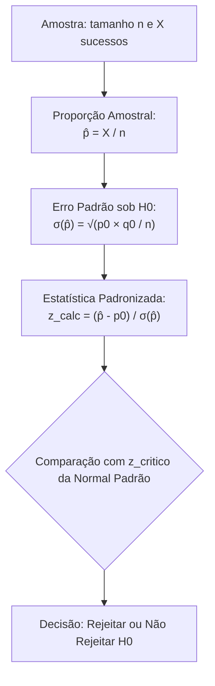
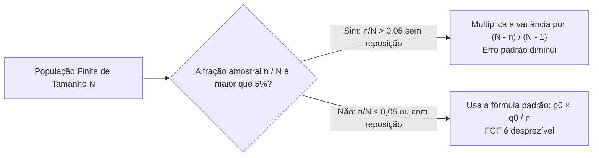
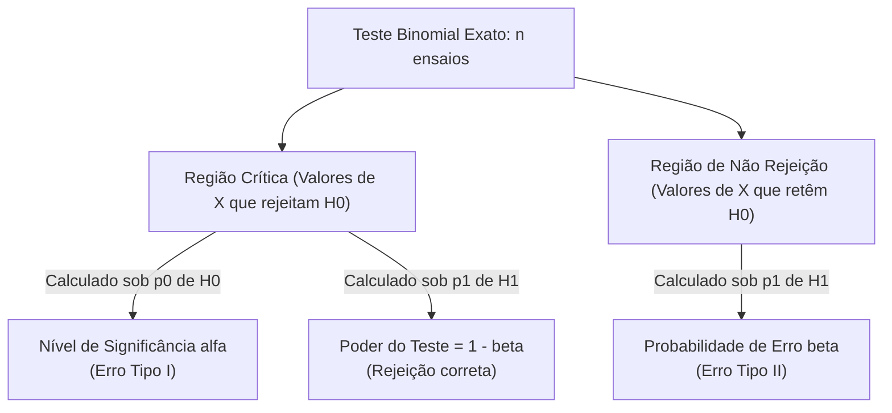
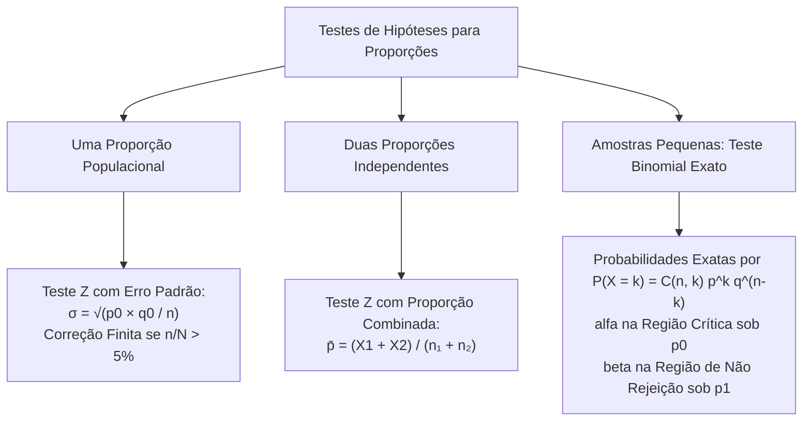

A tomada de decisão estatística sobre atributos qualitativos dicotômicos apoia-se nos testes de hipóteses para proporções populacionais. Na administração de segurança pública, comandantes e gestores operacionais monitoram proporções rotineiramente. Eles avaliam o índice de aprovação da população a uma política de policiamento comunitário. Eles fiscalizam a taxa de não conformidade em coletes balísticos entregues por fornecedores. Quando o tamanho amostral é expressivo, a aproximação pela distribuição normal padrão assegura agilidade de cálculo. Em pequenas amostras, aplica-se o modelo exato da distribuição binomial.

> [!objetivos]
> - Estruturar o teste de hipóteses assintótico para uma proporção populacional utilizando a estatística Z.
> - Determinar os limites da região crítica na escala original da proporção amostral p̂.
> - Aplicar o fator de correção para populações finitas em amostragem sem reposição.
> - Comparar duas proporções populacionais independentes empregando a proporção combinada.
> - Conduzir testes exatos baseados na distribuição binomial para quantificar alfa, beta e o poder do teste.

## Teste Z para uma Proporção Populacional

O teste para uma proporção aplica-se a populações de ensaios de Bernoulli. Cada elemento amostrado exibe apenas dois resultados excludentes: sucesso ou fracasso. A probabilidade populacional de sucesso é denotada pela letra p, e a probabilidade de fracasso vale q = 1 - p.

A hipótese nula postula que a proporção populacional coincide com um valor de referência fixado:

H0: p = p0.

A hipótese alternativa define a orientação analítica do teste:
- Bilateral: H1: p != p0.
- Unilateral à esquerda: H1: p < p0.
- Unilateral à direita: H1: p > p0.

A partir de uma amostra aleatória de tamanho n, observa-se o número de sucessos X. A proporção amostral observada é calculada por:

p̂ = X / n.

Pelo Teorema Central do Limite, a distribuição amostral de p̂ aproxima-se da distribuição normal quando as condições n × p0 >= 5 e n × q0 >= 5 são plenamente atendidas.

Sob a hipótese nula H0, os parâmetros da distribuição amostral são:
- Média da proporção: E(p̂) = p0.
- Variância da proporção: Var(p̂) = (p0 × q0) / n.
- Erro padrão da proporção: σ(p̂) = raiz[(p0 × q0) / n].

A estatística padronizada do teste, denominada escore reduzido Z, é calculada dividindo-se o desvio amostral pelo erro padrão nulo:

z_calc = (p̂ - p0) / raiz[(p0 × q0) / n].

> [!bizu]
> No cálculo do erro padrão do Teste Z para uma proporção, utilize sempre os valores p0 e q0 postulados pela hipótese nula H0. Jamais utilize a proporção observada na amostra p̂ no denominador do teste de hipóteses. A distribuição amostral é calculada sob a condição estrita de que a hipótese nula é verdadeira.

## Limites da Região Crítica na Escala da Proporção

A decisão estatística pode ocorrer diretamente na escala da proporção amostral p̂. Essa abordagem calcula os pontos de corte que separam o domínio de retenção da área de rejeição.

Para um teste com nível de significância alfa, os limites críticos são obtidos pela expressão:

Limite Crítico (L) = p0 + z_crit × σ(p̂).

A aplicação depende da direcionalidade do teste:
- Teste bilateral ao nível alfa: adota-se z_crit = +- z_(alfa/2). A região de não rejeição fica contida entre LINF = p0 - z_(alfa/2) × σ(p̂) e LSUP = p0 + z_(alfa/2) × σ(p̂).
- Teste unilateral à direita: adota-se +z_alfa. Rejeita-se H0 se p̂ for estritamente superior ao limite crítico superior LSUP.
- Teste unilateral à esquerda: adota-se -z_alfa. Rejeita-se H0 se p̂ for estritamente inferior ao limite crítico inferior LINF.

| Direção do Teste | Hipótese Alternativa | Ponto Crítico da Normal | Regra de Rejeição de H0 |
|---|---|---|---|
| Bilateral | H1: p != p0 | +- z_(alfa/2) | p̂ < LINF ou p̂ > LSUP |
| Unilateral à Direita | H1: p > p0 | + z_alfa | p̂ > LSUP |
| Unilateral à Esquerda | H1: p < p0 | - z_alfa | p̂ < LINF |

## Correção para Populações Finitas

Quando a amostragem é realizada sem reposição em uma população finita de tamanho N, as observações não são estritamente independentes. Se a fração amostral n / N ultrapassar 5% (0,05), deve-se aplicar o Fator de Correção para Populações Finitas (FCF).

O fator de correção multiplica a variância teórica da proporção amostral:

FCF = (N - n) / (N - 1).

A variância corrigida da proporção amostral assume a seguinte forma:

Var_corrigida(p̂) = [(p0 × q0) / n] × [(N - n) / (N - 1)].

O erro padrão corrigido é a raiz quadrada dessa expressão:

σ_corrigido(p̂) = raiz[(p0 × q0) / n] × raiz[(N - n) / (N - 1)].

A incorporação do FCF reduz a dispersão do erro padrão. Essa redução estreita os limites da região crítica, tornando o teste mais rigoroso na detecção de desvios populacionais.

> [!atencao]
> Em concursos, preste atenção se o enunciado menciona o tamanho total da população N. Se a amostra n representar mais de 5% de N e a extração for sem reposição, o uso do fator de correção finita é compulsório. Ignorar o FCF superestima o erro padrão e compromete o resultado do teste.

## Aplicação em Auditoria de Recursos Humanos: Proporção Favorável

Em pesquisas institucionais de clima e planejamento do efetivo corporativo; o comando avalia a adesão da tropa a novas diretrizes. Considere uma corporação com grande contingente de colaboradores. A diretoria formula uma proposta de escala operacional de 24 horas de serviço por 72 horas de descanso. A premissa nula H0 sustenta que a proporção de colaboradores com parecer favorável atinge 60% (p0 = 0,60). Uma amostra aleatória de 400 colaboradores é extraída do efetivo para consulta opinativa.

Se a contagem amostral registrar 260 colaboradores com voto favorável, a proporção amostral será p̂ = 260 / 400 = 0,65. O erro padrão nulo vale σ(p̂) = raiz[0,60 × 0,40 / 400] = raiz[0,24 / 400] = raiz[0,0006] = 0,0245. O escore Z calculado atinge z_calc = (0,65 - 0,60) / 0,0245 = 2,04. Em um teste bilateral ao nível de significância de 5% (z_crit = 1,96), a estatística 2,04 supera o valor crítico, autorizando a rejeição de H0. Conclui-se que a proporção real de apoio favorável supera a premissa inicial.

## Controle de Qualidade de Fixadores e Parafusos

O chefe de produção do setor fabril acompanha cada fase da implantação do lote para garantir que os desvios não fogem aos padrões contratuais estipulados entre as partes. No almoxarifado de manutenção veicular do Corpo de Bombeiros, lotes de parafusos estruturais de alta resistência são inspecionados antes da montagem em viaturas. O fabricante assegura que a proporção de parafusos fora do comprimento padrão é de no máximo 2% (p0 = 0,02). A fiscalização pericial extrai uma amostra de 500 parafusos de um lote volumoso para teste de conformidade de comprimento e rosca.

Ao examinar os itens, o engenheiro identifica se a taxa de parafusos desconformes ultrapassa a tolerância contratual. Sob a hipótese nula, a variância da proporção amostral vale (0,02 × 0,98) / 500 = 0,0196 / 500 = 0,0000392, resultando em erro padrão de aproximadamente 0,00626. Essa parametrização rigorosa estabelece limites precisos de aceitabilidade. Qualquer lote cuja amostra de parafusos viole a fronteira crítica é prontamente rejeitado e devolvido ao fornecedor.

## Comparação de Duas Proporções Populacionais

A comparação entre as proporções p1 e p2 de duas populações independentes avalia se uma intervenção produziu impacto diferenciado entre grupos.

A hipótese nula postula a igualdade entre as duas proporções populacionais:

H0: p1 = p2 (ou p1 - p2 = 0).

A hipótese alternativa admite formato bilateral (p1 != p2) ou unilateral (p1 > p2 ou p1 < p2).

Sejam n₁ e n₂ os tamanhos das amostras independentes, com X1 e X2 sucessos observados. As proporções amostrais são p_chapeu_1 = X1 / n₁ e p_chapeu_2 = X2 / n₂.

Sob a hipótese nula de igualdade (p1 = p2 = p), combina-se o total de sucessos para estimar a proporção comum ponderada:

p̄ = (X1 + X2) / (n₁ + n₂).
q̄ = 1 - p̄.

A variância da diferença entre as proporções amostrais é expressa por:

Var(p_chapeu_1 - p_chapeu_2) = p̄ × q̄ × (1 / n₁ + 1 / n₂).

A estatística padronizada do Teste Z para duas proporções é calculada por:

z_calc = (p_chapeu_1 - p_chapeu_2) / raiz[p̄ × q̄ × (1 / n₁ + 1 / n₂)].

A decisão decorre da comparação direta de z_calc com os quantis críticos tabelados da distribuição normal padrão Z.

| Etapa Analítica | Expressão Matemática | Finalidade no Teste |
|---|---|---|
| Proporções amostrais | p_chapeu_1 = X1/n₁ e p_chapeu_2 = X2/n₂ | Medem o desempenho em cada grupo |
| Proporção combinada | p̄ = (X1 + X2) / (n₁ + n₂) | Estima a taxa de sucesso sob premissa de H0 |
| Erro padrão combinado | raiz[p̄ × q̄ × (1/n₁ + 1/n₂)] | Mede a dispersão amostral da diferença |
| Estatística do teste | z_calc = (p_chapeu_1 - p_chapeu_2) / Erro Padrão | Confronta a estimativa com a distribuição Z |

## O Teste Exato Binomial para Amostras Pequenas

Quando o tamanho da amostra n é reduzido ou a probabilidade de sucesso p é muito próxima de zero ou de um, as condições de aproximação normal falham. Nessas circunstâncias, aplica-se o Teste Exato Binomial sem aproximação assintótica.

A variável aleatória X representa o número exato de sucessos em n ensaios de Bernoulli independentes. Sua função de probabilidade é governada pela fórmula binomial canônica:

P(X = k) = C(n, k) × p^k × q^(n - k).

O coeficiente binomial é calculado pela combinação simples de n elementos tomados k a k:

C(n, k) = n! / [k! × (n - k)!].

> [!pegadinha]
> Utilize sempre os atalhos combinatórios clássicos para agilizar a resolução de itens de concurso:
> - C(n, 0) = 1 e C(n, n) = 1.
> - C(n, 1) = n e C(n, n - 1) = n.
> Dominar esses atalhos evita cálculos fatoriais extensos em provas de tempo escasso.

Como ilustração clássica do modelo exato, considere um teste sobre a honestidade de uma moeda balanceada (H0: p = 1/2). Um indivíduo realiza n = 4 lançamentos independentes e contabiliza o número de caras obtidas. Ao obtermos a contagem de caras, cada face possui probabilidade elementar de 0,5. Se a regra decisória rejeitar a moeda apenas quando o número de caras for 0 ou 4, calculam-se as probabilidades binomiais pontuais de cada desfecho. A chance de não obtermos nenhuma cara (zero caras) vale (1/2)⁴ = 1/16, e a chance de obtermos quatro caras também equivale a 1/16. A soma dessas caudas extremas resulta no tamanho exato alfa de 2/16 = 1/8.

No teste exato binomial, as probabilidades dos erros são calculadas diretamente pela soma das probabilidades dos pontos discretos:
- Nível de significância alfa (Erro Tipo I): soma-se a probabilidade P(X = k) para todos os valores de k pertencentes à região crítica, utilizando o parâmetro p0 fixado em H0.
- Probabilidade de Erro Tipo II (beta): soma-se a probabilidade P(X = k) para todos os valores de k situados na região de não rejeição, utilizando o parâmetro verdadeiro p1 sob H1.
- Poder do teste (1 - beta): soma-se a probabilidade P(X = k) para os valores de k da região crítica sob a vigência do parâmetro verdadeiro p1 sob H1.

## Exercício Resolvido: Teste Binomial Exato Passo a Passo

> [!resolvido]
> **Enunciado de Inspeção de Equipamento Militar:**
> Um oficial do Corpo de Bombeiros fiscaliza um lote piloto de 4 válvulas de retenção contra refluxo (n = 4). A especificação de fabricação afirma que a proporção de válvulas conformes é de 75% (p0 = 3/4). A hipótese alternativa suspeita que a qualidade do lote piloto é deficiente, postulando que a verdadeira proporção é de apenas 25% (p1 = 1/4).
> O protocolo de auditoria fixa a seguinte regra de decisão: o lote será rejeitado (rejeita-se H0) se a amostra contiver 1 ou nenhuma válvula conforme (Região Crítica: X <= 1).
> Determine:
> a) O nível de significância alfa do teste.
> b) O poder do teste estatístico sob a hipótese alternativa p1 = 1/4.
> c) A probabilidade beta de cometer o Erro Tipo II.
>
> **Resolução Passo a Passo:**
> 
> 1. **Cálculo do nível de significância alfa:**
> Por definição, alfa é a probabilidade de rejeitar H0 quando H0 é verdadeira (p = 3/4, q = 1/4).
> A região crítica é X <= 1, compreendendo os eventos disjuntos X = 0 e X = 1.
> - Probabilidade de X = 0 sob H0:
> P(X = 0 | p = 3/4) = C(4, 0) × (3/4)⁰ × (1/4)⁴ = 1 × 1 × (1 / 256) = 1 / 256.
> - Probabilidade de X = 1 sob H0:
> P(X = 1 | p = 3/4) = C(4, 1) × (3/4)¹ × (1/4)³ = 4 × (3/4) × (1 / 64) = 12 / 256.
> - Nível de significância alfa:
> alfa = P(X = 0) + P(X = 1) = 1/256 + 12/256 = 13 / 256.
> Em termos decimais, alfa = 13 / 256 aproximadamente igual a 0,0508 (ou 5,08%).
>
> 2. **Cálculo do poder do teste estatístico:**
> O poder é a probabilidade de rejeitar H0 quando a hipótese alternativa H1 é verdadeira (p = 1/4, q = 3/4).
> A regra de rejeição permanece X <= 1, agora avaliada com o parâmetro real p = 1/4:
> - Probabilidade de X = 0 sob H1:
> P(X = 0 | p = 1/4) = C(4, 0) × (1/4)⁰ × (3/4)⁴ = 1 × 1 × (81 / 256) = 81 / 256.
> - Probabilidade de X = 1 sob H1:
> P(X = 1 | p = 1/4) = C(4, 1) × (1/4)¹ × (3/4)³ = 4 × (1/4) × (27 / 64) = 27 / 64 = 108 / 256.
> - Poder do teste:
> Poder = P(X = 0) + P(X = 1) = 81/256 + 108/256 = 189 / 256.
> Em termos decimais, Poder = 189 / 256 aproximadamente igual a 0,7383 (ou 73,83%).
>
> 3. **Cálculo do Erro Tipo II (beta):**
> O erro beta é o complemento do poder do teste:
> beta = 1 - Poder = 1 - (189 / 256) = 67 / 256 aproximadamente igual a 0,2617 (ou 26,17%).
>
> 4. **Conclusão:**
> O teste de inspeção possui tamanho alfa de 13/256 (cerca de 5,1%) e poder analítico de 189/256 (cerca de 73,8%) para detectar o lote deficiente.

## Mapa do capítulo

### Para fixar

- O teste assintótico para uma proporção utiliza a estatística Z com erro padrão baseado exclusivamente em p0 de H0.
- A aproximação normal requer que tanto n vezes p0 quanto n vezes q0 sejam maiores ou iguais a 5.
- Em amostragem sem reposição de populações finitas com n / N superior a 5%, aplica-se o fator de correção finita.
- Na comparação de duas proporções, calcula-se a proporção combinada p̄ pela razão de sucessos totais sobre elementos totais.
- O teste exato binomial calcula probabilidades pontuais sem aproximação assintótica em amostras de pequena dimensão.
- O nível de significância alfa no teste binomial resulta da soma de P(X = k) nos pontos da região crítica sob p0.
- O poder do teste binomial decorre da soma de P(X = k) nos pontos da região crítica avaliados sob o parâmetro p1.
- Os atalhos combinatórios C(n, 0) = C(n, n) = 1 e C(n, 1) = C(n, n - 1) = n agilizam o cálculo de probabilidades.
