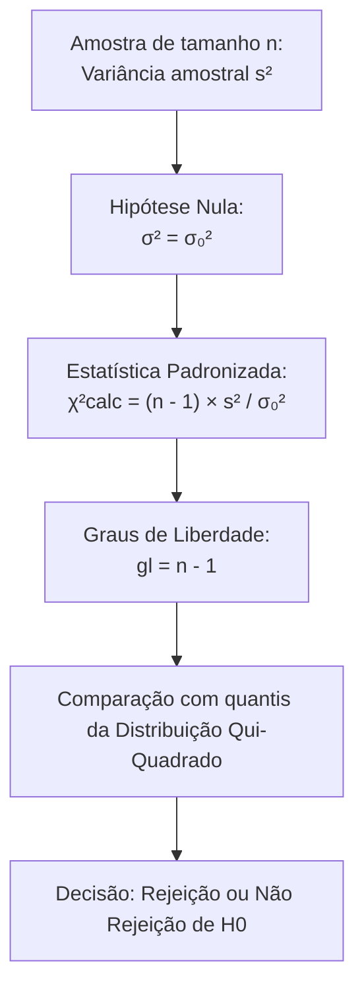
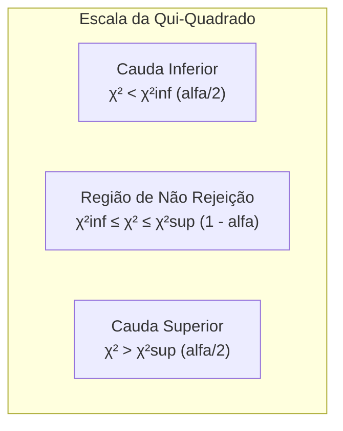
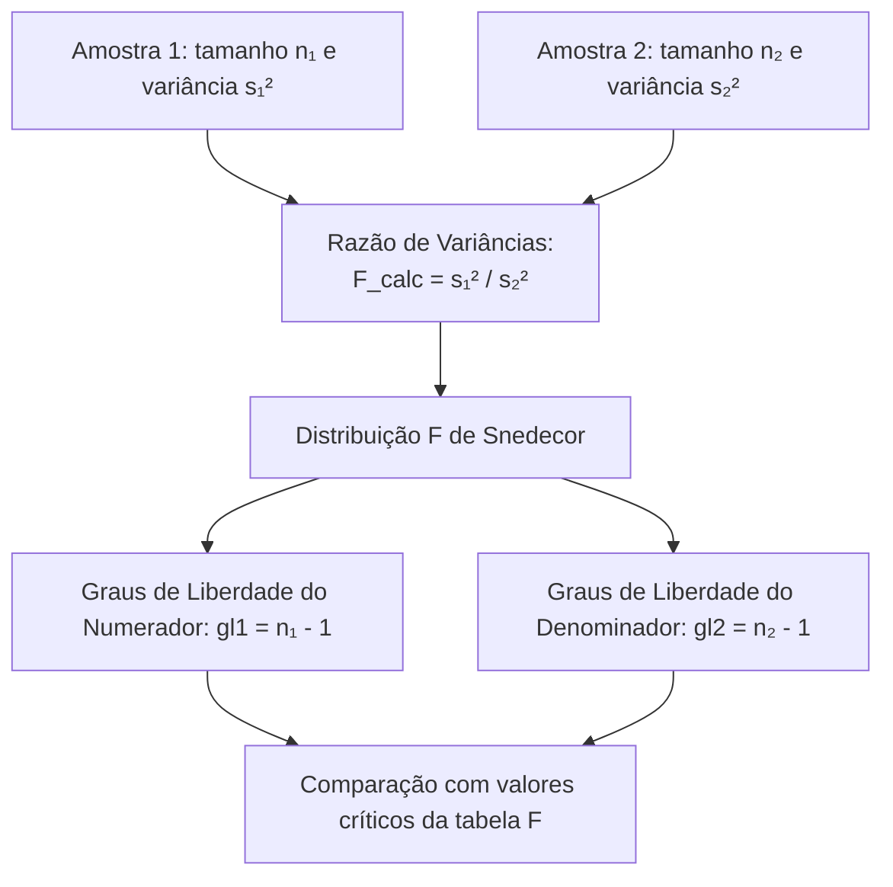
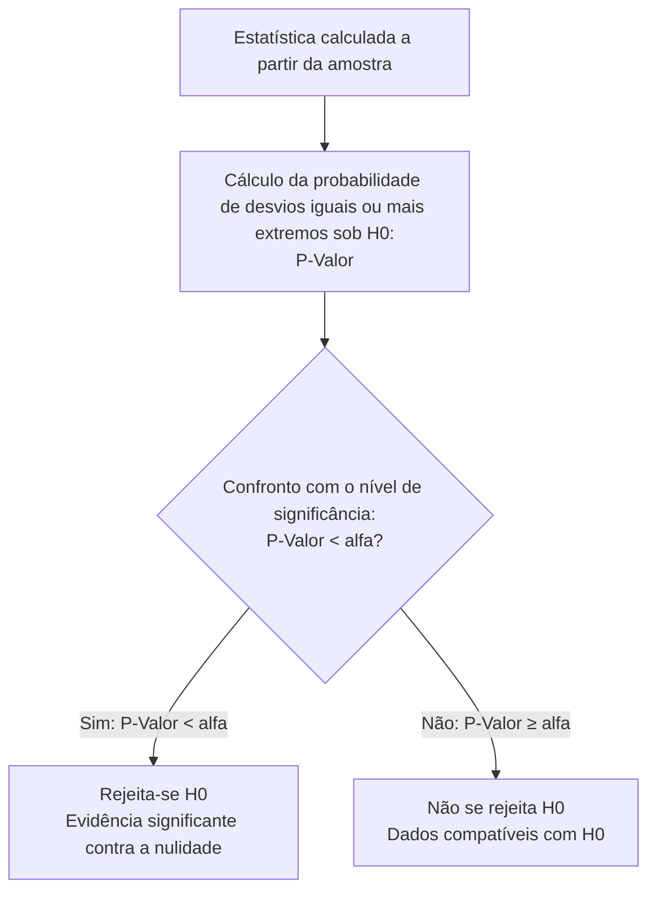
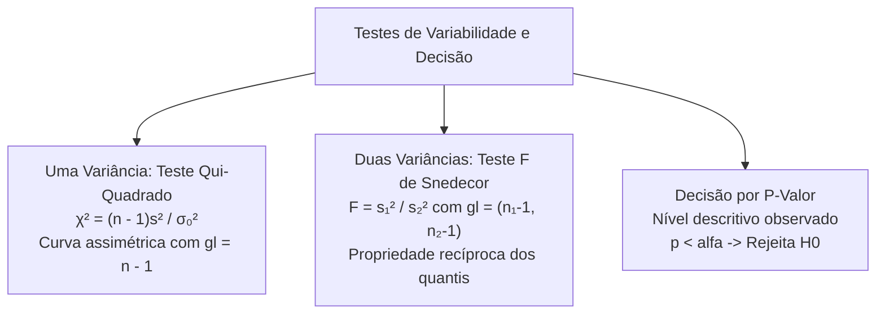

A avaliação da variabilidade e dispersão de processos representa um pilar indispensável do controle de qualidade na segurança pública. Na calibração de armamentos ou na padronização de equipamentos de proteção individual, a estabilidade das medidas é tão importante quanto a média central. Um lote de munições com velocidade média correta pode ser letalmente perigoso se apresentar variância excessiva. O domínio do teste qui-quadrado para uma variância, do teste F de Snedecor para duas variâncias e a interpretação do p-valor constituem competências centrais da inferência estatística.

> [!objetivos]
> - Estruturar o teste de hipóteses para a variância populacional utilizando a distribuição qui-quadrado.
> - Compreender a assimetria da curva qui-quadrado e manusear os valores críticos inferior e superior.
> - Aplicar o Teste F de Snedecor para comparar duas variâncias populacionais e verificar a homocedasticidade.
> - Empregar a propriedade recíproca dos quantis de F para determinar pontos de corte da cauda inferior.
> - Interpretar o conceito formal de p-valor como nível descritivo do teste e aplicar a regra de decisão universal.

## Teste Qui-Quadrado para a Variância de uma População

O teste de hipóteses para a variância avalia se a dispersão populacional σ² é compatível com um valor padrão fixado sob a hipótese nula. O procedimento assume como pressuposto obrigatório que a população de origem possui distribuição normal.

A formulação das hipóteses estatísticas admite três configurações usuais:
- Bilateral: H0: σ² = σ₀² versus H1: σ² != σ₀².
- Unilateral à esquerda: H0: σ² >= σ₀² versus H1: σ² < σ₀².
- Unilateral à direita: H0: σ² <= σ₀² versus H1: σ² > σ₀².

A partir de uma amostra aleatória de tamanho n, calcula-se a variância amostral sem viés s²:

s² = [1 / (n - 1)] × soma((x_i - x̄)²).

Sob a condição de que a hipótese nula H0 é verdadeira, a variável padronizada segue rigorosamente a distribuição qui-quadrado com n menos um graus de liberdade:

χ²calc = (n - 1) × s² / σ₀².

## A Geometria Assimétrica da Curva Qui-Quadrado

A distribuição qui-quadrado possui propriedades matemáticas singulares que a diferenciam da distribuição normal padrão Z e da t de Student.

A variável qui-quadrado resulta da soma de quadrados de variáveis normais padronizadas independentes. Por essa razão estrutural, a curva qui-quadrado assume exclusivamente valores não negativos (χ² >= 0). Ela é acentuadamente assimétrica à direita para pequenos graus de liberdade. À medida que o número de graus de liberdade cresce, a curva torna-se gradualmente mais simétrica.

Em decorrência dessa assimetria, os valores críticos que delimitam a região crítica nas extremidades inferior e superior não possuem módulos idênticos. O ponto crítico inferior χ²inf e o ponto crítico superior χ²sup são grandezas numéricas positivas totalmente distintas. Cada um deve ser consultado individualmente na tabela de distribuição acumulada da qui-quadrado.

| Tipo de Teste para Variância | Hipótese Alternativa (H1) | Alocação do Nível de Significância | Regra de Rejeição de H0 |
|---|---|---|---|
| Bilateral (bicaudal) | σ² != σ₀² | alfa/2 na cauda esquerda e alfa/2 na cauda direita | χ²calc < χ²inf ou χ²calc > χ²sup |
| Unilateral à esquerda | σ² < σ₀² | alfa concentrado na cauda esquerda | χ²calc < χ²inf |
| Unilateral à direita | σ² > σ₀² | alfa concentrado na cauda direita | χ²calc > χ²sup |

> [!bizu]
> Na leitura da tabela qui-quadrado para um teste bilateral com nível de significância de 5% (alfa = 0,05), localize dois quantis distintos:
> - Quantil inferior: associado à probabilidade acumulada de alfa/2 = 0,025.
> - Quantil superior: associado à probabilidade acumulada de 1 - alfa/2 = 0,975.
> Ambos são números positivos. Jamais utilize sinais negativos na distribuição qui-quadrado.

> [!exemplo]
> Um perito de engenharia do Corpo de Bombeiros avalia a estabilidade de pressão de mangueiras de combate a incêndio. A especificação do fabricante afirma que a variância da pressão suportada não deve exceder 4,0 atm² (σ₀² = 4,0). O oficial testa uma amostra de 25 mangueiras (n = 25, gl = 24), obtendo variância amostral s² = 6,5 atm².
> O teste unilateral à direita investiga se a variância real ultrapassa o limite tolerado:
> H0: σ² <= 4,0 versus H1: σ² > 4,0.
> A estatística calculada atinge:
> χ²calc = (25 - 1) × 6,5 / 4,0 = 24 × 6,5 / 4,0 = 156 / 4,0 = 39,0.
> Consultando a tabela qui-quadrado com gl = 24 ao nível de significância de 5%, o valor crítico superior é χ²crit = 36,415.
> Como χ²calc = 39,0 é estritamente superior ao valor crítico tabelado (39,0 > 36,415), rejeita-se H0 ao nível de 5%. Conclui-se que o lote apresenta dispersão excessiva na resistência à pressão.

## O Teste F de Snedecor para Comparação de Duas Variâncias

A comparação da dispersão entre duas populações normais independentes investiga se ambos os processos possuem variabilidade equivalente. Esse procedimento é o teste prévio de homocedasticidade obrigatório antes de comparar médias amostrais.

A hipótese nula estabelece que as variâncias populacionais σ₁² e σ₂² são rigorosamente iguais:

H0: σ₁² = σ₂² (ou σ₁² / σ₂² = 1).

A hipótese alternativa assume formato bilateral (σ₁² != σ₂²) ou unilateral (σ₁² > σ₂² ou σ₁² < σ₂²).

Sejam s₁² e s₂² as variâncias amostrais calculadas a partir de amostras aleatórias independentes de tamanhos n₁ e n₂. Sob a premissa de H0 verdadeira, a razão entre as variâncias amostrais segue a distribuição F de Snedecor com gl1 = n₁ - 1 graus de liberdade no numerador e gl2 = n₂ - 1 graus de liberdade no denominador:

F_calc = s₁² / s₂².

> [!pegadinha]
> Fique atento aos dados informados na questão de prova. As bancas costumam fornecer a Soma dos Quadrados dos desvios (SQ) em vez da variância amostral pronta. Lembre-se: SQ não é variância. Você deve dividir SQ1 por (n₁ - 1) e SQ2 por (n₂ - 1) para obter s₁² e s₂² antes de montar a fração F.

## Propriedade Recíproca dos Quantis da Distribuição F

As tabelas impressas da distribuição F de Snedecor anexadas a cadernos de prova fornecem habitualmente apenas os quantis da cauda superior direita (por exemplo, áreas de 0,05 ou 0,025). Para conduzir testes bilaterais completos, o perito precisa determinar o quantil da cauda inferior esquerda.

Essa determinação apoia-se em uma propriedade matemática notável da distribuição F. O quantil da cauda inferior com probabilidade acumulada alfa e graus de liberdade (gl1, gl2) equivale ao inverso aritmético do quantil da cauda superior com probabilidade (1 - alfa), invertendo-se a ordem dos graus de liberdade:

F_(alfa; gl1, gl2) = 1 / F_(1 - alfa; gl2, gl1).

Essa relação recíproca permite encontrar qualquer ponto de corte inferior com facilidade analítica.

| Parâmetro da Distribuição F | Propriedade Matemática | Aplicação Prática |
|---|---|---|
| Suporte numérico | Exclusivamente valores reais não negativos (F >= 0) | Razão de quadrados de desvios |
| Graus de liberdade | Par ordenado (gl1, gl2) | gl1 no numerador e gl2 no denominador |
| Inversão de caudas | F_(inferior; gl1, gl2) = 1 / F_(superior; gl2, gl1) | Permite obter pontos críticos bilaterais |
| Relação com teste t | O quadrado da variável t com gl graus segue F(1, gl) | Conexão teórica: t²(gl) = F(1, gl) |

> [!bizu]
> Pratique a inversão dos graus de liberdade:
> Para encontrar o ponto crítico inferior de 2,5% de F com 4 graus no numerador e 9 graus no denominador, pegue o ponto superior de 2,5% da tabela F com 9 graus no numerador e 4 no denominador. Se a tabela indicar F_(0,025; 9, 4) = 8,90, o limite inferior procurado será:
> F_(inf) = 1 / 8,90 aproximadamente igual a 0,112.

## Conexão entre o Teste F e a Análise de Variância (ANOVA)

O Teste F de Snedecor não se restringe à comparação isolada de duas variâncias amostrais. Ele constitui o motor computacional da Análise de Variância (ANOVA), técnica inferencial empregada para comparar simultaneamente as médias de três ou mais populações independentes.

Na ANOVA, a variabilidade total observada nos dados é decomposta em duas fontes estocásticas fundamentais:
1. Variabilidade entre tratamentos (quadrado médio do tratamento - QMT): reflete as diferenças sistemáticas entre os grupos avaliados decorrentes das intervenções sob teste.
2. Variabilidade dentro dos tratamentos ou resíduo (quadrado médio do erro - QME): mensura a dispersão aleatória natural inerente aos indivíduos de um mesmo grupo.

A estatística fundamental do teste de ANOVA é expressa pela razão F:

F_calc = QMT / QME.

Sob a hipótese nula de que todas as médias dos grupos são idênticas (H0: mu1 = mu2 = ... = muk), a variabilidade entre grupos decorre exclusivamente do acaso. Nessa condição, a razão F_calc flutua ao redor de 1. Se ao menos uma das médias populacionais diferir das demais, o numerador QMT inflaciona substancialmente, deslocando a estatística F_calc para valores extremos da cauda direita. A decisão de rejeitar a igualdade de múltiplas médias baseia-se na comparação de F_calc com o quantil crítico da distribuição F de Snedecor.

## O Conceito Moderno de P-Valor

Nas últimas décadas, a estatística computacional e a pesquisa empírica consolidaram o p-valor como o indicador supremo de significância. O p-valor, também designado como nível descritivo amostral ou significância observada, substitui a rigidez mecânica dos pontos críticos fixos.

O p-valor define-se como a probabilidade de obter uma estatística de teste tão extrema ou mais extrema do que a efetivamente observada na amostra, sob a premissa de que a hipótese nula H0 seja verdadeira:

P-Valor = P(Estatística tão ou mais extrema que a observada | H0 é verdadeira).

A regra universal de julgamento por p-valor expressa-se de maneira direta e uniforme para qualquer teste estatístico:
- Se P-Valor < alfa: rejeita-se terminantemente a hipótese nula H0. O resultado amostral é estatisticamente significante ao nível alfa. Há forte evidência empírica contra a nulidade.
- Se P-Valor >= alfa: não se rejeita a hipótese nula H0. O teste é classificado como não significante ao nível alfa. Os dados amostrais são perfeitamente compatíveis com a premissa de H0.

## Relação entre P-Valor Unilateral e Bilateral

A correlação entre o p-valor do teste unilateral e o do teste bilateral decorre da simetria da função de densidade da estatística de teste sob H0.

Nas distribuições simétricas, como a curva normal padrão Z e a distribuição t de Student:
- O teste bilateral considera desvios em ambas as caudas da distribuição.
- Por consequência direta da simetria, o p-valor bilateral é rigorosamente o dobro do p-valor obtido em um teste unilateral na mesma direção:

P-Valor_bilateral = 2 × P-Valor_unilateral.

Essa propriedade é explorada com frequência por bancas avaliadoras. Se uma pesquisa unilateral apresentou p-valor de 0,03, o mesmo conjunto de dados submetido a um teste bilateral produzirá p-valor de 0,06. Se o pesquisador fixou o nível de significância alfa em 5% (0,05), ele rejeitaria a hipótese nula no formato unilateral (0,03 < 0,05), mas não rejeitaria H0 no modelo bilateral (0,06 > 0,05).

> [!atencao]
> Cuidado com equívocos conceituais comuns em enunciados de prova:
> - O p-valor NÃO é a probabilidade de a hipótese nula ser verdadeira. O parâmetro populacional não é uma variável aleatória na inferência clássica; ele é fixo e desconhecido.
> - O p-valor NÃO é a probabilidade de a hipótese alternativa ser falsa.
> - O p-valor mede unicamente a compatibilidade dos dados amostrais coletados com a distribuição probabilística postulada sob H0. Quanto menor o p-valor, menor é a compatibilidade dos dados com a hipótese nula.

| Indicador de P-Valor | Magnitude do Valor | Decisão ao Nível de 5% | Interpretação Pericial |
|---|---|---|---|
| p < 0,001 | Extremamente baixo | Rejeição enfática de H0 | Evidência contra H0 é avassaladora |
| 0,001 <= p < 0,01 | Muito baixo | Rejeita H0 com facilidade | Evidência empírica muito forte |
| 0,01 <= p < 0,05 | Baixo | Rejeita H0 ao nível de 5% | Evidência significante contra a nulidade |
| 0,05 <= p < 0,10 | Limítrofe | Não rejeita a 5% (rejeitaria a 10%) | Evidência marginal ou inconclusiva |
| p >= 0,10 | Elevado | Não rejeita H0 | Dados plenamente compatíveis com H0 |

## Interpretação Prática do P-Valor em Laudos Periciais

Na elaboração de laudos periciais criminais e relatórios técnicos militares, a declaração isolada de que a hipótese foi rejeitada revela-se insuficiente. O Ministério Público, juízes e autoridades administrativas exigem a quantificação exata da margem de segurança probatória. A apresentação do p-valor fornece essa transparência analítica.

Um p-valor extremamente reduzido (por exemplo, p = 0,0004) demonstra que a probabilidade de as divergências apuradas decorrerem de mera flutuação aleatória é de apenas quatro em dez mil. Tal constatação confere solidez científica inquestionável à acusação ou à recusa de um lote de equipamentos. Em contrapartida, um p-valor limítrofe (como p = 0,048 em face de alfa = 0,05) alerta o comando de que a decisão de rejeição situa-se na fronteira da incerteza, recomendando a coleta de amostras suplementares para confirmação conclusiva.

## Exercício Resolvido: Teste F e P-Valor Passo a Passo

> [!resolvido]
> **Enunciado de Avaliação Pericial de Manutenção:**
> O setor de transportes da Polícia Militar avalia a precisão operacional do consumo de combustível de duas marcas de viaturas operacionais submetidas a patrulhamento ostensivo. Coletaram-se medições independentes de consumo:
> - Marca Alfa: nA = 11 viaturas, com variância amostral sA² = 3,60 (km/l)².
> - Marca Beta: nB = 16 viaturas, com variância amostral sB² = 1,20 (km/l)².
> Admita que o consumo em ambas as marcas segue distribuição normal.
> Deseja-se testar ao nível de significância de 5% se a Marca Alfa apresenta variância no consumo estritamente superior à Marca Beta (H0: σA² <= σB² versus H1: σA² > σB²).
> Dados da tabela F de Snedecor:
> - Para gl_num = 10 e gl_den = 15: F_0,05 = 2,54; F_0,025 = 3,06; F_0,01 = 3,80.
>
> **Resolução Passo a Passo:**
> 
> 1. **Definição das hipóteses estatísticas:**
> O interesse investigativo consiste em verificar se a dispersão da Marca Alfa supera a da Marca Beta. O teste é unilateral à direita:
> H0: σA² <= σB² (a variabilidade da Marca Alfa não é superior).
> H1: σA² > σB² (a variabilidade da Marca Alfa é estatisticamente superior).
>
> 2. **Determinação dos graus de liberdade:**
> - Graus de liberdade do numerador (Marca Alfa): gl1 = nA - 1 = 11 - 1 = 10.
> - Graus de liberdade do denominador (Marca Beta): gl2 = nB - 1 = 16 - 1 = 15.
>
> 3. **Cálculo da estatística do Teste F:**
> A estatística calculada é a razão direta entre as variâncias amostrais:
> F_calc = sA² / sB² = 3,60 / 1,20 = 3,00.
>
> 4. **Comparação com o quantil crítico tabelado:**
> O nível de significância do teste unilateral é alfa = 0,05.
> Na tabela F de Snedecor para gl1 = 10 e gl2 = 15, o valor crítico é F_crit = 2,54.
> A região crítica é definida por F > 2,54.
> O valor calculado F_calc = 3,00 supera o ponto crítico tabelado 2,54 (3,00 > 2,54), posicionando-se na região crítica.
>
> 5. **Análise por P-Valor:**
> Observando a tabela F com gl = (10, 15):
> - F_0,05 = 2,54
> - F_0,025 = 3,06
> Como a estatística calculada F_calc = 3,00 situa-se entre 2,54 e 3,06, o p-valor do teste unilateral situa-se estritamente entre 0,025 e 0,05:
> 0,025 < P-Valor < 0,05.
> Como o p-valor é estritamente menor que alfa = 0,05, confirma-se a rejeição de H0.
>
> 6. **Conclusão:**
> Rejeita-se a hipótese nula ao nível de 5%. Há evidências estatísticas contundentes de que as viaturas da Marca Alfa possuem variabilidade de consumo de combustível superior às da Marca Beta.

## Mapa do capítulo

### Para fixar

- O teste para uma variância populacional emprega a distribuição qui-quadrado com n menos um graus de liberdade.
- A curva qui-quadrado assume exclusivamente valores não negativos e exibe acentuada assimetria à direita.
- Os quantis críticos inferior e superior da qui-quadrado possuem valores numéricos distintos e positivos.
- A comparação de duas variâncias independentes baseia-se na razão F de Snedecor dada por s₁² dividido por s₂².
- A cauda inferior da distribuição F é determinada pelo inverso recíproco do quantil superior com graus de liberdade trocados.
- O p-valor expressa a probabilidade de desfechos amostrais iguais ou mais extremos sob a premissa de que H0 seja verdadeira.
- A regra decisória universal estabelece a rejeição de H0 sempre que o p-valor for estritamente inferior ao nível de significância alfa.
- Em distribuições simétricas, o p-valor do teste bilateral corresponde exatamente ao dobro do p-valor do teste unilateral.
