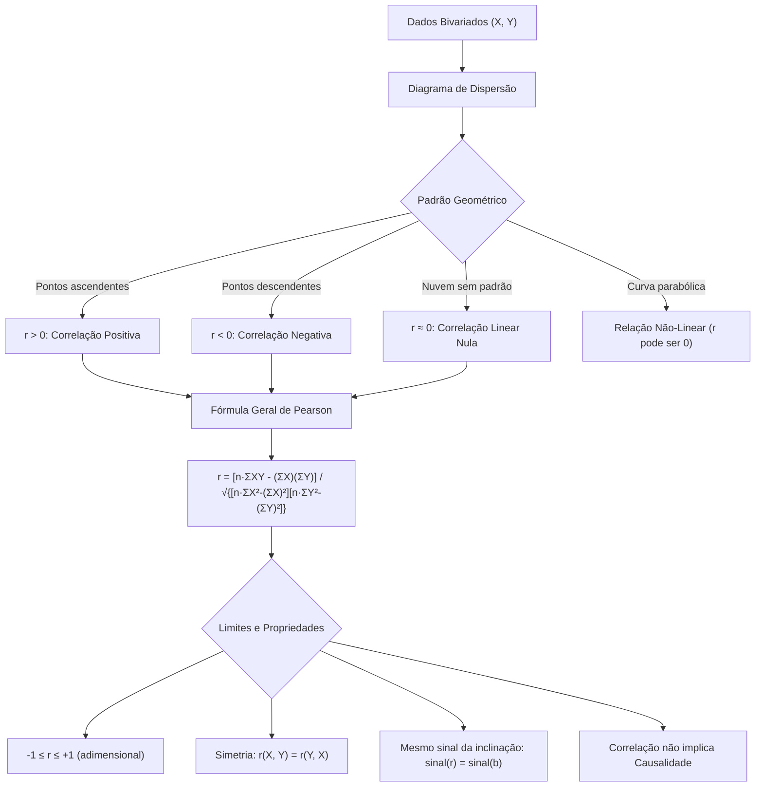

A análise bivariada investiga o comportamento conjunto de duas variáveis aleatórias quantitativas observadas nos mesmos elementos amostrais. Em segurança pública e defesa civil, compreender a relação entre variáveis é essencial: avalia-se o tempo de resposta das guarnições pela distância percorrida e o número de viaturas em patrulhamento na redução da criminalidade. A correlação linear avalia a intensidade e o sentido dessa associação. O coeficiente de Pearson é a ferramenta clássica para quantificar esse vínculo.

> [!objetivos]
> - Compreender a construção e a interpretação do diagrama de dispersão bivariado.
> - Classificar os tipos de correlação linear quanto ao sentido (positiva e negativa) e quanto à intensidade (nula, moderada, forte e perfeita).
> - Dominar a definição matemática do Coeficiente de Correlação de Pearson por meio da covariância e dos desvios padrão.
> - Aplicar as fórmulas operacionais simplificadas por somas de quadrados e produtos cruzados.
> - Identificar as propriedades de invariância de escala e reconhecer a distinção entre correlação e causalidade empírica.

## O Diagrama de Dispersão e a Associação Linear Bivariada

O ponto de partida para analisar o relacionamento entre duas variáveis contínuas X e Y é o **diagrama de dispersão** (*scatterplot*). Trata-se de um gráfico cartesiano bidimensional. Cada par de dados observados (xi, yi) na amostra de tamanho n é representado por um ponto no plano.

O arranjo espacial da nuvem de pontos revela visualmente a presença, a direção e o padrão da dependência estocástica:
- Se os pontos sugerem uma trajetória retilínea ascendente, indica-se uma tendência de crescimento concomitante das duas grandezas.
- Se a nuvem declina da esquerda para a direita, aponta-se que o acréscimo de uma variável é acompanhado pela redução da outra.
- Se os pontos distribuem-se de maneira circular ou dispersa sem orientação preferencial, não há evidência de associação linear.

| Padrão da Nuvem de Pontos | Tendência Geométrica | Tipo de Associação Indicada | Exemplo Prático na Segurança Pública |
|---|---|---|---|
| Pontos alinhados subindo | Reta com inclinação positiva | Associação Linear Positiva | Efetivo policial em ronda e apreensões |
| Pontos alinhados descendo | Reta com inclinação negativa | Associação Linear Negativa | Velocidade de viatura e tempo de resposta |
| Dispersão em nuvem circular | Ausência de alinhamento preferencial | Associação Linear Nula | Altura do militar e pontuação em tiro |
| Curva parabólica perfeita | Trajetória em formato de U ou U invertido | Associação Não-Linear (Curvilínea) | Nível de estresse e precisão em manobra |

## Tipos de Correlação: Sentido e Intensidade

A correlação entre duas variáveis pode ser classificada quanto ao sentido da variação e quanto ao rigor do alinhamento geométrico.

### Correlação Positiva (Direta)

Ocorre quando as duas variáveis caminham no mesmo sentido. Valores acima da média de X tendem a se associar a valores acima da média de Y. Da mesma forma, valores baixos de X associam-se a valores baixos de Y:
- Quanto maior a precipitação pluviométrica acumulada, maior o número de chamados de resgate por alagamento.
- A covariância amostral entre as duas grandezas é positiva: Cov(X, Y) > 0.

### Correlação Negativa (Inversa)

Ocorre quando as variáveis movem-se em sentidos opostos. Valores elevados de X associam-se sistematicamente a valores reduzidos de Y:
- Quanto mais frequente o treinamento tático da guarnição, menor o índice de avarias em viaturas.
- A covariância amostral entre as variáveis assume valor estritamente negativo: Cov(X, Y) < 0.

### Correlação Nula

Verifica-se quando as flutuações de X não guardam qualquer relação linear com as oscilações de Y. A covariância amostral aproxima-se de zero:
- A média de Y permanece constante independentemente dos valores assumidos por X.
- O coeficiente linear não detecta alinhamento preferencial na nuvem de pontos.

### Correlação Perfeita

Constitui o caso limite teórico. Todos os pontos do diagrama de dispersão recaem exatamente sobre uma linha reta no plano:
- **Perfeita Positiva**: todos os pontos situam-se sobre uma reta ascendente. O coeficiente de Pearson é exatamente igual a +1.
- **Perfeita Negativa**: todos os pontos situam-se sobre uma reta descendente. O coeficiente de Pearson é exatamente igual a −1.

> [!atencao]
> A correlação linear perfeita indica uma relação determinística perfeita entre as variáveis observadas na amostra. Em dados empíricos reais, a presença de ruído amostral e erros de medição faz com que coeficientes perfeitamente unitários sejam raros.

## O Coeficiente de Correlação Linear de Pearson

O **Coeficiente de Correlação Linear de Pearson**, simbolizado por **r** na amostra e por **ρ** (rô) na população, é a medida paramétrica padronizada da força da associação linear entre duas variáveis quantitativas.

### Definição Conceitual por Covariância Padronizada

A covariância entre X e Y mede como as duas grandezas variam conjuntamente em torno de suas respectivas médias. Todavia, a covariância depende diretamente das unidades de medida das variáveis analisadas (por exemplo, metros multiplicados por horas). Essa dependência impede a comparação direta entre estudos distintos.

Karl Pearson solucionou essa limitação padronizando a covariância. O procedimento divide a covariância pelo produto dos desvios padrão de cada variável:

`r = Cov(X, Y) / [sX · sY]`

Onde:
- `Cov(X, Y) = [1 / (n - 1)] · Σ(Xi - X̄)(Yi - Ȳ)` é a covariância amostral;
- `sX = √{[1 / (n - 1)] · Σ(Xi - X̄)²}` é o desvio padrão amostral de X;
- `sY = √{[1 / (n - 1)] · Σ(Yi - Ȳ)²}` é o desvio padrão amostral de Y.

Como as unidades de medida do numerador e do denominador coincidem, **o coeficiente r é um número puro e adimensional**. Ele não possui unidade física.

### Intervalo de Variação e Interpretação de Intensidade

Em decorrência da Desigualdade de Cauchy-Schwarz na análise vetorial, o valor de r é rigorosamente delimitado pelo intervalo fechado:

`-1 ≤ r ≤ +1`

A intensidade da relação linear é graduada pela proximidade do módulo de r em relação à unidade:

| Faixa de Valor de r | Interpretação da Associação Linear | Visualização Geométrica |
|---|---|---|
| **r = +1** | Correlação linear positiva perfeita | Todos os pontos exatamente na reta ascendente |
| **+0,80 ≤ r < +1** | Correlação linear positiva forte | Nuvem muito estreita ao redor da reta ascendente |
| **+0,50 ≤ r < +0,80** | Correlação linear positiva moderada | Tendência ascendente nítida, com dispersão média |
| **+0,10 ≤ r < +0,50** | Correlação linear positiva fraca | Nuvem dispersa, mas com leve inclinação positiva |
| **-0,10 < r < +0,10** | Correlação linear praticamente nula | Dispersão desordenada em torno do centróide médio |
| **-0,50 < r ≤ -0,10** | Correlação linear negativa fraca | Nuvem dispersa, com leve inclinação negativa |
| **-0,80 < r ≤ -0,50** | Correlação linear negativa moderada | Tendência descendente nítida, com dispersão média |
| **-1 < r ≤ -0,80** | Correlação linear negativa forte | Nuvem muito estreita ao redor da reta descendente |
| **r = -1** | Correlação linear negativa perfeita | Todos os pontos exatamente na reta descendente |

## Fórmulas Algébricas de Trabalho para Concursos

Na resolução manual de questões de concurso público, o cálculo direto dos desvios individuais `(Xi - X̄)` e `(Yi - Ȳ)` consome tempo precioso. Frequentemente gera números decimais trabalhosos. Para otimizar o tempo de prova, a estatística desenvolveu formas algébricas equivalentes baseadas nos somatórios brutos.

### Fórmula por Desvios em Relação à Média

A fórmula estrutural direta é:

`r = Σ[(Xi - X̄)(Yi - Ȳ)] / √{ [Σ(Xi - X̄)²] · [Σ(Yi - Ȳ)²] }`

Onde o termo do numerador representa a Soma dos Produtos dos Desvios (SPXY). Os termos sob o radical representam a Soma dos Quadrados dos Desvios de X (SQX) e a Soma dos Quadrados dos Desvios de Y (SQY).

### Fórmula Simplificada Operacional

Expandindo os termos quadráticos e distributivos, eliminam-se os desvios individuais:

- `Numerador = ΣXY - n · X̄ · Ȳ`
- `SQX = ΣX² - n · (X̄)²`
- `SQY = ΣY² - n · (Ȳ)²`

Substituindo esses termos, obtém-se a fórmula mais célere quando as médias amostrais são fornecidas ou resultam em números inteiros:

`r = [ΣXY - n · X̄ · Ȳ] / √{ [ΣX² - n · (X̄)²] · [ΣY² - n · (Ȳ)²] }`

### Fórmula Geral por Somatórios Brutos

Quando a banca examinadora fornece diretamente a tabela com os somatórios amostrais brutos `ΣX`, `ΣY`, `ΣX²`, `ΣY²` e `ΣXY`, aplica-se a identidade com o fator n multiplicado:

`r = [n · ΣXY - (ΣX)(ΣY)] / √{ [n · ΣX² - (ΣX)²] · [n · ΣY² - (ΣY)²] }`

| Variante da Fórmula | Expressão do Numerador | Estrutura do Denominador | Cenário Ideal de Aplicação |
|---|---|---|---|
| **Definição por Covariância** | `Cov(X, Y)` | `sX · sY` | Quando variâncias e covariância já são dadas |
| **Desvios em Torno da Média** | `Σ(Xi - X̄)(Yi - Ȳ)` | `√[ Σ(Xi - X̄)² · Σ(Yi - Ȳ)² ]` | Conjuntos com médias inteiras e pequenas |
| **Fórmula Simplificada** | `ΣXY - n · X̄ · Ȳ` | `√[ (ΣX² - n·X̄²) · (ΣY² - n·Ȳ²) ]` | Uso mais veloz quando médias são conhecidas |
| **Somatórios Brutos** | `n·ΣXY - (ΣX)(ΣY)` | `√{ [n·ΣX² - (ΣX)²] · [n·ΣY² - (ΣY)²] }` | Tabelas brutas fornecidas pela banca |

> [!bizu]
> Observe a simetria elegante da fórmula por somatórios brutos:
> - O numerador mede o produto cruzado escalonado por n: `n · ΣXY - (ΣX)(ΣY)`.
> - O denominador é a média geométrica dos desvios quadráticos brutos de cada variável: `√{[n · ΣX² - (ΣX)²] · [n · ΣY² - (ΣY)²]}`.
> Se o numerador for zero, r será zero imediatamente, dispensando calcular o radical do denominador!

### Exemplo Prático de Aplicação com Tabela Amostral

Considere um estudo pedagógico militar em que se avaliou a nota preliminar (X) e a nota final (Y) de n = 5 cadetes. Limpando a memória de cálculo, organizam-se as parcelas observadas:

| Aluno | Nota Preliminar (Xi) | Nota Final (Yi) | Produto (Xi · Yi) | Quadrado (Xi²) | Quadrado (Yi²) |
|---|---|---|---|---|---|
| Cadete 1 | 6,50 | 7,00 | 45,50 | 42,25 | 49,00 |
| Cadete 2 | 7,50 | 8,00 | 60,00 | 56,25 | 64,00 |
| Cadete 3 | 8,00 | 8,00 | 64,00 | 64,00 | 64,00 |
| Cadete 4 | 8,50 | 9,00 | 76,50 | 72,25 | 81,00 |
| Cadete 5 | 9,50 | 10,00 | 95,00 | 90,25 | 100,00 |
| **Totais** | **ΣX = 40,00** | **ΣY = 42,00** | **ΣXY = 341,00** | **ΣX² = 325,00** | **ΣY² = 358,00** |

Calculando os termos com base nas médias `X̄ = 8,00` e `Ȳ = 8,40`:
- Numerador: `341,00 - 5 · (8,00) · (8,40) = 341,00 - 336,00 = 5,00`
- SQX: `325,00 - 5 · (8,00)² = 325,00 - 320,00 = 5,00`
- SQY: `358,00 - 5 · (8,40)² = 358,00 - 352,80 = 5,20`
- Coeficiente de correlação: `r = 5,00 / √[5,00 · 5,20] = 5,00 / √26,00 ≅ 0,9805`

Dizemos que a associação entre a nota preliminar e a nota final é positiva e quase perfeita. Muitos fenômenos observados no planejamento de operações exibem comportamento análogo. Em contrapartida, quando a associação linear é inexistente, os pontos espalham-se aleatoriamente no eixo cartesiano.

## Propriedades Fundamentais do Coeficiente de Pearson

O coeficiente de Pearson exibe características matemáticas essenciais frequentemente exploradas em itens teóricos:

### Simetria Matemática

O coeficiente de correlação entre X e Y é rigorosamente idêntico ao coeficiente de correlação entre Y e X:

`r(X, Y) = r(Y, X)`

A correlação trata as variáveis de modo paritário. Não há distinção entre variável dependente e independente no cálculo da correlação.

### Invariância por Mudança de Origem e Escala

Seja uma transformação linear afim aplicada a ambas as variáveis:
- `U = a · X + b`
- `V = c · Y + d`

Onde a, b, c e d são constantes reais, com a ≠ 0 e c ≠ 0:
- Se as constantes multiplicativas **a e c possuírem o mesmo sinal** (ambas positivas ou ambas negativas), o coeficiente de Pearson **permanece rigorosamente inalterado**:
  `r(U, V) = r(X, Y)`
- Se as constantes **a e c possuírem sinais contrários** (uma positiva e outra negativa), o coeficiente **inverte o seu sinal algébrico**, mantendo o módulo:
  `r(U, V) = -r(X, Y)`

As constantes aditivas b e d (mudança de origem) não afetam o valor do coeficiente em nenhuma hipótese.

### Associação Linear Exclusiva e Relações Não-Lineares

O coeficiente de Pearson é sensível exclusivamente a relacionamentos proporcionais retilíneos. Quando dizemos que a correlação linear é inexistente, isso não descarta dependência funcional em outro formato geométrico. Cada eixo cartesiano reflete apenas a projeção ortogonal dos dados.

> [!pegadinha]
> **Correlação nula (r = 0) NÃO SIGNIFICA independência estatística!**
> Um valor de r = 0 indica apenas que não existe relação **linear** entre as variáveis. Pode haver uma dependência funcional perfeita não-linear.
> Considere a relação quadrática determinística `Y = X²` definida para os pontos simétricos `X = {-2, -1, 0, 1, 2}`:
> - Os valores correspondentes de Y são `{4, 1, 0, 1, 4}`.
> - O produto cruzado resulta em `ΣXY = (-2)(4) + (-1)(1) + (0)(0) + (1)(1) + (2)(4) = -8 - 1 + 0 + 1 + 8 = 0`.
> - Como `X̄ = 0` e `ΣXY = 0`, o coeficiente de Pearson é exatamente `r = 0`.
> Embora Y seja determinado de modo absoluto por X (`Y = X²`), a correlação linear é nula. Nunca confunda ausência de correlação linear com ausência de relacionamento funcional.

## Correlação não Implica Causalidade: Correlações Espúrias

Assumir que forte correlação estatística prove causa e efeito é um erro conceitual danoso. A correlação constata covariabilidade concomitante. Ela não prova qual grandeza influencia a outra. Três situações explicam alta correlação sem causalidade direta:

1. **Variável Oculta de Confundimento**:
   Uma terceira grandeza influencia ambas. Exemplo: consumo de sorvetes e afogamentos aumentam no verão por causa da temperatura, e não por nexo entre si.
2. **Causalidade Reversa**:
   A variável Y causa X, e não o inverso.
3. **Correlação Espúria**:
   Duas grandezas exibem trajetórias paralelas por puro acaso amostral.

> [!exemplo]
> Em perícias rodoviárias, pesquisadores notaram correlação de r = +0,88 entre celulares na cabine e frenagens bruscas. O fator real era o tráfego pesado: motoristas usavam o telefone para alertar a central enquanto freavam no trânsito lento.

## Relação entre o Coeficiente de Pearson e a Inclinação da Reta

Na modelagem de regressão linear simples `Y = a + b · X`, a inclinação b calculada pelo Método dos Mínimos Quadrados guarda estreita conexão algébrica com o coeficiente de correlação linear r. O parâmetro b quantifica a variação média esperada na variável resposta Y para cada acréscimo de uma unidade na variável explicativa X.

A fórmula analítica define b pela razão entre a covariância amostral e a variância de X:

`b = Cov(X, Y) / Var(X)`

Lembrando que `Cov(X, Y) = r · sX · sY` e que `Var(X) = (sX)²`, substitui-se para obter a identidade fundamental:

`b = r · [sY / sX]`

Essa relação estabelece três propriedades teóricas e práticas indispensáveis:
- O coeficiente angular b e o coeficiente de correlação r possuem **obrigatoriamente o mesmo sinal algébrico**. Se r for positivo, a reta estimada é ascendente. Se r for negativo, a reta estimada é descendente. Se r for nulo, a reta ajustada é perfeitamente horizontal.
- A inclinação b depende das escalas físicas originais das variáveis (expressa em unidades de Y por unidade de X). Por sua vez, o coeficiente r é adimensional.
- Quando ambas as variáveis são padronizadas na escala Z (média zero e desvio padrão unitário), os desvios sY e sX igualam-se a 1. Nesse caso especial, a inclinação coincide com o próprio coeficiente: `b = r`.

## Exercício Resolvido Completo

O domínio prático dos cálculos numéricos prepara você para responder a questões clássicas da banca examinadora.

> [!resolvido]
> **Questão (Banca Examinadora Militar - Inédita)**
> O setor de inteligência de um comando de bombeiros analisou o tempo de deslocamento em minutos (variável Y) em função da distância percorrida em quilômetros (variável X) para uma amostra de n = 5 atendimentos emergenciais. O levantamento apresentou os seguintes registros:
> 
> - Atendimento 1: X = 1 km, Y = 2 min
> - Atendimento 2: X = 2 km, Y = 3 min
> - Atendimento 3: X = 3 km, Y = 5 min
> - Atendimento 4: X = 4 km, Y = 4 min
> - Atendimento 5: X = 5 km, Y = 6 min
> 
> Com base nesses dados amostrais, calcule o Coeficiente de Correlação Linear de Pearson entre a distância e o tempo de resposta e classifique a intensidade da associação.
> 
> **Resolução passo a passo:**
> 
> 1. **Cálculo das médias amostrais:**
>    - `ΣX = 1 + 2 + 3 + 4 + 5 = 15`
>    - `X̄ = 15 / 5 = 3,0 km`
>    - `ΣY = 2 + 3 + 5 + 4 + 6 = 20`
>    - `Ȳ = 20 / 5 = 4,0 min`
> 
> 2. **Cálculo dos somatórios de quadrados e produtos:**
>    - `ΣX² = 1² + 2² + 3² + 4² + 5² = 1 + 4 + 9 + 16 + 25 = 55`
>    - `ΣY² = 2² + 3² + 5² + 4² + 6² = 4 + 9 + 25 + 16 + 36 = 90`
>    - `ΣXY = (1)(2) + (2)(3) + (3)(5) + (4)(4) + (5)(6) = 2 + 6 + 15 + 16 + 30 = 69`
> 
> 3. **Cálculo das somas de quadrados e produtos dos desvios:**
>    - Numerador: `ΣXY - n · X̄ · Ȳ = 69 - 5 · (3) · (4) = 69 - 60 = 9`
>    - SQX: `ΣX² - n · (X̄)² = 55 - 5 · (3)² = 55 - 45 = 10`
>    - SQY: `ΣY² - n · (Ȳ)² = 90 - 5 · (4)² = 90 - 80 = 10`
> 
> 4. **Aplicação da fórmula do coeficiente r:**
>    - `r = 9 / √[10 · 10] = 9 / √100 = 9 / 10 = 0,90`
> 
> 5. **Interpretação analítica:**
>    O valor obtido `r = +0,90` situa-se no intervalo `[+0,80; +1,00)`. Indica uma **correlação linear positiva muito forte** entre a distância percorrida e o tempo despendido no deslocamento. Quanto maior a distância da ocorrência, maior o tempo exigido para o socorro.
> 
> **Gabarito definitivo: r = 0,90 (correlação linear positiva forte).**

## Mapa do capítulo

| Tópico | Expressão / Conceito Chave | Ponto Crítico de Atenção na Prova |
|---|---|---|
| **Definição por Covariância** | `r = Cov(X, Y) / (sX · sY)` | Medida pura sem unidades dimensionais |
| **Intervalo de Variação** | `-1 ≤ r ≤ +1` | Valores fora do intervalo indicam erro de cálculo |
| **Correlação Positiva** | `r > 0` | Variáveis aumentam conjuntamente |
| **Correlação Negativa** | `r < 0` | Uma variável aumenta enquanto a outra diminui |
| **Correlação Nula** | `r = 0` | Ausência de alinhamento linear (pode haver vínculo não-linear) |
| **Invariância Linear** | `U = aX + b, V = cY + d` | Se `a · c > 0`, r mantém-se; se `a · c < 0`, r inverte sinal |
| **Conexão com Regressão** | `b = r · (sY / sX)` | O coeficiente angular b possui o mesmo sinal que r |
| **Causalidade** | Correlação não prova causa | Cuidado com correlações espúrias e variáveis ocultas |

### Para fixar

- O diagrama de dispersão é o gráfico bivariado fundamental para visualizar o padrão da relação entre duas grandezas.
- O Coeficiente de Pearson (r) mede a força e o sentido da associação linear, assumindo valores no intervalo de −1 a +1.
- Valores de r próximos a +1 indicam associação positiva forte; próximos a −1 indicam associação negativa forte.
- Um coeficiente r = 0 indica apenas ausência de relação linear, não descartando dependências funcionais curvilíneas.
- O coeficiente de correlação é simétrico: a correlação entre X e Y é idêntica à correlação entre Y e X.
- A multiplicação de X ou Y por constantes com mesmo sinal preserva r; constantes com sinais opostos invertem o sinal de r.
- Constantes somadas às variáveis (mudança de origem) não afetam o valor de r sob nenhuma hipótese.
- O coeficiente angular da reta de regressão b e o coeficiente de correlação r possuem obrigatoriamente o mesmo sinal.
- Correlação estatística mede covariabilidade, não implicando de per si relação de causalidade entre as variáveis.
