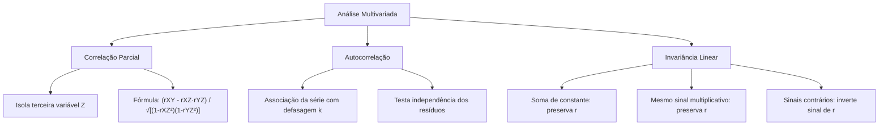

A compreensão da associação linear exige ir além da correlação simples bivariada. Em segurança pública e defesa civil, os fenômenos reais envolvem múltiplos fatores interligados. A relação entre criminalidade e densidade urbana sofre interferência econômica. Também o nível de estresse operacional altera o desempenho da tropa. Da mesma forma, os chamados de socorro ao longo dos meses exibem dependência temporal com registros pretéritos.

Neste capítulo, estudamos a **correlação parcial**, que isola e controla variáveis intervenientes. Analisamos a **autocorrelação serial** em séries temporais. Por fim, examinamos as propriedades do coeficiente de Pearson sob transformações lineares de escala e origem.

> [!objetivos]
> - Compreender o conceito de correlação parcial e a notação técnica utilizada.
> - Aplicar a fórmula da correlação parcial de primeira ordem no controle de variáveis.
> - Definir autocorrelação temporal em séries históricas e resíduos de regressão.
> - Demonstrar o impacto de transformações lineares sobre o coeficiente de Pearson.

## O Conceito de Correlação Parcial: Isolando Efeitos Intervenientes

A **correlação parcial** quantifica a associação linear pura entre duas variáveis X e Y. Ela desconta a influência linear exercida por uma variável de controle Z.

Duas grandezas podem exibir alta correlação simples unicamente por causa de um fator comum oculto. Sem controlar esse fator, diagnostica-se uma correlação espúria.

### Notação Técnica Padronizada

A notação estatística adota subscritos separados por vírgula:
- `rXY,Z` (ou `r12.3`): correlação parcial entre X e Y mantendo Z constante.
- As variáveis antes da vírgula são os alvos da análise. As variáveis após a vírgula são os fatores controlados.
- Se controlarmos duas variáveis (Z e W), temos a correlação de segunda ordem `rXY,ZW`.

| Notação | Ordem do Coeficiente | Variáveis em Análise | Variáveis Sob Controle | Finalidade Metodológica |
|---|---|---|---|---|
| **rXY** | Ordem Zero (Simples) | X e Y | Nenhuma variável | Avaliar associação bivariada bruta |
| **rXY,Z** | Primeira Ordem | X e Y | Z controlada | Descontar efeito interveniente de Z |
| **rXY,ZW** | Segunda Ordem | X e Y | Z e W controladas | Isolar associação líquida entre X e Y |

## Fórmula Operacional da Correlação Parcial

O cálculo de `rXY,Z` decorre das correlações simples bivariadas `rXY`, `rXZ` e `rYZ`:

`rXY,Z = (rXY - rXZ · rYZ) / √{ [1 - (rXZ)²] · [1 - (rYZ)²] }`

O numerador mede a covariabilidade residual entre X e Y após subtrair a parcela explicada por Z. O denominador padroniza a expressão pelas variâncias não explicadas.

### Interpretação Prática dos Resultados

Comparar a correlação simples `rXY` com a correlação parcial `rXY,Z` revela a dinâmica real:
1. **Redução Acentuada**: Se `rXY` for alto e `rXY,Z` for próximo de zero, a relação original era puramente **espúria**.
2. **Manutenção do Valor**: Se `rXZ = 0` e `rYZ = 0`, a correlação parcial iguala-se à correlação simples: `rXY,Z = rXY`.
3. **Efeito Supressor**: A correlação simples pode ser nula, mas a parcial tornar-se forte após controlar Z.

> [!exemplo]
> Suponha coeficientes simples entre chamados (X), avarias (Y) e chuvas (Z):
> - `rXY = 0,60`, `rXZ = 0,50`, `rYZ = 0,70`.
> 
> Aplicando a fórmula operacional:
> - Numerador: `0,60 - (0,50 · 0,70) = 0,60 - 0,35 = 0,25`.
> - Denominador: `√[ (1 - 0,25) · (1 - 0,49) ] = √[0,75 · 0,51] = √0,3825 ≅ 0,6185`.
> - Resultado: `rXY,Z = 0,25 / 0,6185 ≅ 0,404`.
> Controlando a chuva, a correlação caiu de 0,60 para 0,404, encontrando o valor líquido da relação.

## O Conceito de Autocorrelação (Correlação Serial)

A **autocorrelação** mede a associação linear de uma mesma variável consigo mesma ao longo do tempo.

Em uma série temporal `Yt`, a autocorrelação de ordem k compara os valores no instante t com seus valores k períodos antes (`Yt-k`). O coeficiente amostral `rk` é expresso por:

`rk = [ Σ(Yt - Ȳ)(Yt-k - Ȳ) ] / [ Σ(Yt - Ȳ)² ]`

### Classificação da Autocorrelação

A autocorrelação varia de −1 a +1:
- **Positiva (`rk > 0`)**: Valores altos sucedem valores altos. Indica **tendência persistente** ou inércia temporal.
- **Negativa (`rk < 0`)**: Valores altos são seguidos por valores baixos. Apresenta padrão de **oscilação alternada**.
- **Nula (`rk ≈ 0`)**: Observações sucessivas são independentes. Configura ruído branco sem memória temporal.

| Tipo de Autocorrelação | Padrão Visual da Série | Significado Operacional | Implicação em Modelos |
|---|---|---|---|
| **Positiva Forte** | Curva suave e persistente | Inércia ou sazonalidade climática | Subestima variância dos erros |
| **Negativa Forte** | Dentes de serra alternados | Alternância periódica forçada | Superestima variância dos erros |
| **Nula** | Flutuações puramente aleatórias | Eventos independentes | Atende às premissas de Gauss-Markov |

> [!atencao]
> Na regressão linear, os resíduos devem ser mutuamente independentes. A presença de autocorrelação nos resíduos viola as premissas clássicas. Se tivéssemos correlação serial nos erros, os testes t e F perderiam validade estatística.

## Propriedades Algébricas sob Transformações Lineares

Considere as transformações afins `U = a · X + b` e `V = c · Y + d`, com a ≠ 0 e c ≠ 0:

### Efeito da Adição de Constantes (Mudança de Origem)

A adição ou subtração de constantes b e d não altera os desvios em relação à média. Como `(Ui - Ū) = a · (Xi - X̄)`, a correlação linear permanece **rigorosamente inalterada**:
- Somar 100 em X não afeta o coeficiente.
- Subtrair 50 em Y preserva integralmente o valor de r.

### Efeito da Multiplicação por Constantes (Mudança de Escala)

A multiplicação por constantes afeta o numerador e o denominador:
- Se as constantes **a e c tiverem o mesmo sinal** (`a · c > 0`), o valor e o sinal de r **permanecem inalterados**:
  `r(U, V) = r(X, Y)`.
- Se as constantes **a e c tiverem sinais contrários** (`a · c < 0`), o coeficiente **inverte seu sinal algébrico**:
  `r(U, V) = -r(X, Y)`.

O valor absoluto de r nunca se altera: `|r(U, V)| = |r(X, Y)|`.

| Transformação Aplicada | Sinal de a e c | Coeficiente Resultante r(U, V) | Interpretação Direta |
|---|---|---|---|
| `U = X + 50`, `V = Y - 20` | Adição pura (a = 1, c = 1) | `r(U, V) = r(X, Y)` | Translação de eixos sem rotação |
| `U = 3·X`, `V = 2·Y` | Constantes positivas (a > 0, c > 0) | `r(U, V) = r(X, Y)` | Mudança de unidade preserva r |
| `U = -2·X`, `V = -5·Y` | Ambas negativas (a < 0, c < 0) | `r(U, V) = r(X, Y)` | Sinais negativos cancelam-se |
| `U = -4·X`, `V = 2·Y` | Sinais contrários (a < 0, c > 0) | `r(U, V) = -r(X, Y)` | Inversão estrita do sinal algébrico |

## Simplificação de Cálculos por Mudança de Escala e Origem

As bancas de concurso costumam trazer valores grandes para dificultar as contas. O candidato experiente simplifica os dados antes de calcular.

Organizando os dados brutos de duas variáveis, considere a amostra:
- `X = {200, 201, 202, 204, 205}`
- `Y = {300, 301, 302, 308, 309}`

Calcular quadrados de 205 e produtos com 309 consome tempo. Aplicando a mudança de origem `xi - 200` e `yi - 300`:
- `U = X - 200` -> `U = {0, 1, 2, 4, 5}`
- `V = Y - 300` -> `V = {0, 1, 2, 8, 9}`

O coeficiente de Pearson entre U e V é exatamente igual ao de X e Y. Encontramos `r ≅ 0,984` operando apenas com números pequenos. Da mesma forma, se tivéssemos valores múltiplos como 350, 450 e 500, poderíamos aplicar a divisão por 50 (`xi / 50` e `yi / 50`). O cálculo torna-se rápido e seguro.

> [!bizu]
> Diante de números grandes em tabelas de prova, subtraia uma constante de cada coluna. Desde que os fatores multiplicativos tenham o mesmo sinal, o resultado de r não se altera.

## Exercício Resolvido

A aplicação prática fixa os conceitos estudados.

> [!resolvido]
> **Questão (Banca Examinadora Militar - Inédita)**
> A correlação linear simples entre efetivo policial (X) e ocorrências (Y) é `rXY = +0,80`.
> Foram definidas novas variáveis:
> - `W = -3 · X + 50`
> - `K = 2 · Y - 100`
> 
> Sabendo que a variável iluminação pública (Z) apresenta `rXZ = 0,60` e `rYZ = 0,50`, determine:
> 1. A correlação `r(W, K)`;
> 2. A correlação parcial `rXY,Z`.
> 
> **Resolução detalhada:**
> 1. **Cálculo de r(W, K):**
>    As constantes multiplicativas têm sinais opostos (`-3` e `+2`). O sinal de r inverte-se:
>    `r(W, K) = -r(X, Y) = -0,80`.
> 2. **Cálculo da correlação parcial rXY,Z:**
>    - Numerador: `0,80 - (0,60 · 0,50) = 0,80 - 0,30 = 0,50`.
>    - Denominador: `√[ (1 - 0,36) · (1 - 0,25) ] = √[0,64 · 0,75] = √0,48 ≅ 0,6928`.
>    - Resultado: `rXY,Z = 0,50 / 0,6928 ≅ 0,72`.
> 
> **Gabarito definitivo: r(W, K) = -0,80 e rXY,Z ≅ 0,72.**

## Mapa do capítulo

| Tópico | Expressão Central | Regra Prática de Prova |
|---|---|---|
| **Correlação Parcial** | `rXY,Z = (rXY - rXZ·rYZ) / √[(1-rXZ²)(1-rYZ²)]` | Desconta influência linear da variável Z |
| **Autocorrelação** | `rk = [Σ(Yt-Ȳ)(Yt-k-Ȳ)] / [Σ(Yt-Ȳ)²]` | Mede dependência temporal com defasagem k |
| **Soma de Constante** | `r(X + b, Y + d) = r(X, Y)` | Translação pura não altera a correlação |
| **Mesmo Sinal** | `r(aX, cY) = r(X, Y)` com `a·c > 0` | Mudança de unidade preserva r |
| **Sinais Contrários** | `r(aX, cY) = -r(X, Y)` com `a·c < 0` | Inverte exclusivamente o sinal algébrico |

### Para fixar

- A correlação parcial mede a associação líquida entre duas variáveis após controlar uma terceira grandeza.
- A queda acentuada da correlação parcial em relação à simples indica relação originariamente espúria.
- Se a variável de controle for não correlacionada com as demais, a correlação parcial iguala-se à simples.
- A autocorrelação serial avalia a dependência linear de uma mesma série temporal defasada no tempo.
- A ausência de autocorrelação nos resíduos é pressuposto obrigatório para a validade dos testes da regressão.
- Adicionar ou subtrair constantes em X ou Y não modifica o coeficiente de Pearson.
- Multiplicar as variáveis por constantes com mesmo sinal preserva o valor de r.
- Multiplicar as variáveis por constantes com sinais opostos inverte o sinal algébrico de r.
- A mudança de escala e origem agiliza cálculos manuais sem alterar o resultado final.
