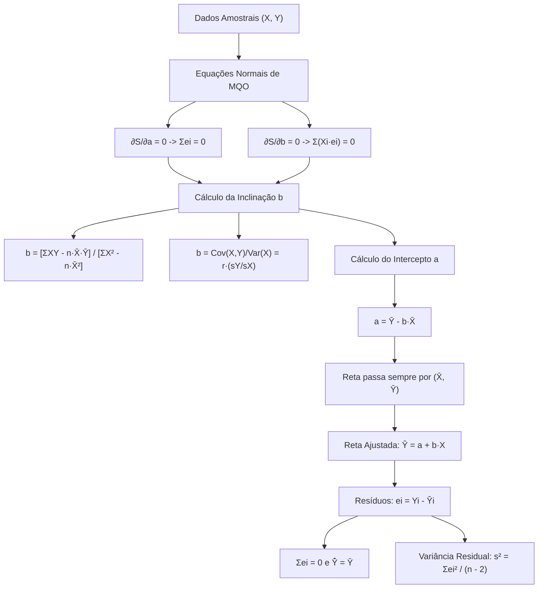

A análise de regressão linear simples investiga a dependência funcional de uma variável resposta em relação a uma variável explicativa. Em operações militares e de defesa civil, essa modelagem é uma ferramenta poderosa. Ela permite prever o tempo de resposta de socorro em função da distância percorrida. Também viabiliza estimar o consumo de combustível da frota conforme a quilometragem patrulhada.

Enquanto a correlação avalia a força da associação bivariada simétrica, a regressão estabelece uma relação direcional assimétrica. Ajusta-se uma linha reta que captura a tendência central dos dados observados.

> [!objetivos]
> - Definir o modelo de regressão linear simples populacional e sua formulação amostral estimada.
> - Compreender os pressupostos clássicos de Gauss-Markov para os erros aleatórios da regressão.
> - Deduzir os estimadores de Mínimos Quadrados Ordinários (MQO) para o intercepto e para a inclinação.
> - Calcular o coeficiente angular por meio da covariância, do desvio padrão e do coeficiente de Pearson.
> - Analisar as propriedades analíticas dos resíduos ordinários e as particularidades da reta pela origem.

## O Modelo de Regressão Linear Simples Populacional e Amostral

O modelo de regressão linear simples supõe que a variável dependente Y se relacione com a variável independente X por meio de uma função linear, acrescida de um termo aleatório estocástico.

### A Equação Populacional

No âmbito da população, o modelo teórico é expresso por:

`Yi = α + β · Xi + εi`

Onde cada elemento possui significado estrutural bem definido:
- **Yi**: Variável dependente, resposta, explicada ou regressando. Representa o fenômeno que se pretende explicar ou prever.
- **Xi**: Variável independente, explicativa, regressora ou preditora. Representa o fator que condiciona a resposta.
- **α (alfa)**: Intercepto populacional ou coeficiente linear. É o valor esperado de Y quando a variável X é igual a zero.
- **β (beta)**: Inclinação populacional ou coeficiente angular. Mede a taxa de variação média em Y para cada aumento unitário em X.
- **εi (épsilon)**: Erro aleatório, perturbação estocástica ou termo de ruído. Captura a influência de variáveis omitidas e imprecisões de medição.

### A Reta Amostral Estimada

Na prática empírica, os parâmetros populacionais α e β são desconhecidos. Eles devem ser estimados a partir de uma amostra de tamanho n. A reta ajustada pelos dados amostrais é expressa por:

`Ŷi = a + b · Xi`

Onde:
- **Ŷi (Y circunflexo)**: Valor ajustado ou estimado pelo modelo para a i-ésima observação.
- **a**: Estimador amostral do intercepto populacional α.
- **b**: Estimador amostral da inclinação populacional β.
- **ei = Yi - Ŷi**: Resíduo amostral ordinário, que mede a diferença entre o valor real observado e o valor estimado.

| Componente | Nível Populacional (Parâmetro) | Nível Amostral (Estimador) | Natureza Matemática |
|---|---|---|---|
| **Relação Funcional** | `Yi = α + β·Xi + εi` | `Ŷi = a + b·Xi` | Função linear determinística + erro |
| **Coeficiente Linear** | `α (alfa)` | `a` | Ponto em que a reta intercepta o eixo Y |
| **Coeficiente Angular** | `β (beta)` | `b` | Taxa marginal de variação (inclinação) |
| **Desvio Individual** | `εi (erro populacional)` | `ei (resíduo amostral)` | Distância vertical do ponto à reta |
| **Variância do Erro** | `σ²` | `s² = Σei² / (n - 2)` | Dispersão dos pontos ao redor da reta |

## Pressupostos Clássicos do Modelo de Regressão: O Teorema de Gauss-Markov

Para que os estimadores obtidos pelo método dos mínimos quadrados possuam propriedades estatísticas ótimas, o termo de perturbação aleatória εi deve satisfazer a cinco premissas clássicas:

1. **Média Nula dos Erros**: A esperança matemática condicional do termo de erro é igual a zero para qualquer valor de X:
   `E(εi | Xi) = 0`
2. **Homocedasticidade**: A variância do termo de erro é constante para todas as observações da amostra:
   `Var(εi | Xi) = σ²`
   Se a dispersão dos erros variar conforme o nível de X, o modelo padece de **heterocedasticidade**.
3. **Ausência de Autocorrelação (Não-Correlação Serial)**: Os erros associados a observações distintas são linearmente independentes:
   `Cov(εi, εj | Xi, Xj) = 0` para todo i ≠ j.
   A violação dessa premissa caracteriza a presença de **autocorrelação residual**.
4. **Exogeneidade Estrita**: A variável explicativa X não é correlacionada com o termo de erro estocástico:
   `Cov(Xi, εi) = 0`
5. **Normalidade dos Erros**: Para fins de inferência exata em pequenas amostras (testes t e F), supõe-se que os erros sigam distribuição normal:
   `εi ~ Normal(0, σ²)`

> [!atencao]
> Sob as premissas de 1 a 4, o consagrado **Teorema de Gauss-Markov** garante que os estimadores de Mínimos Quadrados Ordinários são os **Melhores Estimadores Lineares Não Viesados** (conhecidos pela sigla BLUE, do inglês *Best Linear Unbiased Estimators*). Eles possuem a menor variância possível entre todos os estimadores lineares não viesados.

| Pressuposto Clássico | Expressão Algébrica | Consequência da Violação | Nome da Patologia |
|---|---|---|---|
| Média zero | `E(εi) = 0` | Intercepto absorve o viés sistemático | Viés de especificação |
| Variância constante | `Var(εi) = σ²` | MQO perde eficiência; testes t/F falham | Heterocedasticidade |
| Erros não correlacionados | `Cov(εi, εj) = 0 (i≠j)` | Variância dos coeficientes é subestimada | Autocorrelação serial |
| Exogeneidade | `Cov(Xi, εi) = 0` | Coeficientes tornam-se viesados e inconsistentes | Endogeneidade |
| Normalidade | `εi ~ N(0, σ²)` | Testes t e F não são exatos em amostras curtas | Não-normalidade |

## O Princípio dos Mínimos Quadrados Ordinários (MQO)

O **Método dos Mínimos Quadrados Ordinários (MQO)** estabelece um critério geométrico claro. Ele ajusta a reta de regressão aos dados observados. O método minimiza a **Soma dos Quadrados dos Resíduos (SQR)**. O resíduo ei é a distância vertical do ponto (Xi, Yi) até a reta estimada Ŷi:

`ei = Yi - Ŷi = Yi - (a + b · Xi)`

Minimizar a soma dos resíduos simples `Σei` seria inútil. Resíduos positivos e negativos se anulariam mutuamente. Para superar esse obstáculo, elevam-se os desvios ao quadrado. Define-se a função objetivo quadrática S(a, b):

`S(a, b) = Σ(ei)² = Σ[ Yi - a - b · Xi ]²`

Para minimizar essa função, calculam-se as derivadas parciais em relação a e b. Igualam-se os resultados a zero. Esse procedimento gera as **Equações Normais de Mínimos Quadrados**:

1. Derivada em relação ao intercepto a:
   `∂S / ∂a = -2 · Σ[ Yi - a - b · Xi ] = 0` -> `Σ(Yi - a - b · Xi) = 0` -> `Σei = 0`
2. Derivada em relação à inclinação b:
   `∂S / ∂b = -2 · ΣXi · [ Yi - a - b · Xi ] = 0` -> `Σ(Xi · ei) = 0`

As equações normais formam o sistema linear:
- Equação Normal 1: `n · a + b · (ΣX) = ΣY`
- Equação Normal 2: `a · (ΣX) + b · (ΣX²) = ΣXY`

## Fórmulas para o Coeficiente Angular b (Inclinação da Reta)

Resolvendo o sistema linear das equações normais para o coeficiente angular b, obtêm-se diversas formulações analíticas equivalentes:

### Forma por Covariância e Variância

A inclinação estimada b é a razão direta entre a covariância amostral bivariada e a variância amostral da variável explicativa X:

`b = Cov(X, Y) / Var(X)`

Essa identidade demonstra com clareza a assimetria da regressão: divide-se pela variância da variável independente X, e não pela de Y.

### Forma por Conexão com o Coeficiente de Pearson

Como `Cov(X, Y) = r · sX · sY` e `Var(X) = (sX)²`, simplifica-se a fração para obter a conexão fundamental:

`b = r · [sY / sX]`

Essa relação estabelece três conclusões práticas:
- O coeficiente angular b e o coeficiente de correlação r possuem **obrigatoriamente o mesmo sinal**:
  - Se `r > 0`, a inclinação é positiva (`b > 0`).
  - Se `r < 0`, a inclinação é negativa (`b < 0`).
  - Se `r = 0`, a inclinação é nula (`b = 0`).
- A inclinação b possui dimensão física: unidades de Y por unidade de X (ex.: litros gastos por quilômetro rodado).
- O coeficiente r é adimensional.

### Fórmulas Práticas por Somatórios de Dados

Para resolver exercícios manuais em concursos, utilizam-se duas fórmulas alternativas diretas:

- **Fórmula por Médias Amostrais**:
  `b = [ ΣXY - n · X̄ · Ȳ ] / [ ΣX² - n · (X̄)² ]`
- **Fórmula por Somatórios Brutos**:
  `b = [ n · ΣXY - (ΣX)(ΣY) ] / [ n · ΣX² - (ΣX)² ]`

| Variante da Fórmula de b | Expressão Matemática | Quando Utilizar em Prova |
|---|---|---|
| **Covariância e Variância** | `b = Cov(X, Y) / Var(X)` | Quando a banca já fornece as variâncias prontas |
| **Correlação de Pearson** | `b = r · (sY / sX)` | Quando o coeficiente r e os desvios padrão são conhecidos |
| **Com Médias Amostrais** | `b = [ΣXY - n·X̄·Ȳ] / [ΣX² - n·(X̄)²]` | Quando as médias amostrais são números inteiros |
| **Somatórios Brutos** | `b = [n·ΣXY - (ΣX)(ΣY)] / [n·ΣX² - (ΣX)²]` | Quando a questão traz tabela de somatórios da amostra |

## Fórmula para o Intercepto a (Coeficiente Linear)

A primeira equação normal de mínimos quadrados estabelece:

`n · a + b · (ΣX) = ΣY`

Dividindo todos os termos pelo tamanho amostral n, obtém-se:

`a + b · X̄ = Ȳ`

Isolando o intercepto a:

`a = Ȳ - b · X̄`

### A Propriedade Fundamental do Ponto Médio

A equação `Ȳ = a + b · X̄` comprova uma regra geométrica essencial.

> [!bizu]
> **A reta de MQO passa sempre pelo ponto das médias (X̄, Ȳ)**. Esse ponto é o **centróide da distribuição**.
> Se a questão fornecer as médias amostrais `X̄` e `Ȳ` e a inclinação `b`, o intercepto `a` é obtido imediatamente.

### Interpretação Prática do Intercepto a

O coeficiente linear a representa o valor esperado de Y quando X for nulo. Essa leitura física só tem sentido prático em duas condições:
1. O valor `X = 0` deve estar contido no domínio da amostra.
2. Deve fazer sentido a explicativa assumir valor nulo. Exemplo: custo fixo quando a viatura roda zero quilômetro.

Caso contrário, o intercepto atua apenas como ancoragem vertical da reta.

## Propriedades Analíticas dos Resíduos de Mínimos Quadrados

No modelo com intercepto, os resíduos `ei = Yi - Ŷi` obedecem a quatro regras matemáticas:

1. **A Soma dos Resíduos é Nula**:
   `Σei = 0`.
   A média dos resíduos é estritamente zero: `ē = 0`.
2. **A Média dos Ajustados Coincide com a Média Real**:
   Como `Σ(Yi - Ŷi) = 0`, tem-se `ΣYi = ΣŶi`. Logo:
   `Ȳ̂ = Ȳ`.
3. **Resíduos Não São Correlacionados com X**:
   A segunda equação normal impõe que o produto de X com os resíduos seja nulo:
   `Σ(Xi · ei) = 0` -> `Cov(X, e) = 0`.
4. **Resíduos Não São Correlacionados com Ŷ**:
   `Σ(Ŷi · ei) = 0` -> `Cov(Ŷ, e) = 0`.
   A reta estimada é ortogonal aos resíduos.

> [!exemplo]
> Considere um modelo tradicional de regressão entre investimentos em segurança (X) e o faturamento de empresas em milhões de reais (Y). A equação estimada resultou em `Ŷ = 357 + 0,643 · X`.
> Para uma corporação com X = 200, a previsão de faturamento indica `Ŷ = 357 + 0,643 · (200) = 485,6 milhões`.
> Se o faturamento real observado foi de 499 milhões, o resíduo mede o erro cometido: `ei = Yi - Ŷi = 499 - 485,6 = 13,4 milhões`.
> Em outra unidade com faturamento de 836 milhões, o cálculo analítico com a parcela `yiabxi = Yi - a - b · Xi` confirma que os desvios positivos e negativos anulam-se no conjunto, reduzindo a incerteza decisória na alocação de recursos.

| Propriedade dos Resíduos | Equação Matemática | Consequência Prática |
|---|---|---|
| **Soma nula** | `Σei = 0` | Desvios positivos compensam exatamente os negativos |
| **Média nula** | `ē = 0` | A reta não subestima nem superestima a média geral |
| **Médias coincidentes** | `Ȳ̂ = Ȳ` | A média das previsões é a própria média observada |
| **Ortogonalidade com X** | `Σ(Xi · ei) = 0` | O resíduo não guarda qualquer informação linear de X |
| **Ortogonalidade com Ŷ** | `Σ(Ŷi · ei) = 0` | Os valores ajustados são não correlacionados com o erro |

## Variância do Erro e Variância dos Coeficientes Estimados

A dispersão dos pontos observados em torno da reta de regressão ajustada mede a qualidade do ajuste empírico.

### O Estimador Não Viesado da Variância do Erro (s²)

A variância do termo de erro populacional `σ²` é estimada pela **Variância Residual Amostral** (também denominada Quadrado Médio dos Resíduos - QMRes):

`s² = σ̂² = SQR / (n - 2) = [ Σ(ei)² ] / (n - 2)`

O denominador é `n - 2` porque foram estimados dois parâmetros (o intercepto a e a inclinação b), consumindo 2 graus de liberdade da amostra. O desvio padrão dos resíduos é o **Erro Padrão da Regressão**: `s = √s²`.

### Variância Amostral dos Coeficientes a e b

Os coeficientes a e b são variáveis aleatórias que variam de amostra para amostra. Suas variâncias amostrais teóricas são calculadas por:

- **Variância da Inclinação b**:
  `Var(b) = s² / Sxx = s² / [ Σ(Xi - X̄)² ]`
  O erro padrão de b é `s_b = √[Var(b)] = s / √Sxx`.
- **Variância do Intercepto a**:
  `Var(a) = s² · [ (1 / n) + (X̄)² / Sxx ]`
  O erro padrão de a é `s_a = √[Var(a)]`.

Essas variâncias são utilizadas diretamente na construção de intervalos de confiança e no teste t de Student para testar a significância estatística dos parâmetros (`H0: β = 0`).

## Reta de Regressão Passando pela Origem (Sem Intercepto)

Em certas aplicações da física, da engenharia e da logística operacional, a teoria impõe que quando a variável explicativa for nula, a resposta deva ser necessariamente nula. Nesses casos, fixa-se o intercepto em zero: `α = 0`.

O modelo teórico de regressão sem intercepto é expresso por:

`Yi = β · Xi + εi`

E a reta ajustada amostral assume a forma:

`Ŷi = b · Xi`

### Estimador de MQO para a Reta sem Intercepto

Minimizando a soma dos quadrados dos resíduos `S(b) = Σ(Yi - b · Xi)²`, calcula-se a derivada em relação a b e iguala-se a zero:

`∂S / ∂b = -2 · ΣXi(Yi - b · Xi) = 0` -> `Σ(Xi · Yi) - b · Σ(Xi²) = 0`

Isolando b, obtém-se o estimador de inclinação para o modelo sem intercepto:

`b = [ Σ(Xi · Yi) ] / [ Σ(Xi)² ]`

Observe que no numerador utiliza-se o produto bruto `ΣXY`, e no denominador utiliza-se o quadrado bruto `ΣX²`, sem descontar as médias amostrais!

> [!pegadinha]
> **Cuidado supremo em provas de concurso:**
> Na regressão linear sem intercepto (reta que passa pela origem):
> 1. A soma dos resíduos **NÃO É OBRIGATORIAMENTE IGUAL A ZERO** (`Σei ≠ 0`), a não ser no caso raro em que a média `X̄ = 0`.
> 2. A média dos valores observados **NÃO COINCIDE** necessariamente com a média dos valores estimados: `Ȳ̂ ≠ Ȳ`.
> 3. O coeficiente de determinação clássico `R²` perde a sua interpretação usual de proporção da variância explicada, podendo assumir valores negativos se calculado pela fórmula padrão.
> As bancas adoram cobrar se `Σei = 0` na reta pela origem. Lembre-se: sem intercepto, a soma dos resíduos não precisa anular-se!

| Característica | Regressão Linear com Intercepto (`Ŷ = a + bX`) | Regressão pela Origem (`Ŷ = bX`) |
|---|---|---|
| **Estimador de b** | `[ΣXY - n·X̄·Ȳ] / [ΣX² - n·(X̄)²]` | `[ΣXY] / [ΣX²]` |
| **Estimador de a** | `a = Ȳ - b·X̄` | `a = 0 (fixado a priori)` |
| **Passa por (X̄, Ȳ)?** | Sim, obrigatoriamente | Não necessariamente |
| **Soma dos Resíduos Σei** | Sempre estritamente igual a zero | Não é garantidamente zero |
| **Média Ȳ coincide com Ȳ̂?** | Sim, `Ȳ̂ = Ȳ` em qualquer amostra | Não, geralmente `Ȳ̂ ≠ Ȳ` |
| **Graus de Liberdade do Erro** | `n - 2` | `n - 1` |

## Exercício Resolvido Passo a Passo

O domínio prático dos cálculos numéricos de mínimos quadrados é indispensável para aprovação.

> [!resolvido]
> **Questão (Banca Examinadora Militar - Inédita)**
> O comando do Corpo de Bombeiros realizou um levantamento operacional sobre o tempo de extinção de princípios de incêndio em minutos (Y) em função do volume de água pressurizada utilizado em centenas de litros (X). Em uma amostra de n = 5 ocorrências padronizadas, registraram-se os seguintes dados:
> 
> - Ocorrência 1: X = 1, Y = 3
> - Ocorrência 2: X = 2, Y = 5
> - Ocorrência 3: X = 3, Y = 7
> - Ocorrência 4: X = 4, Y = 8
> - Ocorrência 5: X = 5, Y = 12
> 
> Com base nesses registros amostrais:
> 1. Determine a equação da reta de regressão linear simples ajustada pelo Método dos Mínimos Quadrados Ordinários (`Ŷ = a + b · X`);
> 2. Estime o tempo esperado de combate para uma ocorrência em que sejam previstos X = 6 centenas de litros de água;
> 3. Calcule o resíduo da ocorrência 3.
> 
> **Resolução detalhada:**
> 
> 1. **Cálculo das médias e somatórios básicos:**
>    - `ΣX = 1 + 2 + 3 + 4 + 5 = 15` -> `X̄ = 15 / 5 = 3,0`
>    - `ΣY = 3 + 5 + 7 + 8 + 12 = 35` -> `Ȳ = 35 / 5 = 7,0`
>    - `ΣX² = 1² + 2² + 3² + 4² + 5² = 1 + 4 + 9 + 16 + 25 = 55`
>    - `ΣXY = (1)(3) + (2)(5) + (3)(7) + (4)(8) + (5)(12) = 3 + 10 + 21 + 32 + 60 = 126`
> 
> 2. **Cálculo do coeficiente angular b:**
>    - Numerador: `ΣXY - n · X̄ · Ȳ = 126 - 5 · (3,0) · (7,0) = 126 - 105 = 21`
>    - Denominador: `ΣX² - n · (X̄)² = 55 - 5 · (3,0)² = 55 - 45 = 10`
>    - `b = 21 / 10 = 2,10`
> 
> 3. **Cálculo do intercepto a:**
>    - `a = Ȳ - b · X̄ = 7,0 - (2,10) · (3,0) = 7,0 - 6,30 = 0,70`
>    - Logo, a equação da reta de regressão ajustada é:
>      `Ŷ = 0,70 + 2,10 · X`
> 
> 4. **Previsão pontual para X = 6:**
>    - `Ŷ(6) = 0,70 + 2,10 · (6) = 0,70 + 12,60 = 13,30 minutos`
> 
> 5. **Cálculo do resíduo para a ocorrência 3 (onde X = 3 e Y = 7):**
>    - Valor estimado: `Ŷ3 = 0,70 + 2,10 · (3) = 0,70 + 6,30 = 7,00 minutos`
>    - Resíduo ordinário: `e3 = Y3 - Ŷ3 = 7,00 - 7,00 = 0,00 minutos`
> 
> **Gabarito definitivo: Equação ajustada Ŷ = 0,70 + 2,10·X; Previsão = 13,30 min; Resíduo e3 = 0,00.**

## Mapa do capítulo

| Conceito / Parâmetro | Fórmula Estrutural | Regra Prática de Memorização |
|---|---|---|
| **Modelo Populacional** | `Yi = α + β·Xi + εi` | Relação linear teórica com termo estocástico |
| **Reta Estimada** | `Ŷi = a + b·Xi` | Estimativa amostral ajustada por MQO |
| **Inclinação b** | `b = [ΣXY - n·X̄·Ȳ] / [ΣX² - n·X̄²]` | Covariância sobre variância de X |
| **Intercepto a** | `a = Ȳ - b·X̄` | Valor previsto quando X é nulo |
| **Ponto Médio** | `(X̄, Ȳ) pertence à reta` | A reta sempre intercepta as médias das variáveis |
| **Soma dos Resíduos** | `Σei = 0` | Resíduos somam zero no modelo com intercepto |
| **Reta pela Origem** | `b = ΣXY / ΣX²` | Intercepto zero; resíduos NÃO somam zero |

### Para fixar

- A regressão linear simples modela a relação direcional assimétrica entre uma variável resposta Y e uma explicativa X.
- O critério do MQO minimiza a soma dos quadrados das distâncias verticais dos pontos observados até a reta ajustada.
- Os estimadores de MQO são BLUE (Melhores Estimadores Lineares Não Viesados) sob os pressupostos de Gauss-Markov.
- O coeficiente angular b possui o mesmo sinal do coeficiente de correlação r e é calculado por `b = r · (sY / sX)`.
- O intercepto a é dado por `a = Ȳ - b · X̄`, garantindo que a reta de regressão passe sempre pelo centróide `(X̄, Ȳ)`.
- No modelo clássico com intercepto, a soma dos resíduos ordinários é estritamente nula: `Σei = 0`.
- A média dos valores ajustados pela regressão coincide perfeitamente com a média dos valores reais observados: `Ȳ̂ = Ȳ`.
- Os resíduos ordinários são ortogonais à variável explicativa X (`ΣXi · ei = 0`) e aos valores ajustados Ŷ.
- O estimador não viesado da variância do erro residual consome dois graus de liberdade: `s² = SQR / (n - 2)`.
- Na regressão pela origem (`Ŷ = b · X`), o coeficiente é `b = ΣXY / ΣX²` e a soma dos resíduos não é obrigatoriamente zero.
