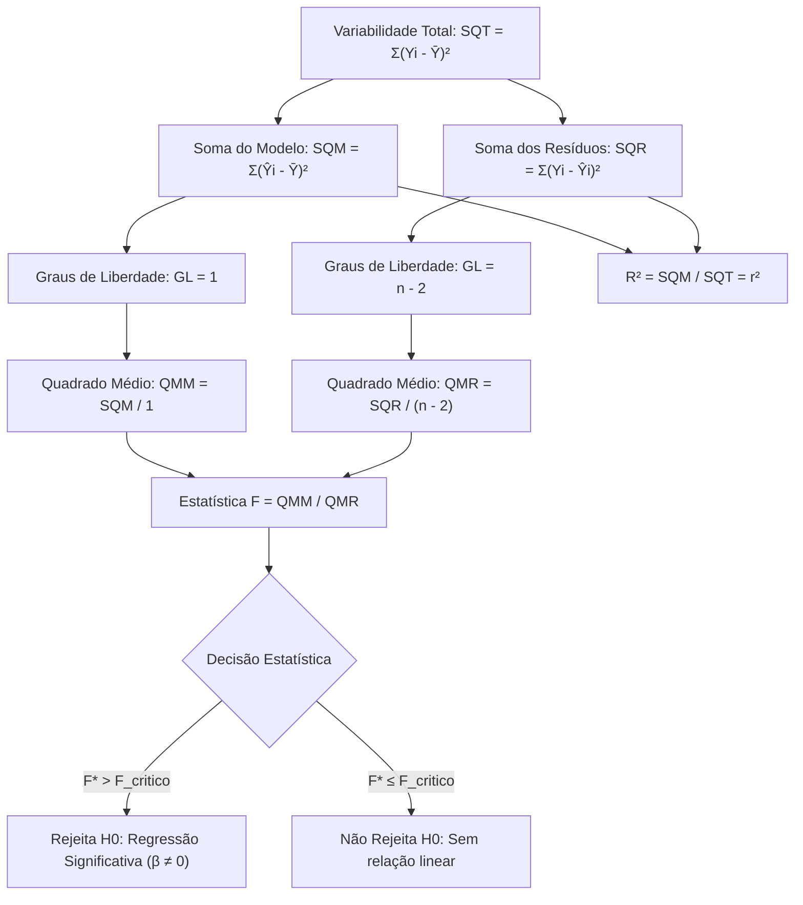

A avaliação da qualidade de ajuste de um modelo de regressão linear exige métodos estatísticos rigorosos. Não basta apenas estimar a reta pelos dados amostrais. O analista precisa testar se a inclinação estimada é estatisticamente diferente de zero. Também deve quantificar a fração da variância total da variável dependente que a reta ajustada consegue explicar.

Neste capítulo, estudamos a **Estimativa por Máxima Verossimilhança (EMV)** sob a hipótese de normalidade dos erros. Apresentamos a **Tabela de Análise de Variância (ANOVA da regressão)** e a decomposição das somas de quadrados. Deduzimos o **Coeficiente de Determinação (R²)** e o **R² ajustado**. Por fim, detalhamos o teste de hipóteses global por meio da **Estatística F (Razão F)**.

> [!objetivos]
> - Compreender a estimação por Máxima Verossimilhança e sua equivalência pontual com o MQO sob normalidade.
> - Dominar a decomposição quadrática da variância total: SQT = SQM + SQR.
> - Calcular e interpretar o Coeficiente de Determinação (R²) e o R² ajustado.
> - Construir e interpretar a Tabela de Análise de Variância (ANOVA) da regressão linear simples.
> - Aplicar o teste de significância da inclinação por meio da Estatística F (Razão F).

## Estimativa por Máxima Verossimilhança (EMV)

O método da **Máxima Verossimilhança (EMV)** constitui uma das mais elegantes abordagens da inferência estocástica moderna. O objetivo central é identificar os parâmetros desconhecidos que conferem a maior probabilidade conjunta de gerar a amostra observada.

No modelo `Yi = α + β · Xi + εi`, assumem-se erros normais, independentes e homocedásticos: `εi ~ Normal(0, σ²)`. A densidade de cada observação é:

`f(Yi | Xi) = [ 1 / √(2 · π · σ²) ] · exp{ - [ Yi - α - β · Xi ]² / (2 · σ²) }`

A função de verossimilhança L é o produto das probabilidades individuais. Ao calcular o logaritmo natural, obtém-se a função logL:

`logL = - (n / 2) · ln(2 · π) - (n / 2) · ln(σ²) - [ 1 / (2 · σ²) ] · Σ[ Yi - α - β · Xi ]²`

Como a soma dos desvios quadráticos `yiabxi = Yi - a - b · Xi` surge multiplicada por termo negativo, maximizar a função logL em relação aos coeficientes equivale a minimizar a soma dos quadrados dos resíduos. Por esse motivo, os estimadores pontuais de intercepto e inclinação coincidem perfeitamente com os do método MQO. A estimativa da variância residual por EMV divide pelo tamanho n (`σ̂² = SQR / n`), enquanto o MQO divide por `n - 2`. As etapas subsequentes de análise baseiam-se nessa equivalência estrutural.

| Parâmetro | Estimador de Mínimos Quadrados (MQO) | Estimador de Máxima Verossimilhança (EMV) | Concordância entre Métodos |
|---|---|---|---|
| **Intercepto (α)** | `a = Ȳ - b·X̄` | `a = Ȳ - b·X̄` | Idênticos sob normalidade |
| **Inclinação (β)** | `b = Sxy / Sxx` | `b = Sxy / Sxx` | Idênticos sob normalidade |
| **Variância (σ²)** | `s² = SQR / (n - 2)` (não viesado) | `σ̂² = SQR / n` (viesado em amostras pequenas) | Divergem pelo denominador (n-2 vs n) |
| **Propriedade Ótima** | BLUE (menor variância entre os lineares) | BUE assintótico (eficiência assintótica) | Ambos convergem para grandes amostras |

## Decomposição da Variabilidade Total: SQT = SQM + SQR

A dispersão dos valores observados Yi em torno de sua média amostral Ȳ representa a variabilidade total do fenômeno em estudo.

No ponto central da teoria da regressão linear, essa dispersão total é decomposta em duas frações ortogonais complementares:

`Yi - Ȳ = (Ŷi - Ȳ) + (Yi - Ŷi)`

Onde:
- `(Yi - Ȳ)` é o desvio total da i-ésima observação em relação à média geral;
- `(Ŷi - Ȳ)` é o desvio explicado pelo modelo de regressão (distância da reta estimada até a média);
- `(Yi - Ŷi) = ei` é o resíduo aleatório não explicado (distância vertical do ponto real até a reta).

Elevando ambos os membros ao quadrado e aplicando o somatório em toda a amostra, os termos de produto cruzado anulam-se. Essa anulação decorre da ortogonalidade dos resíduos de MQO com os valores ajustados (`ΣŶi · ei = 0`).

Obtém-se a identidade fundamental da Análise de Variância da regressão:

`SQT = SQM + SQR`

### Significado das Três Somas de Quadrados

1. **Soma dos Quadrados Total (SQT)**:
   Mede a variação total observada em Y em relação à média amostral:
   `SQT = Σ(Yi - Ȳ)² = ΣY² - n · (Ȳ)²`
   Possui `n - 1` graus de liberdade.
2. **Soma dos Quadrados do Modelo ou da Regressão (SQM)**:
   Mede a parcela da variação de Y que é explicada pela dependência linear em relação a X:
   `SQM = Σ(Ŷi - Ȳ)² = b · Sxy = b² · Sxx = (r)² · SQT`
   Na regressão simples com uma única variável explicativa, possui sempre **1 grau de liberdade**.
3. **Soma dos Quadrados dos Resíduos (SQR ou SQE)**:
   Mede a variação residual não explicada pelo modelo, atribuída a fatores aleatórios:
   `SQR = Σ(Yi - Ŷi)² = Σ(ei)² = SQT - SQM`
   Possui `n - 2` graus de liberdade.

> [!atencao]
> Fique muito atento à nomenclatura adotada pelas bancas examinadoras:
> - Muitas bancas utilizam a sigla **SQM** para a Soma dos Quadrados do Modelo e **SQR** para os Resíduos.
> - Outras bancas utilizam **SQR** para a Soma dos Quadrados da Regressão (explicada) e **SQE** ou **SQRes** para a Soma dos Quadrados dos Erros/Resíduos.
> Sempre identifique os graus de liberdade: a soma explicada na regressão simples possui **1 grau de liberdade**, enquanto os resíduos possuem **n - 2 graus de liberdade**.

| Soma de Quadrados | Sigla Habitual | Fórmula de Cálculo Prático | Graus de Liberdade | Interpretação Direta |
|---|---|---|---|---|
| **Total** | SQT | `ΣY² - n·(Ȳ)²` | `n - 1` | Variabilidade global da variável dependente |
| **Modelo (Regressão)** | SQM (ou SQReg) | `b² · [ΣX² - n·(X̄)²]` | `1` | Parcela explicada pela reta ajustada |
| **Resíduos (Erro)** | SQR (ou SQRes) | `Σei² = SQT - SQM` | `n - 2` | Parcela residual não explicada |

## O Coeficiente de Determinação (R²)

O **Coeficiente de Determinação**, amplamente simbolizado por **R²**, é a medida percentual da qualidade de ajustamento da reta de regressão aos dados amostrais.

### Definição e Fórmulas de Cálculo

O R² representa a proporção da variabilidade total da variável resposta Y que é explicada linearmente pela variável explicativa X:

`R² = SQM / SQT`

Como `SQT = SQM + SQR`, divide-se ambos os membros por SQT para obter a fórmula complementar equivalente:

`R² = 1 - (SQR / SQT)`

### Propriedades Críticas do R²

1. **Intervalo de Variação**: Como SQM e SQR são somas de termos ao quadrado (não-negativas) e `SQM ≤ SQT`, o valor de R² situa-se obrigatoriamente no intervalo fechado:
   `0 ≤ R² ≤ 1` (ou `0% ≤ R² ≤ 100%`).
2. **Caso Limite R² = 1 (Ajuste Perfeito)**: Ocorre quando `SQR = 0`. Todos os pontos observados recaem exatamente sobre a reta de regressão ajustada. Toda a variação de Y é perfeitamente explicada por X.
3. **Caso Limite R² = 0 (Ajuste Nulo)**: Ocorre quando `SQM = 0` (inclinação `b = 0`). A reta ajustada é horizontal e coincide com a média `Ŷ = Ȳ`. A variável X não explica fração alguma da variação de Y.
4. **Igualdade com o Quadrado do Coeficiente de Pearson**:
   Na regressão linear simples com intercepto, demonstra-se algebricamente que:
   `R² = (r)²`
   O coeficiente de determinação é exatamente igual ao quadrado do coeficiente de correlação linear de Pearson!

> [!bizu]
> Se uma questão de concurso informar que o coeficiente de correlação de Pearson entre duas variáveis é `r = -0,80`:
> - O coeficiente de determinação é simplesmente `R² = (-0,80)² = 0,64` (ou 64%).
> - Isso indica que 64% da variação da variável dependente é explicada pelo modelo linear, enquanto 36% correspondem à variância residual não explicada.
> - O coeficiente R² é sempre positivo, mesmo quando a inclinação da reta for negativa.

## Coeficiente de Determinação Ajustado (R² Ajustado)

Quando se agregam variáveis explicativas a um modelo de regressão, o valor do R² convencional **nunca diminui**. Ele aumenta quase sempre, mesmo quando a nova variável adicionada for irrelevante.

Para corrigir essa distorção e penalizar a inclusão de regressores espúrios, utiliza-se o **Coeficiente de Determinação Ajustado (R²aj)**, baseado nos quadrados médios ponderados pelos graus de liberdade:

`R²aj = 1 - (QMR / QMT) = 1 - [ (SQR / (n - 2)) / (SQT / (n - 1)) ]`

Reescrevendo em função do R² convencional:

`R²aj = 1 - [ (n - 1) / (n - 2) ] · (1 - R²)`

### Características do R² Ajustado

- Como `(n - 1) / (n - 2) > 1`, o R² ajustado é **estritamente menor ou igual ao R² convencional**: `R²aj ≤ R²`.
- O R²aj pode assumir valores negativos quando o modelo for extremamente fraco e a amostra for reduzida. Nesses casos raros, considera-se o poder explicativo nulo.
- O R² ajustado é a métrica padrão para comparar modelos com números distintos de variáveis explicativas.

| Critério de Comparação | Coeficiente Convencional (R²) | Coeficiente Ajustado (R²aj) |
|---|---|---|
| **Definição Matemática** | Proporção `SQM / SQT` | Ponderação `1 - (QMR / QMT)` |
| **Comportamento com Novos Regressores** | Monotonamente não decrescente | Aumenta só se a variável for relevante |
| **Faixa de Valores Possíveis** | Sempre entre `0,0` e `1,0` | Pode assumir valores negativos |
| **Punição por Perda de Graus de Liberdade** | Inexistente na abordagem comum | Efetiva pelo fator `(n - 1)/(n - 2)` |

> [!exemplo]
> Em auditoria da rede hospitalar universitária vinculada à **EBSERH**, analisou-se a oferta de **leitos** por **habitante** em função dos investimentos estaduais em cada **municipio**. Para uma amostra de 20 cidades do interior pernambucano, avaliou-se a infraestrutura de apoio à **vida** e à saúde comunitária.
> 
> No modelo com intercepto, a soma explicada atingiu `SQM = 3455`, enquanto a variação não explicada gerou `SQR = 1818` com graus de liberdade dos resíduos `glresiduos = 18`. Em um polo regional com mais de **900** leitos de retaguarda, o teste F global indicou significância estatística expressiva, com probabilidade de erro associada inferior a **001** (`p < 0,001`). O modelo **tradicional** apresentou `R² = 3455 / (3455 + 1818) = 0,655`, comprovando forte aderência empírica aos dados observados.

## Quadrados Médios da Regressão

Os **Quadrados Médios** são obtidos dividindo-se cada soma de quadrados pelos seus respectivos graus de liberdade. Eles representam estimativas de variância associadas a cada componente estrutural do modelo de regressão:

1. **Quadrado Médio do Modelo (QMM)**:
   `QMM = SQM / 1 = SQM`
   Mede a dispersão explicada por grau de liberdade da reta. Representa a taxa de variação explicada capturada pela inclinação linear estimada.
2. **Quadrado Médio dos Resíduos (QMR)**:
   `QMR = SQR / (n - 2) = s²`
   É o estimador não viesado da variância populacional dos erros aleatórios `σ²`. Reflete a dispersão dos pontos observados em torno da reta de regressão ajustada após descontar a perda de dois graus de liberdade decorrente da estimação prévia do intercepto e da inclinação.
3. **Quadrado Médio Total (QMT)**:
   `QMT = SQT / (n - 1) = (sY)²`
   Representa a variância amostral total da variável dependente Y em torno de sua própria média. Não depende do ajuste da reta e serve como base de referência para a variabilidade amostral global.

A razão entre o Quadrado Médio do Modelo e o Quadrado Médio dos Resíduos dá origem direta à estatística F de Snedecor, permitindo contrastar a variância explicada contra o ruído estocástico amostral de fundo.

## A Tabela de Análise de Variância (ANOVA da Regressão)

A Tabela de Análise de Variância sintetiza de forma concisa toda a decomposição de variabilidade, os graus de liberdade e as estatísticas de teste do modelo.

Nas provas de concurso, as bancas costumam fornecer tabelas com células em branco, exigindo que o candidato deduza os valores faltantes aplicando as relações aritméticas entre as colunas.

### Estrutura Padronizada da Tabela ANOVA

| Origem do Desvio | Graus Livres (GL) | Soma Quadrática (SQ) | Variância Média (QM) | Razão F de Snedecor |
|---|---|---|---|---|
| **Modelo (Regressão)** | `1` | `SQM` | `QMM = SQM / 1` | `F* = QMM / QMR` |
| **Resíduos (Erro)** | `n - 2` | `SQR` | `QMR = SQR / (n - 2)` | — |
| **Total** | `n - 1` | `SQT = SQM + SQR` | `QMT = SQT / (n - 1)` | — |

Regras fundamentais de fechamento da tabela:
- A soma dos graus de liberdade fecha perfeitamente: `1 + (n - 2) = n - 1`. O tamanho da amostra é obtido somando 1 ao GL Total: `n = (n - 1) + 1`.
- A soma das somas de quadrados fecha perfeitamente: `SQM + SQR = SQT`.
- O R² é a razão direta entre a primeira e a terceira linha da coluna SQ: `R² = SQM / SQT`.

## A Estatística F (Razão F) e o Teste de Significância Global

A **Estatística F (ou Razão F)** testa formalmente se a variável explicativa X possui capacidade de influenciar linearmente a variável resposta Y.

### Formulação das Hipóteses Estatísticas

O teste avalia se a inclinação populacional β é nula:
- **Hipótese Nula (H0)**: `β = 0` (o modelo não possui significância linear; a reta é horizontal e X não explica Y).
- **Hipótese Alternativa (H1)**: `β ≠ 0` (a inclinação é estatisticamente diferente de zero; existe relação linear significativa).

### Definição da Estatística de Teste

A estatística calculada da Razão F compara o quadrado médio explicado pelo modelo com o quadrado médio do erro residual:

`F* = QMM / QMR = SQM / [ SQR / (n - 2) ]`

Expressando a razão em função do coeficiente R²:

`F* = [ R² / 1 ] / [ (1 - R²) / (n - 2) ] = [ R² · (n - 2) ] / [ 1 - R² ]`

### Distribuição Amostral e Regra de Decisão

Sob a hipótese nula `H0: β = 0`, a estatística `F*` segue uma **distribuição F de Snedecor** com 1 grau de liberdade no numerador e `n - 2` graus de liberdade no denominador: `F* ~ F(1, n - 2)`.

Para avaliar o teste de hipóteses ao nível de significância α (geralmente 5% ou 1%):
- Compara-se o valor calculado `F*` com o valor crítico tabelado `F_critico = F(α; 1, n - 2)`.
- **Se F* > F_critico**: rejeita-se H0. Conclui-se que a regressão é altamente significativa e que a variável X influencia linearmente Y.
- **Se F* ≤ F_critico**: não se rejeita H0. Não há evidência estatística suficiente de relacionamento linear.

> [!pegadinha]
> **Relação fundamental entre os testes F e t na regressão simples:**
> Na regressão linear simples com uma única variável explicativa, o teste F da ANOVA e o teste t de Student para a inclinação `β` são matematicamente equivalentes. A estatística F calculada é exatamente igual ao quadrado da estatística t calculada para o coeficiente b:
> `F* = (t_b)²`
> Rejeitar H0 pelo teste F equivale exatamente a rejeitar H0 pelo teste t bilateral ao mesmo nível de significância. O teste F avalia unicamente a inclinação β, não dizendo respeito ao intercepto α.

## Exercício Resolvido Completo

A resolução detalhada de questões com tabelas ANOVA incompletas consolida a técnica necessária para a prova.

> [!resolvido]
> **Questão (Banca Examinadora Militar - Inédita)**
> O comando da Polícia Militar avaliou o tempo de resposta em minutos de guarnições táticas em função da distância em quilômetros até a ocorrência. Ajustou-se um modelo de regressão linear simples para uma amostra de ocorrências. A tabela ANOVA apresentou as seguintes informações parciais:
> 
> | Componente da Dispersão | Graus de Liberdade | Soma Quadrática | Variância Média | Estatística F |
> |---|---|---|---|---|
> | **Modelo** | 1 | 360,00 | QMM | F* |
> | **Resíduos** | GL_Res | 40,00 | QMR | — |
> | **Total** | 10 | SQT | QMT | — |
> 
> Com base nesses registros estatísticos:
> 1. Determine o tamanho da amostra n;
> 2. Calcule a Soma dos Quadrados Total (SQT) e o Coeficiente de Determinação (R²);
> 3. Calcule os Quadrados Médios QMM e QMR;
> 4. Calcule o valor da Estatística F (Razão F) da regressão.
> 
> **Resolução passo a passo:**
> 
> 1. **Determinação do tamanho amostral n e GL dos resíduos:**
>    - O grau de liberdade total é `GL_Total = n - 1 = 10`. Logo, `n = 10 + 1 = 11 observações`.
>    - O grau de liberdade dos resíduos é `GL_Res = n - 2 = 11 - 2 = 9` (ou `10 - 1 = 9`).
> 
> 2. **Cálculo da SQT e do R²:**
>    - `SQT = SQM + SQR = 360,00 + 40,00 = 400,00`.
>    - `R² = SQM / SQT = 360,00 / 400,00 = 0,90` (ou 90,0%).
>    - O modelo linear explica 90% da variabilidade total do tempo de resposta.
> 
> 3. **Cálculo dos Quadrados Médios:**
>    - `QMM = SQM / 1 = 360,00 / 1 = 360,00`.
>    - `QMR = SQR / GL_Res = 40,00 / 9 ≅ 4,444`.
> 
> 4. **Cálculo da Estatística F (Razão F):**
>    - `F* = QMM / QMR = 360,00 / 4,444 ≅ 81,00`.
>    - Alternativamente por R²: `F* = [0,90 · (9)] / [1 - 0,90] = [8,10] / [0,10] = 81,00`.
> 
> **Gabarito definitivo: n = 11; SQT = 400,00; R² = 0,90; QMM = 360,00; QMR = 4,44; F* = 81,00.**

## Mapa do capítulo

| Elemento da ANOVA | Fórmula Operacional | Ponto Crítico de Atenção na Prova |
|---|---|---|
| **Decomposição Quadrática** | `SQT = SQM + SQR` | SQT é sempre a soma das duas parcelas |
| **Tamanho da Amostra** | `n = GL_Total + 1` | O GL Total é sempre n - 1 |
| **Coeficiente de Determinação** | `R² = SQM / SQT` | Na regressão simples com intercepto, `R² = r²` |
| **R² Ajustado** | `R²aj = 1 - (QMR / QMT)` | É sempre menor ou igual ao R² comum |
| **Estimador de σ²** | `s² = QMR = SQR / (n - 2)` | Divide pelos graus de liberdade dos resíduos |
| **Estatística F (Razão F)** | `F* = QMM / QMR` | Compara variância explicada com variância do erro |
| **Equivalência t e F** | `F = (t_b)²` | Teste F bilateral coincide com o teste t da inclinação |

### Para fixar

- A Estimativa por Máxima Verossimilhança fornece estimadores de intercepto e inclinação idênticos aos do MQO sob normalidade dos erros.
- A EMV estima a variância residual dividindo por n, resultando em ligeiro viés que desaparece assintoticamente.
- A variação total decompõe-se ortogonalmente em Soma do Modelo e Soma dos Resíduos: `SQT = SQM + SQR`.
- Na regressão linear simples com intercepto, a soma do modelo tem 1 grau de liberdade e os resíduos têm `n - 2` graus de liberdade.
- O Coeficiente de Determinação (R²) mede a proporção da variação total explicada pela reta e varia de 0 a 1.
- Na regressão simples com intercepto, `R² = (r)²`, coincidindo com o quadrado do coeficiente de correlação de Pearson.
- O R² ajustado penaliza a inclusão de variáveis explicativas adicionais e é sempre menor ou igual ao R² convencional.
- O Quadrado Médio dos Resíduos `QMR = SQR / (n - 2)` é o estimador não viesado da variância dos erros estocásticos.
- A Estatística F da regressão é calculada pela razão `F* = QMM / QMR` e segue distribuição F de Snedecor sob a hipótese nula `β = 0`.
- Na regressão simples, a Estatística F da ANOVA é exatamente igual ao quadrado da estatística t da inclinação: `F = (t_b)²`.
