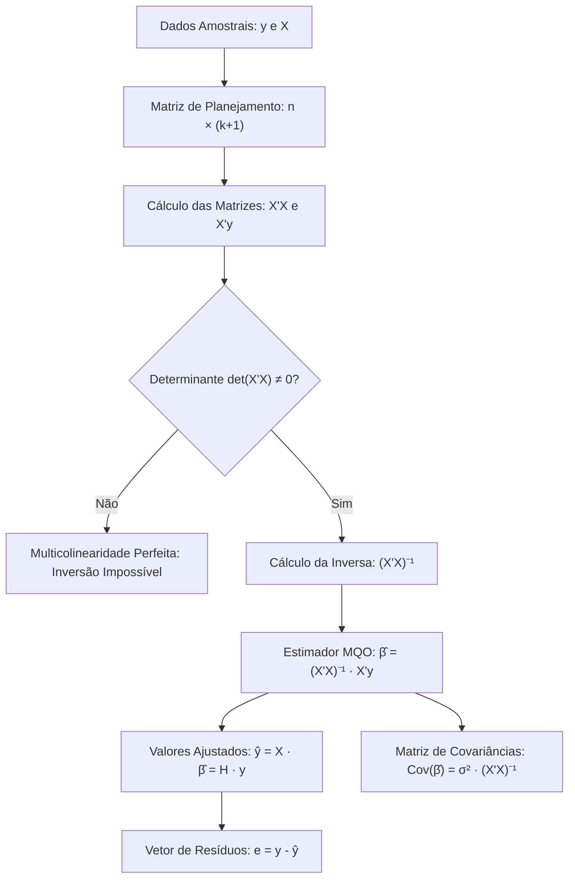

A **Regressão Linear Múltipla** expande a modelagem estatística para duas ou mais variáveis explicativas independentes. No planejamento operacional de segurança pública e defesa civil, o tempo de atendimento depende simultaneamente da distância, do fluxo viário e do efetivo de serviço. Essa formulação quantifica o impacto isolado de cada fator sob a condição metodológica *ceteris paribus*.

> [!objetivos]
> - Compreender o modelo de regressão múltipla populacional e amostral.
> - Interpretar coeficientes parciais sob a condição de tudo o mais constante.
> - Conhecer os pressupostos clássicos e o efeito da multicolinearidade.
> - Dominar a representação matricial com vetores y, ε, β e matriz X.
> - Aplicar o estimador de Mínimos Quadrados: `β̂ = (X'X)⁻¹ · X'y`.

## O Modelo de Regressão Linear Múltipla

O modelo teórico populacional com k variáveis explicativas adota a seguinte equação linear aditiva:

`Y = α + β1 · X1 + β2 · X2 + ... + βk · Xk + ε`

Nessa relação estrutural:
- **Y** é a variável dependente (resposta);
- **α** é o intercepto linear global (valor esperado de Y quando todas as variáveis X forem iguais a zero);
- **βi** são os coeficientes angulares parciais de regressão;
- **Xi** são as variáveis independentes (preditoras ou explicativas);
- **ε** é o termo de erro aleatório estocástico.

A equação estimada a partir de dados amostrais adota a notação:

`Ŷ = a + b1 · X1 + b2 · X2 + ... + bk · Xk`

Onde `Ŷ` representa o valor previsto e `bi` são as estimativas pontuais dos parâmetros populacionais `βi`.

### Interpretação dos Coeficientes Parciais

Cada coeficiente `bi` representa a variação média esperada na variável Y quando a respectiva variável `Xi` aumenta em uma unidade, **mantendo-se todas as demais variáveis independentes inalteradas**.

Essa condição metodológica é designada em economia e estatística como **ceteris paribus** ("tudo o mais constante").

| Coeficiente | Papel Estatístico | Interpretação Direta | Exemplo Prático de Aplicação |
|---|---|---|---|
| **Intercepto (a)** | Nível basal | Valor previsto de Y quando todos os regressores são nulos | Ocorrências mínimas diárias sem fatores sazonais |
| **Inclinação Parcial (b1)** | Efeito marginal isolado | Variação de Y por unidade de X1 mantendo os outros fixos | Minutos extras gastos a cada quilômetro adicional |
| **Inclinação Parcial (b2)** | Efeito marginal isolado | Variação de Y por unidade de X2 mantendo os outros fixos | Variação de viaturas em função do efetivo escalado |

> [!exemplo]
> Suponha que o comando operacional ajustou o seguinte modelo preditivo de viaturas necessárias para apoio:
> 
> `Ŷ = 8 + 1,5 · X1 - 0,4 · X2`
> 
> Onde X1 representa a área de risco em quilômetros quadrados e X2 representa os postos avançados já instalados.
> 
> Mantendo o número de postos fixo, cada quilômetro quadrado adicional de área exige em média mais 1,5 viatura.
> Mantendo a área fixa, cada novo posto instalado reduz a demanda média de viaturas móveis em 0,4 unidade.

### Tamanho Mínimo Amostral

Para estimar um modelo com k variáveis explicativas além do intercepto, o modelo consome `k + 1` graus de liberdade.

Por essa razão teórica, o tamanho da amostra n deve ser estritamente superior ao número de regressores em pelo menos duas unidades:

`n ≥ k + 2`

Para um modelo com 2 regressores independentes (`k = 2`), são necessárias no mínimo 4 observações amostrais (`n ≥ 4`). Isso viabiliza o cálculo das variâncias residuais com graus de liberdade estritamente positivos.

## Pressupostos Clássicos do Modelo Múltiplo

Os parâmetros estimados pelo método de Mínimos Quadrados Ordinários (MQO) possuem propriedades ótimas sob certas hipóteses fundamentais:

1. **Média Nula dos Erros**: `E(εi) = 0` para qualquer observação da amostra.
2. **Homocedasticidade**: `Var(εi) = σ²` constante para todas as observações.
3. **Não Autocorrelação Residual**: `Cov(εi, εj) = 0` para `i ≠ j`. Os erros de observações distintas são estocasticamente independentes.
4. **Normalidade dos Erros**: `εi ~ Normal(0, σ²)`, necessária para os testes de hipóteses t e F.
5. **Posto Completo (Ausência de Multicolinearidade Perfeita)**: Nenhuma variável explicativa pode ser uma função linear exata de outra variável explicativa do modelo.

> [!atencao]
> A **multicolinearidade** consiste na correlação linear expressiva entre duas ou mais variáveis explicativas.
> - Se houver combinação linear exata (exemplo: `X2 = 3 · X1`), ocorre multicolinearidade perfeita. A matriz `X'X` torna-se singular (`det(X'X) = 0`), tornando impossível inverter a matriz e inviabilizando o cálculo de `β̂`.
> - Se houver correlação imperfeita mas muito alta, a matriz pode ser invertida, mas as variâncias dos estimadores tornam-se gigantescas. Isso gera coeficientes com sinais invertidos e testes t não significativos, mesmo com R² elevado.
> A multicolinearidade é um problema exclusivo entre as **variáveis explicativas**, e nunca entre as explicativas e a dependente Y.

## Notação Matricial do Modelo

O tratamento algébrico com muitas variáveis torna-se excessivamente complexo na notação escalar comum. A representação matricial simplifica todas as deduções da regressão linear múltipla.

Considere uma amostra de n observações e k regressores. O modelo matricial escreve-se como:

`y = X · β + ε`

Onde os elementos vetoriais e matriciais são estruturados da seguinte forma:

1. **Vetor Resposta (y)**: vetor-coluna de dimensão `n × 1` contendo os valores observados da variável dependente:
   `y = [ Y1, Y2, ..., Yn ]'`

2. **Matriz de Regressores (X)**: matriz de planejamento com dimensão `n × (k + 1)`. A primeira coluna é inteiramente preenchida pelo número 1, associada ao intercepto `β0`. As demais colunas contêm as medições dos regressores:
   `X = [ 1  X11  X12 ... X1k ]`
   `    [ 1  X21  X22 ... X2k ]`
   `    [ ...  ...  ... ... ... ]`
   `    [ 1  Xn1  Xn2 ... Xnk ]`

3. **Vetor de Parâmetros (β)**: vetor-coluna de dimensão `(k + 1) × 1` com os coeficientes desconhecidos:
   `β = [ α, β1, β2, ..., βk ]'`

4. **Vetor de Perturbações (ε)**: vetor-coluna de dimensão `n × 1` com os distúrbios estocásticos.

| Matriz ou Vetor | Dimensão Matricial | Conteúdo Representado |
|---|---|---|
| **Vetor y** | `n × 1` | Observações da variável dependente |
| **Matriz X** | `n × (k + 1)` | Coluna de uns e regressores observados |
| **Vetor β** | `(k + 1) × 1` | Intercepto e inclinações populacionais |
| **Matriz X'X** | `(k + 1) × (k + 1)` | Matriz simétrica de somas quadráticas e cruzadas |
| **Vetor X'y** | `(k + 1) × 1` | Vetor de produtos cruzados com y |

## O Estimador de Mínimos Quadrados Ordinários em Notação Matricial

O método de MQO busca o vetor de estimadores `b = β̂` que minimiza a soma dos quadrados dos resíduos amostrais:

`SQR = e' · e = (y - Xb)' · (y - Xb) = y'y - 2 · b'X'y + b'X'Xb`

Derivando a forma quadrática em relação ao vetor de parâmetros b e igualando a zero, chega-se ao **Sistema de Equações Normais**:

`X'X · b = X'y`

Multiplicando ambos os membros pela matriz inversa `(X'X)⁻¹`, obtém-se o consagrado estimador matricial de MQO:

`β̂ = (X'X)⁻¹ · X'y`

Para que essa solução analítica exista e seja única, o determinante da matriz `X'X` deve ser estritamente diferente de zero: `det(X'X) ≠ 0`. Essa condição garante a invertibilidade da matriz.

Na álgebra linear aplicada à regressão, a obtenção de `(X'X)⁻¹` envolve a determinação da matriz **adjunta**, obtida pela **transposta** dos **cofatores** de `X'X`, dividida pelo determinante. Em exemplos acadêmicos de menor escala, após a **transposicao** e montagem de `X'X`, surgem somas de produtos como **34**, **38** e **43**, combinadas com o vetor de produtos **1xty**. Quando os regressores são **altamente** correlacionados (por exemplo, com correlações acima de **75**%), ou se **tivermos** quase-dependência linear, as estimativas pontuais resultam em variâncias inflacionadas e testes estatisticamente **insignificantes**.

### Propriedades do Estimador MQO

Sob as hipóteses clássicas de Gauss-Markov:
- O estimador é não viciado: `E(β̂) = β`.
- É o estimador de variância mínima na classe dos estimadores lineares não viciados (BLUE - *Best Linear Unbiased Estimator*).
- Sua matriz de variâncias e covariâncias é dada por:
  `Cov(β̂) = σ² · (X'X)⁻¹`
  Onde os elementos da diagonal principal contêm as variâncias de cada estimador individual (`Var(bj)`), e os elementos fora da diagonal contêm as covariâncias entre pares de estimadores (`Cov(bi, bj)`).

### Valores Ajustados e a Matriz Chapéu

Com o vetor de coeficientes estimado, obtêm-se os valores ajustados pelo modelo:

`ŷ = X · β̂ = X · (X'X)⁻¹ · X'y = H · y`

A matriz `H = X · (X'X)⁻¹ · X'` é denominada **Matriz Chapéu (Hat Matrix)**. Ela projeta ortogonalmente o vetor de observações y sobre o subespaço vetorial gerado pelas colunas da matriz X.

O vetor de resíduos é calculado por:

`e = y - ŷ = (I - H) · y`

Onde `I` representa a matriz identidade de ordem n.

> [!bizu]
> Em provas de concurso, as bancas raramente exigem que o candidato inverta matrizes grandes.
> O enunciado costuma fornecer diretamente:
> 1. A matriz inversa `(X'X)⁻¹`;
> 2. O vetor `X'y`.
> Nesse caso, sua única tarefa é realizar o produto linha por coluna entre a matriz inversa e o vetor. Cada linha da inversa multiplicada pelo vetor coluna produz o respectivo coeficiente `bj`.

## Exercício Prático Resolvido

A aplicação prática do produto matricial ilustra como as questões de concurso abordam o tema.

> [!resolvido]
> **Questão Típica de Concurso**
> Um analista estatístico estimou uma modelagem linear multivariada com dois regressores explanatórios (`k = 2`) para avaliar o custo operacional em função de horas de patrulhamento e consumo de combustível. A matriz inversa `(X'X)⁻¹` e o vetor `X'y` obtidos a partir dos dados foram:
> 
> `(X'X)⁻¹ = [ 0,5   0,1   0,0 ]`
> `          [ 0,1   0,4   0,1 ]`
> `          [ 0,0   0,1   0,3 ]`
> 
> `X'y = [ 20, 10, 30 ]'`
> 
> Determine o vetor de coeficientes estimados `β̂ = [ a, b1, b2 ]'`.
> 
> **Resolução Passo a Passo:**
> 
> Aplicamos diretamente a equação `β̂ = (X'X)⁻¹ · X'y`:
> 
> 1. **Cálculo do intercepto a (primeira linha):**
>    `a = (0,5 · 20) + (0,1 · 10) + (0,0 · 30) = 10 + 1 + 0 = 11,0`
> 
> 2. **Cálculo do coeficiente b1 (segunda linha):**
>    `b1 = (0,1 · 20) + (0,4 · 10) + (0,1 · 30) = 2 + 4 + 3 = 9,0`
> 
> 3. **Cálculo do coeficiente b2 (terceira linha):**
>    `b2 = (0,0 · 20) + (0,1 · 10) + (0,3 · 30) = 0 + 1 + 9 = 10,0`
> 
> O vetor de coeficientes estimados é `β̂ = [ 11,0; 9,0; 10,0 ]'`.
> A equação ajustada final é `Ŷ = 11,0 + 9,0 · X1 + 10,0 · X2`.

## Mapa do capítulo

| Conceito Central | Expressão Matemática | Significado no Modelo |
|---|---|---|
| **Equação Matricial** | `y = Xβ + ε` | Estrutura vetorial para n observações e k regressores |
| **Estimador MQO** | `β̂ = (X'X)⁻¹X'y` | Vetor de parâmetros que minimiza a soma residual |
| **Matriz de Variâncias** | `Cov(β̂) = σ²(X'X)⁻¹` | Variâncias dos coeficientes na diagonal principal |
| **Matriz Chapéu (H)** | `H = X(X'X)⁻¹X'` | Operador de projeção ortogonal dos valores preditos |
| **Graus de Liberdade do Erro** | `GL = n - (k + 1)` | Amostra total descontada de todos os parâmetros |

### Para fixar

- A regressão múltipla envolve uma variável resposta Y e duas ou mais variáveis explicativas independentes.
- Os coeficientes angulares parciais medem o impacto isolado de cada regressor sob a condição de tudo o mais constante (*ceteris paribus*).
- O número mínimo de observações amostrais deve superar o número de regressores em pelo menos duas unidades: `n ≥ k + 2`.
- A multicolinearidade refere-se à correlação linear forte entre variáveis independentes, tornando as estimativas instáveis ou impossíveis de calcular.
- Na formulação matricial `y = Xβ + ε`, a matriz de regressores X possui dimensão `n × (k + 1)`, com a primeira coluna formada inteiramente pelo número 1.
- O estimador clássico de MQO é dado pela relação matricial `β̂ = (X'X)⁻¹ · X'y`.
- A matriz `X'X` só pode ser invertida se o seu determinante for não nulo (`det(X'X) ≠ 0`), o que exige ausência de dependência linear entre as colunas.
- A matriz de covariâncias dos estimadores é `Cov(β̂) = σ² · (X'X)⁻¹`, permitindo calcular o desvio padrão de cada coeficiente.
- A Matriz Chapéu `H = X(X'X)⁻¹X'` projeta o vetor y nos valores ajustados `ŷ = H · y`.
