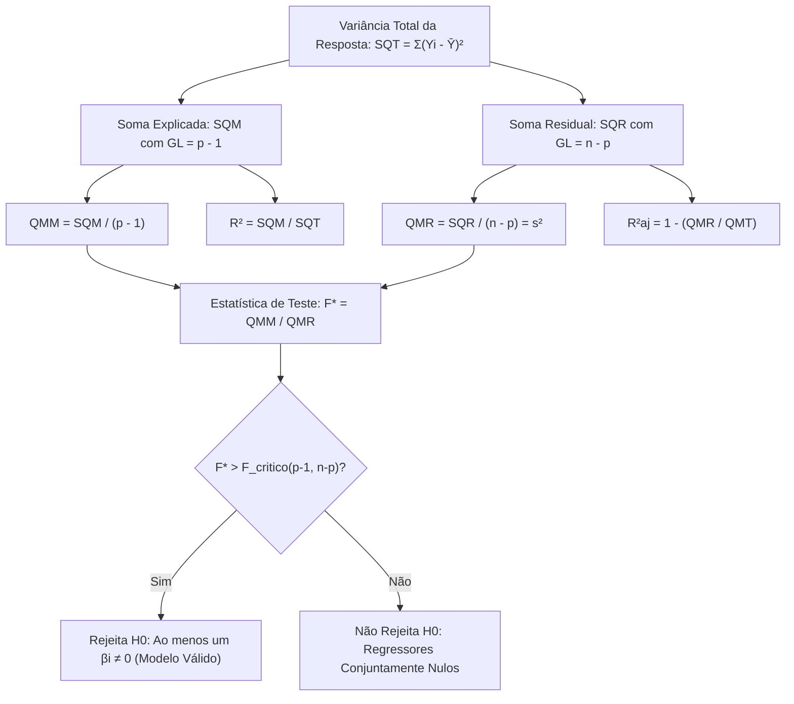

A estimação dos parâmetros de uma regressão linear múltipla fornece os efeitos marginais de cada regressor. No entanto, é fundamental testar a relevância conjunta de todas as variáveis. Uma equação estimada pode não apresentar utilidade real se a variabilidade residual for excessiva.

A **Análise de Variância (ANOVA)** para a regressão múltipla verifica se pelo menos um regressor contribui para prever a resposta. Essa técnica decompõe a variabilidade total em parcelas explicadas e residuais. Ela permite aplicar o teste global por meio da estatística F de Snedecor.

> [!objetivos]
> - Compreender as hipóteses estatísticas do teste global na regressão múltipla.
> - Dominar a decomposição da variância total: SQT = SQM + SQR.
> - Calcular os graus de liberdade do modelo, dos resíduos e do total: p - 1, n - p e n - 1.
> - Obter os Quadrados Médios (QMM e QMR) e a Estatística F da regressão.
> - Diferenciar o estimador não viciado de σ² do Erro Quadrático Médio (EQM).

## Interpretação da Equação Ajustada

No modelo com duas variáveis explicativas, a equação estimada adota a seguinte forma:

`Ŷ = a + b1 · X1 + b2 · X2`

O intercepto **a** indica o valor previsto de Y com regressores nulos (`X1 = 0` e `X2 = 0`). O coeficiente **b1** mede a variação em Y por unidade de X1, com X2 constante. O coeficiente **b2** mede a variação em Y por unidade de X2, com X1 constante.

A variação marginal obedece à equação:

`ΔŶ = b1 · ΔX1 + b2 · ΔX2`

Sem relação linear, o parâmetro populacional é nulo (`βi = 0`).

| Coeficiente | Papel Estrutural | Condição de Avaliação | Efeito Marginal |
|---|---|---|---|
| **Intercepto (a)** | Nível de base | `X1 = 0, X2 = 0` | Valor inicial de resposta esperado |
| **Inclinação b1** | Efeito parcial de X1 | Mantém X2 fixo | `ΔŶ = b1 · ΔX1` |
| **Inclinação b2** | Efeito parcial de X2 | Mantém X1 fixo | `ΔŶ = b2 · ΔX2` |

> [!exemplo]
> Em uma análise pericial de consumo de combustível militar, o modelo ajustado foi expresso por:
> 
> `Ŷ = 12,0 + 0,8 · X1 - 0,5 · X2`
> 
> A variável X1 representa a distância percorrida em dezenas de quilômetros. A variável X2 representa a temperatura ambiente em graus Celsius.
> Para cada dez quilômetros adicionais com temperatura estável, o consumo previsto sobe em 0,8 litro.
> Para cada elevação de um grau na temperatura com distância inalterada, o consumo cai em 0,5 litro.

## O Teste Global da Regressão via ANOVA

O teste global da regressão múltipla avalia a qualidade explicativa conjunta do modelo. Ele verifica se as variáveis independentes conseguem explicar a variação observada em Y.

Não é recomendável avaliar apenas testes t individuais de cada regressor. Quando existem muitas variáveis explicativas, múltiplos testes t isolados elevam a chance global de erro falso positivo. O teste F da ANOVA evita esse problema. Ele testa conjuntamente todos os coeficientes angulares em uma única avaliação estocástica.

As hipóteses estatísticas do teste global são:
- **Hipótese Nula (H0)**: `β1 = β2 = ... = βk = 0`. Nenhuma das variáveis explicativas possui relação linear com Y. O hiperplano estimado não possui poder preditivo.
- **Hipótese Alternativa (Ha)**: Pelo menos um dos coeficientes `βi` é diferente de zero (`pelo menos um βi ≠ 0`). Ao menos um regressor incluído contribui significativamente para prever Y.

Se o teste F não rejeitar a hipótese nula H0, o analista deve concluir que o modelo é ineficaz em conjunto. Se H0 for rejeitada, comprova-se a validade global do ajuste.

## Decomposição da Variância e Graus de Liberdade

A variabilidade total observada na amostra decompõe-se na soma da variação explicada pelo modelo com a variação residual não explicada:

`SQT = SQM + SQR`

A **Soma dos Quadrados Total (SQT)** mede a dispersão de Yi em relação à média geral: `SQT = Σ(Yi - Ȳ)²`.
A **Soma dos Quadrados do Modelo (SQM)** mede a variação capturada pela regressão: `SQM = Σ(Ŷi - Ȳ)²`.
A **Soma dos Quadrados dos Resíduos (SQR)** mede a variação residual não explicada: `SQR = Σ(Yi - Ŷi)² = Σei²`.

### Distribuição dos Graus de Liberdade

Considere uma amostra de **n** dados e **p** parâmetros estimados no modelo. O número p inclui o intercepto e os k regressores (`p = k + 1`).

1. **Graus de Liberdade do Modelo (GLM)**:
   `GLM = p - 1 = k`
   Corresponde à quantidade de variáveis explicativas do modelo.
2. **Graus de Liberdade dos Resíduos (GLR)**:
   `GLR = n - p = n - k - 1`
   Representa o tamanho da amostra deduzido de todos os parâmetros estimados.
3. **Graus de Liberdade Total (GLT)**:
   `GLT = n - 1`

A soma dos graus livres fecha perfeitamente a partição da variância:

`(p - 1) + (n - p) = n - 1`

| Componente | Soma de Quadrados | Graus de Liberdade | Quadrado Médio |
|---|---|---|---|
| **Modelo (Regressão)** | SQM | `p - 1` (ou k) | `QMM = SQM / (p - 1)` |
| **Resíduos (Erro)** | SQR | `n - p` (ou n - k - 1) | `QMR = SQR / (n - p)` |
| **Total Amostral** | SQT | `n - 1` | `QMT = SQT / (n - 1)` |

## Quadrados Médios e a Estatística F de Snedecor

Os Quadrados Médios representam as estimativas de variância associadas a cada componente da partição.

O **Quadrado Médio do Modelo (QMM)** mede a dispersão explicada por regressor:

`QMM = SQM / (p - 1)`

O **Quadrado Médio dos Resíduos (QMR)** expressa a dispersão residual dos erros:

`QMR = SQR / (n - p)`

A estatística calculada do teste global é a **Razão F (Estatística F)**:

`F* = QMM / QMR = [ SQM / (p - 1) ] / [ SQR / (n - p) ]`

A Razão F também pode ser expressa em função do coeficiente de determinação R²:

`F* = [ R² / (p - 1) ] / [ (1 - R²) / (n - p) ]`

Sob a hipótese nula de coeficientes nulos, a estatística `F*` segue distribuição F de Snedecor com `p - 1` graus no numerador e `n - p` graus no denominador: `F* ~ F(p - 1, n - p)`.

Diferentes **autores** adotam **nomenclaturas** diversas para a ANOVA. O resíduo individual decorre da diferença `yiyi = Yi - Ŷi`. A soma explicada incorpora as contribuições dos termos `b1x1i` e `b2x2i`. A soma explicada pode ser deduzida pela diferença `sqtsqr = SQT - SQR`. Na tabela, os graus livres do modelo são definidos por `glequacao = p - 1`, enquanto o resíduo recebe `glresiduos = n - p`. O limiar tabelado é **consultado** na tabela F como **fcritico**. Cada coeficiente quantifica a variável explicativa **relacionada**, com todo o restante dos regressores **mantido** inalterado.

A regra de decisão adota o critério padrão:
- Se `F* > F_critico` (ou **fcritico**), rejeita-se H0. O modelo possui significância estatística global.
- Se `F* ≤ F_critico`, não se rejeita H0. Não há suporte estatístico para afirmar que os regressores explicam Y.

> [!pegadinha]
> Fique atento aos denominadores:
> - O estimador **não viciado** da variância dos erros estocásticos `σ²` é o `QMR = SQR / (n - p)`.
> - O **Erro Quadrático Médio (EQM)** e a estimativa por Máxima Verossimilhança utilizam o divisor n: `EQM = SQR / n`.
> Esse estimador divide pelo total de dados sem descontar a perda de graus de liberdade. Ele subestima a verdadeira variância populacional em amostras reduzidas.

## Coeficiente de Determinação na Regressão Múltipla

O Coeficiente de Determinação mede a fração da variância total da variável Y explicada pelo hiperplano ajustado:

`R² = SQM / SQT = 1 - (SQR / SQT)`

Na regressão linear múltipla, a inclusão de qualquer nova variável independente sempre eleva o valor do R² (ou o mantém inalterado). Esse aumento ocorre mesmo quando a variável adicionada for irrelevante ou espúria.

Para corrigir essa deficiência, utiliza-se o **R² Ajustado**:

`R²aj = 1 - [ (SQR / (n - p)) / (SQT / (n - 1)) ] = 1 - (1 - R²) · [ (n - 1) / (n - p) ]`

O R² ajustado penaliza a inclusão de regressores desnecessários. Ele só cresce quando o ganho explicativo gerado pelo novo regressor supera a perda de um grau de liberdade no resíduo. Por essa propriedade teórica, o R² ajustado é a métrica indicada para comparar modelos concorrentes com quantidades distintas de preditores.

## Exemplo Numérico Completo da ANOVA

A análise prática de tabelas consolida as relações numéricas fundamentais cobradas em concursos.

> [!resolvido]
> **Questão Prática Resolvida**
> Considere um modelo de regressão múltipla estimado com duas variáveis explicativas (`k = 2`, logo `p = 3`) em uma amostra de 5 observações (`n = 5`).
> O vetor de valores observados foi `y = [ 1, 2, 3, 4, 5 ]'`, com `Ȳ = 3,0` e `SQT = 10,0`.
> A equação estimada foi:
> 
> `ŷ = -0,5 + 2,0 · X1 - 0,5 · X2`
> 
> Os resíduos obtidos nas 5 observações foram `e = [ 0,0; -0,5; 0,5; 0,0; 0,0 ]'`.
> 
> 1. Calcule a Soma dos Quadrados dos Resíduos (SQR) e a Soma do Modelo (SQM);
> 2. Calcule os Graus de Liberdade e os Quadrados Médios (QMM e QMR);
> 3. Calcule o Coeficiente de Determinação R² e a Estatística F da regressão.
> 
> **Resolução Passo a Passo:**
> 
> 1. **Cálculo da SQR e da SQM:**
>    - `SQR = Σei² = (0,0)² + (-0,5)² + (0,5)² + (0,0)² + (0,0)² = 0,25 + 0,25 = 0,50`.
>    - Pela identidade da partição: `SQM = SQT - SQR = 10,00 - 0,50 = 9,50`.
> 
> 2. **Graus de Liberdade e Quadrados Médios:**
>    - `GL_Modelo = p - 1 = 3 - 1 = 2`.
>    - `GL_Residuos = n - p = 5 - 3 = 2`.
>    - `GL_Total = n - 1 = 5 - 1 = 4`.
>    - `QMM = SQM / (p - 1) = 9,50 / 2 = 4,75`.
>    - `QMR = SQR / (n - p) = 0,50 / 2 = 0,25`.
> 
> 3. **Coeficiente de Determinação e Estatística F:**
>    - `R² = SQM / SQT = 9,50 / 10,00 = 0,95` (ou 95,0%).
>    - `F* = QMM / QMR = 4,75 / 0,25 = 19,00`.
> 
> Se o valor crítico tabelado ao nível de 5% for `F(0,05; 2, 2) = 19,00`, a estatística calculada atinge o limiar de significância. O exemplo demonstra a sensibilidade das decisões quando a amostra é reduzida.

## Mapa do capítulo

| Elemento Estatístico | Expressão Operacional | Ponto Chave em Provas |
|---|---|---|
| **Hipótese Nula H0** | `β1 = β2 = ... = βk = 0` | Testa o conjunto total dos regressores angulares |
| **Graus do Modelo** | `GL = p - 1 = k` | Igual à quantidade de variáveis explicativas |
| **Graus dos Resíduos** | `GL = n - p = n - k - 1` | Tamanho amostral deduzido de todos os parâmetros |
| **Estimador não Viciado de σ²** | `s² = QMR = SQR / (n - p)` | Considera os graus de liberdade residuais corretos |
| **Estatística F Global** | `F* = QMM / QMR` | Compara dispersão do modelo contra ruído residual |

### Para fixar

- Os coeficientes angulares de uma regressão múltipla medem efeitos marginais sob a hipótese de outras variáveis constantes (*ceteris paribus*).
- O teste global via ANOVA avalia a hipótese nula de que todas as inclinações populacionais são simultaneamente nulas (`H0: β1 = ... = βk = 0`).
- A hipótese alternativa estabelece que pelo menos um dos coeficientes difere de zero.
- A decomposição da variância obedece à equação `SQT = SQM + SQR`.
- Os graus de liberdade distribuem-se em `p - 1` para o modelo, `n - p` para os resíduos e `n - 1` para a variação total (sendo p o total de parâmetros incluindo intercepto).
- Os quadrados médios são definidos por `QMM = SQM / (p - 1)` e `QMR = SQR / (n - p)`.
- A Razão F segue distribuição F de Snedecor com `(p - 1, n - p)` graus de liberdade.
- O estimador não viesado da variância do erro estocástico é o `QMR = SQR / (n - p)`.
- O Erro Quadrático Médio `EQM = SQR / n` divide pelo número total de observações, constituindo estimador viciado em amostras finitas.
- O R² ajustado desconta o consumo de graus de liberdade e viabiliza a comparação entre modelos com números diferentes de regressores.
