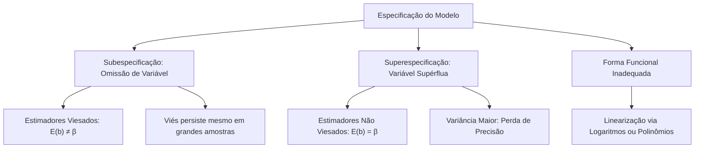

A formulação de um modelo estatístico exige a definição precisa das variáveis explanatórias e da estrutura matemática adotada. Quando o pesquisador seleciona equações incompatíveis com a realidade ou omite fatores causais essenciais, surgem graves distorções inferenciais.

O **Problema da Especificação** consiste na formulação incorreta do modelo de regressão. Esse equívoco decorre da omissão de variáveis relevantes, da inclusão de variáveis desnecessárias ou da escolha de formas funcionais inadequadas. Este capítulo analisa o impacto dessas falhas sobre o viés e a variância dos estimadores.

> [!objetivos]
> - Compreender o conceito de especificação de modelos de regressão linear.
> - Analisar as consequências teóricas da omissão de variáveis relevantes (subespecificação).
> - Identificar as consequências da inclusão de regressores irrelevantes (superespecificação).
> - Conhecer as principais formas funcionais não lineares passíveis de linearização.

## Conceito de Especificação do Modelo

A especificação de um modelo define duas decisões estruturais fundamentais:
1. Quais variáveis independentes X compõem a equação explicativa;
2. Qual função matemática relaciona as variáveis explicativas com a variável resposta Y.

A definição correta baseia-se em fundamentação teórica prévia e na análise de diagramas de dispersão. Ajustar uma reta a uma dinâmica curvilínea gera erro de especificação estrutural.

| Forma Funcional | Equação Matemática | Transformação para Linearização |
|---|---|---|
| **Linear Simples** | `Y = α + β · X` | Relação linear direta sem transformação |
| **Potência** | `Y = α · X^β` | Logarítmica: `ln(Y) = ln(α) + β · ln(X)` |
| **Exponencial** | `Y = α · β^X` | Logarítmica: `ln(Y) = ln(α) + X · ln(β)` |
| **Logarítmica** | `Y = α + β · ln(X)` | Regressão linear sobre a variável transformada `Z = ln(X)` |
| **Polinomial Quadrática** | `Y = α + β · X + γ · X²` | Regressão múltipla com variáveis `X1 = X` e `X2 = X²` |

## Omissão de Variável Relevante (Subespecificação)

A omissão de variável ocorre quando um fator com impacto causal comprovado é excluído da equação.

Suponha que o modelo verdadeiro seja regido por três regressores:

`Y = β1 · X1 + β2 · X2 + β3 · X3 + ε`

Se o analista estima um modelo incompleto apenas com X1 e X2, o termo `β3 · X3` é empurrado para o resíduo aleatório. Se a variável omitida X3 for correlacionada com X1 ou X2, os estimadores tornam-se **tendenciosos (viesados)**:

`E(b1) = β1 + θ1 · β3`

`E(b2) = β2 + θ2 · β3`

Onde `θi` mede a correlação linear entre as variáveis incluídas e a variável excluída. A inclinação estimada passa a capturar indevidamente a influência do fator omitido. Nem mesmo o aumento indefinido da amostra elimina esse vício estrutural.

> [!exemplo]
> Em uma análise do custo de intervenções de bombeiros, o analista usa apenas a distância e a área atingida. Ele omite o tipo de material em combustão.
> Como materiais inflamáveis costumam exigir maiores distâncias de segurança, o coeficiente da distância absorve parte do efeito térmico do material. A estimativa da distância torna-se superestimada e viesada. A única solução é reintroduzir a variável omitida.

## Inclusão de Variável Irrelevante (Superespecificação)

A superespecificação ocorre quando o pesquisador adiciona regressores que não possuem impacto real sobre a variável dependente.

Suponha que o modelo verdadeiro dependa unicamente de duas variáveis:

`Y = β1 · X1 + β2 · X2 + ε`

Se o modelo for ajustado com uma terceira variável inútil X3, o seu parâmetro populacional verdadeiro é nulo (`β3 = 0`).

Nessa circunstância:
- As esperanças dos estimadores mantêm-se corretas: `E(b1) = β1` e `E(b2) = β2`.
- O coeficiente associado à variável supérflua converge para zero: `E(b3) = 0`.
- Os estimadores permanecem **não tendenciosos (não viciados)**.

Entretanto, a inclusão supérflua consome graus de liberdade desnecessariamente. Como resultado direto, **a variância dos estimadores aumenta**. As estimativas perdem precisão estatística e os intervalos de confiança tornam-se mais largos.

| Erro de Especificação | Impacto no Viés (Tendenciosidade) | Impacto na Variância e Eficiência | Consequência Inferencial Prática |
|---|---|---|---|
| **Omissão de Variável Relevante** | Estimadores **viesados (tendenciosos)** | Prejudicada por erro sistemático | Coeficientes incorretos e testes t inválidos |
| **Inclusão de Variável Irrelevante** | Estimadores **não viesados** | **Variância inflacionada** | Perda de precisão e testes menos potentes |

> [!pegadinha]
> **Questão clássica de prova:**
> As bancas costumam confrontar as duas falhas de especificação:
> 1. Omitir uma variável relevante torna os estimadores tendenciosos;
> 2. Incluir uma variável irrelevante mantém os estimadores não tendenciosos, mas inflaciona suas variâncias.
> Em termos metodológicos, omitir uma variável importante é uma falha muito mais grave do que superespecificar o modelo. Ainda assim, a inclusão excessiva reduz o poder dos testes estocásticos.

## Exercício Resolvido: Impacto da Especificação

A análise de questões práticas demonstra como os examinadores cobram a omissão de regressores e seus reflexos numéricos.

> [!resolvido]
> **Questão Prática de Fixação**
> Um analista estimou a remuneração de servidores em função do tempo no **cargo** (`X1`) e dos anos de serviço (`X2`). O modelo populacional verdadeiro possui um termo quadrático de experiência:
> 
> `Y = β0 + β1 · X1 + β2 · X2 + β3 · experiencia2 + ε`
> 
> Ao estimar o modelo, o pesquisador utilizou apenas os termos lineares `b1x1i` e `b2x2i`, desconsiderando o fator `experiencia2` da **matriz** de dados. Suponha que, para valores observados de remuneração de **150**, **250**, **300**, **350** e **400**, a correlação entre o tempo no cargo e o termo quadrático seja positiva.
> 
> Julgue as consequências metodológicas:
> 1. O estimador `b1` permanecerá não viesado?
> 2. Como a omissão afeta a interpretação prática se o modelo **fosse** aplicado para concessão de gratificações?
> 
> **Resolução Passo a Passo:**
> 
> 1. **Avaliação do viés:**
>    - Pela teoria de subespecificação, a esperança matemática do estimador é:
>      `E(b1) = β1 + θ1 · β3`
>    - Como `β3 ≠ 0` e existe correlação positiva (`θ1 > 0`), o produto `θ1 · β3` é não nulo.
>    - Logo, o estimador `b1` torna-se **tendencioso (viesado)**. Ele absorve indevidamente a influência do termo quadrático omitido.
> 
> 2. **Reflexos na tomada de decisão:**
>    - **Desenvolvendo** as equações para os valores amostrais, **chegariamos** a previsões distorcidas para os níveis superiores de carreira.
>    - A única correção estatisticamente válida consiste em reincluir o regressor `experiencia2` na modelagem matricial.

## Mapa do capítulo

### Para fixar

- Especificar o modelo compreende a escolha da forma matemática e das variáveis explicativas adequadas.
- A forma funcional pode ser identificada por meio de conhecimento teórico e diagramas de dispersão.
- Modelos intrinsecamente não lineares podem ser linearizados por transformações logarítmicas ou polinomiais.
- A omissão de variáveis relevantes provoca viés sistemático nos estimadores dos coeficientes remanescentes.
- O viés da omissão decorre da correlação entre as variáveis incluídas e a variável excluída.
- A inclusão de variáveis irrelevantes preserva o caráter não viciado dos estimadores pontuais.
- A inclusão desnecessária inflaciona a variância dos estimadores e reduz a precisão das previsões.
- A subespecificação é estatisticamente mais danosa do que a superespecificação.
