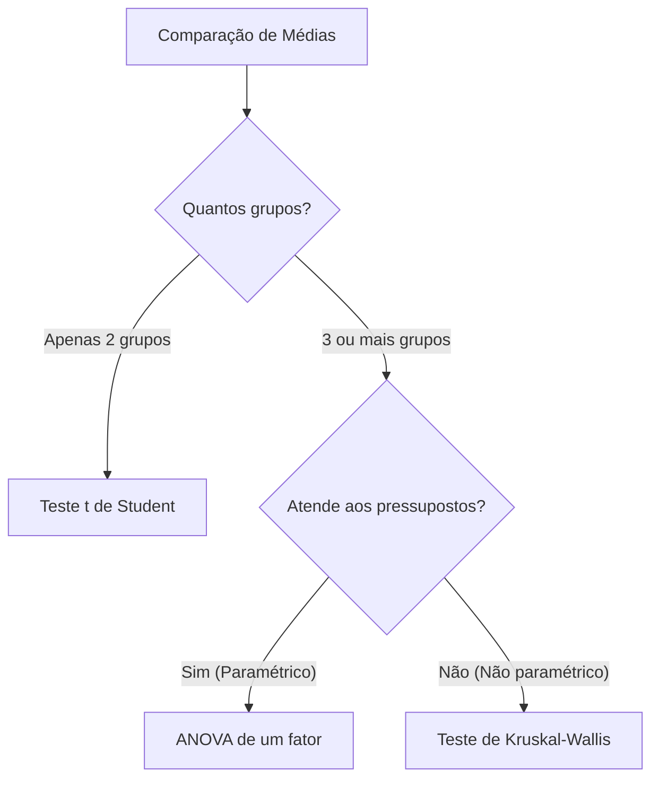
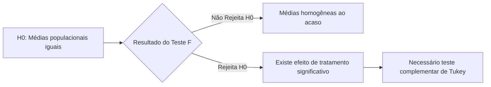
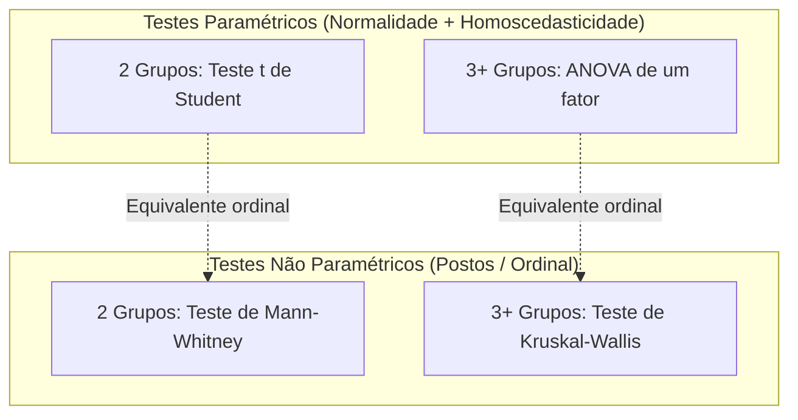
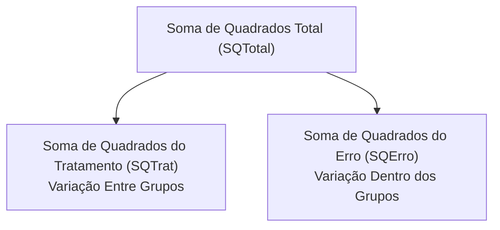
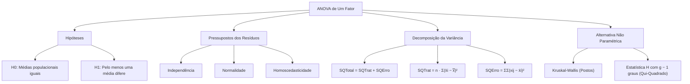

A **Análise de Variância (ANOVA)** constitui a técnica estatística clássica para avaliar simultaneamente a igualdade de médias entre três ou mais grupos independentes. No planejamento e na tomada de decisões em segurança pública e defesa civil, o método permite verificar se diferentes protocolos operacionais, equipamentos de combate a incêndio ou unidades territoriais apresentam eficiências equivalentes sem inflacionar a taxa de erro do tipo I.

> [!objetivos]
> - Compreender a formulação de hipóteses da ANOVA simples de um fator.
> - Dominar os pressupostos paramétricos de independência, normalidade e homoscedasticidade.
> - Identificar as situações de emprego da alternativa não paramétrica de Kruskal-Wallis.
> - Realizar a partição aditiva da variação total: SQTotal = SQTrat + SQErro.
> - Aplicar as fórmulas computacionais de atalho para somas de quadrados em dados balanceados.

## Introdução à Análise de Variância

Na tomada de decisões e no planejamento operacional da segurança pública, comparamos rotineiramente o desempenho de diferentes grupos. Um comandante pode querer avaliar se o tempo médio de resposta a ocorrências de resgate varia entre quatro batalhões distintos. Em outra situação, busca-se checar se três marcas de mangueiras de combate a incêndio apresentam resistências mecânicas similares.

Quando comparamos apenas duas médias populacionais, utilizamos o teste t de Student. Porém, quando temos três ou mais grupos independentes, a realização repetida de testes t par a par é um equívoco metodológico. A realização de múltiplas comparações independentes inflaciona vertiginosamente a taxa global de erro do tipo I. Isso aumenta a probabilidade de rejeitar uma hipótese verdadeira por mero acaso.

Para resolver essa limitação, Ronald Fisher desenvolveu a Análise de Variância, universalmente conhecida pela sigla ANOVA. A técnica avalia simultaneamente todas as médias por meio da comparação padronizada de variâncias.

## Nomenclatura e Definições Essenciais

Para dominar as questões de concurso público, o candidato precisa familiarizar-se com os termos técnicos da ANOVA.

| Termo Técnico | Significado Estatístico | Exemplo Prático Operacional |
|---|---|---|
| Fator | A variável categórica independente sob estudo. | Modelo de viatura de socorro utilizada. |
| Tratamento (Nível) | Cada uma das subdivisões ou modalidades do fator. | Viatura A, Viatura B e Viatura C. |
| Unidade Experimental | A entidade física individual que recebe o tratamento. | Um trecho específico de rodovia atendido. |
| Variável Resposta | A variável contínua quantitativa mensurada. | Tempo de deslocamento em minutos. |
| Resíduo (Erro) | A oscilação casual aleatória dentro do mesmo grupo. | Pequenas flutuações de tráfego imprevistas. |

O modelo linear da ANOVA de um fator expressa cada observação individual por uma equação linear básica:

yij = μ + αi + εij

Nesta formulação:
- yij representa a j-ésima observação coletada sob o i-ésimo tratamento.
- μ é a média geral de todas as observações combinadas.
- αi simboliza o efeito específico associado ao tratamento i.
- εij representa a componente estocástica do erro aleatório experimental.

> [!bizu]
> Os valores de μ e dos parâmetros de efeito de cada tratamento são parâmetros fixos populacionais a estimar. Em contrapartida, a componente do erro residual representa uma variável aleatória não observável diretamente, com média nula e variância constante em todos os níveis. No estudo comparativo de turnos de serviço (como manhã, tarde e noite), o administrador público avalia se os turnos apresentam efeitos médios diferenciados.

> [!pegadinha]
> Cuidado com questões de prova que tentam induzir o candidato ao erro afirmando que tendenciosidade ou autocorrelação constituem pressupostos da ANOVA. A tendenciosidade e a autocorrelação são, na verdade, violações graves da independência das observações. Se os dados tiverem correlação serial ou vício sistemático, o modelo linear perde completamente a sua validade.

## Formulação das Hipóteses Estatísticas

A ANOVA simples de um fator testa a igualdade simultânea das médias de k populações independentes. As hipóteses formais do teste estruturam-se da seguinte maneira:

- Hipótese Nula (H0): μ1 = μ2 = ... = μk
- Hipótese Alternativa (H1): pelo menos uma das médias difere das demais.

A rejeição da hipótese nula indica apenas a presença de alguma diferença estatisticamente relevante. O teste da ANOVA não aponta diretamente qual grupo é diferente nem a quantidade exata de pares divergentes. Para discriminar os grupos com comportamentos desiguais, é imperativo aplicar procedimentos posteriores de comparações múltiplas.

> [!atencao]
> Tenha cautela com armadilhas conceituais de banca examinadora. A hipótese alternativa não afirma que todas as médias são diferentes entre si. Basta que um único grupo apresente média discrepante dos demais para invalidar a hipótese nula.

## Pressupostos Paramétricos Fundamentais

Como teste paramétrico clássico, a validade inferencial da ANOVA repousa em três pressupostos obrigatórios sobre o termo de erro:

1. **Independência**: As observações e os erros devem ser estatisticamente independentes entre si. A coleta dos dados não pode conter dependência espacial, temporal ou de amostragem viciada.
2. **Normalidade**: Os erros experimentais associados a cada tratamento devem seguir uma distribuição normal com média igual a zero.
3. **Homoscedasticidade (Homogeneidade de Variâncias)**: A variância do erro populacional deve ser rigorosamente constante em todos os tratamentos analisados. Simbolicamente, expressamos: σ1² = σ2² = ... = σk² = σ².

| Pressuposto Obrigatório | Condição Estatística | Ferramenta de Avaliação Comum |
|---|---|---|
| Independência | Covariância nula entre resíduos. | Gráfico de dispersão e Durbin-Watson. |
| Normalidade | Distribuição Gaussiana dos erros. | Teste de Shapiro-Wilk ou Kolmogorov-Smirnov. |
| Homoscedasticidade | Variâncias constantes nos grupos. | Teste de Levene ou teste de Bartlett. |

> [!exemplo]
> Suponha que um perito avalia três marcas de extintores sob diferentes pressões de teste. Se uma das marcas apresenta dispersão de resultados muito superior às outras, a homoscedasticidade é violada. Nesses casos, o teste F tradicional perde robustez e pode apontar falsos positivos.

Tamanho amostral mínimo de 30 observações não é pressuposto da ANOVA. Conceitos como ausência de correlação não se confundem com independência. A presença de autocorrelação nos resíduos indica expressa violação do pressuposto da independência, avaliada por testes específicos como Breusch-Godfrey.

## A Alternativa Não Paramétrica: Teste de Kruskal-Wallis

Quando as premissas de normalidade ou de homogeneidade de variâncias são violadas, a aplicação da ANOVA torna-se inadequada. Em tais circunstâncias, o estatístico recorre ao teste de Kruskal-Wallis, também conhecido como ANOVA por postos.

O teste de Kruskal-Wallis é uma técnica não paramétrica para comparar três ou mais grupos independentes. Ele dispensa suposições rigorosas sobre a distribuição de probabilidades original da população. O teste exige apenas que as variáveis sejam passíveis de ordenação hierárquica, operando em escala no mínimo ordinal.

Para realizar o teste de Kruskal-Wallis, todas as observações combinadas dos grupos são ordenadas conjuntamente. Em seguida, atribuem-se postos de 1 a N para cada observação individual. Nos casos de valores empatados, calcula-se a média aritmética dos postos correspondentes. A estatística H do teste compara a soma dos postos obtida em cada grupo.

Sob a hipótese nula de igualdade de distribuições, a estatística H segue uma distribuição assintótica de qui-quadrado. O número de graus de liberdade da distribuição de referência equivale a g − 1, em que g representa o número de grupos sob comparação.

| Característica Avaliada | ANOVA de Um Fator | Teste de Kruskal-Wallis |
|---|---|---|
| Natureza Metodológica | Teste Paramétrico. | Teste Não Paramétrico. |
| Exigência de Normalidade | Obrigatória para os erros. | Dispensada. |
| Exigência de Homoscedasticidade | Obrigatória em todas as populações. | Dispensada. |
| Métrica Comparada | Médias aritméticas das amostras. | Postos médios das observações. |
| Distribuição da Estatística | Distribuição F de Snedecor. | Distribuição Qui-Quadrado (g − 1 graus). |

## Decomposição Algébrica da Variabilidade

A ideia intuitiva central da ANOVA fundamenta-se na decomposição da variação total observada nos dados. Cada ponto experimental difere da média global do experimento por dois motivos distintos:
1. Pelo efeito exercido pelo tratamento em que o elemento foi inserido.
2. Pela oscilação residual casual intrínseca àquele indivíduo ou medição.

Seja xij a observação referente ao elemento j do grupo i. Denotamos por x̄i a média amostral do tratamento i, e por x̿ a média aritmética de todas as observações amostrais reunidas. Podemos desdobrar o desvio total em duas parcelas aditivas perfeitas:

xij − x̿ = (x̄i − x̿) + (xij − x̄i)

Nesta igualdade fundamental:
- O termo da esquerda, (xij − x̿), expressa o desvio total da observação em relação à média geral.
- A primeira parcela da direita, (x̄i − x̿), indica a discrepância da média do grupo em relação à média geral. Essa componente reflete a variação entre os tratamentos.
- A segunda parcela da direita, (xij − x̄i), mede a distância da observação pontual até a média do seu próprio grupo. Essa componente expressa a oscilação puramente residual, interna ou erro casual.

## Identidade Fundamental das Somas de Quadrados

Ao elevarmos ambos os membros da decomposição ao quadrado e realizarmos o somatório duplo para todas as observações, os produtos cruzados anulam-se. Obtemos assim a célebre identidade das somas de quadrados:

SQTotal = SQTrat + SQErro

Algumas bancas examinadoras adotam nomenclaturas sinônimas com frequência:
- SQTrat é frequentemente denominada SQEntre (Soma de Quadrados Entre Grupos) ou Soma de Quadrados do Modelo.
- SQErro é denominada SQDentro (Soma de Quadrados Dentro dos Grupos) ou Soma de Quadrados dos Resíduos.
- SQTotal corresponde à Soma de Quadrados Total do experimento.

| Componente | Nomes Alternativos | Expressão de Definição Conceitual | Significado Físico |
|---|---|---|---|
| SQTrat | SQEntre, SQModelo | n · Σ(x̄i − x̿)² | Variabilidade explicada pelo fator. |
| SQErro | SQDentro, SQResidual | ΣΣ(xij − x̄i)² | Variabilidade inexplicada (acaso). |
| SQTotal | SQT | ΣΣ(xij − x̿)² | Dispersão global de todos os dados. |

Considerando k tratamentos com número balanceado de n repetições por tratamento (sendo o total de observações N = k · n), podemos utilizar fórmulas computacionais simplificadas.

## Fórmulas Computacionais de Atalho

No contexto de provas de concurso público, o tempo é exíguo. Calcular os desvios individuais em relação à média gera contas decimais trabalhosas. Por isso, as fórmulas de atalho são ferramentas indispensáveis para o candidato:

1. Termo de Correção Geral (C):
C = (Σ de todos os valores)² / N

2. Soma de Quadrados Total:
SQTotal = (Σ de todos os valores ao quadrado) − C

3. Soma de Quadrados de Tratamento:
SQTrat = [Σ (Total do grupo i)² / n] − C

4. Soma de Quadrados do Erro:
SQErro = SQTotal − SQTrat

> [!bizu]
> A soma dos quadrados de tratamento é calculada utilizando os totais de cada grupo ao quadrado divididos pelo número de repetições n de cada grupo. Jamais se esqueça de subtrair a constante de correção C ao final. O cálculo de SQErro pode ser feito diretamente pela simples subtração: SQTotal − SQTrat.

> [!esquema]
> A versão não paramétrica do teste de Kruskal-Wallis é uma extensão do teste de Mann-Whitney para múltiplos grupos. Se as amostras tiverem distribuições assimétricas ou variâncias heterogêneas, essa versão ordinal garante inferência válida sem supor normalidade gaussiana. Alternativas de prova que afirmem a necessidade de variâncias idênticas para Kruskal-Wallis são manifestamente incorretas.

## Exercício Prático Resolvido

> [!resolvido]
> Um laboratório do Corpo de Bombeiros Militar realiza ensaios de tração em cabos de salvamento fornecidos por 3 fabricantes distintos (A, B e C). De cada fabricante, foram testadas 4 amostras de cabos sob condições idênticas de temperatura. Os índices de resistência observados foram os seguintes:
> 
> - Fabricante A: 5, 6, 7, 6
> - Fabricante B: 8, 9, 7, 8
> - Fabricante C: 4, 5, 3, 4
> 
> Calcule passo a passo as somas de quadrados do tratamento, do erro e total.
> 
> **Resolução Passo a Passo:**
> 
> 1. **Totais e Médias dos Grupos:**
>    - Grupo A: Soma TA = 5 + 6 + 7 + 6 = 24. Média x̄A = 24 / 4 = 6.
>    - Grupo B: Soma TB = 8 + 9 + 7 + 8 = 32. Média x̄B = 32 / 4 = 8.
>    - Grupo C: Soma TC = 4 + 5 + 3 + 4 = 16. Média x̄C = 16 / 4 = 4.
>    - Número de grupos k = 3; repetições n = 4; total de observações N = 12.
>    - Soma geral G = 24 + 32 + 16 = 72. Média geral x̿ = 72 / 12 = 6.
> 
> 2. **Cálculo da Soma de Quadrados do Tratamento (SQTrat):**
>    - Desvios em relação à média geral: (6−6)² = 0; (8−6)² = 4; (4−6)² = 4.
>    - Soma dos desvios quadráticos: 0 + 4 + 4 = 8.
>    - Multiplicando por n = 4: `SQTrat = 4 · 8 = 32`.
> 
> 3. **Cálculo da Soma de Quadrados do Erro (SQErro):**
>    - Desvios internos no Grupo A: (5−6)² + (6−6)² + (7−6)² + (6−6)² = 1 + 0 + 1 + 0 = 2.
>    - Desvios internos no Grupo B: (8−8)² + (9−8)² + (7−8)² + (8−8)² = 0 + 1 + 1 + 0 = 2.
>    - Desvios internos no Grupo C: (4−4)² + (5−4)² + (3−4)² + (4−4)² = 0 + 1 + 1 + 0 = 2.
>    - Somatório dos três grupos: `SQErro = 2 + 2 + 2 = 6`.
> 
> 4. **Cálculo da Soma de Quadrados Total (SQTotal):**
>    - Pela identidade fundamental: `SQTotal = SQTrat + SQErro = 32 + 6 = 38`.
>    - Pelo atalho computacional: C = 72² / 12 = 432. Soma dos quadrados de todos os valores = 470.
>    - `SQTotal = 470 − 432 = 38`.

## Mapa do capítulo

| Conceito Nuclear | Fórmula Matemática | Propriedade Operacional |
|---|---|---|
| **Modelo da ANOVA** | `yij = μ + αi + εij` | Decomposição linear em média geral, efeito do tratamento e erro |
| **Identidade Fundamental** | `SQTotal = SQTrat + SQErro` | Propriedade aditiva exata das somas de quadrados |
| **SQ do Tratamento** | `n · Σ(x̄i − x̿)²` | Dispersão entre médias dos grupos ponderada pelas repetições |
| **SQ do Erro** | `ΣΣ(xij − x̄i)²` | Variação residual interna dentro dos próprios tratamentos |
| **Teste Não Paramétrico** | `Kruskal-Wallis` | Alternativa por postos quando falham normalidade ou homoscedasticidade |

### Para fixar

- A ANOVA de um fator compara simultaneamente as médias de três ou mais populações independentes.
- A hipótese nula estabelece que todas as médias populacionais são estritamente iguais entre si.
- A hipótese alternativa afirma que pelo menos uma média difere das demais.
- Os pressupostos inegociáveis para a validade do modelo são independência, normalidade e homoscedasticidade dos termos de erro residual.
- Tamanho amostral mínimo de 30 observações não é pressuposto da ANOVA.
- Quando as premissas paramétricas falham, o teste não paramétrico indicado é o teste de Kruskal-Wallis, que utiliza postos e segue qui-quadrado com g − 1 graus de liberdade.
- Para comparação de dois grupos independentes sem normalidade, utiliza-se o teste de Mann-Whitney.
- A decomposição da variância desdobra a variação total em variação entre tratamentos e variação dentro dos grupos: SQTotal = SQTrat + SQErro.
- A soma de quadrados do tratamento deve obrigatoriamente ser multiplicada pelo número de observações n de cada grupo quando deduzida a partir das médias amostrais.
- Pelo atalho computacional, utiliza-se a constante de correção C = (Σx)² / N, facilitando os cálculos manuais em concurso.
