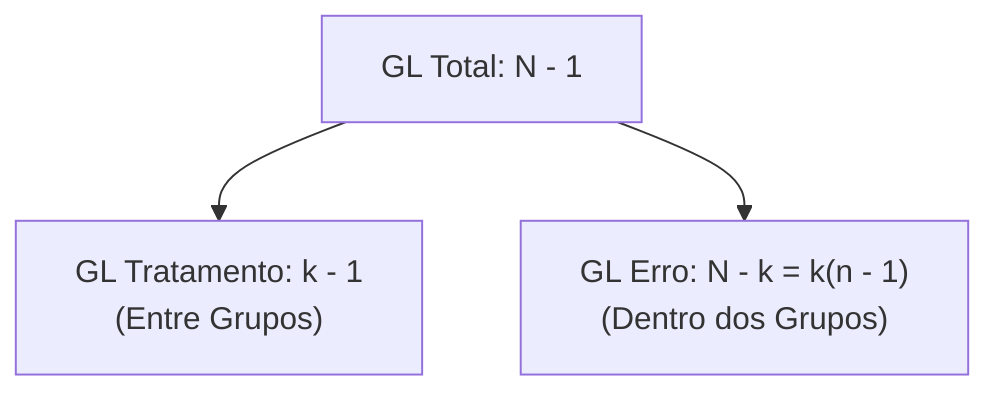
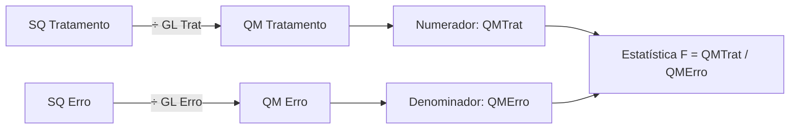
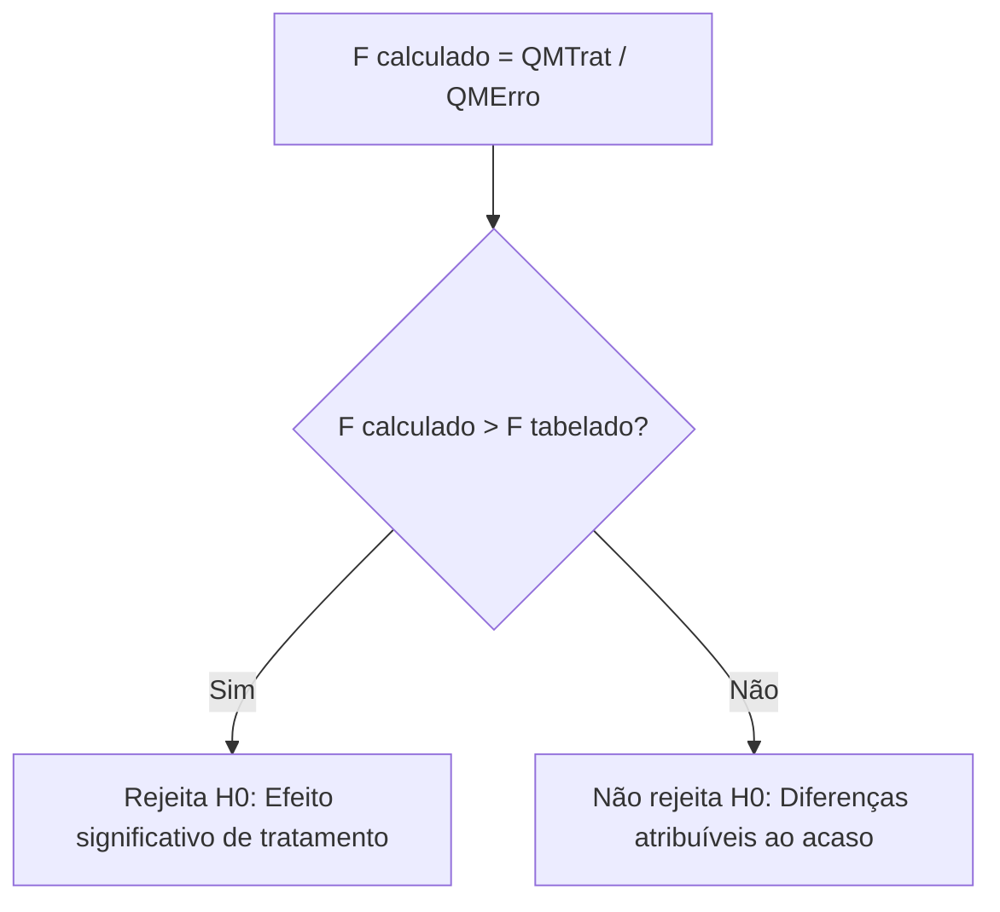
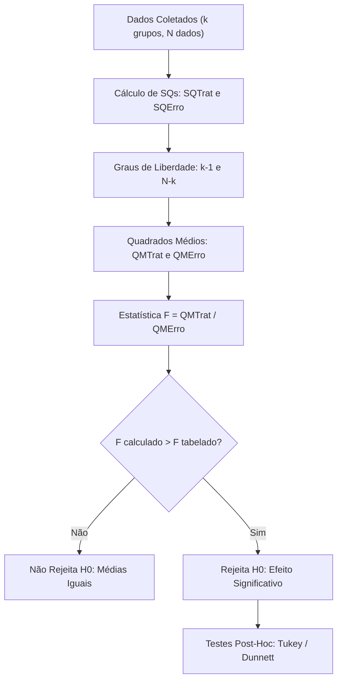

A **Tabela da ANOVA** organiza as fontes de variação do experimento. Ela reúne os graus de liberdade e os quadrados médios necessários para o teste F de Snedecor. Na segurança pública e na defesa civil, essa tabela permite uma decisão objetiva. O analista descobre se as discrepâncias observadas entre grupos decorrem de causas reais ou do acaso.

> [!objetivos]
> - Calcular os graus de liberdade do tratamento, do erro residual e total.
> - Compreender a dedução e a interpretação dos quadrados médios.
> - Estruturar a estatística F e aplicar os critérios de decisão estatística.
> - Analisar o delineamento em blocos ao acaso e repetições desiguais.
> - Aplicar os testes de comparações múltiplas aos pares de Tukey e Dunnett.

## Graus de Liberdade na ANOVA de Um Fator

Os graus de liberdade mensuram o número de informações independentes da amostra. Na ANOVA simples balanceada, dispomos de k tratamentos. Cada grupo contém n repetições. O total de observações do estudo é N = k · n.

A partição dos graus de liberdade é estritamente aditiva:

GLTotal = GLTrat + GLErro

Cada fonte de variação possui uma fórmula direta:

1. **Graus de Liberdade do Tratamento (GLTrat)**: Mede o número de comparações entre os grupos.
GLTrat = k − 1

2. **Graus de Liberdade do Erro Residual (GLErro)**: Mede a variação interna dentro dos grupos. Em cada grupo, perde-se um grau de liberdade para a média local. Restam n − 1 graus por grupo. Multiplicando pelos k grupos, obtemos:
GLErro = k · (n − 1) = N − k

3. **Graus de Liberdade Total (GLTotal)**: Corresponde ao total N menos um grau consumido pela média geral.
GLTotal = N − 1

| Fonte de Variação | Fórmula dos Graus de Liberdade | Exemplo: 4 Grupos com 5 Dados Cada |
|---|---|---|
| Tratamento (Entre) | k − 1 | 4 − 1 = 3 |
| Erro (Dentro) | N − k ou k · (n − 1) | 20 − 4 = 16 ou 4 · 4 = 16 |
| Total | N − 1 | 20 − 1 = 19 |

> [!bizu]
> Observe a soma exata: 3 + 16 = 19. A linha total sempre equivale à soma direta do tratamento com o erro. Essa relação resolve rapidamente questões de prova com tabelas incompletas.

## Quadrados Médios: Estimadores de Variância

Uma soma de quadrados cresce com o tamanho da amostra. Por isso, não podemos compará-la diretamente entre diferentes fontes. Dividimos cada soma de quadrados pelos seus respectivos graus de liberdade. Esse quociente denomina-se **Quadrado Médio (QM)**.

O quadrado médio expressa a variância por unidade de informação independente:

- Quadrado Médio do Tratamento:
QMTrat = SQTrat / GLTrat = SQTrat / (k − 1)

- Quadrado Médio do Erro Residual:
QMErro = SQErro / GLErro = SQErro / (N − k)

O Quadrado Médio do Erro possui relevância ímpar. Ele estima a variância populacional comum dos erros sem viés:

E(QMErro) = σ²

Mesmo se as médias dos tratamentos forem desiguais, o QMErro continua estimando σ².

> [!atencao]
> A linha "Total" da tabela ANOVA não possui Quadrado Médio nem estatística F. A divisão de SQTotal por N − 1 gera a variância amostral global. Porém, esse valor não é utilizado para compor a estatística de teste da ANOVA.

## Modelo de Efeitos Aleatórios e Componente de Variância

Na experimentação científica e na pesquisa operacional, distinguimos dois tipos de delineamento quanto à natureza dos tratamentos: o modelo de efeitos fixos e o modelo de efeitos aleatórios. 

No modelo de efeitos fixos, os tratamentos avaliados são os únicos níveis de interesse direto do pesquisador. As conclusões inferenciais aplicam-se estritamente aos grupos testados. É o caso de comparar três marcas específicas de mangueiras adquiridas pelo Corpo de Bombeiros.

Por outro lado, no modelo de efeitos aleatórios, os níveis testados representam apenas uma amostra aleatória extraída de uma população muito maior de tratamentos. O interesse não se restringe àqueles grupos particulares. Busca-se estimar a variabilidade global de toda a população de onde a amostra foi extraída. É o caso de inspecionar 4 lotes de munição selecionados aleatoriamente entre dezenas de lotes em depósito.

Nesse modelo estocástico, a esperança matemática do Quadrado Médio do Tratamento incorpora a variabilidade entre os tratamentos (σ²trat), além da variabilidade do erro residual:

E(QMTrat) = σ²erro + n · σ²trat

Sob a hipótese nula de que não há variabilidade entre os tratamentos (H0: σ²trat = 0), a esperança de QMTrat iguala-se à esperança de QMErro. Isso fundamenta a mesma estatística F = QMTrat / QMErro. 

Quando rejeitamos H0, podemos isolar e estimar o componente de variância do tratamento a partir da tabela da ANOVA:

σ̂²trat = (QMTrat − QMErro) / n

Essa quantidade mede quanto da dispersão total das medições decorre da heterogeneidade entre os diferentes lotes ou grupos.

> [!exemplo]
> Um comando avaliou 4 lotes de munição escolhidos aleatoriamente. Foram realizados 5 disparos por lote. A tabela registrou QMTrat = 130 e QMErro = 30. A estimativa do componente de variância é calculada assim:
> σ̂²trat = (130 − 30) / 5 = 100 / 5 = 20.
> O divisor da fórmula é rigorosamente o número de repetições n = 5 de cada lote. Esse resultado indica que a variância entre os lotes de munição é estimada em 20 unidades quadráticas.

## A Estatística F de Snedecor e a Tabela da ANOVA

A estatística de teste da ANOVA divide a variância entre grupos pela variância interna residual:

F = QMTrat / QMErro

A estrutura padronizada da Tabela da ANOVA organiza todos os cálculos:

| Fonte de Variação | Graus de Liberdade (GL) | Soma de Quadrados (SQ) | Quadrado Médio (QM) | Estatística F Calculada |
|---|---|---|---|---|
| Tratamento (Entre) | k − 1 | SQTrat | QMTrat = SQTrat / (k − 1) | F = QMTrat / QMErro |
| Erro (Dentro) | N − k | SQErro | QMErro = SQErro / (N − k) | — |
| Total | N − 1 | SQTotal | — | — |

A lógica da estatística F baseia-se em comparações simples:
- **F Próximo de 1**: A variação entre os grupos assemelha-se ao ruído interno. As diferenças observadas decorrem do mero acaso. Não rejeitamos a hipótese nula H0.
- **F Muito Superior a 1**: A dispersão entre os grupos supera o erro casual. Há evidência de efeito real do tratamento. Rejeitamos a hipótese nula H0.

## Critérios de Decisão Estatística

Para concluir o teste, dispomos de duas abordagens equivalentes: o valor crítico tabelado e o p-valor.

### Decisão pelo Valor Crítico da Distribuição F

Sob a hipótese nula, a razão F segue a distribuição teórica de Snedecor. Os parâmetros de graus de liberdade são:
- Numerador: v1 = GLTrat = k − 1
- Denominador: v2 = GLErro = N − k

Fixamos o nível de significância α. Consultamos o valor F(α; v1; v2) na tabela teórica:
- Se F calculado > F tabelado: **Rejeita-se H0**. Conclui-se que pelo menos uma média difere das demais.
- Se F calculado ≤ F tabelado: **Não se rejeita H0**. Não há evidência suficiente de diferenças entre as médias.

> [!pegadinha]
> A ordem dos graus de liberdade na tabela F não pode ser invertida. O primeiro parâmetro (v1) refere-se ao numerador. O segundo parâmetro (v2) refere-se ao denominador. Se você inverter a ordem na consulta, o resultado do teste será invalidado.

### Decisão pelo p-valor

O p-valor expressa a probabilidade de obter uma estatística F tão extrema quanto a observada, sob H0 verdadeira:
- Se p-valor < α: **Rejeita-se H0** (diferença estatisticamente significativa).
- Se p-valor ≥ α: **Não se rejeita H0** (diferença atribuível ao acaso).

Valores reduzidos de p-valor oferecem forte rejeição contra a hipótese de médias iguais.

## Delineamento em Blocos Casualizados

Quando as unidades experimentais não são homogêneas, um fator externo pode inflacionar o erro residual. Para isolar essa perturbação, emprega-se o delineamento em blocos casualizados.

Em testes operacionais, os combatentes podem ser agrupados por turno de serviço. Os turnos matutino, vespertino e noturno funcionam como blocos. O tipo de equipamento testado representa o fator principal.

A soma de quadrados total divide-se em três partes:

SQTotal = SQTrat + SQBloco + SQErro

Com b blocos e k tratamentos, a tabela ANOVA exibe duas estatísticas F:

| Fonte de Variação | GL | Soma de Quadrados | Quadrado Médio | Estatística F |
|---|---|---|---|---|
| Tratamentos | k − 1 | SQTrat | QMTrat = SQTrat / (k − 1) | FTrat = QMTrat / QMErro |
| Blocos | b − 1 | SQBloco | QMBloco = SQBloco / (b − 1) | FBloco = QMBloco / QMErro |
| Erro Residual | (k − 1)(b − 1) | SQErro | QMErro = SQErro / GL | — |
| Total | k · b − 1 | SQTotal | — | — |

A decisão sobre as médias dos tratamentos apoia-se unicamente em **FTrat**. O valor de FBloco serve apenas para atestar a eficácia da blocagem na redução do erro.

> [!esquema]
> Se a normalidade falhar no delineamento em blocos com postos pareados, usamos o **teste de Friedman**. Esse teste não paramétrico ordena os postos dentro de cada bloco e avalia diferenças entre tratamentos.

## ANOVA com Número Distinto de Repetições

Em estudos reais, os grupos experimentais frequentemente possuem quantidades desiguais de observações. Denotamos esses tamanhos por n₁, n₂, ..., nk. O número total de dados reunidos continua sendo N = Σ ni. 

A estrutura lógica da ANOVA mantém-se preservada nesse cenário desbalanceado. Contudo, as formulações algébricas passam a ponderar cada grupo pelo seu respectivo número de observações. A média geral ponderada é dada pela divisão da soma de todos os valores por N. Cada desvio entre a média do grupo e a média geral é multiplicado pelo peso ni correspondente. 

A soma de quadrados do tratamento calcula-se por:

SQTrat = Σ [ni · (x̄i − x̿)²]

Em termos práticos, pode-se usar a fórmula computacional direta com os totais de cada grupo Ti:

SQTrat = [Σ (Ti² / ni)] − [(Σ de todos os valores)² / N]

Os graus de liberdade do erro residual continuam equivalendo exatamente a N − k. A soma de quadrados do erro permanece obtida pela diferença direta: SQErro = SQTotal − SQTrat. O cálculo dos quadrados médios e da razão F segue rigorosamente as mesmas etapas do delineamento balanceado.

Vejamos um exemplo ilustrativo com três grupos de tamanhos desiguais. O Grupo A possui 2 medições (6 e 8), com total TA = 14 e média 7. O Grupo B possui 2 medições (4 e 6), com total TB = 10 e média 5. O Grupo C possui 4 medições (2, 4, 4 e 6), com total TC = 16 e média 4. O total de observações é N = 2 + 2 + 4 = 8. A soma geral é 40 e a média geral é x̿ = 40 / 8 = 5.

Calculando a soma de quadrados de tratamento ponderada pelos tamanhos:
- Grupo A: 2 · (7 − 5)² = 2 · 4 = 8.
- Grupo B: 2 · (5 − 5)² = 2 · 0 = 0.
- Grupo C: 4 · (4 − 5)² = 4 · 1 = 4.
- SQTrat = 8 + 0 + 4 = 12.

Pela fórmula de atalho: (14² / 2) + (10² / 2) + (16² / 4) − (40² / 8) = 98 + 50 + 64 − 200 = 12. Os graus de liberdade são GLTrat = 3 − 1 = 2 e GLErro = 8 − 3 = 5. O quadrado médio do tratamento é QMTrat = 12 / 2 = 6, e o teste prossegue sem alterações conceituais.

## Testes de Comparações Múltiplas aos Pares

A rejeição de H0 na ANOVA indica que pelo menos uma média diverge. Porém, a ANOVA não informa quais pares são distintos. Para sanar essa dúvida, usamos procedimentos de comparações múltiplas.

A aplicação imprudente de múltiplos testes t aos pares eleva o erro do tipo I para 1 − (1 − α)^c, em que c representa o número total de combinações pareadas possíveis. Com 4 grupos, existem c = 6 pares. Se usássemos o teste t comum a 5%, a taxa de erro falso positivo saltaria para mais de 26%. Os procedimentos post-hoc controlam essa taxa de erro da família de comparações, mantendo o nível de significância global fixo em α.

| Procedimento | Finalidade Específica | Distribuição de Referência |
|---|---|---|
| Teste de Tukey (HSD) | Compara todos os pares de médias simultaneamente. | Amplitude Estudentizada (q). |
| Teste de Dunnett | Compara cada tratamento contra um grupo controle. | Distribuição t de Dunnett. |
| Teste t com Bonferroni | Divide o nível de significância pelo total de pares. | Distribuição t de Student. |
| Teste de Scheffé | Permite contrastes complexos entre médias combinadas. | Distribuição F de Snedecor. |

O Teste de Tukey utiliza a **Diferença Mínima Significativa (DMS)**:

DMS = q(α; k; GLErro) · √(QMErro / n)

Se a diferença observada entre duas médias (|x̄i − x̄j|) for superior à DMS, consideramos que o par difere com significância estatística. Por outro lado, quando o objetivo for unicamente contrastar tratamentos inovadores contra uma condição de referência ou controle padrão, o teste de Dunnett é preferível por oferecer maior poder estatístico.

## Exercício Prático Resolvido

> [!resolvido]
> Um perito criminal militar submete 4 lotes de coletes a testes de resistência balística. Cada lote continha 5 coletes testados sob condições idênticas (N = 20 dados).
> Os dados preliminares registraram:
> - Soma de Quadrados do Tratamento (SQTrat) = 360
> - Soma de Quadrados Total (SQTotal) = 648
> O valor crítico tabelado com 3 e 16 graus a 5% é F(0,05; 3; 16) = 3,24.
> Complete a tabela ANOVA e apresente a decisão formal do teste.
> 
> **Resolução Passo a Passo:**
> 
> 1. **Dedução dos Graus de Liberdade:**
>    - GLTrat = k − 1 = 4 − 1 = 3.
>    - GLTotal = N − 1 = 20 − 1 = 19.
>    - GLErro = 19 − 3 = 16.
> 
> 2. **Dedução da Soma de Quadrados do Erro (SQErro):**
>    - SQErro = SQTotal − SQTrat = 648 − 360 = 288.
> 
> 3. **Cálculo dos Quadrados Médios:**
>    - QMTrat = 360 / 3 = 120.
>    - QMErro = 288 / 16 = 18.
> 
> 4. **Cálculo da Estatística F:**
>    - F = QMTrat / QMErro = 120 / 18 = 6,67.
> 
> 5. **Tabela ANOVA Completa:**
>    - Tratamento: GL = 3 | SQ = 360 | QM = 120 | F = 6,67
>    - Erro: GL = 16 | SQ = 288 | QM = 18 | F = —
>    - Total: GL = 19 | SQ = 648 | QM = — | F = —
> 
> 6. **Decisão:**
>    - O F calculado (6,67) é superior ao F crítico tabelado (3,24).
>    - Rejeita-se a hipótese nula H0 ao nível de 5%. Há evidência de efeito significativo entre os lotes.

## Mapa do capítulo

| Elemento da Tabela ANOVA | Fórmula Operacional | Função Inferencial Primária |
|---|---|---|
| **GL Tratamento** | `k − 1` | Quantidade de parâmetros independentes entre médias |
| **GL Erro** | `N − k` | Variabilidade independente interna residual |
| **Quadrado Médio do Erro** | `SQErro / (N − k)` | Estimador não tendencioso da variância residual σ² |
| **Estatística F** | `QMTrat / QMErro` | Razão de variâncias que testa a igualdade das médias |
| **Decisão de Rejeição** | `Fcalc > Ftab ou p < α` | Evidência contra a homogeneidade das populações |
| **Diferença Mínima (DMS)** | `q · √(QMErro / n)` | Limiar do teste de Tukey para separar pares desiguais |

### Para fixar

- Os graus de liberdade satisfazem a identidade: GLTotal = GLTrat + GLErro, com GLTrat = k − 1, GLErro = N − k e GLTotal = N − 1.
- O Quadrado Médio é o quociente entre a soma de quadrados e seus graus de liberdade (QM = SQ / GL).
- O Quadrado Médio do Erro (QMErro) é o estimador não viesado da variância dos erros experimentais σ².
- A estatística de teste F é dada pela razão F = QMTrat / QMErro.
- Sob H0, F segue a distribuição de Snedecor com k − 1 graus no numerador e N − k graus no denominador.
- Rejeita-se H0 quando o F calculado for superior ao F crítico tabelado ou quando o p-valor for menor que α.
- A rejeição de H0 indica apenas que alguma média difere, exigindo testes complementares de comparações múltiplas.
- O Teste de Tukey compara todos os pares de médias, enquanto o Teste de Dunnett compara tratamentos contra um grupo controle.
- Em blocos casualizados, a variação total divide-se em tratamento, blocos e erro, decidindo-se as médias por FTrat.
- Com repetições desiguais, os graus de liberdade do erro continuam sendo N − k, ponderando-se SQTrat pelo tamanho ni de cada grupo.
