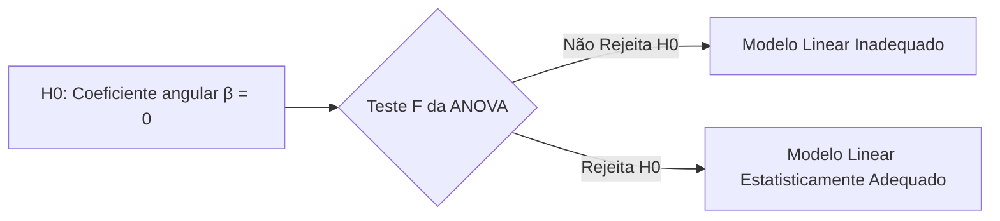
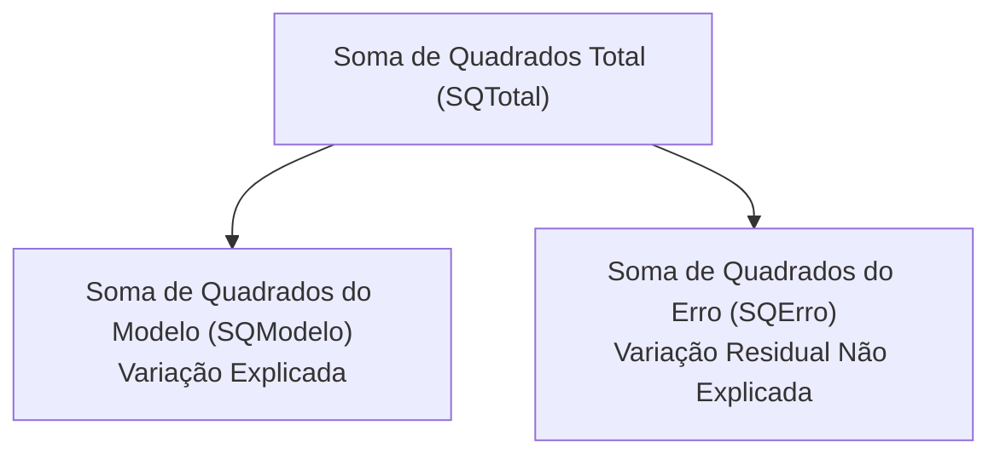
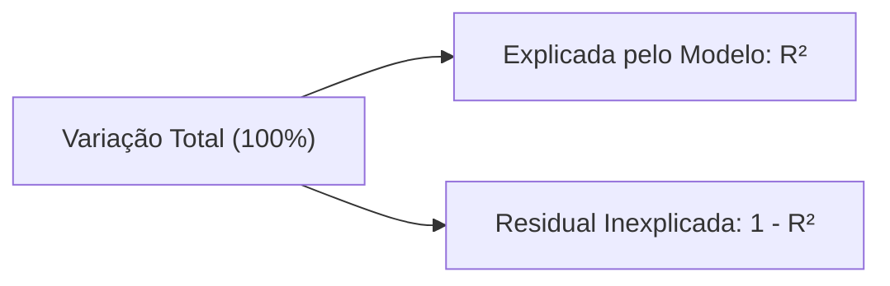
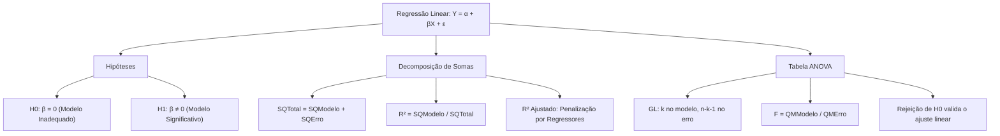

A **Análise de Variância da Regressão** aplica o teste F para avaliar a utilidade global de um modelo linear. Na gestão estratégica de segurança pública e defesa civil, os comandantes precisam testar se uma variável prediz com eficácia o tempo de resposta ou a gravidade de incidentes. A tabela ANOVA fornece a resposta estatística para validar ou descartar o modelo ajustado.

> [!objetivos]
> - Formular as hipóteses nula e alternativa da regressão linear simples e múltipla.
> - Compreender a partição da soma de quadrados: SQTotal = SQModelo + SQErro.
> - Construir a tabela ANOVA da regressão e calcular a razão F de significância global.
> - Interpretar o Coeficiente de Determinação (R²) e sua relação com a correlação linear.
> - Aplicar o Coeficiente de Determinação Ajustado para comparar modelos concorrentes.

## O Modelo Linear e as Hipóteses Estatísticas

No modelo de regressão linear simples, assumimos uma relação teórica populacional entre duas variáveis contínuas:

Y = α + β · X + ε

Nesta equação fundamental:
- X representa a variável explicativa independente.
- Y simboliza a variável resposta dependente.
- α é o intercepto linear da reta.
- β é o coeficiente angular populacional.
- ε expressa o erro estocástico residual.

Pelo método dos Mínimos Quadrados Ordinários, estimamos os parâmetros amostrais a e b. A reta de regressão ajustada escreve-se como:

Ŷ = a + b · X

A questão primordial respondida pela ANOVA é direta. O modelo linear possui utilidade preditiva real?

As hipóteses estruturam-se assim:
- Hipótese Nula (H0): β = 0. Não há associação linear entre as variáveis. A reta não melhora a previsão de Y.
- Hipótese Alternativa (H1): β ≠ 0. Existe relação linear significativa. O modelo linear é estatisticamente adequado.



Na regressão múltipla com k regressores, a hipótese nula estabelece que todos os coeficientes angulares são simultaneamente nulos. Simbolicamente: H0: β1 = β2 = ... = βk = 0. A hipótese alternativa afirma que pelo menos um coeficiente angular difere de zero.

> [!atencao]
> Rejeitar a hipótese nula na ANOVA da regressão constitui uma decisão inferencial forte. Isso atesta que a reta estimada explica uma fração da variação de Y muito superior ao esperado pelo puro acaso.

## Decomposição da Variabilidade na Regressão

A dispersão de cada valor observado Yi em relação à média geral Ȳ pode ser desmembrada em duas partes aditivas:

Yi − Ȳ = (Ŷi − Ȳ) + (Yi − Ŷi)

Nesta igualdade:
- O termo (Ŷi − Ȳ) expressa a distância do valor previsto até a média de Y. Essa parcela mede o quanto o modelo explica a variabilidade da resposta.
- O termo (Yi − Ŷi) representa o resíduo individual ei. Ele quantifica o erro não capturado pelo ajuste linear.

Elevando ambos os membros ao quadrado e somando para todas as n observações, obtemos a identidade das somas de quadrados:

SQTotal = SQModelo + SQErro

| Componente | Nomes Alternativos | Fórmula de Cálculo | Significado Físico no Modelo |
|---|---|---|---|
| SQTotal | SQT | Σ(Yi − Ȳ)² | Dispersão total de Y em torno da sua média |
| SQModelo | SQRegressão, SQM | Σ(Ŷi − Ȳ)² | Variação de Y efetivamente explicada pela reta |
| SQErro | SQResidual, SQE | Σ(Yi − Ŷi)² = Σ ei² | Variação não explicada (ruído residual) |



Na regressão linear simples, dispomos de atalhos computacionais úteis. Podemos deduzir a SQModelo diretamente a partir do coeficiente angular b:

SQModelo = b · Σ [(Xi − X̄)(Yi − Ȳ)]

De forma equivalente:

SQModelo = b² · Σ (Xi − X̄)² = b² · s²X · (n − 1)

Nesta fórmula, s²X é a variância amostral da variável regressora X.

> [!bizu]
> A soma de quadrados total pode ser obtida multiplicando a variância amostral de Y por n − 1: SQTotal = s²Y · (n − 1). Com a SQTotal e o coeficiente b conhecidos, deduz-se SQModelo rapidamente em questões de cálculo.

## Graus de Liberdade e Quadrados Médios da Regressão

A tabela ANOVA da regressão organiza os graus de liberdade conforme o número de variáveis explicativas e de observações:

1. **Graus de Liberdade do Modelo (GLModelo)**: Equivale ao número k de variáveis regressoras independentes. Na regressão simples com uma única variável explicativa, temos GLModelo = 1.
2. **Graus de Liberdade do Erro (GLErro)**: Equivale ao total n menos o número de parâmetros estimados (k variáveis mais o intercepto): GLErro = n − k − 1. Na regressão simples, temos GLErro = n − 2.
3. **Graus de Liberdade Total (GLTotal)**: GLTotal = n − 1.

Os Quadrados Médios resultam da divisão de cada soma de quadrados pelos seus respectivos graus de liberdade:

- Quadrado Médio do Modelo:
QMModelo = SQModelo / k. Na regressão simples, como k = 1, o QMModelo é idêntico à própria SQModelo.

- Quadrado Médio do Erro:
QMErro = SQErro / (n − k − 1). O QMErro também é denominado Erro Quadrático Médio do modelo.

- Quadrado Médio Total:
QMTotal = SQTotal / (n − 1). O QMTotal é exatamente a variância amostral s²Y de todas as observações reunidas.

## Tabela da ANOVA da Regressão e a Estatística F

A estatística de teste F avalia se a variabilidade explicada pelo modelo supera significativamente a variabilidade residual:

F = QMModelo / QMErro

```mermaid Fluxo de cálculo da razão F na regressão linear
flowchart LR
    SQM["SQ Modelo"] -->|÷ k| QMM["QM Modelo"]
    SQE["SQ Erro"] -->|÷ (n - k - 1)| QME["QM Erro"]
    QMM & QME --> Fcalc["Estatística F = QMModelo / QMErro"]
```

A estrutura da Tabela ANOVA para a regressão organiza-se da seguinte forma:

| Fonte de Variação | Graus de Liberdade (GL) | Soma de Quadrados (SQ) | Quadrado Médio (QM) | Estatística F |
|---|---|---|---|---|
| Modelo (Regressão) | k | SQModelo | QMModelo = SQModelo / k | F = QMModelo / QMErro |
| Erro (Resíduo) | n − k − 1 | SQErro | QMErro = SQErro / (n − k − 1) | — |
| Total | n − 1 | SQTotal | — | — |

Sob a hipótese nula de ausência de relação linear, a razão F segue a distribuição teórica F com k graus de liberdade no numerador e n − k − 1 graus no denominador. Rejeitamos H0 se F calculado for superior ao F crítico tabelado F(α; k; n − k − 1) ou se o p-valor for menor que o nível de significância adotado.

> [!pegadinha]
> Fique atento ao número de variáveis explicativas. O número de graus de liberdade do modelo é k, e não k + 1. O número total de parâmetros da regressão é k + 1 (incluindo o intercepto). Porém, o intercepto já foi descontado na linha Total, restando k graus para a regressão.

## Coeficiente de Determinação (R²)

O Coeficiente de Determinação, simbolizado por R², quantifica a proporção da variabilidade total da variável resposta Y que é explicada pelas variáveis do modelo linear:

R² = SQModelo / SQTotal = 1 − (SQErro / SQTotal)



Propriedades fundamentais do R²:
- Varia sempre no intervalo fechado de 0 a 1 (0% a 100%).
- Se R² = 0, o modelo linear não explica nada da variação de Y. A reta é horizontal com b = 0.
- Se R² = 1, todos os pontos experimentais recaem exatamente sobre a reta ajustada. A soma residual é nula (SQErro = 0).
- Na regressão linear simples, o coeficiente de determinação R² é exatamente igual ao quadrado do coeficiente de correlação linear de Pearson (r): R² = r².

Consequentemente, o módulo do coeficiente de correlação é a raiz quadrada de R²:

`|r| = √R²`

O sinal algébrico do coeficiente de correlação r coincide rigorosamente com o sinal do coeficiente angular b da reta. Se a inclinação da reta for negativa (b < 0), a correlação de Pearson será negativa: r = −√R².

> [!exemplo]
> Suponha que uma regressão linear simples apresentou SQModelo = 150 e SQTotal = 200.
> O coeficiente de determinação é R² = 150 / 200 = 0,75 (75% da variação é explicada pela reta).
> O módulo da correlação é dado por `|r| = √0,75 ≈ 0,866`. Se o coeficiente angular b for negativo, temos r ≈ −0,866.

## Coeficiente de Determinação Ajustado (R² Ajustado)

Ao adicionarmos qualquer regressor ao modelo, a SQModelo nunca diminui. Consequentemente, o R² comum sempre sobe ou permanece constante. Isso ocorre mesmo se a nova variável for mero ruído sem qualquer relevância prática.

Para corrigir essa distorção e viabilizar comparações justas entre modelos, utiliza-se o **R² Ajustado** (R̄²). Ele penaliza a inclusão de variáveis dividindo cada soma de quadrados pelos seus respectivos graus de liberdade:

R̄² = 1 − [(SQErro / GLErro) / (SQTotal / GLTotal)]

Substituindo os graus de liberdade, obtemos a fórmula padrão de prova:

R̄² = 1 − [(n − 1) / (n − k − 1)] · (1 − R²)

Na regressão linear simples com k = 1:

R̄² = 1 − [(n − 1) / (n − 2)] · (1 − R²)

| Característica Comparada | Coeficiente R² Comum | Coeficiente R² Ajustado |
|---|---|---|
| Comportamento com Novas Variáveis | Sempre aumenta ou fica estável. | Só aumenta se a variável agregar poder preditivo real. |
| Relação com os Graus de Liberdade | Ignora os graus de liberdade. | Pondera as somas pelos graus de liberdade. |
| Magnitude Comparativa | É sempre maior ou igual a R̄². | É sempre menor ou igual a R² (exceto se R² = 1). |
| Possibilidade de Valores Negativos | Jamais (sempre entre 0 e 1). | Pode ser negativo se o modelo for extremamente fraco. |

> [!bizu]
> O R² ajustado só se eleva com a entrada de uma nova variável se a contribuição explicativa superar a perda de um grau de liberdade residual. Se o novo regressor for inútil, o R² ajustado decresce.

## Critério Cp de Mallows para Seleção de Modelos

Em modelagens com muitas variáveis potenciais, o estatístico recorre a critérios complementares de seleção de modelos. Um desses instrumentos clássicos é a estatística **Cp de Mallows**. 

A métrica avalia o equilíbrio entre a precisão do ajuste e a parcimônia no número de regressores:

Cp = (SQErro / QMErroCompleto) − n + 2p

Nesta expressão matemática:
- SQErro representa a soma dos quadrados dos resíduos do modelo reduzido testado.
- QMErroCompleto é o quadrado médio do erro residual do modelo que contém todas as variáveis disponíveis.
- n é o tamanho total da amostra.
- p expressa o número de parâmetros estimados no modelo sob análise (p = k + 1, incluindo o intercepto).

A interpretação do Cp de Mallows orienta-se pela proximidade em relação ao número de parâmetros p:
- **Bons Modelos**: Apresentam valor de Cp próximo ou ligeiramente inferior a p (Cp ≈ p), indicando ausência de viés relevante nas previsões.
- **Modelos Inadequados**: Apresentam valores de Cp substancialmente superiores a p (Cp >> p), sinalizando que variáveis relevantes foram omitidas do ajuste.

## Exercício Prático Resolvido

> [!resolvido]
> Uma equipe de analistas estudou o tempo de resposta (Y) em função do tráfego viário (X1) e da distância de deslocamento (X2) para uma amostra de n = 40 ocorrências de resgate.
> A regressão múltipla apresentou os seguintes resultados amostrais:
> - Soma de Quadrados Total (SQTotal) = 755
> - Soma de Quadrados do Erro (SQErro) = 555
> Calcule:
> 1. A Soma de Quadrados do Modelo (SQModelo).
> 2. Os graus de liberdade do modelo e do erro.
> 3. Os quadrados médios e a estatística F da ANOVA.
> 4. O coeficiente de determinação R² e o R² ajustado.
> 
> **Resolução Passo a Passo:**
> 
> 1. **Soma de Quadrados do Modelo:**
>    - `SQModelo = SQTotal − SQErro = 755 − 555 = 200`.
> 
> 2. **Graus de Liberdade:**
>    - Como temos duas variáveis explicativas (X1 e X2), k = 2.
>    - GLModelo = k = 2.
>    - GLTotal = n − 1 = 40 − 1 = 39.
>    - GLErro = n − k − 1 = 40 − 2 − 1 = 37.
> 
> 3. **Quadrados Médios e Estatística F:**
>    - QMModelo = SQModelo / GLModelo = 200 / 2 = 100.
>    - QMErro = SQErro / GLErro = 555 / 37 = 15.
>    - `F = QMModelo / QMErro = 100 / 15 = 20 / 3 ≈ 6,67`.
>    - A distribuição de referência sob H0 é a F de Snedecor com 2 e 37 graus de liberdade.
> 
> 4. **Coeficientes de Determinação:**
>    - `R² = SQModelo / SQTotal = 200 / 755 ≈ 0,2649 (26,49%)`.
>    - R² Ajustado:
>      R̄² = 1 − [(n − 1) / (n − k − 1)] · (1 − R²)
>      R̄² = 1 − (39 / 37) · (1 − 0,2649) = 1 − 1,054 · 0,7351 = 1 − 0,7748 ≈ 0,2252 (22,52%).
>    - O R² ajustado (22,52%) é inferior ao R² comum (26,49%), refletindo a penalização pelos 2 parâmetros angulares incluídos.

## Mapa do capítulo



| Conceito da ANOVA da Regressão | Fórmula de Definição | Interpretação no Modelo Linear |
|---|---|---|
| **Hipótese Nula (H0)** | `β = 0` (simples) ou `β1 = ... = βk = 0` | As variáveis explicativas não exercem efeito linear |
| **SQ do Modelo** | `Σ(Ŷi − Ȳ)²` | Variabilidade de Y capturada pela reta ajustada |
| **Estatística F** | `QMModelo / QMErro` | Teste de significância global do ajuste do modelo |
| **Coeficiente R²** | `SQModelo / SQTotal` | Proporção da variância total explicada pelo modelo |
| **R² Ajustado** | `1 − [(n−1)/(n−k−1)] · (1 − R²)` | Coeficiente corrigido contra a inflação de variáveis |
| **Cp de Mallows** | `(SQErro / QMErroCompleto) − n + 2p` | Critério de seleção: valores próximos de p indicam boa parcimônia |

### Para fixar

- Na ANOVA da regressão, H0 estabelece que todos os coeficientes angulares são nulos, invalidando o uso do modelo linear.
- A soma de quadrados total decompõe-se perfeitamente em SQTotal = SQModelo + SQErro.
- Os graus de liberdade distribuem-se em k para o modelo, n − k − 1 para o erro e n − 1 para o total.
- Na regressão linear simples, o modelo possui sempre 1 grau de liberdade, e o erro possui n − 2 graus.
- A estatística de teste da regressão é calculada por F = QMModelo / QMErro.
- Rejeitar H0 indica que o modelo linear é estatisticamente significativo ao nível de confiança adotado.
- O Coeficiente de Determinação R² varia entre 0 e 1, medindo a fração da variância explicada pela reta.
- Na regressão simples, o módulo da correlação de Pearson é igual à raiz quadrada de R², com o sinal do coeficiente angular b.
- O R² comum nunca diminui ao incluir variáveis; por isso, usa-se o R² ajustado para comparar modelos com dimensões distintas.
- O critério Cp de Mallows auxilia na seleção de variáveis, considerando adequados os modelos em que Cp aproxima-se do número de parâmetros p.
