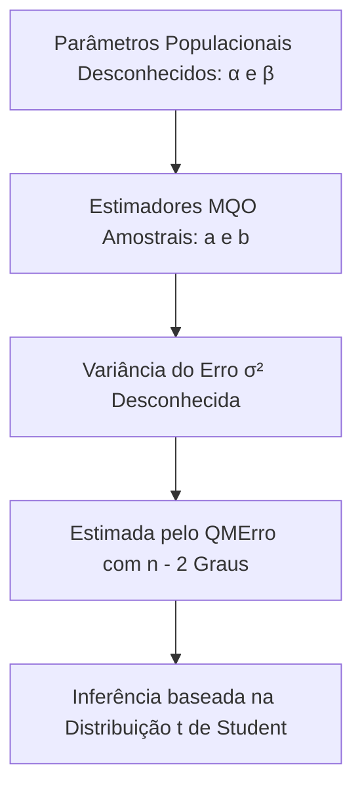
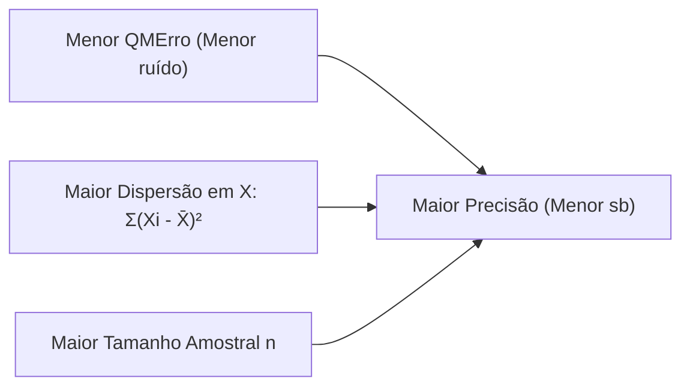
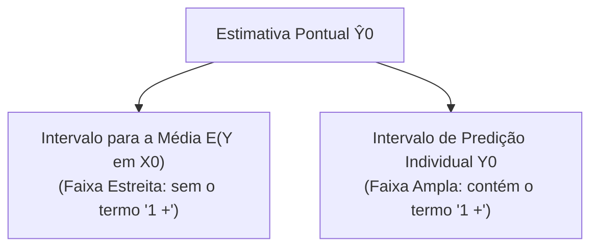
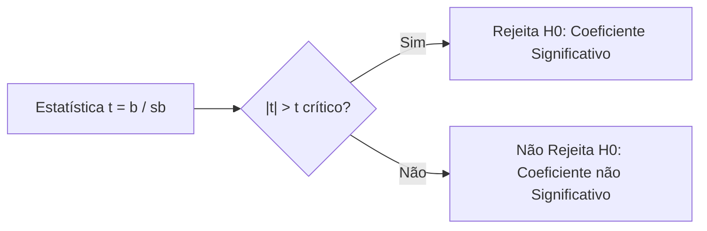
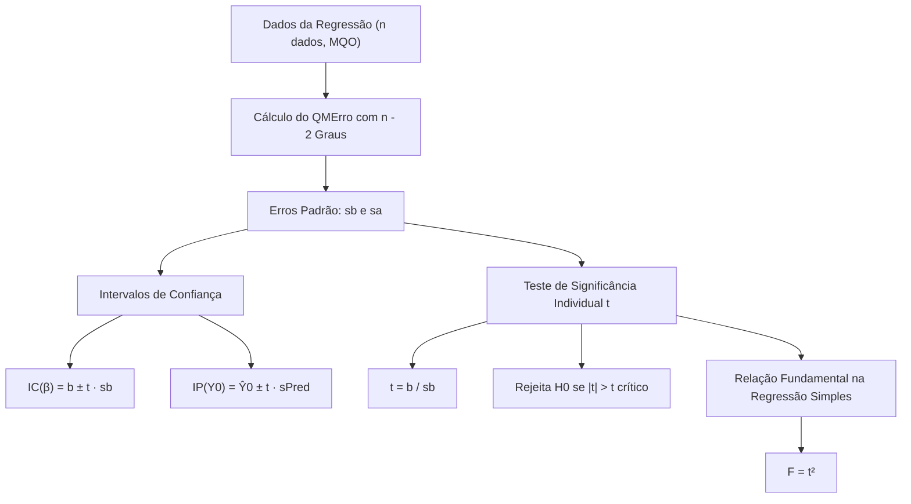

A **Incerteza Amostral nos Coeficientes da Regressão** exige ferramentas inferenciais precisas para avaliar a confiabilidade das estimativas. Os parâmetros de uma reta ajustada flutuam de uma amostra para outra. Na segurança pública e na defesa civil, prever ocorrências ou dimensionar tempos de socorro com base em dados amostrais requer delimitar margens de erro rigorosas. Os intervalos de confiança e o teste t de Student quantificam essa precisão com rigor matemático.

> [!objetivos]
> - Compreender a origem da incerteza amostral nos coeficientes da reta linear.
> - Deduzir os graus de liberdade e o erro padrão do coeficiente angular e do intercepto.
> - Construir intervalos de confiança para parâmetros e intervalos de predição individual.
> - Aplicar o teste t de significância individual e interpretar testes unilaterais e bilaterais.
> - Dominar a relação matemática fundamental F = t² na regressão linear simples.

## Origem da Incerteza e a Distribuição t de Student

Os coeficientes estimados a e b da reta de regressão são variáveis aleatórias. Se coletássemos uma nova amostra sob condições idênticas, obteríamos outros valores numéricos para essas estimativas. Essa flutuação amostral é natural em qualquer estudo empírico. A dispersão das estimativas depende diretamente do ruído residual do modelo e do tamanho da amostra coletada.

A precisão dos estimadores depende de três fatores essenciais. O primeiro fator é o tamanho n da amostra. O segundo fator é a variância do erro residual populacional desconhecido (σ²). O terceiro fator é a dispersão observada na variável explicativa X em torno da sua média amostral.

Na prática inferencial, a variância populacional dos erros σ² é desconhecida. Nós a estimamos a partir dos dados pelo Quadrado Médio do Erro (QMErro). Por conta dessa estimação amostral da variância, as estatísticas padronizadas dos coeficientes não seguem a distribuição normal padrão Z. Elas seguem rigorosamente a distribuição **t de Student**. 

Em amostras pequenas, as caudas da distribuição t de Student são mais pesadas que as da normal. À medida que o tamanho amostral n cresce substancialmente, a distribuição t de Student aproxima-se assintoticamente da distribuição normal padrão.

## Graus de Liberdade e Erros Padrão dos Estimadores

Na regressão linear com k regressores independentes, os graus de liberdade do erro residual (GLErro) correspondem à amostra total deduzida de todos os parâmetros estimados:

GLErro = n − k − 1

Na regressão linear simples com um único regressor (k = 1), estimamos dois parâmetros: o intercepto α e a inclinação β. Consequentemente, temos:

GLErro = n − 2

O Quadrado Médio do Erro obtém-se dividindo a soma residual pelos graus de liberdade:

QMErro = SQErro / (n − 2)

Na formulação matricial com múltiplos regressores, os erros padrão saem da diagonal principal da matriz (X'X)⁻¹ multiplicada pelo QMErro. Na regressão simples, as fórmulas escalares são diretas e intuitivas.

### Erro Padrão do Coeficiente Angular (sb)

A variância amostral do estimador da inclinação b calcula-se por:

s²β = QMErro / Σ(Xi − X̄)² = QMErro / [s²X · (n − 1)]

O erro padrão sb é a raiz quadrada positiva dessa variância:

sb = √(s²β) = √(QMErro / Σ(Xi − X̄)²)

Quanto mais dispersos forem os valores da variável regressora X, maior será o denominador Σ(Xi − X̄)². Logo, menor será o erro padrão sb, e mais precisa será a inclinação da reta estimada.

### Erro Padrão do Intercepto (sa)

O estimador do intercepto a possui a seguinte variância amostral:

s²α = QMErro · [(1 / n) + (X̄² / Σ(Xi − X̄)²)]

O erro padrão sa é a raiz quadrada dessa expressão:

sa = √(s²α)

Observe a presença do termo X̄² no numerador. Quanto mais distante de zero estiver a média da variável explicativa (X̄), maior será a incerteza associada ao ponto em que a reta intercepta o eixo vertical Y.

| Parâmetro Estimado | Estimativa Pontual | Expressão da Variância Amostral | Erro Padrão Notável |
|---|---|---|---|
| Coeficiente Angular (β) | b | QMErro / Σ(Xi − X̄)² | sb = √(QMErro / Σ(Xi − X̄)²) |
| Intercepto Linear (α) | a | QMErro · [(1/n) + X̄² / Σ(Xi − X̄)²] | sa = √(QMErro · [1/n + X̄²/Σ...]) |
| Resposta Média E(Y em X0) | Ŷ0 | QMErro · [(1/n) + (X0 − X̄)² / Σ(Xi − X̄)²] | sMédia = √(QMErro · [1/n + ...]) |
| Predição Individual (Y0) | Ŷ0 | QMErro · [1 + (1/n) + (X0 − X̄)² / Σ(Xi − X̄)²] | sIndiv = √(QMErro · [1 + 1/n + ...]) |

> [!bizu]
> Graus de liberdade na regressão linear simples equivalem rigorosamente a n − 2. Utilizar n − 1 na consulta da tabela t é uma das armadilhas mais comuns elaboradas pelas bancas examinadoras.

## Construção de Intervalos de Confiança Bilaterais

A estrutura analítica geral de um intervalo de confiança bilateral com nível de confiança 1 − α segue a fórmula clássica:

Intervalo de Confiança = Estimativa Pontual ± t(crítico) · Erro Padrão

O valor t(crítico) é obtido na tabela da distribuição t de Student com GLErro = n − 2 graus de liberdade. Como o teste é bilateral, a probabilidade em cada cauda extrema equivale a α / 2.

### Intervalo de Confiança para o Coeficiente Angular β

IC(β; 1 − α) = b ± t(α/2; n−2) · sb

Se o intervalo de confiança calculado contiver o valor zero dentro dos seus limites numéricos, conclui-se que não há evidência de associação linear significativa entre X e Y ao nível de confiança adotado.

### Intervalo de Confiança para o Intercepto α

IC(α; 1 − α) = a ± t(α/2; n−2) · sa

### Intervalo para Predição Individual (Intervalo de Predição)

Quando desejamos prever o valor individual de uma nova observação Y0 para um valor fixado X0, a incerteza é substancialmente maior. Além da imprecisão na posição da reta estimada, existe o erro aleatório intrínseco ε0 da própria observação futura.

Essa incerteza adicional é representada matematicamente pelo termo "1 +" dentro da raiz:

sPred = √{ QMErro · [1 + (1 / n) + ((X0 − X̄)² / Σ(Xi − X̄)²)] }

O intervalo de predição individual estrutura-se como:

IP(Y0; 1 − α) = Ŷ0 ± t(α/2; n−2) · sPred

> [!atencao]
> Observe o termo (X0 − X̄)² presente em ambas as formulações. Quanto mais distante o ponto X0 estiver da média amostral X̄, maior será o erro padrão e mais largo será o intervalo. A previsão mais precisa ocorre exatamente quando X0 coincide com a média X̄.

## Teste t de Significância Individual dos Coeficientes

O teste de significância individual avalia se determinado coeficiente difere de forma estatisticamente significante de um valor nulo de referência.

### Estatística de Teste t

Para testar a hipótese nula de ausência de efeito linear do coeficiente angular:
- Hipótese Nula (H0): β = 0
- Hipótese Alternativa (H1): β ≠ 0 (teste bilateral)

A estatística de teste t calcula-se dividindo a estimativa pelo seu respectivo erro padrão:

t = (b − 0) / sb = b / sb

Como o erro padrão sb é estritamente positivo, a estatística t possui exatamente o mesmo sinal algébrico da estimativa b.

Para o intercepto α:

t = (a − 0) / sa = a / sa

### Regras de Decisão: Valor Crítico e p-valor

1. **Teste Bilateral (H1: β ≠ 0)**:
Rejeita-se H0 se o módulo da estatística calculada superar o valor crítico tabelado (|t| > t(α/2; n−2)) ou se o p-valor for menor que α.

2. **Testes Unilaterais (H1: β > 0 ou H1: β < 0)**:
Quando a teoria prévia impõe uma direção esperada, emprega-se o teste unicaudal. Rejeita-se H0 se t recair na cauda correspondente da hipótese alternativa.

> [!pegadinha]
> Em distribuições simétricas como a t de Student, o p-valor de um teste unilateral é exatamente a metade do p-valor do teste bilateral para uma estatística alinhada com a hipótese alternativa. Não confunda os quantis tabelados ao converter entre abordagens uni e bicaudais.

## A Relação Fundamental: F = t² na Regressão Simples

Uma das propriedades mais elegantes da inferência em regressão linear simples relaciona o teste global da ANOVA com o teste t individual do coeficiente angular.

Sob a hipótese nula H0: β = 0 na regressão linear simples, a estatística F da ANOVA e a estatística t do coeficiente angular guardam uma equivalência matemática exata:

F = t²

Essa identidade decorre do fato de que o quadrado de uma variável com distribuição t de Student com v graus de liberdade segue uma distribuição F de Snedecor com 1 grau no numerador e v graus no denominador:

[t(v)]² ~ F(1; v)

Consequentemente, na regressão linear simples:
- O teste F da tabela ANOVA e o teste t bilateral para a inclinação b produzem decisões inferenciais rigorosamente idênticas.
- O p-valor associado à estatística F é exatamente igual ao p-valor do teste t bilateral.
- O módulo da estatística t é a raiz quadrada da estatística F: `|t| = √F`.

| Propriedade Inferencial | Teste F da ANOVA | Teste t de Student |
|---|---|---|
| Escopo de Aplicação | Significância global do modelo. | Significância individual do parâmetro. |
| Graus de Liberdade | v1 = 1 e v2 = n − 2. | v = n − 2. |
| Natureza do Teste | Unilateral por construção (cauda superior). | Bilateral ou unilateral conforme H1. |
| Relação Matemática | F = t² | t = ±√F (sinal coincide com b). |
| Regressão Múltipla | Avalia todos os regressores juntos. | Isola o efeito marginal de cada regressor. |

Na regressão linear múltipla, essa equivalência direta deixa de valer. O teste F avalia se o conjunto de todos os regressores possui significância simultânea. O teste t avalia o efeito marginal isolado de cada regressor mantendo os demais fixos por meio de coeficientes parciais.

## Exercício Prático Resolvido

> [!resolvido]
> Um estudo avaliou a demanda de sorvetes e bebidas isotônicas consumidas por brigadistas em função da temperatura ambiente (X) em n = 20 dias de treinamento intenso de verão.
> O modelo ajustado forneceu os seguintes resultados amostrais:
> - Estimativa do intercepto: a = 5,0 unidades.
> - Estimativa do coeficiente angular: b = 1,5 unidades por grau de temperatura.
> - Temperatura média observada: X̄ = 22 graus Celsius.
> - Variância amostral da temperatura: s²X = 28.
> - Soma de Quadrados do Erro (SQErro) = 9,0.
> - Para n = 20 e GLErro = 18 graus de liberdade, o quantil crítico bicaudal com 95% de confiança é t(0,025; 18) = 2,10.
> Calcule:
> 1. A soma dos desvios quadráticos de X: Σ(Xi − X̄)².
> 2. O Quadrado Médio do Erro (QMErro).
> 3. A previsão pontual e a variância do erro para uma nova observação em temperatura X0 = 18 graus Celsius.
> 4. O intervalo de predição individual de 95% para essa nova observação.
> 
> **Resolução Passo a Passo:**
> 
> 1. **Soma dos Desvios Quadráticos de X:**
>    - Sabemos que s²X = Σ(Xi − X̄)² / (n − 1).
>    - Logo: `Σ(Xi − X̄)² = s²X · (n − 1) = 28 · 19 = 532`.
> 
> 2. **Quadrado Médio do Erro:**
>    - Graus de liberdade do erro: GLErro = n − 2 = 20 − 2 = 18.
>    - `QMErro = SQErro / GLErro = 9,0 / 18 = 0,50`.
> 
> 3. **Previsão Pontual e Variância da Predição em X0 = 18:**
>    - Previsão pontual: `Ŷ0 = a + b · X0 = 5,0 + 1,5 · 18 = 5,0 + 27,0 = 32,0 unidades`.
>    - Desvio da temperatura em relação à média: (X0 − X̄)² = (18 − 22)² = (−4)² = 16.
>    - Variância da predição individual:
>      s²Pred = QMErro · [1 + (1 / n) + ((X0 − X̄)² / Σ(Xi − X̄)²)]
>      s²Pred = 0,50 · [1 + (1 / 20) + (16 / 532)] = 0,50 · [1 + 0,05 + 0,0301] = 0,50 · 1,0801 ≈ 0,54.
>    - Erro padrão da predição: `sPred = √(0,54) ≈ 0,735`.
> 
> 4. **Intervalo de Predição Individual de 95%:**
>    - Margem de erro = t(0,025; 18) · sPred = 2,10 · 0,735 ≈ 1,54.
>    - `IP(Y0; 95%) = 32,0 ± 1,54 = [30,46 ; 33,54]`.

## Mapa do capítulo

| Instrumento de Avaliação | Fórmula Operacional | Utilidade Prática na Regressão |
|---|---|---|
| **Graus de Liberdade do Erro** | `n − k − 1` (na simples: `n − 2`) | Parâmetro de referência da distribuição t de Student |
| **Erro Padrão de β** | `√(QMErro / Σ(Xi − X̄)²)` | Mede a dispersão amostral da inclinação da reta |
| **Intervalo de Confiança** | `b ± t(crítico) · sb` | Faixa de plausibilidade do verdadeiro parâmetro β |
| **Intervalo de Predição** | `Ŷ0 ± t(crítico) · sPred` | Faixa de incerteza de uma observação individual futura |
| **Estatística t** | `b / sb` | Testa a significância individual da variável regressora |
| **Identidade F e t** | `F = t²` | Equivalência exata entre teste global e individual na simples |

### Para fixar

- Os coeficientes estimados da reta flutuam amostralmente, exigindo inferência sob a distribuição t de Student com n − 2 graus de liberdade.
- O erro padrão do coeficiente angular é dado por sb = √(QMErro / Σ(Xi − X̄)²), diminuindo quando a dispersão de X aumenta.
- O erro padrão do intercepto cresce conforme a média da variável explicativa X̄ afasta-se da origem zero.
- O intervalo de confiança para o coeficiente angular estrutura-se como b ± t · sb; se o zero estiver contido no intervalo, não há efeito linear comprovado.
- O intervalo de predição individual contém o termo extra "1 +" dentro da raiz, sendo substancialmente mais largo do que o intervalo para a resposta média.
- A incerteza preditiva atinge seu valor mínimo exatamente quando a variável explicativa coincide com a média amostral (X0 = X̄).
- A estatística t de significância individual calcula-se por t = b / sb e possui rigorosamente o mesmo sinal do coeficiente angular b.
- O p-valor de um teste unilateral é exatamente a metade do p-valor do teste bilateral correspondente.
- Na regressão linear simples, vale a identidade matemática fundamental F = t², gerando conclusões inferenciais idênticas entre o teste global e o teste individual.
- Na regressão múltipla, o teste F avalia o efeito conjunto de todas as variáveis, enquanto o teste t isola o impacto marginal de cada regressor.
