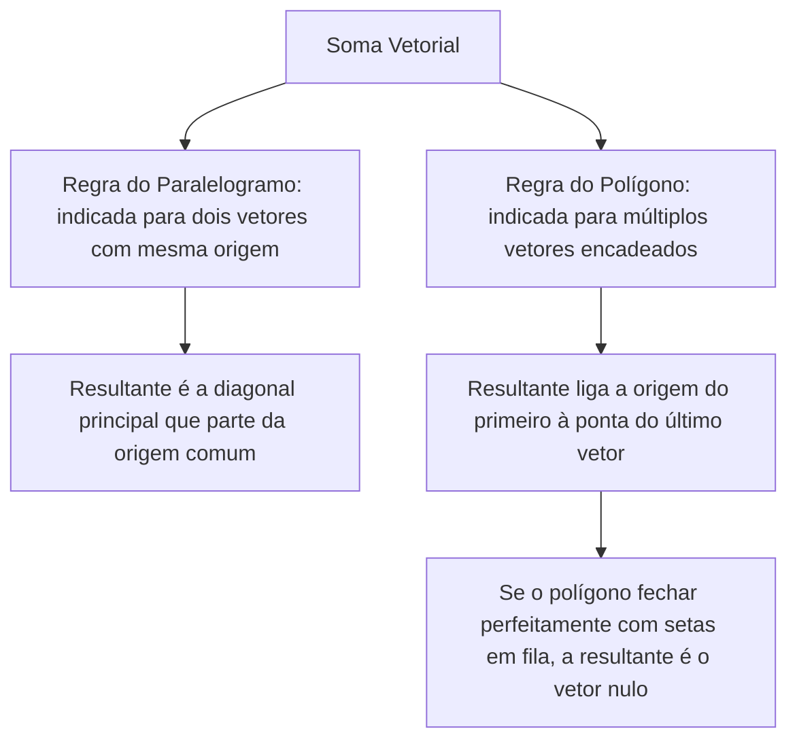
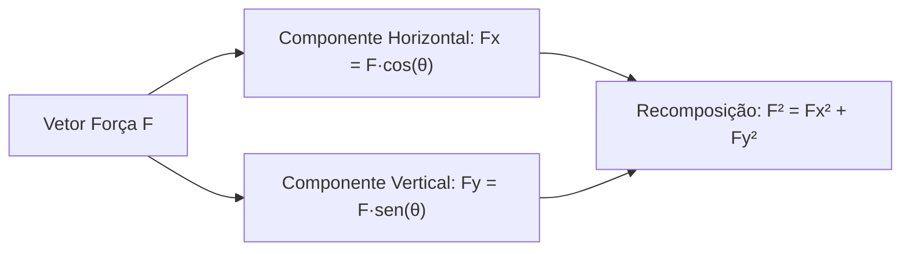
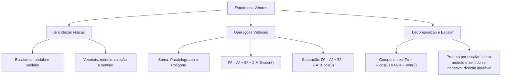

A Física é uma ciência experimental alicerçada na observação dos fenômenos naturais e na sua quantificação rigorosa. No estudo da Mecânica e nas ações operacionais dos bombeiros militares, medir grandezas com exatidão é imperativo para planejar intervenções seguras. Contudo, as grandezas físicas comportam-se de maneiras matemáticas distintas. Enquanto algumas ficam plenamente descritas por um número e uma unidade de medida, outras demandam orientação espacial explícita. O domínio das operações com vetores é o alicerce metodológico indispensável para avançar com solidez no estudo dos movimentos e do equilíbrio estático.

> [!objetivos]
> - Diferenciar conceitualmente grandezas escalares e grandezas vetoriais com precisão.
> - Compreender a definição geométrica de vetor e os critérios rígidos de igualdade vetorial.
> - Dominar a composição vetorial por meio das regras do paralelogramo e do polígono.
> - Calcular o módulo da resultante em configurações angulares notáveis e dominar a decomposição ortogonal.
> - Analisar o efeito da multiplicação por escalar e a operação de subtração de vetores.

## Grandezas Escalares e Vetoriais

No estudo dos fenômenos físicos, mensurar significa comparar uma grandeza com um padrão unitário predefinido. A natureza das grandezas determina o tipo de ferramenta matemática requerida para sua manipulação.

As grandezas escalares são aquelas que ficam integralmente determinadas apenas pelo seu valor numérico (módulo) acompanhado da respectiva unidade de medida. Para compreender uma grandeza escalar, nenhuma orientação espacial é necessária. Por exemplo, ao afirmar que um reservatório de viatura contém 4000 litros de água, ou que a temperatura de combustão de um material alcançou 600 °C, a informação é autossuficiente e completa.

Por outro lado, as grandezas vetoriais exigem quatro características obrigatórias:
1. Módulo: a magnitude ou intensidade numérica positiva associada à unidade de medida.
2. Direção: a linha reta no espaço sobre a qual a grandeza opera (horizontal, vertical ou oblíqua).
3. Sentido: o rumo específico adotado ao longo dessa reta suporte, indicado pela ponta da seta.
4. Ponto de aplicação: a posição física exata onde a ação é introduzida no corpo ou sistema.

Informar que um barco de resgate deslocou-se 500 metros é insuficiente para orientar a guarnição. É indispensável especificar a direção do rio e o sentido da correnteza.

| Grandeza Física | Classificação | Unidade no SI | Informação Espacial Exigida |
| --- | --- | --- | --- |
| Massa | Escalar | quilograma (kg) | Não exige |
| Tempo | Escalar | segundo (s) | Não exige |
| Temperatura | Escalar | kelvin (K) | Não exige |
| Energia e Trabalho | Escalar | joule (J) | Não exige |
| Deslocamento | Vetorial | metro (m) | Módulo, direção e sentido |
| Velocidade | Vetorial | metro por segundo (m/s) | Módulo, direção e sentido |
| Aceleração | Vetorial | metro por segundo ao quadrado (m/s²) | Módulo, direção e sentido |
| Força | Vetorial | newton (N) | Módulo, direção e sentido |
| Quantidade de Movimento | Vetorial | kg·m/s | Módulo, direção e sentido |

> [!bizu]
> Guarde as grandezas escalares mais cobradas em pegadinhas de prova: massa, tempo, temperatura, densidade, energia, trabalho mecânico e pressão. Já forças, impulsos, velocidades, acelerações e campos eletromagnéticos são grandezas estritamente vetoriais.

## O Ente Geométrico Vetor e Critérios de Igualdade

Um vetor é representado graficamente por um segmento de reta orientado. A reta imaginária que contém o segmento determina sua direção. O comprimento proporcional do segmento expressa o seu módulo. A seta em sua terminação indica o seu sentido.

Dois vetores **u** e **v** são considerados rigorosamente iguais se, e somente se, satisfizerem conjuntamente a três exigências:
- Apresentarem módulos idênticos.
- Compartilharem a mesma direção (retas suportes paralelas ou coincidentes).
- Apontarem para o mesmo sentido.

> [!pegadinha]
> Dois vetores com o mesmo módulo e pertencentes à mesma reta suporte nem sempre são iguais. Se ambos possuírem módulo de 10 N na direção horizontal, mas um apontar para a direita e o outro para a esquerda, eles são vetores opostos. Vetores opostos somados geram o vetor nulo.

## Soma Vetorial: Regras do Paralelogramo e do Polígono

A determinação da resultante de grandezas vetoriais difere da soma aritmética tradicional. O ângulo formado entre os vetores atua diretamente sobre o módulo do vetor resultante.

Na regra do paralelogramo, os dois vetores têm suas origens unidas no mesmo ponto cartesiano. Pelas suas extremidades, traçam-se linhas paralelas aos vetores opostos, formando uma figura geométrica fechada. O vetor resultante parte da origem comum e alcança o vértice oposto.

Na regra do polígono, os vetores são conectados em sequência: a origem do vetor seguinte coincide com a ponta da seta do vetor antecedente. A resultante é o vetor que parte do início do primeiro elemento e toca a extremidade do último.

> [!atencao]
> Quando vários vetores formam um polígono fechado e todos mantêm o sentido contínuo de circulação das setas (origem tocando ponta sucessivamente), a resultante total é necessariamente o vetor nulo. Se uma das setas apontar em sentido contrário, ela representa a própria resultante da composição dos demais.

## Determinação Analítica do Módulo da Resultante

Considere dois vetores concorrentes **A** e **B** que formam um ângulo θ entre si em suas origens. O módulo da resultante **R** é determinado analiticamente pela relação:

R² = A² + B² + 2·A·B·cos(θ)

Logo:

R = √(A² + B² + 2·A·B·cos(θ))

Observe quatro configurações angulares notáveis:

1. Mesma direção e mesmo sentido (θ = 0°): cos(0°) = 1. A resultante alcança seu valor máximo: R = A + B.
2. Mesma direção e sentidos opostos (θ = 180°): cos(180°) = -1. A resultante alcança seu valor mínimo: R = abs(A - B).
3. Vetores perpendiculares (θ = 90°): cos(90°) = 0. A expressão recai exatamente no Teorema de Pitágoras: R² = A² + B².
4. Vetores de mesmo módulo com ângulo de 120° (A = B e θ = 120°): cos(120°) = -0,5. A resultante possui módulo exatamente igual a A.

> [!resolvido]
> Dois cabos de aço operados por um guincho do Corpo de Bombeiros puxam uma viga de concreto. As forças exercidas pelos cabos são perpendiculares entre si, possuindo módulos iguais a F₁ = 300 N e F₂ = 400 N. Determine o módulo da força resultante aplicada sobre a viga.
>
> Passo 1: Identificar o ângulo relativo entre as forças. O enunciado afirma que as forças são perpendiculares, logo θ = 90°.
> Passo 2: Aplicar a equação do módulo da resultante para forças ortogonais. Como cos(90°) = 0, a expressão simplifica-se no Teorema de Pitágoras:
> R² = F₁² + F₂²
> Passo 3: Substituir os valores numéricos fornecidos:
> R² = 300² + 400²
> R² = 90000 + 160000 = 250000
> Passo 4: Extrair a raiz quadrada:
> R = √250000 = 500 N.
> Conclusão: A força resultante possui intensidade de 500 N.

## Decomposição de Vetores em Eixos Ortogonais

Em diversas situações práticas, a resolução de problemas mecânicos em duas dimensões torna-se complexa ao manusear forças que atuam em direções inclinadas. A técnica de decomposição vetorial fundamenta-se na ideia intuitiva e eficaz de trocar um único vetor oblíquo por duas componentes perpendiculares entre si, geralmente alinhadas aos eixos cartesianos ortogonais x (eixo horizontal) e y (eixo vertical). Quando somadas vetorialmente, essas duas componentes reproduzem com fidelidade exata a ação do vetor original.

Seja um vetor força **F** contido em um plano cartesiano, formando um ângulo agudo θ com o eixo horizontal x. Suas projeções ortogonais nos eixos x e y são expressas pelas relações trigonométricas fundamentais:

- Componente horizontal: Fx = F·cos(θ)
- Componente vertical: Fy = F·sen(θ)

A recomposição dessas componentes conduz imediatamente à intensidade original da força por meio do Teorema de Pitágoras: F² = Fx² + Fy². 

No estudo do plano inclinado, por exemplo, o movimento de descida ou subida ocorre estritamente ao longo da rampa. Por esse motivo, é muito mais conveniente e agradável proceder à troca dos eixos cartesianos habituais por eixos alinhados à rampa: um eixo paralelo ao plano inclinado e outro perpendicular a ele. Assim, decompõe-se o peso do corpo nessas duas direções estratégicas: a componente tangencial Px = P·sen(θ) puxa o corpo ao longo da rampa, enquanto a componente normal Py = P·cos(θ) comprime a superfície.

> [!esquema]
> Mnemônico para não errar seno e cosseno na decomposição:
> - O eixo que está "com" o ângulo θ utiliza a função cosseno: F_com = F·cos(θ).
> - O eixo que está "sem" o ângulo θ utiliza a função seno: F_sem = F·sen(θ).
> Se o ângulo θ estiver encostado no eixo vertical y em vez do eixo horizontal, a regra inverte: Fy passa a ser F·cos(θ) e Fx passa a ser F·sen(θ).

> [!exemplo]
> Um socorrista puxa uma maca de resgate no solo horizontal aplicando uma força de tração constante F = 200 N por meio de uma fita que forma 60° com a horizontal. Sabendo que cos(60°) = 0,5 e sen(60°) = 0,866, as componentes dessa força são:
> - Força horizontal útil para o arrasto: Fx = F·cos(60°) = 200·0,5 = 100 N.
> - Força vertical que alivia o peso da maca: Fy = F·sen(60°) = 200·0,866 = 173,2 N.

## Multiplicação de Vetor por Escalar e Diferença Vetorial

Multiplicar um vetor **v** por um número real k produz um novo vetor **w** = k·**v**. Essa operação obedece a regras claras:
- A direção nunca muda. O novo vetor permanece sobre a mesma reta suporte.
- O módulo é multiplicado pelo valor absoluto do número: |w| = |k|·|v|.
- O sentido mantém-se se k > 0, e inverte-se se k < 0.

A subtração de vetores (**D** = **A** - **B**) consiste em somar o vetor **A** com o vetor oposto de **B**:

**D** = **A** + (-**B**)

O módulo da diferença entre dois vetores que formam um ângulo θ em suas origens é calculado por:

D² = A² + B² - 2·A·B·cos(θ)

> [!exemplo]
> Se um vetor velocidade inicial aponta para o norte com intensidade de 20 m/s e a velocidade final aponta para o leste com intensidade de 20 m/s, o vetor variação de velocidade Δv = v_final - v_inicial possui módulo calculado por Pitágoras (vetores ortogonais): Δv = √(20² + 20²) = 20·√2 m/s, apontando na direção sudeste.

## Mapa do Capítulo

### Para fixar

- **Grandezas Escalares:** Ficam completas com módulo numérico e unidade de medida, sem orientação espacial.
- **Grandezas Vetoriais:** Exigem simultaneamente módulo, direção, sentido e ponto de aplicação para sua determinação.
- **Igualdade Vetorial:** Exige identidade concomitante de módulo, direção e sentido.
- **Regra do Paralelogramo:** Aplica-se a pares de vetores concorrentes com mesma origem, formando a diagonal principal.
- **Regra do Polígono:** Encadeia vetores extremidade com origem sucessivamente; a resultante fecha a poligonal.
- **Polígono Fechado:** Quando a cadeia vetorial fecha sobre si mesma em sentido contínuo, a resultante é nula.
- **Casos Notáveis de Soma:** Paralelos no mesmo sentido somam módulos; sentidos contrários subtraem; ortogonais usam Pitágoras.
- **Decomposição Ortogonal:** Fx = F·cos(θ) e Fy = F·sen(θ), viabilizando o estudo analítico do plano inclinado.
- **Multiplicação por Escalar:** Altera o módulo e pode inverter o sentido se o escalar for negativo, mantendo a direção inalterada.
- **Diferença Vetorial:** Equivale a somar com o vetor oposto, utilizando sinal negativo no termo cruzado da lei dos cossenos.
