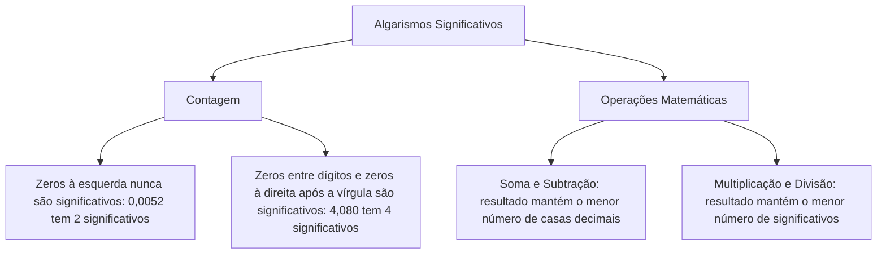
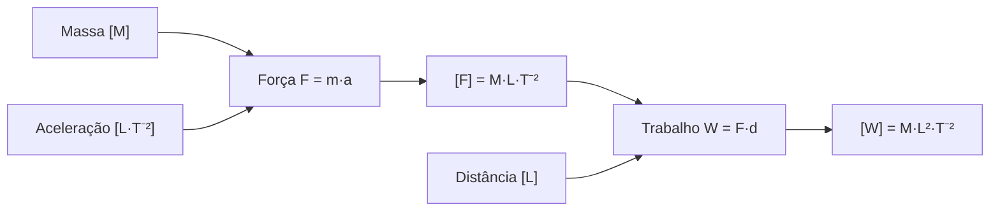
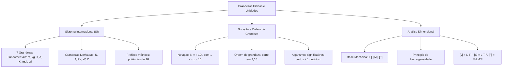

A compreensão dos fenômenos físicos exige a capacidade de quantificar propriedades da matéria e da energia com clareza e reprodutibilidade. No ambiente das ciências exatas e da engenharia contra incêndio e pânico, uma fórmula matemática só tem validade se respeitar a consistência dimensional de suas grandezas. Além disso, o manuseio de grandezas astronômicas ou microscópicas demanda o domínio de técnicas de notação científica, estimativas precisas de ordem de grandeza e conversão correta entre múltiplos e submúltiplos do Sistema Internacional. Dominar esses conceitos é indispensável para interpretar problemas e evitar falhas de cálculo em avaliações de alto rendimento.

> [!objetivos]
> - Compreender a estrutura do Sistema Internacional de Unidades e diferenciar grandezas fundamentais de derivadas.
> - Representar números em notação científica e operar com algarismos significativos.
> - Determinar a ordem de grandeza de medidas físicas utilizando o critério formal de corte.
> - Aplicar a análise dimensional para determinar fórmulas dimensionais e verificar a homogeneidade de equações.
> - Converter unidades lineares, de área e de volume com auxílio dos prefixos métricos decimais.

## Grandezas Físicas e o Sistema Internacional de Unidades

Na Física clássica, uma grandeza física é qualquer atributo mensurável de um corpo ou fenômeno. Para viabilizar a comunicação científica e o intercâmbio tecnológico global, estabeleceu-se o Sistema Internacional de Unidades (SI), consolidado na 11ª Conferência Geral de Pesos e Medidas em 1960.

O SI estrutura-se sobre sete grandezas fundamentais de base, independentes entre si do ponto de vista dimensional. Todas as demais grandezas físicas da natureza são denominadas grandezas derivadas, resultantes de combinações multiplicativas ou divisórias dessas grandezas primárias.

| Grandeza de Base | Símbolo Dimensional | Unidade no SI | Símbolo da Unidade |
| --- | --- | --- | --- |
| Comprimento | L | metro | m |
| Massa | M | quilograma | kg |
| Tempo | T | segundo | s |
| Corrente elétrica | I | ampere | A |
| Temperatura termodinâmica | Θ | kelvin | K |
| Quantidade de substância | N | mol | mol |
| Intensidade luminosa | J | candela | cd |

A combinação das unidades fundamentais gera unidades derivadas. Muitas dessas unidades recebem nomes especiais e símbolos próprios consagrados nas tabelas oficiais do SI em homenagem a cientistas de destaque:
- Força: 1 newton (N) = 1 kg·m/s²
- Pressão: 1 pascal (Pa) = 1 N/m² = 1 kg/(m·s²)
- Energia e Trabalho: 1 joule (J) = 1 N·m = 1 kg·m²/s²
- Potência: 1 watt (W) = 1 J/s = 1 kg·m²/s³
- Carga elétrica: 1 coulomb (C) = 1 A·s

Quando transformarmos unidades cotidianas para o rigor do padrão do SI, é essencial realizar as conversões cabíveis. Por exemplo, se uma operação de combate a incêndio dura 45 minutos, essa grandeza temporal deve ser expressa em segundos (2700 s) antes de ser inserida nas equações dinâmicas da cinemática.

> [!bizu]
> Observe que o quilograma (kg) é a única unidade fundamental do SI que já possui um prefixo multiplicador (quilo = 10³) em seu padrão de base. A massa deve ser mantida em quilogramas em todas as fórmulas mecânicas do SI.

## Notação Científica e Algarismos Significativos

Para manipular grandezas de grandezas extremas sem a inconveniência de grafar extensas sequências de zeros, adota-se a notação científica.

Um número em notação científica assume a forma padrão N = x·10ʸ, em que o coeficiente x (mantissa) é um número real que obedece ao intervalo fechado-aberto 1 <= x < 10, e o expoente y é um número inteiro positivo ou negativo:
- Ao deslocar a vírgula para a esquerda, o expoente positivo contabiliza a quantidade de casas decimais avançadas. Exemplo: 4500000 m = 4,5·10⁶ m.
- Ao deslocar a vírgula para a direita, o expoente negativo contabiliza as casas percorridas. Exemplo: 0,000028 s = 2,8·10⁻⁵ s.

Os algarismos significativos representam todos os dígitos de uma medição física que possuem significado experimental concreto. Em qualquer medição laboratorial ou de campo, registram-se todos os algarismos conhecidos com certeza absoluta pelo instrumento mais um único algarismo duvidoso estimado pelo operador. Esse algarismo não é um mero número arbitrário; ele traduz o limite da dúvida metrológica admissível daquele equipamento.

Nas operações aritméticas entre medições, a propagação de incertezas obedece a dois critérios diretos:
- Na adição e subtração, o resultado final deve conter a mesma quantidade de casas decimais da parcela com menor precisão decimal.
- Na multiplicação e divisão, o resultado final não pode conter mais algarismos do que o termo mais pobre em algarismos significativos. Por exemplo, ao multiplicar 15,48 por 0,2, o resultado bruto 3,096 deve ser arredondado para 3, refletindo o único algarismo significativo do fator mais pobre. Tornar esse manuseio matemático fluído torna o estudo da física muito mais agradável e produtivo.

## Ordem de Grandeza e o Critério de Corte

A ordem de grandeza é a potência de 10 mais próxima do valor real de uma medida física. Ela serve para estimativas rápidas de ordem dimensional em cenários onde a precisão de décimos não é o fator primordial.

Para determinar formalmente a ordem de grandeza de um número, segue-se o procedimento padrão:
1. Converte-se o valor para a notação científica canônica: N = x·10ʸ, com 1 <= x < 10.
2. Compara-se a mantissa x com o ponto divisor geométrico √10, que vale aproximadamente 3,16.
3. Se x < 3,16, a potência 10ʸ é a mais próxima, e a ordem de grandeza é 10ʸ.
4. Se x >= 3,16, o valor está mais próximo de 10ʸ⁺¹, e a ordem de grandeza é 10ʸ⁺¹.

> [!pegadinha]
> Muitos candidatos utilizam erroneamente o número 5 como referência para a ordem de grandeza, por analogia ao arredondamento decimal comum. Esse procedimento está errado! Em escala logarítmica multiplicativa, o ponto equidistante entre 10⁰ (1) e 10¹ (10) é a média geométrica √(1·10) = √10 = 3,16. Assim, uma medida de 4·10³ m possui ordem de grandeza igual a 10⁴ m, pois 4 é maior que 3,16.

> [!resolvido]
> Um grande incêndio florestal consumiu uma área de vegetação estimada em 280000000 metros quadrados. Determine a representação dessa área em notação científica e a sua respectiva ordem de grandeza.
>
> Passo 1: Converter o valor numérico para a notação científica padrão:
> Desloca-se a vírgula 8 casas para a esquerda:
> N = 2,8·10⁸ m².
> Observe que o coeficiente x = 2,8 satisfaz a condição 1 <= x < 10.
> Passo 2: Comparar a mantissa com o ponto divisor 3,16:
> Analisa-se: 2,8 < 3,16.
> Passo 3: Definir a ordem de grandeza conforme a regra de corte:
> Como a mantissa é menor que 3,16, mantém-se o expoente original y = 8.
> Conclusão: A área é expressa por 2,8·10⁸ m² e sua ordem de grandeza é 10⁸ m².

## Análise Dimensional de Equações Físicas

A análise dimensional é uma ferramenta matemática voltada para determinar as dimensões de grandezas físicas e verificar a coerência interna de leis e modelos físicos.

Em Mecânica, as grandezas fundamentais de dimensão são:
- Comprimento: [L]
- Massa: [M]
- Tempo: [T]

Toda grandeza física derivada G possui uma fórmula dimensional expressa pelo produto monomial das dimensões fundamentais:
[G] = M^a · L^b · T^c

Para deduzir a dimensão de qualquer grandeza derivada, basta recorrer a uma equação física conhecida que a relacione com termos conhecidos:
- Velocidade: v = Δs / Δt -> [v] = L / T = L·T⁻¹
- Aceleração: a = Δv / Δt -> [a] = (L·T⁻¹) / T = L·T⁻²
- Força: F = m·a -> [F] = M·L·T⁻²
- Trabalho e Energia: W = F·d -> [W] = (M·L·T⁻²)·L = M·L²·T⁻²
- Pressão: P = F / A -> [P] = (M·L·T⁻²) / L² = M·L⁻¹·T⁻²
- Potência: Pot = W / Δt -> [Pot] = (M·L²·T⁻²) / T = M·L²·T⁻³

> [!atencao]
> Princípio da Homogeneidade Dimensional: Em qualquer equação física fisicamente válida, todos os termos separados por sinais de soma ou subtração devem possuir rigorosamente a mesma fórmula dimensional, que deve coincidir com a dimensão do outro lado da igualdade. Se uma equação apresenta termos com dimensões incompatíveis, ela é conceitualmente falsa. Constantes adimensionais puras (números, funções trigonométricas e logaritmos) possuem dimensão unitária [1].

## Prefixos do Sistema Internacional e Conversões

O Sistema Internacional emprega prefixos decimais padronizados para representar múltiplos e submúltiplos das unidades básicas, simplificando a escrita de medidas.

| Prefixo | Símbolo | Fator Multiplicador | Notação em Potência |
| --- | --- | --- | --- |
| giga | G | 1000000000 | 10⁹ |
| mega | M | 1000000 | 10⁶ |
| quilo | k | 1000 | 10³ |
| hecto | h | 100 | 10² |
| deca | da | 10 | 10¹ |
| deci | d | 0,1 | 10⁻¹ |
| centi | c | 0,01 | 10⁻² |
| mili | m | 0,001 | 10⁻³ |
| micro | μ | 0,000001 | 10⁻⁶ |
| nano | n | 0,000000001 | 10⁻⁹ |

Ao converter grandezas de área e volume, o fator multiplicador do prefixo deve ser elevado ao quadrado ou ao cubo, respectivamente:
- Conversão linear: 1 cm = 10⁻² m.
- Conversão de área: 1 cm² = (10⁻² m)² = 10⁻⁴ m².
- Conversão de volume: 1 cm³ = (10⁻² m)³ = 10⁻⁶ m³.
- Relação com litros: 1 litro (L) = 1 dm³ = 10⁻³ m³, e 1 m³ = 1000 litros.

## Mapa do Capítulo

### Para fixar

- **Grandezas Fundamentais do SI:** Comprimento (m), massa (kg), tempo (s), corrente (A), temperatura (K), quantidade de matéria (mol) e intensidade luminosa (cd).
- **Grandezas Derivadas:** Obtidas pela composição de grandezas de base, como força (N), energia (J) e pressão (Pa).
- **Notação Científica:** Representação na forma x·10ʸ, com mantissa restrita ao intervalo 1 <= x < 10.
- **Algarismos Significativos:** Formados por todos os dígitos obtidos com certeza pelo instrumento mais o primeiro dígito duvidoso estimado.
- **Operações com Significativos:** Adição e subtração preservam as casas decimais; multiplicação e divisão preservam a quantidade de algarismos significativos.
- **Critério de Ordem de Grandeza:** Compara-se a mantissa com 3,16 (raiz quadrada de 10). Se menor, mantém 10ʸ; se maior ou igual, eleva para 10ʸ⁺¹.
- **Fórmula Dimensional Mecânica:** Estruturada no produto das potências M^a · L^b · T^c.
- **Dimensões Indispensáveis:** Velocidade [L·T⁻¹], aceleração [L·T⁻²], força [M·L·T⁻²] e energia [M·L²·T⁻²].
- **Homogeneidade Dimensional:** Todos os termos aditivos de uma expressão física real compartilham a mesma dimensão fundamental.
- **Conversão com Expoentes:** Fatores de prefixos lineares são elevados ao quadrado para áreas e ao cubo para volumes.
