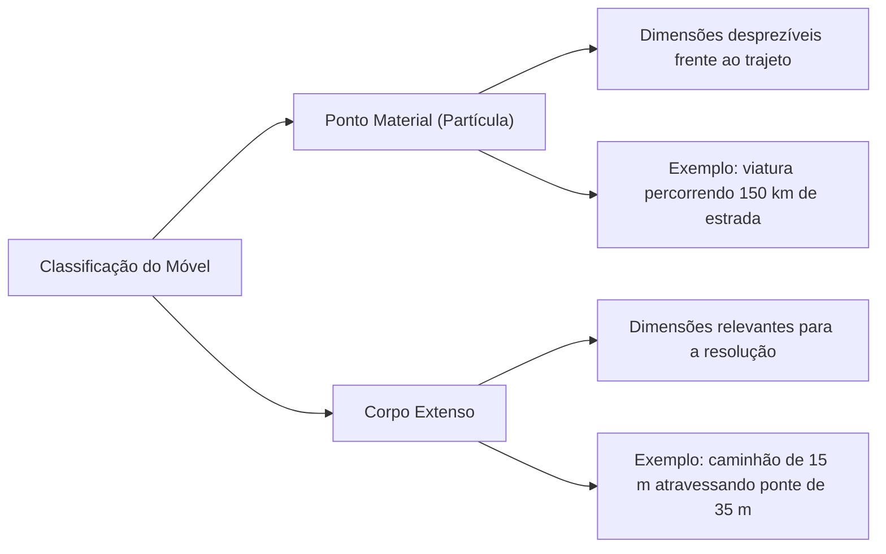
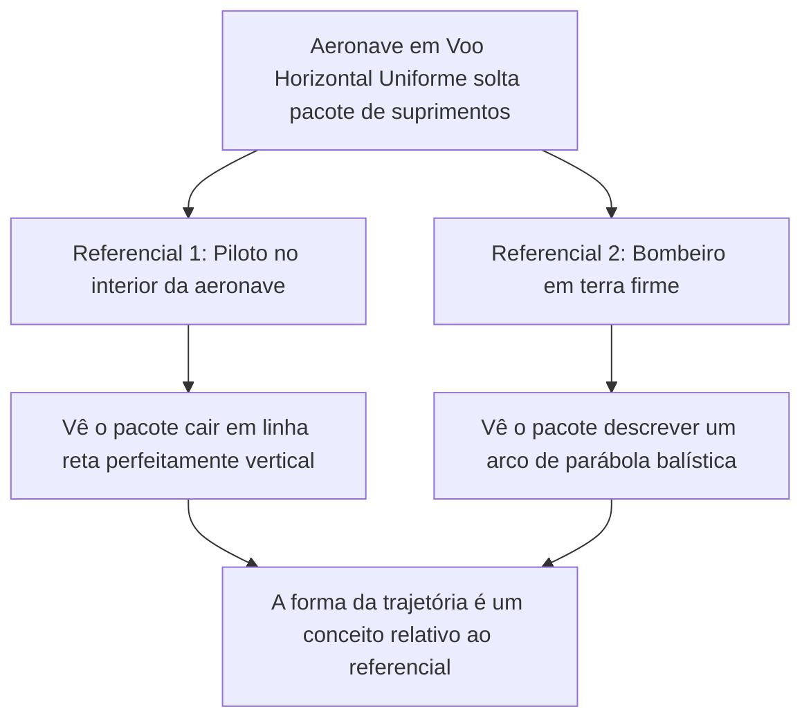
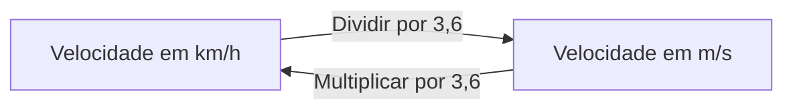
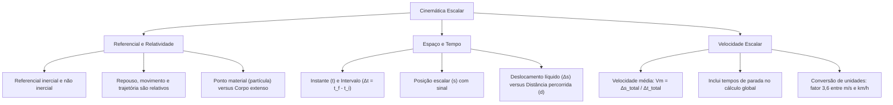

A Cinemática é o ramo da Mecânica clássica dedicado à descrição pura dos movimentos dos corpos no espaço e no tempo. Nesse estudo geométrico inicial, descreve-se com exatidão a posição, a velocidade e a aceleração de um móvel sem investigar as forças dinâmicas que originam ou modificam esse estado de movimento. Em operações de resgate, transporte de vítimas ou combate a incêndios florestais, o domínio dos conceitos de referencial, trajetória, deslocamento e velocidade escalar média permite planejar rotas e estimar tempos de chegada com precisão científica.

> [!objetivos]
> - Compreender o papel do referencial e a relatividade do repouso, movimento e trajetória.
> - Diferenciar ponto material de corpo extenso e aplicar o conceito de centro de massa.
> - Distinguir instante de intervalo de tempo, operando com correções em relógios.
> - Contrastar deslocamento escalar líquido com distância total percorrida.
> - Calcular a velocidade escalar média e aplicar a conversão de unidades com o fator 3,6.

## O Referencial e a Relatividade do Movimento

Na Física, nenhum movimento pode ser descrito de forma absoluta. Qualquer afirmação sobre a localização ou a velocidade de um corpo só possui sentido real quando associada a um referencial previamente escolhido.

Um referencial é um corpo físico ou um sistema de coordenadas espaciais em relação ao qual se avalia a posição de outros objetos ao longo do tempo. Se a posição de um móvel muda em relação ao referencial com o passar do tempo, diz-se que o móvel está em movimento. Caso a sua posição não mude, o móvel encontra-se em repouso em relação àquele referencial.

Considere o exemplo tradicional de um ônibus de transporte coletivo em marcha por uma avenida movimentada:
- O ônibus e todos os seus passageiros sentados estão em movimento acelerado ou uniforme em relação à Terra (a calçada e as árvores).
- No entanto, dois passageiros sentados lado a lado no interior do ônibus encontram-se em repouso absoluto um em relação ao outro.
- Uma pessoa parada na calçada está em repouso em relação à Terra e em movimento em relação ao ônibus.
- Para o chefe da guarnição ou coordenador de tráfego, fica claro que qualquer cálculo cinemático depende de qual referencial o observador utilizou como base de medição.

Os referenciais classificam-se fundamentalmente em duas classes:
- **Referenciais inerciais:** são aqueles nos quais as Leis de Newton são válidas em sua forma padrão, sem a necessidade de introduzir forças fictícias ou inerciais. Qualquer referencial em repouso ou em movimento retilíneo e uniforme (MRU) em relação a um referencial inercial primário é também um referencial inercial. A superfície da Terra é tratada como inercial para a maioria dos problemas de engenharia e trânsito.
- **Referenciais não inerciais (acelerados):** são aqueles que apresentam aceleração linear ou rotação em relação a um referencial inercial. No interior de uma viatura que freia bruscamente ou faz uma curva acentuada, os ocupantes experimentam efeitos inerciais (como a aparente força que os projeta para a frente ou para o lado de fora da curva).

| Conceito Cinemático | Natureza Física | Dependência de Referencial |
| --- | --- | --- |
| Posição escalar | Algébrica | Sim, depende da origem e do referencial |
| Repouso e Movimento | Relativa | Sim, depende exclusivamente do referencial |
| Trajetória | Geométrica | Sim, varia conforme o referencial adotado |
| Deslocamento vetorial | Vetorial | Sim, depende do referencial |
| Intervalo de tempo | Escalar | Não (na mecânica clássica não relativística) |

## Ponto Material, Corpo Extenso e Centro de Massa

Ao modelar um móvel, a Mecânica estabelece uma simplificação baseada na relação entre as dimensões do corpo e as distâncias envolvidas no fenômeno investigado.

Um corpo é classificado como ponto material (ou partícula) quando suas dimensões geométricas são irrelevantes em comparação com as distâncias percorridas ou com as dimensões do ambiente estudado. O exemplo didático consagrado é o de uma formiga deslocando-se sobre o gramado de um campo de futebol: seu tamanho físico é desprezível diante da extensão do gramado. Do mesmo modo, uma viatura de bombeiros de 6 metros de comprimento percorrendo 150 km de rodovia pode ser tratada matematicamente como um simples ponto material.

Em contrapartida, um corpo é denominado corpo extenso quando suas dimensões geométricas não podem ser desprezadas na resolução do problema. Na ultrapassagem de uma carreta ou na travessia completa de uma ponte ou túnel por um caminhão-tanque do Corpo de Bombeiros, o comprimento do próprio veículo determina o instante final do evento. A travessia só termina quando a traseira do veículo ultrapassa totalmente a extremidade final do obstáculo.

O centro de massa é o ponto geométrico no qual se pode considerar concentrada toda a massa de um sistema ou corpo para efeito de translação. Quando um corpo extenso se move, seu centro de massa descreve uma trajetória translacional que obedece rigorosamente às leis da cinemática do ponto material.

## Tempo, Instante e Intervalo de Tempo

O tempo é a grandeza escalar contínua que estabelece a ordem e a duração dos acontecimentos.

- **Instante (t):** representa a leitura pontual em um cronômetro ou relógio de referência. É a coordenada temporal que identifica o momento preciso em que um evento ocorre (por exemplo: um carro policial que busca um suspeito de camisa roxa passa pelo marco do km 310 às 10h 50min 10s).
- **Intervalo de tempo (Δt):** é a duração decorrida entre dois instantes sucessivos. Calcula-se pela diferença algébrica entre o instante final e o instante inicial:
  Δt = t_final - t_inicial

Em física mecânica, todo intervalo denotado pela letra grega delta (Δ) representa sempre a diferença entre o valor final e o valor inicial da grandeza.

> [!pegadinha]
> Em provas de trânsito e fiscalização eletrônica, a banca costuma apresentar postos de monitoramento equipados com relógios dessincronizados. Nunca subtraia os horários diretamente sem antes ajustar as leituras para uma referência temporal comum. Se o relógio do posto A está adiantado 2 minutos em relação ao posto B, a leitura de A deve ter 2 minutos subtraídos antes de calcular o intervalo de tempo Δt.

> [!resolvido]
> Um automóvel passa pelo posto rodoviário 1 (localizado no km 80 da rodovia) às 14h 10min pelo relógio do posto 1. Em seguida, passa pelo posto rodoviário 2 (localizado no km 200 da mesma rodovia) às 15h 25min pelo relógio do posto 2. Uma perícia técnica constatou que o relógio do posto 1 estava 5 minutos adiantado em relação ao relógio do posto 2. Calcule a velocidade escalar média desenvolvida pelo veículo no trecho entre os dois postos.
>
> Passo 1: Harmonizar as leituras dos relógios adotando o posto 2 como referência.
> O relógio do posto 1 estava 5 minutos adiantado, marcando um horário à frente do correto.
> Horário corrigido de passagem no posto 1:
> t₁ = 14h 10min - 5min = 14h 05min.
> Passo 2: Determinar o intervalo de tempo real da viagem:
> O instante final registrado no posto 2 foi t₂ = 15h 25min.
> Δt = t₂ - t₁ = 15h 25min - 14h 05min = 1 hora e 20 minutos.
> Convertendo para fração de hora: 20 minutos equivalem a 20 / 60 = 1 / 3 de hora.
> Logo: Δt = 1 + (1 / 3) = 4 / 3 de hora.
> Passo 3: Calcular o deslocamento escalar realizado:
> Δs = s₂ - s₁ = 200 km - 80 km = 120 km.
> Passo 4: Calcular a velocidade escalar média:
> Vm = Δs / Δt = 120 / (4 / 3) = 120·(3 / 4) = 90 km/h.
> Conclusão: A velocidade escalar média do veículo foi de 90 km/h.

## Posição Escalar, Deslocamento e Distância Percorrida

Para quantificar a posição de um móvel ao longo de uma via ou trajetória, adota-se uma escala orientada com uma origem predefinida (marco zero).

A **posição escalar (s)** indica a localização instantânea do móvel medida sobre a linha da trajetória em relação à origem. A posição pode ser:
- Positiva (s > 0): quando o móvel localiza-se na região convencionada como positiva da trajetória.
- Nula (s = 0): quando o móvel encontra-se exatamente sobre o marco de origem.
- Negativa (s < 0): quando o móvel localiza-se antes da origem na orientação convencionada.

### Deslocamento escalar (Δs)

O deslocamento escalar representa a variação líquida entre a posição final e a posição inicial ocupada pelo móvel:
Δs = s_final - s_inicial

O deslocamento escalar é uma grandeza algébrica que admite sinal:
- Se s_final > s_inicial, tem-se Δs > 0. O móvel deslocou-se no sentido positivo da via.
- Se s_final < s_inicial, tem-se Δs < 0. O móvel deslocou-se no sentido retrógrado da via.
- Se o móvel parte de uma posição, realiza manobras e retorna à mesma posição original, tem-se Δs = 0.

### Distância efetiva percorrida (d)

Diferente do deslocamento escalar, a distância percorrida (ou espaço percorrido) corresponde ao comprimento total de pista efetivamente percorrido pelo móvel durante o trajeto. É a soma de todos os módulos dos deslocamentos parciais, sem compensação de sinais. A distância percorrida é uma grandeza estritamente positiva (ou nula se o móvel permaneceu em repouso contínuo).

> [!atencao]
> Distinção crucial para provas: Uma viatura de resgate parte da base no marco km 30, avança até o km 80 para atender uma ocorrência e, em seguida, retorna até o km 50 para reabastecimento.
> - Deslocamento escalar líquido: Δs = s_final - s_inicial = 50 - 30 = +20 km.
> - Distância total percorrida: d = (80 - 30) de ida + (80 - 50) de volta = 50 + 30 = 80 km.
> Observe que o hodômetro da viatura registrou 80 km rodados, enquanto a variação líquida de posição foi de apenas 20 km.

| Parâmetro | Deslocamento Escalar (Δs) | Distância Efetiva Percorrida (d) |
| --- | --- | --- |
| Definição | Variação líquida da posição (s_final - s_inicial) | Comprimento total somado dos trechos percorridos |
| Sinal algébrico | Pode ser positivo, negativo ou nulo | Sempre estritamente positivo ou nulo |
| Trajetória de ida e volta | Resulta em zero se retornar ao marco inicial | Soma a distância da ida com a distância da volta |
| Correspondência no veículo | Vetor de posição relativa | Medição total do hodômetro da viatura |

## Trajetória e sua Natureza Relativa

A trajetória é a curva geométrica formada pelo conjunto sucessivo de todas as posições ocupadas por um ponto material no espaço durante o seu movimento. A trajetória pode ser retilínea, curvilínea, parabólica, elíptica ou circular.

Assim como a velocidade e o repouso, a forma da trajetória depende inteiramente do referencial escolhido pelo observador.

Exemplo clássico: Um avião militar em voo horizontal constante solta uma bomba ou pacote de socorro.
- Para o piloto e os tripulantes a bordo da aeronave, o objeto cai mantendo-se sempre abaixo da aeronave. Sua trajetória observada pelo piloto é uma linha reta vertical.
- Para um observador posicionado em solo firme, a bomba herda a velocidade horizontal do avião no instante em que é solta. A composição do avanço horizontal com a queda livre acelerada pela gravidade faz com que o observador na Terra enxergue uma trajetória em formato de parábola.

Ambas as descrições estão rigorosamente corretas dentro de seus respectivos sistemas de referência.

## Velocidade Escalar Média e Velocidade Instantânea

A velocidade escalar é a taxa temporal que quantifica a rapidez com que a posição de um móvel varia ao longo da trajetória.

### Velocidade escalar média (Vm)

A velocidade escalar média é definida matematicamente pela razão direta entre o deslocamento escalar total realizado e o intervalo de tempo total decorrido para percorrê-lo:

Vm = Δs_total / Δt_total

Essa grandeza expressa a velocidade constante hipotética que produziria exatamente o mesmo deslocamento no mesmo tempo total de percurso.

> [!bizu]
> Cálculo em viagens com paradas: Para calcular a velocidade escalar média de uma viagem completa, o intervalo de tempo total Δt deve incluir obrigatoriamente todos os tempos de parada intermediários (paradas para alimentação, abastecimento, troca de pneus ou fiscalizações). Jamais descarte os períodos de repouso ao compor o tempo total da jornada.

### Velocidade instantânea (v)

A velocidade escalar instantânea é a velocidade medida em um instante infinitesimal de tempo (quando o intervalo de tempo tende a zero). É o valor que reflete a intensidade e o sentido do movimento em cada fração de segundo, exatamente como indicado no velocímetro de uma viatura.

A velocidade média não garante que o móvel tenha mantido esse valor durante todo o percurso. Por exemplo, se uma viatura percorre uma distância de 540 km em 6 horas, sua velocidade escalar média foi de 90 km/h. Entretanto, durante o percurso o condutor realizou paradas de 15 min ou 20 min para refeição ou abastecimento (onde v = 0 km/h), exigindo velocidades instantâneas de 100 km/h, 120 km/h ou até 140 km/h em trechos rodoviários desimpedidos para compensar o tempo perdido e fechar o percurso dentro do horário previsto. No cálculo rigoroso, considera-se sempre o instante inicial t_inicial e o instante final t_final, com Δt = t_final - t_inicial (ajustando eventuais diferenças de 3 min em relógios dessincronizados).

> [!resolvido]
> Um veículo de socorro realiza um trajeto rodoviário de 240 km dividido em duas etapas. Na primeira etapa, percorre 120 km a uma velocidade constante de 60 km/h. Na segunda etapa, percorre os 120 km restantes a uma velocidade constante de 120 km/h. Calcule a velocidade escalar média do veículo ao longo de todo o percurso de 240 km.
>
> Passo 1: Calcular o intervalo de tempo gasto na primeira etapa:
> Δt₁ = Δs₁ / v₁ = 120 / 60 = 2 horas.
> Passo 2: Calcular o intervalo de tempo gasto na segunda etapa:
> Δt₂ = Δs₂ / v₂ = 120 / 120 = 1 hora.
> Passo 3: Somar os deslocamentos e os tempos para obter os valores totais:
> Δs_total = 120 + 120 = 240 km.
> Δt_total = 2 + 1 = 3 horas.
> Passo 4: Calcular a velocidade média global:
> Vm = Δs_total / Δt_total = 240 / 3 = 80 km/h.
> Atenção: Observe que a velocidade média (80 km/h) **não** é a média aritmética simples entre 60 e 120 (que seria 90 km/h). Como o veículo passou mais tempo trafegando a 60 km/h (2 horas) do que a 120 km/h (1 hora), a velocidade menor tem maior peso no resultado final. Trata-se da média harmônica das velocidades.

## Unidades de Velocidade e o Fator de Conversão 3,6

No Sistema Internacional de Unidades (SI), o comprimento é medido em metros (m) e o tempo em segundos (s). Portanto, a unidade padrão de velocidade no SI é o **metro por segundo (m/s)**.

No cotidiano das cidades e na sinalização viária de trânsito, a velocidade é comumente expressa em **quilômetros por hora (km/h)**. A relação entre essas duas unidades deduz-se diretamente das grandezas de base:
- 1 quilômetro = 1000 metros.
- 1 hora = 60 minutos = 60·60 segundos = 3600 segundos.

Logo:
1 km/h = 1000 m / 3600 s = 1 m / 3,6 s.

Dessa equivalência surge a regra operacional consagrada:
- Para converter de **km/h para m/s**, divide-se o valor por 3,6.
- Para converter de **m/s para km/h**, multiplica-se o valor por 3,6.

A tabela a seguir apresenta os valores notáveis mais recorrentes em questões de concurso:

| Velocidade em km/h | Operação Aritmética | Velocidade no SI em m/s | Contexto Operacional Típico |
| --- | --- | --- | --- |
| 18 km/h | 18 / 3,6 | 5 m/s | Trote de bombeiro militar em atividade física |
| 36 km/h | 36 / 3,6 | 10 m/s | Velocidade em via urbana restrita ou manobra |
| 54 km/h | 54 / 3,6 | 15 m/s | Tráfego em avenida coletora urbana |
| 72 km/h | 72 / 3,6 | 20 m/s | Trânsito em via arterial metropolitana |
| 90 km/h | 90 / 3,6 | 25 m/s | Deslocamento de viatura pesada em rodovia |
| 108 km/h | 108 / 3,6 | 30 m/s | Velocidade máxima permitida em rodovia plana |
| 126 km/h | 126 / 3,6 | 35 m/s | Resposta rápida de veículo leve de emergência |

> [!exemplo]
> Uma viatura de resgate trafega a 108 km/h em uma via rápida. Ao se aproximar de um cruzamento, o condutor visualiza um obstáculo. Sabendo que o tempo de reação humana do motorista até iniciar o acionamento do pedal de freio é de 0,8 segundo, que distância o veículo percorre durante esse intervalo de reação?
> 
> Resolução:
> Primeiro, converte-se a velocidade para o padrão SI:
> v = 108 / 3,6 = 30 m/s.
> Durante o tempo de reação (0,8 s), o veículo mantém velocidade constante.
> Distância de reação:
> d = v·t = 30·0,8 = 24 metros.
> A viatura percorre 24 metros antes mesmo de os freios começarem a atuar.

## Mapa do Capítulo

### Para fixar

- **Referencial:** Sistema em relação ao qual se define o estado de repouso, movimento e trajetória de um corpo.
- **Relatividade Cinemática:** Um móvel pode estar em repouso para um observador e em movimento para outro referencial.
- **Ponto Material e Corpo Extenso:** Ponto material possui dimensões desprezíveis; corpo extenso possui tamanho relevante no problema.
- **Intervalo de Tempo:** Diferença entre o instante final e o inicial (Δt = t_final - t_inicial), exigindo relógios sincronizados.
- **Posição Escalar (s):** Coordenada da localização do móvel ao longo da via orientada em relação ao marco zero.
- **Deslocamento Escalar (Δs):** Variação líquida de posição (s_final - s_inicial), podendo ser positivo, negativo ou nulo.
- **Distância Percorrida (d):** Soma do comprimento de todos os trechos percorridos, sendo sempre não negativa.
- **Trajetória Relativa:** A geometria descrita pelo corpo depende do observador (reta para o piloto, parábola para quem está no solo).
- **Velocidade Média e Fator 3,6:** Vm = Δs_total / Δt_total (inclui paradas); converte-se entre m/s e km/h pelo fator 3,6.
