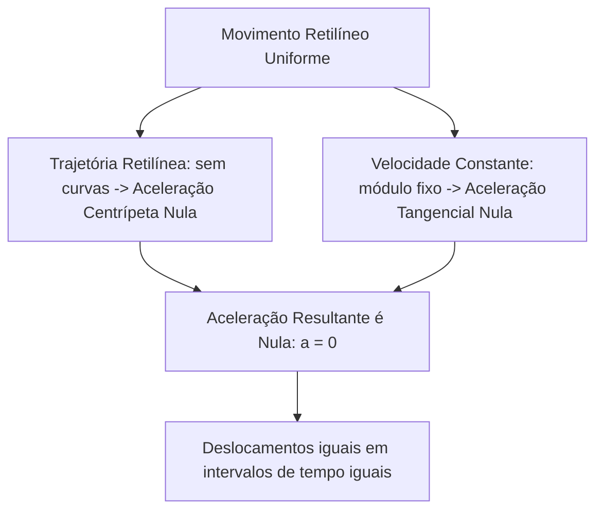
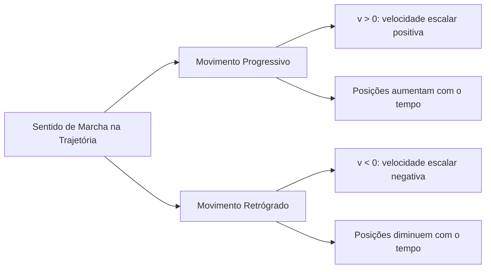
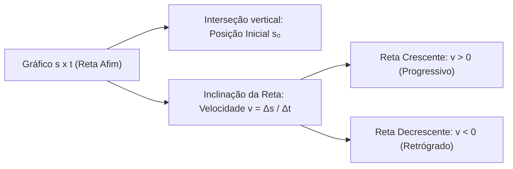
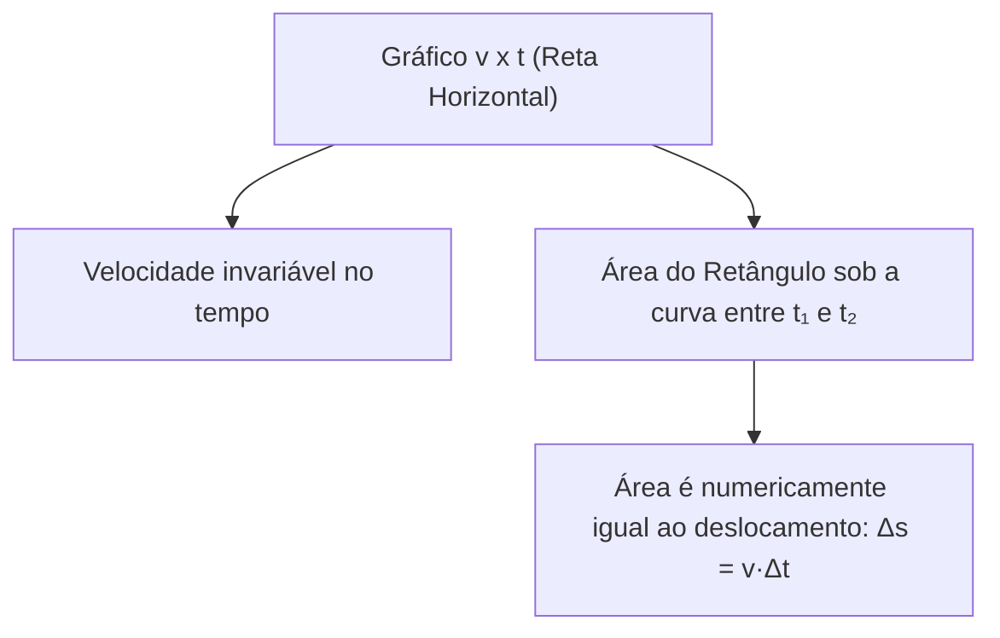
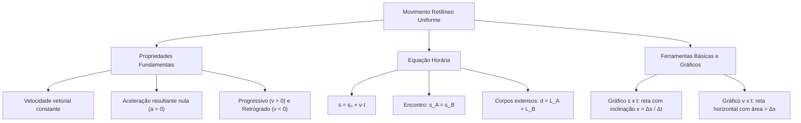

O Movimento Retilíneo e Uniforme (MRU) representa o modelo cinemático mais elementar da Mecânica clássica. Nesse regime, um ponto material desloca-se em linha reta. Sua velocidade vetorial permanece rigorosamente constante ao longo do tempo. A ausência de curvas e de variações de rapidez implica que a aceleração é nula. No edital do concurso, os gráficos e vetores atuam como ferramentas básicas indispensáveis para a descrição matemática e geométrica dos movimentos. Dominar a função horária e a análise gráfica permite solucionar problemas com rapidez e precisão.

> [!objetivos]
> - Caracterizar o Movimento Retilíneo e Uniforme identificando a constância da velocidade vetorial e a anulação da aceleração.
> - Classificar o movimento em progressivo e retrógrado com base na orientação da trajetória.
> - Deduzir e aplicar a equação horária da posição (s = s₀ + v·t) em problemas de translação linear.
> - Modelar e resolver analiticamente problemas de encontro e ultrapassagem entre pontos materiais e corpos extensos.
> - Interpretar gráficos s x t e v x t como ferramentas básicas para extrair grandezas cinemáticas.

## Conceito e Propriedades Fundamentais do MRU

Um móvel realiza um Movimento Retilíneo e Uniforme quando percorre uma trajetória reta com velocidade constante.

Para que a velocidade vetorial seja constante, três condições devem ser cumpridas simultaneamente:
- O módulo da velocidade não varia. O velocímetro indica sempre o mesmo valor. Logo, a aceleração tangencial é nula.
- A direção não varia. O móvel não realiza curvas. Logo, a aceleração centrípeta é nula.
- O sentido não varia. O corpo não inverte o rumo de sua marcha.

Dessa forma, a aceleração resultante é identicamente nula (a = 0). No MRU, a velocidade instantânea coincide com a velocidade escalar média em qualquer intervalo de tempo.

A principal propriedade do MRU estabelece que o móvel percorre deslocamentos iguais em tempos iguais. Se uma viatura em MRU avança 20 metros em 1 segundo, ela percorrerá 40 metros em 2 segundos. Em 3 segundos, percorrerá 60 metros.

## Classificação do MRU: Progressivo e Retrógrado

A classificação do MRU baseia-se no sentido do movimento em relação à orientação da trajetória.

### Movimento progressivo

O movimento é classificado como progressivo quando o móvel caminha no sentido positivo da trajetória. Nesse caso:
- As posições escalares aumentam com o tempo.
- O deslocamento escalar é positivo (Δs > 0).
- A velocidade escalar é estritamente positiva (v > 0).

Por exemplo, uma viatura que parte do km 20 em direção ao km 100 move-se a favor dos marcos da rodovia. Seu movimento é progressivo.

### Movimento retrógrado

O movimento é classificado como retrógrado quando o móvel caminha em sentido contrário à orientação da trajetória. Nesse caso:
- As posições escalares diminuem com o tempo.
- O deslocamento escalar é negativo (Δs < 0).
- A velocidade escalar é estritamente negativa (v < 0).

Se a viatura retornar do km 100 para o km 20, ela caminha contra a orientação dos marcos. Sua velocidade algébrica é negativa (v = -80 km/h). Esse movimento é retrógrado.

> [!pegadinha]
> Não confunda movimento retrógrado com movimento retardado. A classificação em progressivo ou retrógrado indica apenas o sentido da marcha (sinal de v). Já os termos acelerado e retardado indicam se o módulo da velocidade está aumentando ou diminuindo. No MRU, a velocidade é constante. Portanto, o MRU nunca é acelerado nem retardado.

## Equação Horária da Posição no MRU

A equação horária permite calcular a posição escalar ocupada pelo móvel em qualquer instante de tempo t.

Sua dedução formal parte da definição de velocidade constante:
v = Δs / Δt = (s_final - s_inicial) / (t_final - t_inicial)

Considerando simplificadamente o instante inicial como t_inicial = 0 e adotando s_final como s e s_inicial como s₀:
v = (s - s₀) / t
s - s₀ = v·t
Assim, chegamos à equação horária fundamental:
s = s₀ + v·t

Onde:
- **s:** posição escalar no instante t (medida em metros no SI).
- **s₀:** posição inicial no instante t = 0 no trecho estudado.
- **v:** velocidade escalar constante.
- **t:** instante de tempo considerado.

A posição inicial s₀ não precisa ser igual a zero. Se o movimento começar a ser monitorado quando a viatura estiver posicionada no km 540 da rodovia BR-116, adota-se s₀ = 540 km. O marco zero é apenas uma convenção do sistema de coordenadas. Se a viatura trafega com velocidade de 108 km/h (que equivale a 30 m/s no SI), sua posição após t horas no trecho estudado será s = 540 + 108·t.

| Equação Horária | Posição Inicial (s₀) | Velocidade Escalar (v) | Classificação | Posição em t = 5 s |
| --- | --- | --- | --- | --- |
| s = 10 + 4·t | 10 m | +4 m/s | Progressivo | s = 30 m |
| s = 50 - 6·t | 50 m | -6 m/s | Retrógrado | s = 20 m |
| s = 8·t | 0 m | +8 m/s | Progressivo | s = 40 m |
| s = -25 + 5·t | -25 m | +5 m/s | Progressivo | s = 0 m |

> [!bizu]
> Na equação s = -25 + 5·t, a posição anula-se em t = 5 s (s = 0). Isso significa que o móvel cruza a origem no instante de 5 segundos. Para achar o instante de passagem pela origem, basta impor s = 0 e calcular t.

## Problemas de Encontro e Ultrapassagem

O estudo do MRU permite calcular com exatidão o encontro de viaturas e ultrapassagens em rodovias.

### Encontro de pontos materiais

Dois móveis que trafegam na mesma trajetória encontram-se quando ocupam a mesma posição no mesmo instante:
s_A = s_B

Para resolver problemas de encontro, siga quatro etapas simples:
1. Adote uma origem e um sentido positivo para a trajetória.
2. Escreva a equação horária de cada móvel, respeitando o sinal da velocidade.
3. Iguale as equações (s_A = s_B) e isole o tempo t para encontrar o instante de encontro.
4. Substitua o tempo t em qualquer equação para achar a posição do encontro.

> [!resolvido]
> Duas viaturas partem no mesmo instante de duas cidades ligadas por uma rodovia de 300 km. A viatura A parte do km 0 com velocidade constante de 80 km/h em direção à cidade 2. A viatura B parte do km 300 com velocidade constante de 70 km/h em direção à cidade 1. Determine o instante do encontro e o local onde as viaturas se cruzam.
>
> Passo 1: Escrever as equações horárias com base no referencial adotado:
> Viatura A (movimento progressivo): s_A = 0 + 80·t = 80·t.
> Viatura B (movimento retrógrado): s_B = 300 - 70·t.
> Passo 2: Igualar as posições no encontro (s_A = s_B):
> 80·t = 300 - 70·t
> 150·t = 300
> t = 300 / 150 = 2 horas.
> Passo 3: Calcular a posição do encontro substituindo t = 2 h na equação de A:
> s_encontro = 80·2 = 160 km.
> Conclusão: O encontro ocorre 2 horas após a partida, na marcação do km 160.

### Ultrapassagem de corpos extensos

Quando os corpos possuem dimensões relevantes, deve-se considerar o comprimento de cada veículo.

Na travessia de uma ponte de extensão L_ponte por uma viatura de comprimento L_A, a distância percorrida é:
d_total = L_A + L_ponte

Na ultrapassagem entre dois veículos de comprimentos L_A e L_B com velocidades v_A e v_B (v_A > v_B), a distância relativa é:
d_relativa = L_A + L_B
t_ultrapassagem = (L_A + L_B) / (v_A - v_B)

## Ferramentas Básicas: Análise Gráfica e Vetores no MRU

A física utiliza a representação gráfica e o cálculo com vetores como ferramentas básicas para descrever o movimento. A descrição matemática por meio de gráficos revela o comportamento dos corpos de forma visual.

### Gráfico posição versus tempo (s x t)

A equação s = s₀ + v·t é uma função do primeiro grau. Por isso, seu gráfico s x t é uma linha reta:
- A reta intercepta o eixo vertical no ponto s₀.
- A inclinação da reta fornece a velocidade escalar do móvel.
- Se a reta for crescente, a velocidade é positiva e o movimento é progressivo.
- Se a reta for decrescente, a velocidade é negativa e o movimento é retrógrado.
- Se a reta for horizontal, a velocidade é nula e o móvel está parado.

A inclinação da reta fornece diretamente a velocidade escalar do móvel. No triângulo retângulo formado pela reta e pelos eixos, a tangente do ângulo de inclinação α corresponde à razão entre o cateto oposto (variação da posição Δs) e o cateto adjacente (intervalo de tempo Δt), respeitando a escala de cada eixo:
v = tan(α) = cateto oposto / cateto adjacente = Δs / Δt

Assim, quanto maior for a inclinação da reta, maior será a rapidez do móvel. Se a reta for horizontal, a tangente é nula (v = 0), indicando que o corpo permanece em repouso.

### Gráfico velocidade versus tempo (v x t)

No MRU, a velocidade não muda. Portanto, o gráfico v x t é uma reta horizontal paralela ao eixo do tempo:
- Se v > 0, a reta fica acima do eixo horizontal.
- Se v < 0, a reta fica abaixo do eixo horizontal.

A área sob a curva no gráfico v x t é numericamente igual ao deslocamento escalar Δs:
Área = v·(t₂ - t₁) = v·Δt = Δs

Se a área estiver acima do eixo, o deslocamento é positivo. Se estiver abaixo, o deslocamento é negativo.

## Mapa do Capítulo

### Para fixar

- **Definição de MRU:** Movimento em linha reta com velocidade vetorial constante e aceleração nula.
- **Movimento Progressivo:** Ocorre no sentido da trajetória com velocidade positiva e posições crescentes.
- **Movimento Retrógrado:** Ocorre contra o sentido da via com velocidade negativa e posições decrescentes.
- **Sentido versus Variação:** Progressivo e retrógrado indicam o sentido de marcha, sem relação com frear ou acelerar.
- **Equação Horária:** s = s₀ + v·t, relacionando posição, posição inicial, velocidade e tempo.
- **Passagem pela Origem:** Momento em que a posição escalar do móvel atinge o marco zero (s = 0).
- **Condição de Encontro:** Instante em que os móveis ocupam a mesma posição na via (s_A = s_B).
- **Corpos Extensos:** Na ultrapassagem completa, a distância percorrida engloba a soma dos comprimentos dos corpos.
- **Gráfico s x t:** A inclinação da reta fornece diretamente a velocidade escalar do móvel.
- **Gráfico v x t:** A área da figura retangular sob a reta fornece o deslocamento escalar realizado.
