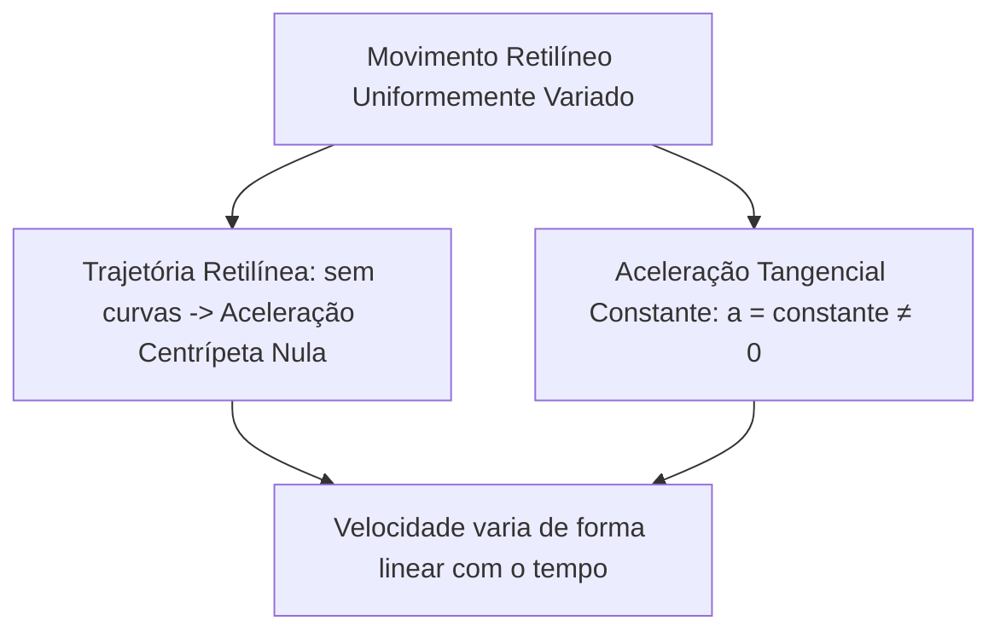
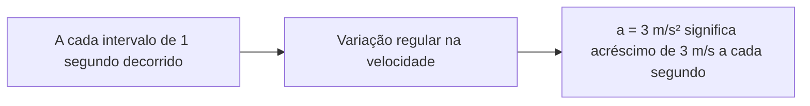
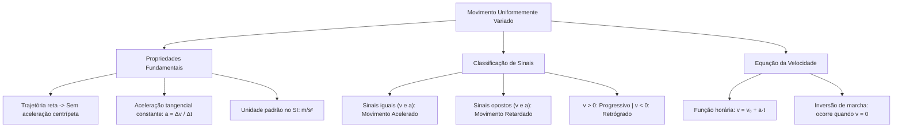

O Movimento Retilíneo Uniformemente Variado (MRUV) é o modelo físico que descreve as arrancadas e frenagens em linha reta. No edital, as descrições do movimento abrangem a quantificação, a descrição matemática e gráfica das grandezas cinemáticas fundamentais. No trânsito urbano e nas operações com viaturas de emergência, veículos raramente trafegam com velocidade constante. O tráfego real exige acelerações para ultrapassagens rápidas e desacelerações intensas para paradas seguras em semáforos ou cruzamentos. No MRUV, a aceleração escalar tangencial mantém-se constante em todos os instantes. Compreender esse conceito e a história do deslocamento permite que o oficial responsável analise a segurança viária e estime marcas de frenagem em perícias técnicas com rigor matemático previsível.

> [!objetivos]
> - Definir o Movimento Retilíneo Uniformemente Variado diferenciando-o de outros movimentos de velocidade variável.
> - Calcular a aceleração escalar média aplicando a correta conversão de unidades para o padrão SI.
> - Classificar com precisão o movimento em acelerado ou retardado e em progressivo ou retrógrado pelo confronto de sinais.
> - Estruturar e interpretar a função horária da velocidade (v = v₀ + a·t).
> - Determinar o instante de parada e de inversão do sentido de marcha de um móvel.

## O Que Define o Movimento Retilíneo Uniformemente Variado

O próprio nome da grandeza indica a sua estrutura física: Movimento Retilíneo (trajetória em linha reta), Uniformemente (taxa de variação constante) Variado (velocidade escalar variável).

Para que um corpo execute um MRUV, duas exigências devem ser satisfeitas de forma simultânea:
- **Trajetória retilínea:** a direção do vetor velocidade permanece fixa no espaço. Como não há curvas, a aceleração centrípeta é identicamente nula.
- **Aceleração escalar constante e não nula:** a taxa de variação da velocidade escalar é uniforme. Isso significa que o módulo da velocidade aumenta ou diminui na mesma quantidade a cada segundo decorrido.

> [!pegadinha]
> Cuidado com afirmações genéricas em provas! Todo MRUV possui velocidade escalar variável, mas nem todo movimento com velocidade variável é um MRUV. Se um móvel faz uma curva com velocidade constante, ele possui aceleração centrípeta. Se a aceleração escalar mudar de intensidade com o tempo, o movimento é variado, mas não uniformemente variado. O MRUV exige aceleração tangencial estritamente constante ao longo de uma reta.

## Aceleração Escalar Média e Instantânea

A aceleração escalar é a grandeza física que mede o ritmo de variação da velocidade escalar com o passar do tempo.

A aceleração escalar média (a_m) expressa a razão entre a variação de velocidade escalar observada e o intervalo de tempo decorrido:
a_m = Δv / Δt = (v_final - v_inicial) / (t_final - t_inicial)

No Sistema Internacional (SI), a velocidade é medida em metros por segundo (m/s) e o tempo em segundos (s). Portanto, a unidade padrão de aceleração no SI é o **metro por segundo ao quadrado (m/s²)**.

Dizer que uma viatura dos bombeiros possui aceleração constante de 3 m/s² significa que, a cada 1 segundo de marcha, sua velocidade escalar aumenta exatamente em 3 m/s. Se ela partiu do repouso (v₀ = 0), sua velocidade será de 3 m/s após 1 s, de 6 m/s após 2 s e de 9 m/s após 3 s.

> [!atencao]
> Antes de calcular a aceleração escalar, confira sempre a compatibilidade das unidades de medida! Se a velocidade for fornecida em km/h e o tempo em segundos, divida a velocidade por 3,6 antes de aplicar a fórmula da aceleração. O esquecimento dessa conversão é o erro mais frequente nas provas.

> [!exemplo]
> Em uma suposta fiscalização rodoviária, uma equipe policial registra um automóvel passando a 15 m/s. Exatamente 1 h e 30 min depois (Δt = 90 min = 5400 s), o mesmo veículo é registrado no horizonte rodoviário a 162 km/h (45 m/s). A aceleração escalar média observada é calculada por:
> a_m = Δv / Δt = (45 - 15) / 5400 = 30 / 5400 = 0,0056 m/s².
> Esse valor é muito pequeno porque o intervalo de tempo de 5400 s é excessivamente longo. Em situações reais de trânsito onde uma pessoa freia bruscamente uma viatura, a desaceleração atua em intervalos de poucos segundos, com intensidade raramente inferior a 2 m/s².

> [!resolvido]
> Uma viatura de resgate parte do repouso em uma pista retilínea e atinge a velocidade de 108 km/h em um intervalo de tempo de 6 segundos com aceleração constante. Calcule a aceleração escalar desenvolvida pelo veículo.
>
> Passo 1: Identificar os dados do enunciado:
> Partida do repouso: v_inicial = 0 m/s.
> Velocidade final informada: v_final = 108 km/h.
> Intervalo de tempo: Δt = 6 segundos.
> Passo 2: Converter a velocidade final para o padrão SI:
> v_final = 108 / 3,6 = 30 m/s.
> Passo 3: Calcular a variação da velocidade:
> Δv = v_final - v_inicial = 30 - 0 = 30 m/s.
> Passo 4: Aplicar a definição de aceleração escalar média:
> a = Δv / Δt = 30 / 6 = 5 m/s².
> Conclusão: A aceleração escalar da viatura foi de 5 m/s².

## Classificação do Movimento: Critério dos Sinais

Para classificar um movimento em MRUV, deve-se analisar dois aspectos independentes: o sentido do movimento e a variação da rapidez.

### Sentido do movimento (sinal de v)

- **Progressivo:** o móvel desloca-se a favor da orientação da trajetória (v > 0).
- **Retrógrado:** o móvel desloca-se contra a orientação da trajetória (v < 0).

### Variação da rapidez (sinais comparados de v e a)

- **Acelerado:** o módulo da velocidade (rapidez) aumenta com o tempo. O móvel torna-se cada vez mais veloz. Isso ocorre quando a velocidade e a aceleração possuem o **mesmo sinal** algébrico:
  - v > 0 e a > 0: o corpo avança a favor da via e ganha rapidez (acelerado progressivo).
  - v < 0 e a < 0: o corpo avança em marcha à ré contra a via e ganha rapidez (acelerado retrógrado).
- **Retardado:** o módulo da velocidade diminui com o tempo. O móvel está freando. Isso ocorre quando a velocidade e a aceleração possuem **sinais contrários**:
  - v > 0 e a < 0: o corpo avança a favor da via, mas sua rapidez diminui (retardado progressivo).
  - v < 0 e a > 0: o corpo avança contra a via, mas sua rapidez diminui (retardado retrógrado).

| Sinal da Velocidade (v) | Sinal da Aceleração (a) | Sentido da Marcha | Variação da Rapidez | Classificação Completa |
| --- | --- | --- | --- | --- |
| v > 0 (positivo) | a > 0 (positivo) | A favor da trajetória | Módulo aumenta | Acelerado progressivo |
| v < 0 (negativo) | a < 0 (negativo) | Contra a trajetória | Módulo aumenta | Acelerado retrógrado |
| v > 0 (positivo) | a < 0 (negativo) | A favor da trajetória | Módulo diminui | Retardado progressivo |
| v < 0 (negativo) | a > 0 (positivo) | Contra a trajetória | Módulo diminui | Retardado retrógrado |

> [!pegadinha]
> Aceleração negativa (a < 0) não significa necessariamente que o movimento seja retardado! Se um veículo desloca-se com velocidade negativa (v = -20 m/s) e aceleração negativa (a = -4 m/s²), ele está no sentido retrógrado ganhando velocidade (passando para -24 m/s, -28 m/s). O módulo aumentou de 20 para 28 m/s. Portanto, o movimento é acelerado. Para ser retardado, a velocidade e a aceleração precisam ter sinais opostos.

## Função Horária da Velocidade no MRUV

No MRUV, a aceleração escalar é constante. Portanto, a aceleração média coincide com a aceleração instantânea em qualquer instante:
a = (v - v₀) / (t - 0)

Multiplicando e isolando a velocidade v, obtém-se a função horária da velocidade:
v = v₀ + a·t

Onde:
- **v:** velocidade escalar no instante t (m/s).
- **v₀:** velocidade escalar inicial no instante t = 0 (m/s).
- **a:** aceleração escalar constante (m/s²).
- **t:** instante de tempo decorrido (s).

A função v = v₀ + a·t é uma função polinomial do primeiro grau em relação ao tempo. Ela indica como a velocidade varia linearmente a cada instante.

| Velocidade Inicial (v₀) | Aceleração (a) | Função Horária da Velocidade | Velocidade em t = 3 s |
| --- | --- | --- | --- |
| 4 m/s | +2 m/s² | v = 4 + 2·t | v = 4 + 2·3 = 10 m/s |
| 20 m/s | -5 m/s² | v = 20 - 5·t | v = 20 - 5·3 = 5 m/s |
| 0 m/s (repouso) | +3 m/s² | v = 3·t | v = 3·3 = 9 m/s |
| -15 m/s | -2 m/s² | v = -15 - 2·t | v = -15 - 2·3 = -21 m/s |

> [!bizu]
> Inversão do sentido de movimento: Quando um corpo em MRU ou MRUV atinge a parada momentânea para inverter o seu rumo de movimento, sua velocidade anula-se instantaneamente (v = 0). Para calcular o instante de inversão, basta impor v = 0 na equação da velocidade. Por exemplo, na função v = 20 - 5·t, faz-se 0 = 20 - 5·t -> 5·t = 20 -> t = 4 s. No instante t = 4 s o móvel para, e a partir desse instante passa a se deslocar em sentido retrógrado.

## Mapa do Capítulo

### Para fixar

- **Definição de MRUV:** Movimento em trajetória reta com aceleração escalar tangencial constante e diferente de zero.
- **Aceleração Nula em Curvas:** Por ser estritamente retilíneo, o MRUV possui aceleração centrípeta sempre nula.
- **Aceleração Escalar:** Razão entre a variação de velocidade e o tempo (a = Δv / Δt), expressa em m/s² no SI.
- **Movimento Acelerado:** Ocorre quando velocidade e aceleração têm o mesmo sinal, aumentando o módulo da velocidade.
- **Movimento Retardado:** Ocorre quando velocidade e aceleração têm sinais opostos, diminuindo o módulo da velocidade.
- **Progressivo e Retrógrado:** Classificação vinculada unicamente ao sinal da velocidade em relação à orientação da via.
- **Função da Velocidade:** v = v₀ + a·t, estabelecendo dependência linear de primeiro grau entre velocidade e tempo.
- **Partida do Repouso:** Significa velocidade escalar inicial nula (v₀ = 0), simplificando a função para v = a·t.
- **Instante de Parada:** Obtido impondo v = 0 na função horária da velocidade, indicando eventual inversão de sentido.
- **Espaços Percorridos:** No MRUV, deslocamentos em tempos iguais não são constantes devido à variação contínua da rapidez.
