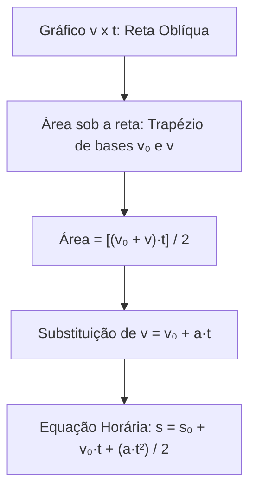
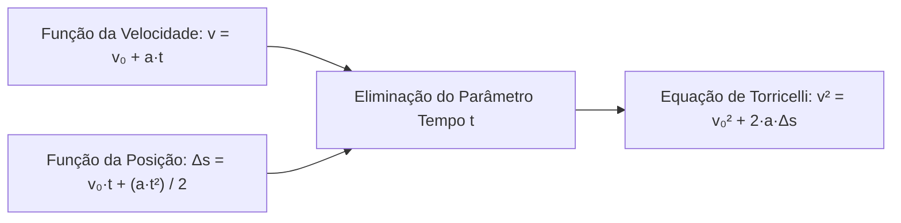
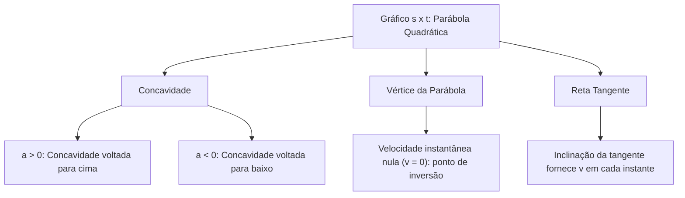
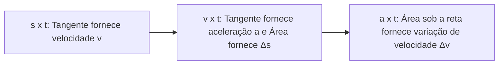
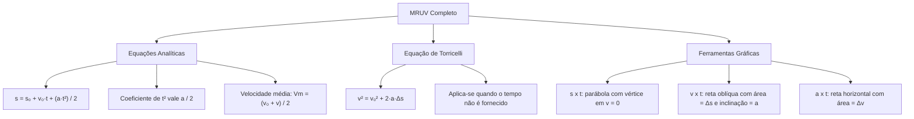

O estudo completo do Movimento Retilíneo Uniformemente Variado atinge sua maturidade matemática na análise das funções do espaço, da velocidade e de seus gráficos. No edital, a quantificação e a descrição matemática e gráfica do movimento atuam em conjunto com ferramentas básicas como gráficos e vetores. Saber determinar a distância percorrida por uma viatura durante uma freada brusca, mesmo sem conhecer o tempo do evento, é fundamental em perícias de trânsito. A Equação de Torricelli e o cálculo de áreas sob curvas constituem métodos eficientes para solucionar problemas com agilidade.

> [!objetivos]
> - Deduzir e aplicar a equação horária da posição no MRUV: s = s₀ + v₀·t + (a·t²) / 2.
> - Identificar a posição inicial, a velocidade inicial e a aceleração a partir de equações quadráticas.
> - Aplicar a Equação de Torricelli (v² = v₀² + 2·a·Δs) para solucionar problemas sem a variável tempo.
> - Compreender a propriedade da velocidade escalar média como média aritmética no MRUV.
> - Interpretar gráficos s x t, v x t e a x t relacionando áreas e inclinações.

## Equação Horária da Posição no MRUV

No MRUV, a velocidade varia de maneira linear com o tempo. Por essa razão, a posição não varia de forma proporcional direta ao tempo. Ela obedece a uma função quadrática do segundo grau.

A dedução matemática da equação horária do espaço decorre do gráfico velocidade versus tempo (v x t). A área sob a reta oblíqua da velocidade entre o instante inicial t = 0 e um instante genérico t representa uma região trapezoidal.

A base menor do trapézio corresponde à velocidade inicial v₀. A base maior do trapézio corresponde à velocidade final v. A altura do trapézio é dada pelo tempo decorrido t.

A área desse trapézio fornece o deslocamento escalar realizado pelo móvel:
Δs = Área = [(v₀ + v)·t] / 2.

Substitui-se a função da velocidade v = v₀ + a·t na expressão da área.
Dessa forma, obtém-se: Δs = [(v₀ + v₀ + a·t)·t] / 2.
Desenvolvendo os termos: Δs = [(2·v₀ + a·t)·t] / 2.
Chega-se à relação do deslocamento: Δs = v₀·t + (a·t²) / 2.

Como o deslocamento é a diferença entre a posição final e a inicial (Δs = s - s₀), isola-se a posição s:
s = s₀ + v₀·t + (a·t²) / 2.

### Leitura dos coeficientes na equação do espaço

Ao analisar uma função horária do segundo grau no formato padrão s = A + B·t + C·t², a leitura física dos termos é direta:
- O termo independente A representa a posição inicial: s₀ = A.
- O coeficiente B do termo em t representa a velocidade inicial: v₀ = B.
- O coeficiente C do termo em t² representa a metade da aceleração: C = a / 2.
- A aceleração real do móvel é dada pelo dobro do coeficiente de t²: a = 2·C.

| Equação Horária do Espaço | Posição Inicial (s₀) | Velocidade Inicial (v₀) | Coeficiente de t² | Aceleração Escalar (a = 2·C) |
| --- | --- | --- | --- | --- |
| s = 10 + 4·t + 3·t² | 10 m | +4 m/s | 3 | a = 2·3 = +6 m/s² |
| s = 25 - 8·t + 2·t² | 25 m | -8 m/s | 2 | a = 2·2 = +4 m/s² |
| s = 40 + 12·t - 5·t² | 40 m | +12 m/s | -5 | a = 2·(-5) = -10 m/s² |
| s = 6·t + t² | 0 m | +6 m/s | 1 | a = 2·1 = +2 m/s² |

> [!pegadinha]
> O erro mais comum em provas de MRUV consiste em tomar o coeficiente de t² diretamente como a aceleração. Lembre-se sempre de que o número que multiplica t² equivale a a / 2. Portanto, para achar a aceleração real, multiplique esse coeficiente por 2. Na função s = 20 - 4·t + 3·t², a aceleração vale a = 2·3 = 6 m/s².

## Equação de Torricelli: Independência do Tempo

Muitas vezes, uma ocorrência de trânsito não permite registrar o tempo de duração de uma manobra. Conhecem-se apenas a distância de frenagem marcada no solo e as velocidades dos veículos.

A Equação de Torricelli surge da eliminação do tempo t entre a função da velocidade e a função da posição.

Primeiro, isola-se o tempo t na função horária da velocidade:
t = (v - v₀) / a.

Em seguida, substitui-se essa expressão do tempo na equação do deslocamento:
Δs = v₀·[(v - v₀) / a] + (a / 2)·[(v - v₀) / a]².

Multiplicando todos os termos da equação por 2·a, eliminam-se os denominadores fracionários.
Desenvolvem-se os produtos notáveis algébricos.
Os termos mistos cruzados anulam-se mutuamente.
Obtém-se finalmente a célebre Equação de Torricelli:
v² = v₀² + 2·a·Δs.

Onde:
- **v:** velocidade escalar final do corpo.
- **v₀:** velocidade escalar inicial do corpo.
- **a:** aceleração escalar constante.
- **Δs:** deslocamento escalar percorrido pelo corpo.

> [!resolvido]
> Uma viatura trafega a 72 km/h por uma avenida. O condutor visualiza uma interdição e aciona os freios bruscamente. Os freios produzem uma desaceleração constante de 5 m/s² até a parada completa do veículo. Determine a distância percorrida pela viatura durante a frenagem.
>
> Passo 1: Converter a velocidade inicial para o padrão SI:
> v₀ = 72 / 3,6 = 20 m/s.
> Passo 2: Listar os parâmetros da frenagem:
> O veículo atinge a imobilização total, logo v = 0 m/s.
> Como o veículo freia, a aceleração tem sentido contrário à velocidade: a = -5 m/s².
> Passo 3: Aplicar a Equação de Torricelli:
> v² = v₀² + 2·a·Δs.
> 0² = 20² + 2·(-5)·Δs.
> 0 = 400 - 10·Δs.
> 10·Δs = 400.
> Δs = 400 / 10 = 40 metros.
> Conclusão: A viatura percorre 40 metros durante a desaceleração até parar.

## Velocidade Escalar Média como Média Aritmética no MRUV

No Movimento Retilíneo Uniformemente Variado, a velocidade escalar média calculada em qualquer intervalo de tempo possui uma propriedade matemática singular. Ela coincide com a média aritmética simples entre a velocidade no início e a velocidade no fim do intervalo considerado.

Essa relação deduz-se diretamente da fórmula do deslocamento trapezoidal:
Δs = [(v₀ + v) / 2]·Δt.
Dividindo ambos os membros pelo intervalo de tempo Δt:
Δs / Δt = (v₀ + v) / 2.
Como a razão Δs / Δt representa a velocidade escalar média Vm, tem-se:
Vm = (v₀ + v) / 2.

Essa igualdade simplifica enormemente a resolução de problemas de prova. Suponha que uma viatura acelere de forma uniforme desde 10 m/s até alcançar 30 m/s durante um intervalo de 4 segundos. A velocidade escalar média durante essa aceleração é simplesmente Vm = (10 + 30) / 2 = 20 m/s. Multiplicando essa velocidade média pelo tempo total de 4 segundos, obtém-se o deslocamento percorrido: Δs = Vm·Δt = 20·4 = 80 metros. Não é necessário recorrer à equação horária completa do espaço.

> [!atencao]
> Essa propriedade da média aritmética simples é válida exclusivamente no MRUV. Ela decorre da variação linear uniforme da velocidade. Em movimentos com aceleração variável ou em percursos fracionados em MRU com velocidades distintas, o emprego da média aritmética simples conduz a erros graves. Nesses casos, deve-se aplicar a definição universal: Vm = Δs_total / Δt_total.

## Ferramentas Básicas: Gráficos do MRUV

Os gráficos cartesianos constituem ferramentas básicas essenciais para a física mecânica. Eles permitem visualizar e quantificar o comportamento de grandezas cinemáticas com precisão.

### Gráfico posição versus tempo (s x t)

No MRUV, a função s = s₀ + v₀·t + (a·t²) / 2 descreve uma parábola:
- A concavidade da curva é determinada pelo sinal da aceleração escalar:
  - Se a > 0, a concavidade é voltada para cima.
  - Se a < 0, a concavidade é voltada para baixo.
- A inclinação da reta tangente à curva em qualquer instante representa a velocidade instantânea do móvel naquele instante.
- O vértice da parábola indica o ponto onde a tangente é horizontal. Nesse ponto, a velocidade instantânea é nula (v = 0). O vértice assinala a parada momentânea e a inversão do sentido de movimento.

### Gráfico velocidade versus tempo (v x t)

O gráfico v x t no MRUV é uma linha reta oblíqua:
- A reta cruza o eixo vertical na velocidade inicial v₀.
- A inclinação da reta fornece a aceleração escalar do móvel: a = tan(θ) = Δv / Δt.
  - Reta ascendente indica aceleração positiva (a > 0).
  - Reta descendente indica aceleração negativa (a < 0).
- A área sob a reta entre dois instantes t₁ e t₂ fornece numericamente o deslocamento escalar Δs.

### Gráfico aceleração versus tempo (a x t)

No MRUV, a aceleração escalar é constante ao longo do tempo. O gráfico a x t é uma linha reta horizontal paralela ao eixo dos tempos:
- Se a > 0, a reta fica acima do eixo temporal.
- Se a < 0, a reta fica abaixo do eixo temporal.
- A área sob a reta entre dois instantes fornece a variação de velocidade: Δv = a·Δt.

## Mapa do Capítulo

### Para fixar

- **Equação Horária do Espaço:** s = s₀ + v₀·t + (a·t²) / 2, modelando a posição como parábola quadrática.
- **Leitura da Aceleração:** A aceleração escalar é obtida multiplicando por 2 o coeficiente do termo em t².
- **Equação de Torricelli:** v² = v₀² + 2·a·Δs, permitindo calcular velocidades e distâncias sem conhecer o tempo.
- **Velocidade Média no MRUV:** É calculada pela média aritmética simples entre a velocidade inicial e final: (v₀ + v) / 2.
- **Gráfico s x t:** Curva parabólica cuja concavidade segue o sinal de a (para cima se a > 0, para baixo se a < 0).
- **Vértice da Parábola:** Ponto onde a reta tangente é horizontal, a velocidade anula-se e ocorre inversão de sentido.
- **Gráfico v x t:** Linha reta cuja inclinação fornece a aceleração e cuja área sob a curva fornece o deslocamento.
- **Gráfico a x t:** Reta horizontal constante cuja área sob a curva fornece a variação líquida de velocidade (Δv).
- **Condição de Parada:** Anula-se a velocidade final (v = 0) na equação de Torricelli ou na função da velocidade.
- **Áreas Algébricas:** Áreas acima do eixo temporal são positivas e áreas abaixo representam grandezas negativas.
