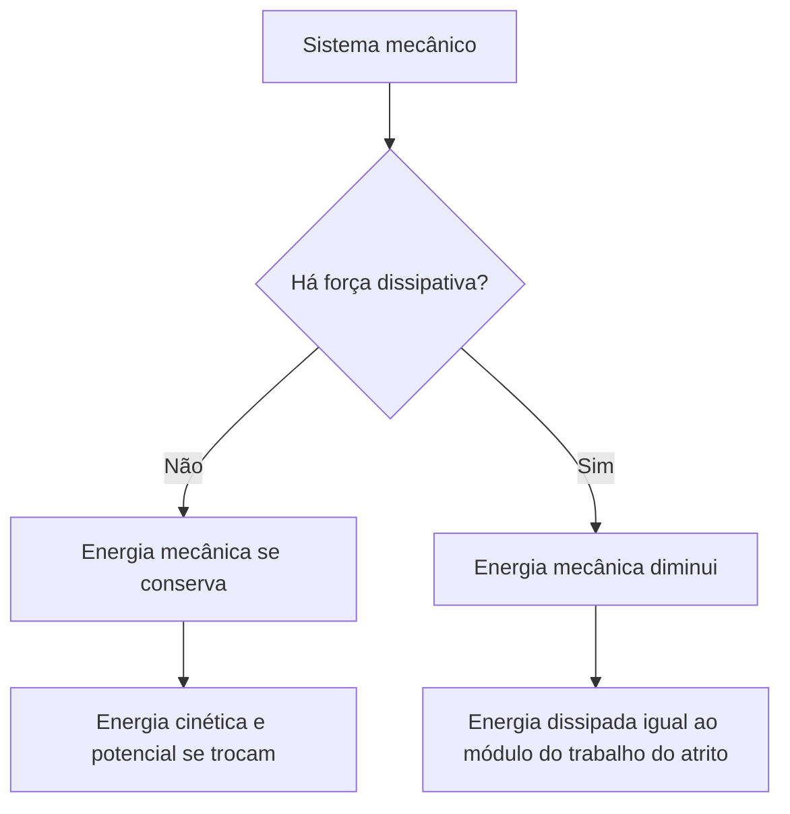

Trabalho conta quanta energia foi transferida; **potência** diz com que rapidez isso acontece. Duas pessoas que sobem a mesma escada realizam o mesmo trabalho, mas a que sobe em menos tempo desenvolve mais potência. Este capítulo mostra como calcular a potência média e a instantânea, o rendimento de uma máquina e as formas de **energia mecânica**: cinética, potencial gravitacional e potencial elástica. Termina com a **conservação da energia mecânica**, que vale quando só há forças conservativas, e com os **sistemas dissipativos**, em que parte da energia se perde em forma de calor.

> [!objetivos]
> - Calcular potência média e instantânea e converter suas unidades.
> - Calcular o rendimento de uma máquina.
> - Distinguir energia cinética, potencial gravitacional e potencial elástica.
> - Aplicar a conservação da energia mecânica e tratar sistemas dissipativos.

## Potência

A **potência média** é o trabalho realizado dividido pelo tempo gasto:

    P = W / Δt

No Sistema Internacional, a unidade é o **watt (W)**, que equivale a 1 J/s. Outras unidades aparecem em provas: o **quilowatt (kW)**, igual a 1.000 W; o **cavalo-vapor (cv)**, de cerca de 735 W; o **horse-power (hp)**, de cerca de 746 W; e o **quilowatt-hora (kWh)**, que é unidade de **energia**, e não de potência: 1 kWh = 3,6 · 10⁶ J.

Quando uma força F constante atua sobre um corpo que se move com velocidade v na mesma direção, a **potência instantânea** vale:

    P = F · v

Um carro cuja força motriz é de 2.000 N a 20 m/s desenvolve P = 2.000 · 20 = 40.000 W = 40 kW. Em geral, P = F · v · cos θ, com θ o ângulo entre a força e a velocidade.

### Gráfico potência por tempo

No gráfico de P em função de t, a **área sob a curva** é igual ao **trabalho** realizado (ou à energia transferida) no intervalo. Se a potência é constante, a área é um retângulo: P · Δt = W. Por exemplo, uma lâmpada de 60 W acesa por 5 horas consome 0,06 kW · 5 h = 0,3 kWh.

> [!resolvido] Potência de um elevador e rendimento
> **Enunciado.** Um elevador levanta uma carga de 500 kg a uma altura de 20 m em 10 s, em movimento com velocidade constante. Use g = 10 m/s². Calcule a potência útil. Se o motor tem rendimento de 80%, qual é a potência que ele consome?
>
> **Raciocínio.** O trabalho útil é o ganho de energia potencial. A potência útil divide esse trabalho pelo tempo. O rendimento é a razão entre a potência útil e a potência total.
>
> **Conta.** W = m · g · h = 500 · 10 · 20 = 100.000 J. A potência útil é 100.000/10 = 10.000 W = 10 kW. Como η = P_útil/P_total = 0,8, P_total = 10/0,8 = 12,5 kW.
>
> **Resposta.** A potência útil é de 10 kW e o motor consome 12,5 kW.

## Rendimento

Nenhuma máquina real transforma toda a energia que recebe em trabalho útil: parte se perde, em geral como calor. O **rendimento** η mede a fração aproveitada:

    η = P_útil / P_total = E_útil / E_total

É um número entre 0 e 1 (ou entre 0% e 100%), sem unidade. Um rendimento de 80% significa que, de cada 100 J recebidos, 80 J viram trabalho útil e 20 J são dissipados. Nenhum rendimento chega a 100% em uma máquina real.

Quando duas máquinas funcionam em sequência, os rendimentos se multiplicam. Se um motor tem rendimento de 80% e uma transmissão acoplada a ele tem rendimento de 90%, o conjunto tem rendimento de 0,8 · 0,9 = 0,72, ou 72%. Por isso um sistema com muitas etapas aproveita menos a energia inicial: cada etapa adicional retira uma fração. Para uma potência útil de 7,2 kW com esse conjunto, a potência fornecida ao motor precisa ser de 7,2/0,72 = 10 kW.

### Unidades de potência e de energia

| Grandeza | Unidade | Equivalência |
| --- | --- | --- |
| Potência | watt (W) | 1 J/s |
| Potência | quilowatt (kW) | 1.000 W |
| Potência | cavalo-vapor (cv) | Cerca de 735 W |
| Potência | horse-power (hp) | Cerca de 746 W |
| Energia | quilowatt-hora (kWh) | 3,6 milhões de J |

## Energia mecânica

A **energia mecânica** é a soma das energias cinética e potencial de um corpo:

| Forma de energia | Fórmula | Depende de |
| --- | --- | --- |
| Cinética | E_c = m·v²/2 | Massa e velocidade ao quadrado |
| Potencial gravitacional | E_p = m·g·h | Massa e altura em relação a um nível de referência |
| Potencial elástica | E_pel = k·x²/2 | Constante elástica e deformação ao quadrado |
| Mecânica | E_m = E_c + E_p | A soma das anteriores |

A energia potencial gravitacional é relativa a um **nível de referência** escolhido: a altura é medida a partir dele. O que tem significado físico é a **variação** da energia potencial, que não depende do nível escolhido.

### Forças conservativas e dissipativas

Uma força é **conservativa** quando o trabalho que ela realiza entre dois pontos não depende da trajetória. São exemplos o peso, a força elástica e a força eletrostática. Para essas forças, existe uma energia potencial associada. Uma força é **dissipativa** quando o trabalho depende do caminho percorrido e transforma energia mecânica em outras formas, geralmente calor. São exemplos o atrito cinético e a resistência do ar.

## Conservação da energia mecânica

Em um sistema em que atuam **apenas forças conservativas** (ou em que as demais não realizam trabalho), a energia mecânica **se conserva**:

    E_m,inicial = E_m,final

Em termos de partes, a energia cinética se converte em potencial e vice-versa, mas a soma é constante. Na queda, a energia potencial diminui e a cinética aumenta. Na subida, ocorre o contrário.

> [!resolvido] Velocidade pela conservação da energia
> **Enunciado.** Um corpo é abandonado do repouso de uma altura de 1,8 m, em um plano sem atrito, e desce até a base. Use g = 10 m/s². Qual é a velocidade na base?
>
> **Raciocínio.** Como não há atrito, a energia mecânica se conserva. No início, só há potencial; no final, só há cinética.
>
> **Conta.** m·g·h = m·v²/2, logo v² = 2·g·h = 2 · 10 · 1,8 = 36, e v = 6 m/s.
>
> **Resposta.** A velocidade na base é de 6 m/s, e não depende da massa nem do formato do caminho.

```svg Energia em uma pista sem atrito
<svg viewBox="0 0 640 260" xmlns="http://www.w3.org/2000/svg">
  <path d="M30 60 Q130 60 200 200 Q260 230 320 200 Q420 60 610 60" stroke="#0e1b2e" stroke-width="3" fill="none"/>
  <circle cx="36" cy="55" r="9" fill="#d4301f"/>
  <circle cx="260" cy="216" r="9" fill="#2563eb"/>
  <circle cx="604" cy="55" r="9" fill="#7c3aed"/>
  <text x="20" y="30" font-family="Public Sans, Arial, sans-serif" font-size="14" fill="#d4301f">alto: só E_p</text>
  <text x="205" y="250" font-family="Public Sans, Arial, sans-serif" font-size="14" fill="#2563eb">base: só E_c</text>
  <text x="510" y="30" font-family="Public Sans, Arial, sans-serif" font-size="14" fill="#7c3aed">volta à mesma altura</text>
</svg>
```

### Energia elástica

Em um sistema massa-mola sem atrito, a energia se conserva entre a energia elástica e a cinética. Um bloco de 0,5 kg encostado em uma mola de k = 200 N/m comprimida 0,1 m, ao ser solto sobre uma superfície sem atrito, deixa a mola com v dada por k·x²/2 = m·v²/2, isto é, 200 · 0,01/2 = 0,5 · v²/2. Então 1 = 0,25 · v², v² = 4 e v = 2 m/s.

## Sistemas dissipativos

Quando há força dissipativa, a energia mecânica **diminui**. O que se perde não desaparece: vira outras formas de energia, como calor, som e deformação, e vale a conservação da **energia total**. A energia dissipada é o módulo do trabalho da força dissipativa:

    E_diss = E_m,inicial − E_m,final = |W_atrito|

> [!resolvido] Energia dissipada pelo atrito
> **Enunciado.** Um bloco de 2 kg é abandonado do repouso no alto de uma rampa de 5 m de altura e chega à base com 8 m/s. Use g = 10 m/s². Quanta energia foi dissipada?
>
> **Raciocínio.** A energia mecânica inicial é só potencial, e a final é só cinética. A diferença foi dissipada.
>
> **Conta.** E_m,inicial = 2 · 10 · 5 = 100 J. E_m,final = 2 · 64/2 = 64 J. E_diss = 100 − 64 = 36 J.
>
> **Resposta.** A energia dissipada foi de 36 J, que corresponde a 36% da energia inicial.



> [!pegadinha]
> Dizer que, com atrito, a energia "desaparece". Ela não desaparece: a energia mecânica diminui, mas a energia total se conserva, porque a perda aparece como calor. E, ao contrário, dizer que a energia mecânica se conserva quando há atrito é um erro. Outra troca é tratar o quilowatt-hora como unidade de potência, quando é de energia.

> [!bizu]
> Para escolher o caminho de solução: se o problema envolve **tempo**, pense em potência (P = W/Δt); se envolve **altura e velocidade** sem tempo, use a conservação da energia mecânica; se há **atrito**, use a conservação com o termo dissipado ou o teorema da energia cinética. Em todos os casos, o nível de referência da altura é escolha sua.

## Exemplos do dia a dia

Uma moeda de 10 g que cai da borda de uma mesa de 0,8 m chega ao chão com v² = 2 · 10 · 0,8 = 16, isto é, 4 m/s, desprezando a resistência do ar. A energia cinética no chão é 0,01 · 16/2 = 0,08 J, que era a energia potencial inicial, 0,01 · 10 · 0,8 = 0,08 J. Um vaso de 2 kg na janela, a 5 m do chão, tem 100 J de energia potencial em relação ao chão; se cair sem atrito, chega com 10 m/s (v² = 2 · 10 · 5 = 100). Uma borracha lançada do bolso para cima converte energia cinética em potencial e depois faz o caminho contrário.

Em máquinas, as perdas aparecem como calor: o motor de um carro queima combustível, mas só uma parte da energia vira movimento. Por isso o rendimento é menor que 100%. Matematicamente, a conservação da energia mecânica se escreve E_m inicial = E_m final, e, aquilo que sobra de diferença entre os dois lados, em sistemas reais, é a energia dissipada.

## Como a banca cobra este assunto

Os padrões mais frequentes são:

- **Potência:** P = W/Δt e P = F·v, com conversão entre watt, kW, cv e kWh.
- **Rendimento:** potência total ou útil dado o rendimento de motor ou máquina.
- **Conservação:** velocidade em montanha-russa, pêndulo ou queda sem atrito.
- **Dissipação:** energia perdida pelo atrito, a partir de duas velocidades ou alturas.
- **Conceito:** diferença entre força conservativa e dissipativa, e o que acontece com a energia total.

## Mapa do capítulo

| Tema | Fórmula | Cuidado |
| --- | --- | --- |
| Potência média | W/Δt | Unidade: watt (J/s) |
| Potência instantânea | F·v | Mesma direção de F e v |
| Rendimento | P_útil/P_total | Entre 0 e 1; nunca 100% |
| Energia mecânica | E_c + E_p | Nível de referência arbitrário |
| Conservação | E_m inicial = E_m final | Só sem forças dissipativas |
| Dissipação | E_m inicial − E_m final | Igual ao módulo do trabalho do atrito |

### Para fixar

- Potência é trabalho dividido pelo tempo, medida em watt (1 W = 1 J/s).
- P = F·v para força e velocidade na mesma direção.
- A área sob o gráfico potência por tempo é o trabalho.
- O quilowatt-hora é unidade de energia, e 1 kWh = 3,6·10⁶ J.
- O rendimento é a razão entre a potência útil e a total e é sempre menor que 1.
- A energia mecânica é a soma de energia cinética, potencial gravitacional e potencial elástica.
- Forças conservativas (peso, elástica) conservam a energia mecânica; as dissipativas (atrito) a diminuem.
- A energia dissipada vira calor, e a energia total se conserva.
