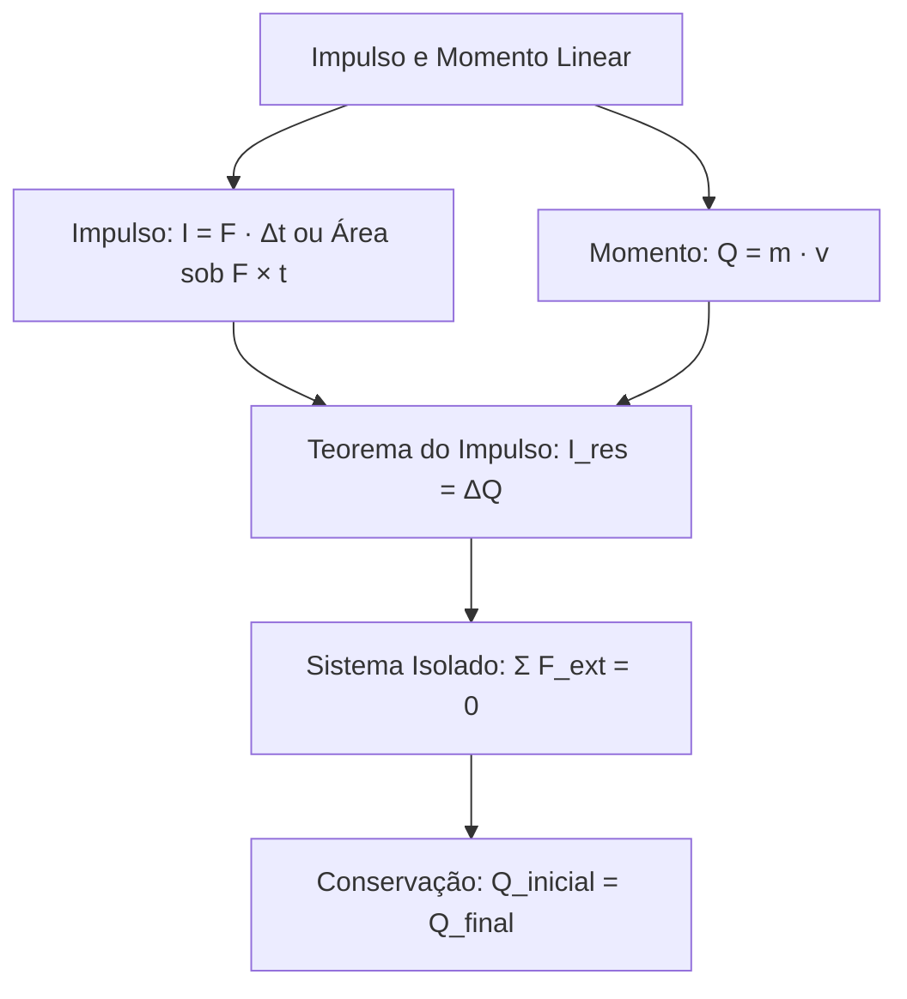

A mecânica newtoniana estuda o efeito de forças aplicadas em intervalos de tempo curtos. O estudo do impulso e da quantidade de movimento simplifica a análise de colisões e disparos. Essas grandezas eliminam a necessidade de calcular acelerações a cada instante. Neste capítulo, você aprenderá as bases conceituais, o Teorema do Impulso e a conservação vetorial em sistemas isolados.

> [!objetivos]
> - Definir impulso para forças constantes e forças variáveis no tempo.
> - Interpretar a área sob gráficos de força em função do tempo.
> - Relacionar o momento linear com a energia cinética translacional.
> - Aplicar o Teorema do Impulso na determinação de forças médias.
> - Empregar a conservação da quantidade de movimento em sistemas mecânicos isolados.

## Impulso de Forças Constantes e Variáveis

O impulso mede o efeito acumulado gerado por uma força durante determinado intervalo temporal. Trata-se de uma grandeza física vetorial. O vetor impulso assume orientação idêntica à do vetor força resultante responsável por sua produção.

Para uma força constante F que atua durante o intervalo temporal Δt = tf - ti, o vetor impulso I vale:

I = F · Δt

No Sistema Internacional (SI), a força é medida em newtons (N) e o tempo em segundos (s). A unidade de impulso é o newton-segundo (N · s). Quando a força agiu de modo variável, essa relação simples não se aplica diretamente.

Na prática, as forças durante impactos mudam de intensidade com extrema rapidez. Exemplos clássicos são a tacada na bola de bilhar e o golpe vigoroso de uma raquete de tênis. Nesses casos, o cálculo gráfico substitui a fórmula linear: o impulso corresponde numericamente à área sob a curva no diagrama cartesiano de força por tempo.

| Tipo de Força Atuante | Método de Cálculo do Impulso | Unidade no SI | Sentido Vetorial |
| --- | --- | --- | --- |
| Força Constante | I = F · Δt | N · s | Alinhado à força F aplicada |
| Força Variável | Área sob o gráfico F versus t | N · s | Definido pelo sinal algébrico |
| Força Média Equivalente | I = Fm · Δt | N · s | Sentido idêntico ao da resultante |

Áreas acima do eixo temporal fornecem impulsos com valor positivo. Por outro lado, regiões situadas abaixo do eixo indicam impulso negativo. Na verdade, se o sentido da força se inverter durante a ação, haverá parcelas de sinais opostos. A soma algébrica fornecerá o impulso total. A força média equivalente (Fm) produz exatamente a mesma modificação no intervalo Δt:

Fm = I / Δt

## Momento Linear e Dinâmica da Massa

A quantidade de movimento também é chamada momento linear na maioria dos livros didáticos e manuais de engenharia. Ela traduz a medida do movimento inercial de uma partícula. Para uma partícula de massa m dotada de velocidade vetorial v, define-se:

Q = m · v

Essa grandeza possui caráter rigorosamente vetorial. O vetor Q compartilha a direção e o sentido do vetor velocidade instantânea. A unidade no SI é o quilograma-metro por segundo (kg · m/s). Em termos dimensionais, as unidades N · s e kg · m/s são inteiramente equivalentes:

1 N · s = (1 kg · m / s²) · s = 1 kg · m/s

| Parâmetro Físico | Natureza | Equação Fundamental | Comportamento em Oposição |
| --- | --- | --- | --- |
| Momento Linear (Q) | Vetorial | Q = m · v | Pode anular o vetor resultante |
| Energia Cinética (Ec) | Escalar | Ec = (m · v²) / 2 | Sempre positiva para corpos velozes |
| Força Resultante (F) | Vetorial | F = m · a | Determina a modificação temporal de Q |

### Relação entre Momento Linear e Energia Cinética

A energia cinética translacional pode ser calculada com base na quantidade de movimento. Partindo da definição clássica da energia de movimento:

Ec = (m · v²) / 2 = (m² · v²) / (2 · m) = Q² / (2 · m)

Isolando o módulo da quantidade de movimento em termos de Ec:

Q = √(2 · m · Ec)

Essa relação mostra um aspecto teórico essencial para concursos. Dois corpos com o mesmo momento linear não apresentam a mesma energia cinética. O corpo de menor massa transporta a maior cota de energia, pois a massa opera como divisor na expressão fundamental.

> [!pegadinha] Grandeza Escalar versus Grandeza Vetorial
> Dois projéteis idênticos disparados em sentidos opostos com mesma rapidez possuem energias cinéticas estritamente iguais e positivas. Contudo, suas quantidades de movimento possuem sinais contrários e se anulam na soma vetorial do conjunto.

## Teorema do Impulso

O Teorema do Impulso conecta a força externa à modificação dinâmica do móvel. Ele decorre da segunda lei de Newton:

F_res = m · a = m · (Δv / Δt)

Multiplicando os dois membros da igualdade pelo intervalo temporal Δt:

F_res · Δt = m · vf - m · vi

Como I = F_res · Δt e Q = m · v, temos a formulação definitiva:

I_res = ΔQ = Qf - Qi

O impulso da força resultante equivale à variação vetorial da quantidade de movimento experimentada pelo corpo. Se nenhuma força externa resultante agiu sobre o móvel, não haverá alteração do seu momento total.

> [!resolvido] Choque Contra Obstáculo e Força Média
> **Enunciado:** Uma bola de tênis de 0,10 kg move-se horizontalmente para a direita a 20 m/s. Ela atinge uma parede vertical e retorna horizontalmente a 15 m/s para a esquerda. O contato dura 0,02 s. Determine a variação da quantidade de movimento e a intensidade da força média exercida pela barreira.
>
> **Resolução passo a passo:**
> 1. Adotamos o sentido positivo para a direita. Temos vi = +20 m/s e vf = -15 m/s.
> 2. Calculamos o momento linear inicial: Qi = 0,10 · (+20) = +2,0 kg · m/s.
> 3. Calculamos o momento linear final com sinal negativo: Qf = 0,10 · (-15) = -1,5 kg · m/s.
> 4. Determinamos a variação vetorial: ΔQ = Qf - Qi = -1,5 - (+2,0) = -3,5 kg · m/s.
> 5. Pelo Teorema do Impulso: I = ΔQ = -3,5 N · s. O módulo do impulso vale 3,5 N · s.
> 6. Calculamos a força média: Fm = I / Δt = (-3,5) / 0,02 = -175 N.
> 7. A barreira exerceu força média de 175 N orientada para a esquerda.

## Conservação da Quantidade de Movimento

Em mecânica, as forças atuantes distribuem-se em duas categorias primordiais:

1. Forças internas: resultam de interações trocadas mutuamente entre partes do próprio sistema. Pela terceira lei de Newton, formam pares de ação e reação com soma vetorial nula.
2. Forças externas: decorrem da interação com corpos situados fora dos limites do sistema.

Um sistema mecânico é isolado quando a resultante de todas as forças externas for nula:

Σ F_ext = 0

Sob resultante externa zero, o impulso externo total também se anula. Desse modo:

ΔQ_total = 0 => Q_total(final) = Q_total(inicial)

Em sistemas isolados, o momento linear vetorial total permanece rigorosamente inalterado ao longo do tempo. Esse princípio é entendido como uma das leis mais universais da física.

| Sistema Físico | Forças Internas Presentes | Forças Externas Atuantes | Conservação de Q |
| --- | --- | --- | --- |
| Patinadores no gelo plano | Empurrão mútuo das mãos | Peso e normal (anulam-se) | Conservação estrita e plena |
| Canhão disparando projétil | Pressão dos gases internos | Gravidade e reação do solo | Conservação no plano horizontal |
| Dois blocos com mola | Força elástica comprimida | Gravidade e apoio vertical | Conservação estrita e plena |

Suponha dois patinadores parados sobre uma superfície de gelo horizontal sem atrito. O patinador A tem 60 kg e o patinador B tem 90 kg. Eles se empurram mutuamente com as mãos. O momento total inicial é zero. Após o empurrão:

mA · vA + mB · vB = 0 => 60 · vA + 90 · vB = 0

Se o patinador A passa a se mover a 3 m/s para a esquerda (-3 m/s):

60 · (-3) + 90 · vB = 0 => -180 + 90 · vB = 0 => vB = +2 m/s

O patinador B passa a se mover a 2 m/s para a direita. Na verdade, para anular o momento linear total, ambos devem se mover em sentidos contrários. O corpo de menor massa adquire velocidade com maior módulo numérico.

> [!bizu] O Efeito Recuo em Provas
> Em disparos de armas ou desprendimentos a partir do repouso, o módulo da velocidade final é inversamente proporcional à massa de cada parte: vA / vB = mB / mA.

## Mapa do capítulo

### Para fixar

- Impulso é grandeza vetorial e assume orientação idêntica à da força resultante aplicada.
- Em gráficos de força variável por tempo, a área sob a curva fornece o impulso numérico real.
- Momento linear e energia cinética relacionam-se pela relação Ec = Q² / (2 · m).
- O Teorema do Impulso estabelece que o impulso resultante equivale à variação da quantidade de movimento.
- Em impactos com inversão de marcha, as velocidades têm sinais opostos e elevam o módulo do impulso.
- Sistemas mecanicamente isolados apresentam resultante de forças externas estritamente nula.
- Em sistemas isolados, a quantidade de movimento vetorial total permanece rigorosamente conservada.
