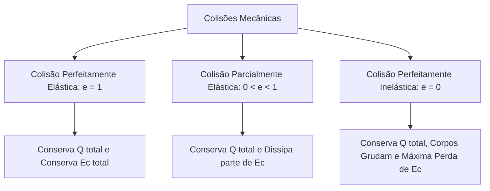
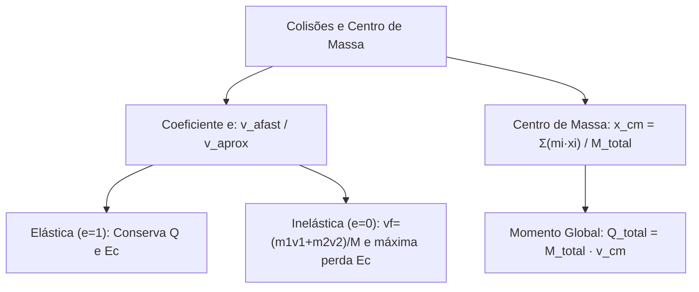

As colisões mecânicas representam interações intensas que ocorrem em frações ínfimas de segundo. Durante o impacto entre dois ou mais corpos, as forças internas trocadas superam amplamente quaisquer forças externas atuantes. Por essa razão, todo choque isolado preserva a quantidade de movimento vetorial total. Contudo, a energia cinética do sistema pode sofrer transformações profundas devido à deformação plástica, aquecimento térmico e emissão de ondas sonoras. Este capítulo estuda o coeficiente de restituição, a classificação dos choques mecânicos e o conceito dinâmico de centro de massa.

> [!objetivos]
> - Compreender a dinâmica temporal e as fases de deformação e restituição de um choque.
> - Definir e calcular o coeficiente de restituição em aproximações e afastamentos unidimensionais.
> - Classificar colisões em elásticas, parcialmente elásticas e perfeitamente inelásticas.
> - Determinar a velocidade comum final e a dissipação de energia cinética no choque inelástico.
> - Localizar as coordenadas do centro de massa e relacioná-las com a quantidade de movimento total.

## Dinâmica das Colisões e Coeficiente de Restituição

Uma colisão mecânica desenvolve-se essencialmente em duas etapas sucessivas: a fase de deformação e a fase de restituição. No instante do primeiro contato físico, os corpos começam a se comprimir mutuamente. A velocidade relativa diminui até se anular no ponto de máxima deformação. Nesse ponto transitório, parte considerável da energia cinética converte-se temporariamente em energia potencial de deformação elástica. Em seguida, inicia-se a fase de restituição. As estruturas tentam recuperar sua geometria espacial primitiva, empurrando os corpos para longe um do outro.

A capacidade de restituição mecânica é quantificada pelo coeficiente de restituição (e). Trata-se de uma grandeza adimensional definida pelo quociente entre a velocidade relativa de afastamento após o choque e a velocidade relativa de aproximação antes da colisão:

e = v_afastamento / v_aproximação (razão entre módulos)

Para corpos que se deslocam sobre a mesma reta diretriz, as velocidades relativas são determinadas comparando os sentidos de movimento:

1. Aproximação em sentidos contrários: a rapidez relativa inicial equivale à soma algébrica dos módulos das velocidades: v_aprox = |v1| + |v2|.
2. Aproximação no mesmo sentido: o móvel de trás deve ser mais veloz para alcançar o da frente; a rapidez relativa equivale à diferença dos módulos: v_aprox = |v1| - |v2|.
3. Afastamento em sentidos opostos: a rapidez de separação equivale à soma dos módulos após o choque: v_afast = |v1'| + |v2'|.
4. Afastamento no mesmo sentido: o corpo dianteiro move-se mais rápido; a rapidez de separação equivale à diferença dos módulos: v_afast = |v2'| - |v1'|.

| Parâmetro de Movimento | Corpos em Sentidos Contrários | Corpos no Mesmo Sentido |
| --- | --- | --- |
| Velocidade de Aproximação | v_aprox = v1 + v2 (módulos) | v_aprox = v1 - v2 (módulos) |
| Velocidade de Afastamento | v_afast = v1' + v2' (módulos) | v_afast = v2' - v1' (módulos) |
| Coeficiente Adimensional e | e = v_afast / v_aprox | e = v_afast / v_aprox |

O valor do coeficiente de restituição situa-se estritamente no intervalo fechado de zero a um: 0 ≤ e ≤ 1.

## Classificação dos Choques Mecânicos

A conservação da energia mecânica durante o choque varia conforme a rigidez e elasticidade dos materiais envolvidos. As colisões dividem-se em três modalidades fundamentais:

### Colisão Perfeitamente Elástica (e = 1)

Na colisão perfeitamente elástica, a fase de restituição devolve integralmente a energia acumulada na deformação. O coeficiente de restituição é unitário (e = 1). Consequentemente, o módulo da velocidade relativa de afastamento é exatamente igual ao módulo da velocidade relativa de aproximação:

v_afastamento = v_aproximação (em módulos)

Nessa modalidade particular, ocorrem simultaneamente duas leis de conservação:

1. Conservação da quantidade de movimento vetorial: Q_total(inicial) = Q_total(final).
2. Conservação da energia cinética escalar: Ec_total(inicial) = Ec_total(final).

Caso dois corpos de massas estritamente idênticas sofram uma colisão perfeitamente elástica unidimensional, eles simplesmente trocam de velocidades entre si. Se o primeiro móvel possuía velocidade v e o segundo repousava, o primeiro móvel para imediatamente e o segundo parte com velocidade v.

### Colisão Parcialmente Elástica (0 < e < 1)

Na colisão parcialmente elástica, a recuperação do formato original é imperfeita. Os corpos se separam após o impacto mecânico, mas com velocidade relativa inferior à velocidade de aproximação inicial.

Em termos dinâmicos:

- A quantidade de movimento vetorial total conserva-se plenamente: Q_total(inicial) = Q_total(final).
- A energia cinética diminui: Ec_total(final) < Ec_total(inicial). A diferença de energia converte-se em energia térmica e ondas mecânicas.

### Colisão Perfeitamente Inelástica (e = 0)

Na colisão perfeitamente inelástica, a fase de restituição simplesmente não acontece. Os corpos colidem, deformam-se de forma irreversível e passam a mover-se grudados, compartilhando uma única velocidade comum final (vf). Como não existe afastamento mútuo, a velocidade relativa após a colisão anula-se, resultando em e = 0.

A quantidade de movimento permanece rigorosamente conservada. Pela equação de conservação:

m1 · v1 + m2 · v2 = (m1 + m2) · vf

A velocidade comum final resulta da média ponderada:

vf = (m1 · v1 + m2 · v2) / (m1 + m2)

Nessa modalidade ocorre a perda máxima possível de energia cinética que o sistema pode dissipar mantendo a conservação inercial da quantidade de movimento.

| Propriedade Física | Perfeitamente Elástica | Parcialmente Elástica | Perfeitamente Inelástica |
| --- | --- | --- | --- |
| Coeficiente e | e = 1 | 0 < e < 1 | e = 0 |
| Velocidade de Afastamento | Igual à de aproximação | Menor que a de aproximação | Nula (corpos unidos) |
| Momento Linear Total | Rigorosamente conservado | Rigorosamente conservado | Rigorosamente conservado |
| Energia Cinética Total | Rigorosamente conservada | Parcialmente dissipada | Máxima dissipação compatível |

> [!pegadinha] Conservação de Energia versus Conservação de Momento
> Muitos candidatos acreditam erroneamente que, em colisões inelásticas, o momento linear também se perde. Lembre-se: em todo sistema isolado, o momento linear total SEMPRE se conserva. O que se perde nos choques reais é a energia mecânica na forma de calor, som e amassamento.

> [!resolvido] Choque Inelástico e Dissipação Energética
> **Enunciado:** Um vagão ferroviário de massa m1 = 2000 kg desloca-se a 10 m/s sobre trilhos retos horizontais. Ele engata em um vagão idêntico de m2 = 2000 kg inicialmente em repouso. Calcule a velocidade do conjunto após o engate e a variação da energia cinética.
>
> **Resolução passo a passo:**
> 1. Trata-se de uma colisão perfeitamente inelástica, pois os vagões engatam e seguem juntos.
> 2. Pela conservação da quantidade de movimento:
> m1 · v1 + m2 · v2 = (m1 + m2) · vf
> 2000 · 10 + 2000 · 0 = (2000 + 2000) · vf
> 20000 = 4000 · vf => vf = 5 m/s.
> 3. Calculamos a energia cinética inicial:
> Ec_inicial = (2000 · 10²) / 2 = (2000 · 100) / 2 = 100 000 J.
> 4. Calculamos a energia cinética final com a massa agregada:
> Ec_final = (4000 · 5²) / 2 = (4000 · 25) / 2 = 50 000 J.
> 5. A variação da energia mecânica equivale à perda dissipada:
> ΔEc = 50 000 - 100 000 = -50 000 J. Metade da energia cinética original converteu-se em calor e atrito de engate.

## Centro de Massa e Movimento Global

O centro de massa (CM) representa o ponto geométrico médio ponderado pelas massas de todas as partículas que compõem um sistema físico. Para um sistema constituído por n partículas alinhadas no eixo linear x, a coordenada x_cm calcula-se por:

x_cm = (m1 · x1 + m2 · x2 + ... + mn · xn) / (m1 + m2 + ... + mn) = Σ (mi · xi) / M_total

A partícula dotada de maior massa exerce peso relativo maior na média, atraindo o centro de massa para as suas proximidades espaciais. Se uma partícula de 2 kg situa-se em x = 1 m e outra de 4 kg situa-se em x = 4 m, a posição média ponderada vale:

x_cm = (2 · 1 + 4 · 4) / (2 + 4) = (2 + 16) / 6 = 18 / 6 = 3 m

Derivando a posição em relação ao tempo, estabelece-se a velocidade do centro de massa (v_cm):

v_cm = (m1 · v1 + m2 · v2 + ... + mn · vn) / M_total = Q_total / M_total

Essa equação sintetiza um dos teoremas mais expressivos da mecânica clássica:

Q_total = M_total · v_cm

A quantidade de movimento total de qualquer conjunto de partículas é idêntica à quantidade de movimento de uma única partícula hipotética, cuja massa seja a massa total agregada, deslocando-se com a velocidade do centro de massa. Em sistemas mecanicamente isolados, onde Q_total permanece invariável, a velocidade do centro de massa (v_cm) mantém-se rigorosamente constante.

> [!bizu] O Centro de Massa Ignora Forças Internas
> Explosões no ar, tiros ou colisões internas não alteram a trajetória parabólica do centro de massa de um projétil sob a ação da gravidade. Enquanto a força externa resultante permanecer constante, o centro de massa prosseguirá em sua órbita imperturbável.

## Mapa do capítulo

### Para fixar

- Colisões mecânicas dividem-se nas fases de deformação estrutural e restituição elástica.
- O coeficiente de restituição mede a razão adimensional entre velocidade de afastamento e aproximação.
- No choque perfeitamente elástico (e = 1), conservam-se tanto o momento linear quanto a energia cinética.
- No choque parcialmente elástico (0 < e < 1), os corpos se separam com perda parcial de energia mecânica.
- No choque inelástico (e = 0), os corpos prosseguem grudados com velocidade comum e máxima dissipação energética.
- A quantidade de movimento total vetorial SEMPRE se conserva em sistemas isolados, independente do choque.
- O centro de massa é o ponto médio ponderado pelas massas e obedece à equação Q_total = M_total · v_cm.
