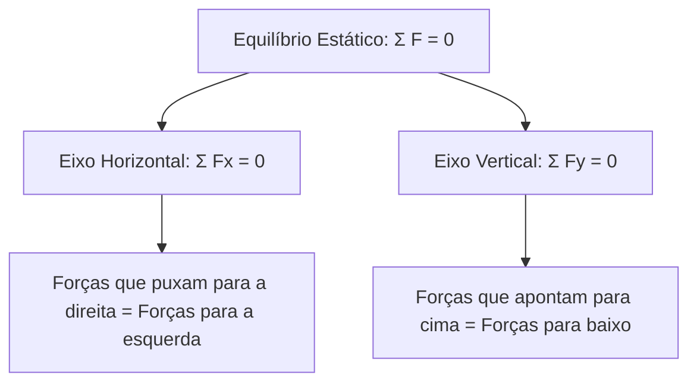
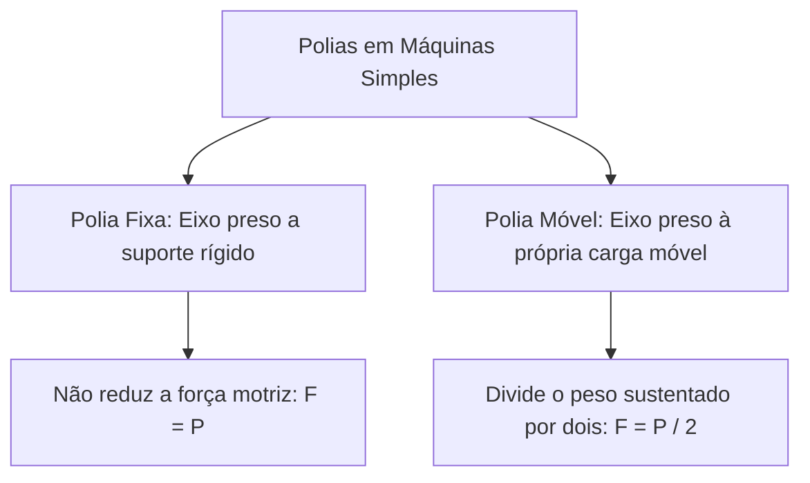
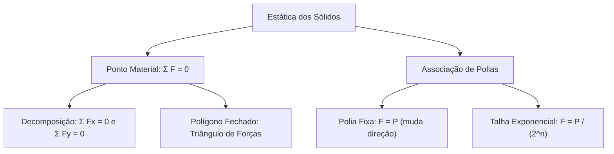

A estática estuda as condições sob as quais corpos materiais permanecem em repouso absoluto ou em equilíbrio mecânico estável. Quando as dimensões geométricas de um corpo não afetam o fenômeno físico, ele é modelado como ponto material. Nesses sistemas, a ausência de rotação reduz o equilíbrio à condição translacional pura. Além dos pontos materiais sob ação de forças concorrentes, este capítulo aborda a mecânica das máquinas simples, com foco na multiplicação de forças por meio de associações de roldanas ideais.

> [!objetivos]
> - Aplicar a primeira condição de equilíbrio estático para pontos materiais.
> - Construir diagramas de corpo livre com forças de tração, peso e normais.
> - Resolver problemas estáticos por decomposição ortogonal e polígono fechado.
> - Distinguir funcionalmente roldanas fixas e roldanas móveis.
> - Calcular a força motriz necessária e a vantagem mecânica em talhas exponenciais.

## Estática dos Sólidos e Equilíbrio do Ponto Material

A estática analisa os corpos que não apresentam aceleração. No ponto material, as dimensões físicas são desprezíveis. Por essa razão, não ocorrem rotações em torno de eixos próprios. Para corpos com dimensões grandes, o tamanho e a forma passam a influenciar a distribuição das forças, tema reservado ao corpo extenso.

No ponto material, a exigência fundamental de repouso é a resultante nula de todas as forças que agem sobre ele:

Σ F = 0

Essa condição vetorial única desdobra-se em duas equações escalares independentes sobre eixos perpendiculares cartesianos no plano:

Σ Fx = 0 (equilíbrio no eixo horizontal)
Σ Fy = 0 (equilíbrio no eixo vertical)

A regra básica é direta: as forças que puxam para a direita devem igualar as que puxam para a esquerda. No eixo vertical, as forças que apontam para cima devem igualar as que apontam para baixo. Se a resultante não for zero, haverá aceleração e o equilíbrio se desfaz.

## Métodos de Resolução: Decomposição e Polígono Fechado

Para resolver sistemas estáticos com forças inclinadas, vale a pena esquematizar o diagrama de corpo livre. O estudante pode escolher entre dois métodos práticos:

1. Decomposição ortogonal: consiste em trocar cada vetor inclinado por duas componentes perpendiculares nos eixos x e y. Usa-se Fx = F · cos(θ) e Fy = F · sen(θ). É o procedimento mais mecânico e confiável.
2. Polígono fechado de forças: como a resultante vetorial é zero, dispor os vetores cabeça com cauda forma uma figura geométrica fechada. Se agem três forças coplanares, elas formam obrigatoriamente um triângulo de forças.

| Método de Resolução | Procedimento Operacional | Vantagem Prática | Cuidados Necessários |
| --- | --- | --- | --- |
| Decomposição Ortogonal | Projeção com F · cos(θ) e F · sen(θ) | Aplicação padronizada e segura | Atenção ao ângulo em relação a x ou y |
| Polígono Fechado | Montagem geométrica de triângulo de forças | Resolução rápida por trigonometria básica | Desenho rigoroso do sentido das flechas |

> [!resolvido] Equilíbrio de Carga Suspensa
> **Enunciado:** Uma carga com peso P = 100 N está suspensa por um cabo ideal inclinado de 30 graus com a horizontal. Uma força horizontal F mantém o ponto material em repouso. Calcule a tração T no cabo e a força F.
>
> **Resolução passo a passo:**
> 1. É útil relembrar a decomposição nos eixos cartesianos.
> 2. No eixo vertical: T · sen(30°) = 100 N => T · 0,5 = 100 N => T = 200 N.
> 3. No eixo horizontal: F = T · cos(30°) = 200 · (√3 / 2) = 100 · √3 N (cerca de 173 N).
> 4. Pelo triângulo fechado, tg(30°) = 100 / F => F = 100 / tg(30°) = 100 · √3 N. Uma coisa notável é que os dois métodos geram exatamente o mesmo valor final.

## Associação de Roldanas e Talha Exponencial

As roldanas, também chamadas de polias, são máquinas simples essenciais no manuseio de pesos. Em sistemas ideais, cabos e polias não possuem atrito nem massa relevante. Existem dois tipos de roldanas:

### Polia Fixa

A polia fixa fica ancorada rigidamente ao teto ou a uma viga. Ela não altera o módulo da força necessária. Sua vantagem é ergométrica: permite puxar a corda para baixo com o apoio do peso corporal:

F = P

### Polia Móvel e Talha Exponencial

A polia móvel fica acoplada à própria carga suspensa. O peso reparte-se igualmente entre dois ramos paralelos da mesma corda. Por isso, a força motriz cai pela metade:

F = P / 2

Ao associar n polias móveis em cascata, obtém-se uma talha exponencial. A cada polia móvel acrescentada, a força motriz divide-se por dois:

F = P / (2^n)

| Número de Polias Móveis (n) | Divisor de Força (2^n) | Força para Sustentar Carga de 100 kgf | Deslocamento da Corda (d) |
| --- | --- | --- | --- |
| 1 polia móvel | 2 | 50 kgf | 2 · h |
| 2 polias móveis | 4 | 25 kgf | 4 · h |
| 3 polias móveis | 8 | 12,5 kgf | 8 · h |
| 4 polias móveis | 16 | 6,25 kgf | 16 · h |

Para elevar a carga a uma altura h, a extensão de corda puxada precisa compensar o ganho de força:

d = (2^n) · h

> [!pegadinha] Distinção Crucial entre Polia Fixa e Móvel
> Na fórmula F = P / (2^n), o expoente n contabiliza EXCLUSIVAMENTE o número de polias móveis. A polia fixa que apenas redireciona a extremidade livre do cabo não entra na contagem de n. Esquecer essa distinção é o erro mais comum em questões de bancas examinadoras.

> [!bizu] Conferência das Trações nos Cabos
> Em uma talha exponencial de duas polias móveis com carga P = 100 kgf, as trações nos cabos são: primeiro cabo livre F = 25 kgf, cabo intermediário sustentando a primeira móvel T = 50 kgf, e cabo da carga principal suportando 100 kgf.

## Mapa do capítulo

### Para fixar

- O equilíbrio translacional do ponto material exige resultante externa nula: Σ F = 0.
- As componentes horizontais e verticais devem se anular de modo independente nos dois eixos.
- Três forças coplanares concorrentes em equilíbrio formam necessariamente um triângulo vetorial fechado.
- Polias fixas alteram apenas o sentido e a direção da força, mantendo o módulo F = P.
- Cada polia móvel ideal reduz a força motriz necessária pela metade.
- Em talhas exponenciais com n polias móveis, a força de equilíbrio vale F = P / (2^n).
- A vantagem de força exige puxar um comprimento de corda maior: d = (2^n) · h.
