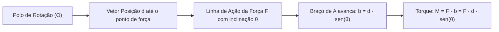
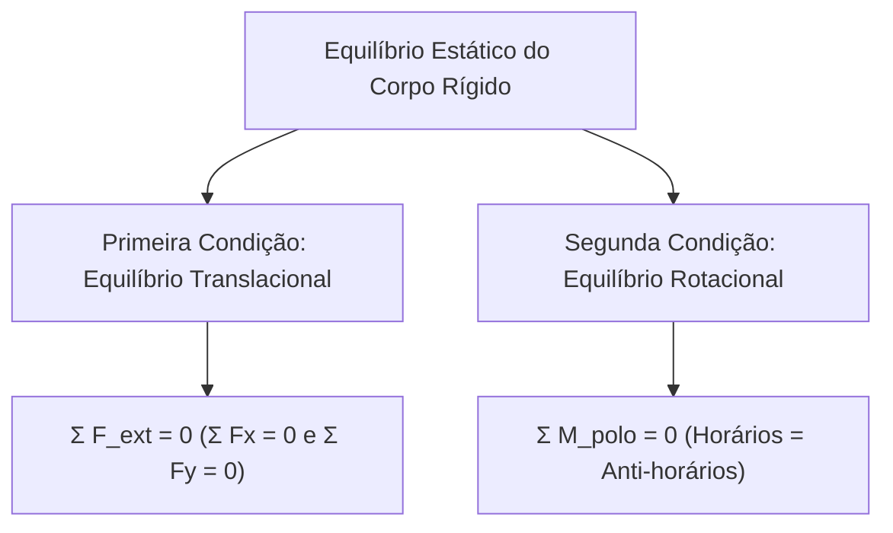
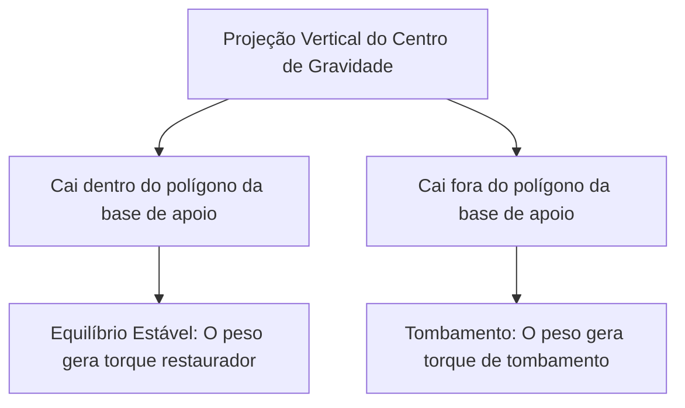
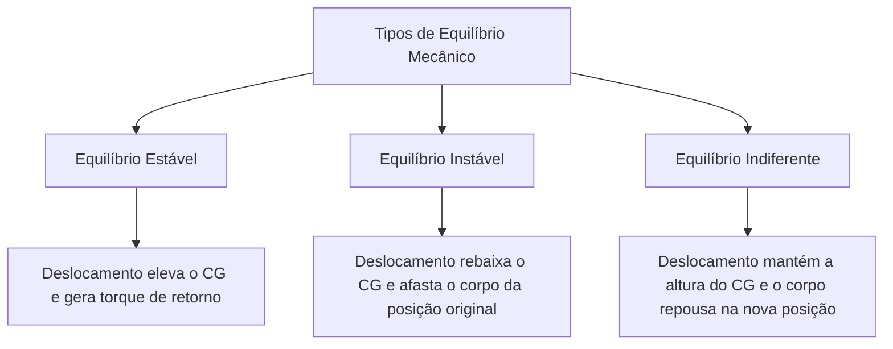
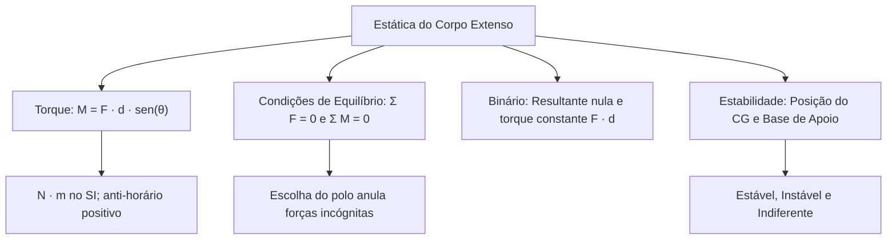

Quando as dimensões de um corpo influenciam as forças atuantes, o modelo de ponto material torna-se insuficiente. Em corpos extensos, as forças podem produzir translações e giros em torno de eixos fixos ou móveis. Para assegurar o repouso mecânico completo de vigas, escadas, guindastes e viaturas operacionais, a física exige o controle simultâneo da resultante de forças e da resultante de momentos de rotação. Este capítulo aborda o torque, o teorema das três forças, a estabilidade física e a localização do centro de gravidade.

> [!objetivos]
> - Definir o momento de uma força (torque) e a regra do braço de alavanca.
> - Aplicar a convenção de sinais para momentos de rotação horários e anti-horários.
> - Estabelecer as duas condições simultâneas de equilíbrio estático do corpo rígido.
> - Compreender a dinâmica do binário de forças e suas vantagens mecânicas.
> - Classificar os tipos de equilíbrio e determinar a estabilidade pelo centro de gravidade.

## Momento de uma Força ou Torque

O momento de uma força, também conhecido como torque, mede a eficiência com que uma força externa é capaz de produzir a rotação de um corpo em torno de um determinado eixo ou ponto de apoio (polo O).

A intensidade do torque depende de três fatores mecânicos: a intensidade da força F aplicada, a distância d entre o ponto de aplicação da força e o eixo de giro (vetor posição), e o ângulo θ formado entre a linha de ação da força e a haste:

M = F · d · sen(θ)

Define-se como braço de alavanca (b) a distância perpendicular traçada do polo até a linha de ação da força: b = d · sen(θ). Portanto, o torque pode ser formulado de maneira compacta:

M = F · b

No Sistema Internacional (SI), o torque é medido em newton-metro (N · m). Embora compartilhe as mesmas dimensões da energia mecânica em joules (N · m), o torque não é trabalho nem calor. Ele representa um esforço de rotação vetorial. Por convenção tradicional, o torque é considerado positivo quando tende a girar o corpo no sentido anti-horário, e negativo quando tende a girá-lo no sentido horário.

| Condição Angular (θ) | Fator sen(θ) | Valor do Torque (M) | Significado Físico Operacional |
| --- | --- | --- | --- |
| Força Perpendicular (θ = 90°) | 1 | M = F · d (Máximo) | Maior facilidade para abrir portas ou girar porcas |
| Força Inclinada (0° < θ < 90°) | Entre 0 e 1 | M = F · d · sen(θ) | Eficiência rotacional reduzida pela inclinação |
| Força Paralela à Haste (θ = 0°) | 0 | M = 0 (Nulo) | A força puxa ou empurra o eixo sem girar |

Para maximizar o torque com a menor força muscular possível, o operador deve aplicar o esforço no ponto mais distante do polo e sob ângulo estritamente perpendicular. É por esse princípio que as maçanetas das portas são instaladas na borda oposta às dobradiças. Do mesmo modo, cabos longos em chaves de roda facilitam a soltura de parafusos presos.

## Condições de Equilíbrio do Corpo Extenso

Para que um corpo rígido permaneça em repouso estático absoluto, a anulação da resultante de forças não é suficiente. Um disco pode ter resultante de forças nula e continuar girando aceleradamente. Por conseguinte, o equilíbrio estático completo impõe duas condições fundamentais e independentes:

1. Equilíbrio translacional: a resultante vetorial de todas as forças externas deve ser zero:
Σ F_ext = 0, desdobrando-se em Σ Fx = 0 e Σ Fy = 0.
2. Equilíbrio rotacional: a soma algébrica dos momentos de todas as forças externas em relação a qualquer polo O escolhido deve ser zero:
Σ M_polo = 0, o que equivale a afirmar que a soma dos torques anti-horários iguala a soma dos torques horários.

A escolha estratégica do polo de cálculo simplifica a resolução de problemas em provas. Ao escolher o polo exatamente sobre o ponto onde atua uma força desconhecida, a distância d dessa força até o polo torna-se nula. Seu torque anula-se, eliminando uma incógnita da equação dos momentos.

| Parâmetro de Equilíbrio | Equação Vetorial | Equações Escalares no Plano | Efeito Impedido |
| --- | --- | --- | --- |
| Equilíbrio Translacional | Σ F = 0 | Σ Fx = 0 e Σ Fy = 0 | Impede aceleração linear |
| Equilíbrio Rotacional | Σ M = 0 | Σ M_horários = Σ M_anti-horários | Impede aceleração angular |

> [!resolvido] Barra Homogênea em Equilíbrio Horizontal
> **Enunciado:** Uma barra homogênea de comprimento L = 4,0 m e peso P̄ = 200 N está apoiada horizontalmente em suas extremidades A e B. Um bloco com peso P_bloco = 300 N é colocado a 1,0 m do apoio A. Determine as reações normais de sustentação nos apoios A e B.
>
> **Resolução passo a passo:**
> 1. Como a barra é homogênea, seu peso próprio atua exatamente no centro geométrico (x = 2,0 m de A).
> 2. Fixamos o polo de rotação no apoio A para anular o momento da reação Na.
> 3. Aplicamos a condição dos momentos em relação ao polo A (Σ M_A = 0):
> O peso do bloco tenta girar a barra no sentido horário: M1 = - 300 · 1,0 = - 300 N · m.
> O peso da barra tenta girar no sentido horário: M2 = - 200 · 2,0 = - 400 N · m.
> A reação normal Nb atua para cima no sentido anti-horário: M3 = + Nb · 4,0.
> 4. Igualamos a soma dos momentos a zero:
> Nb · 4,0 - 300 - 400 = 0 => Nb · 4,0 = 700 => Nb = 175 N.
> 5. Aplicamos a condição de equilíbrio vertical (Σ Fy = 0):
> Na + Nb - P_bloco - P̄ = 0 => Na + 175 - 300 - 200 = 0 => Na = 325 N.
> 6. As reações normais são Na = 325 N e Nb = 175 N.

## Binário de Forças e Teorema das Três Forças

Em mecânica aplicada, configurações especiais de forças apresentam propriedades de alto rendimento operacional:

### O Binário de Forças

Um binário, ou par de forças, é constituído por duas forças de mesma intensidade F, direções estritamente paralelas e sentidos opostos, cujas linhas de ação distam entre si por um espaçamento perpendicular d.

A resultante vetorial de um binário é identicamente nula:

Σ F = F + (-F) = 0

Portanto, um binário é incapaz de provocar qualquer translação linear no corpo. Entretanto, a soma dos momentos dessas forças nunca é zero. O torque produzido pelo binário vale:

M_binário = F · d

Uma propriedade notável do binário reside no fato de seu torque total ser rigorosamente independente do polo de cálculo escolhido. Seja qual for o referencial no plano, o torque do par mantém-se constante e igual a F · d.

Em operações com chaves de roda (chave em cruz), acionar as duas extremidades com as duas mãos aplicando forças opostas F constitui um binário. Esse procedimento exige metade da força muscular que seria exigida com uma única mão aplicada na mesma distância para produzir o mesmo torque desapertador.

### Teorema das Três Forças Concorrentes

Quando um corpo rígido se encontra em equilíbrio sob a ação exclusiva de três forças coplanares não paralelas, as linhas de ação dessas três forças devem obrigatoriamente convergir para um único ponto comum de interseção (ponto concorrente).

Se duas forças se cruzam em um ponto espacial P e a terceira força não passar por P, o momento resultante dessa terceira força em relação a P não poderá ser equilibrado, quebrando o repouso. O ponto de concurso pode localizar-se fora do próprio perímetro do corpo material analisado.

| Conceito Mecânico | Configuração Geométrica | Força Resultante | Torque Resultante | Aplicação Prática |
| --- | --- | --- | --- | --- |
| Binário | Duas forças paralelas e opostas | Nula (Σ F = 0) | Constante (M = F · d) | Volantes de veículos e chave em cruz |
| Três Forças Concorrentes | Linhas de ação cruzam-se no mesmo ponto | Nula (Σ F = 0) | Nulo no ponto comum | Escadas apoiadas e mastros ancorados |

> [!exemplo] Resgate de Veículo Tombado
> Em intervenções de busca e salvamento do Corpo de Bombeiros, o destombamento de viaturas pesadas baseia-se na física do torque. Para girar o veículo em torno do ponto de pivô com o solo gastando o menor esforço no guincho:
> 1. Ancorar o cabo no ponto estrutural mais alto possível da viatura (aumentando a distância d até o ponto de pivô no solo).
> 2. Tracionar o cabo na direção mais perpendicular possível à linha de apoio (maximizando sen(θ) e o braço de alavanca).
> 3. Posicionar o guincho afastado do veículo, assegurando ângulo mecânico favorável e segurança perimetral da equipe.

## Centro de Gravidade e Estabilidade do Equilíbrio

O centro de gravidade (CG) é o ponto geométrico de aplicação da força peso resultante que a gravidade exerce sobre todos os elementos de massa de um corpo. Em corpos imersos em campos gravitacionais uniformes, o centro de gravidade coincide espacialmente com o centro de massa (CM).

Em sólidos homogêneos dotados de simetria geométrica (esferas, cilindros, retângulos, barras regulares), o centro de gravidade situa-se exatamente em seu centro geométrico.

Para corpos apoiados sobre superfícies horizontais, a estabilidade física depende da linha vertical que passa pelo centro de gravidade:

Enquanto a reta vertical traçada a partir do centro de gravidade cortar a área delimitada pela base de apoio, o corpo permanecerá em equilíbrio. Se a inclinação fizer a linha vertical cair fora dos limites da base, o torque do próprio peso provocará o tombamento do corpo.

### Equilíbrio Estável

Se o corpo sofre um pequeno deslocamento angular, seu centro de gravidade eleva-se levemente. O peso cria um torque restaurador que tende a trazer a estrutura de volta à postura primitiva. Exemplo: um pêndulo suspenso ou uma esfera no fundo de uma bacia côncava.

### Equilíbrio Instável

Se o corpo sofre uma leve perturbação, seu centro de gravidade rebaixa-se. O peso gera um torque instabilizador que afasta o corpo ainda mais da posição original, culminando na queda. Exemplo: um lápis equilibrado sobre sua ponta afiada ou uma esfera no topo de uma calota esférica convexa.

### Equilíbrio Indiferente

Ao ser deslocado ligeiramente, o centro de gravidade mantém-se sempre à mesma altura horizontal. O corpo não desenvolve torques restauradores nem instabilizadores, repousando na nova posição com a mesma tranquilidade. Exemplo: uma esfera homogênea apoiada sobre uma mesa plana perfeitamente horizontal.

> [!pegadinha] Centro de Gravidade Rebaixado e Boneco Teimoso
> O boneco joão-bobo nunca tomba porque sua base arredondada contém uma massa de chumbo pesada no fundo. Isso posiciona o centro de gravidade muito abaixo do centro geométrico. Ao inclinar o brinquedo, o ponto de apoio desloca-se lateralmente mais rápido que o CG, gerando um torque restaurador automático.

> [!bizu] Barra com Fio no Ponto Médio
> Em uma barra homogênea articulada à parede com um tirante horizontal preso ao seu ponto médio e sustentando uma carga m na ponta, a reação vertical da parede depende exclusivamente do peso do bloco suspenso e independe da massa da barra, pois a tração no ponto médio suporta integralmente o peso próprio da barra.

## Mapa do capítulo

### Para fixar

- O torque mede a eficácia rotacional de uma força e calcula-se por M = F · d · sen(θ).
- Forças perpendiculares ao braço produzem torque máximo; forças que cruzam o polo não geram torque.
- O equilíbrio do corpo extenso exige simultaneamente resultante de forças nula e resultante de torques nula.
- A escolha do polo sobre pontos com forças desconhecidas cancela o torque dessas forças na equação.
- O binário anula a translação (Σ F = 0), mas gera torque puro M = F · d independente do polo.
- No teorema das três forças em equilíbrio, as linhas de ação concorrem em um único ponto geométrico.
- O equilíbrio é estável quando o deslocamento eleva o CG, instável quando rebaixa, e indiferente quando mantém a altura.
