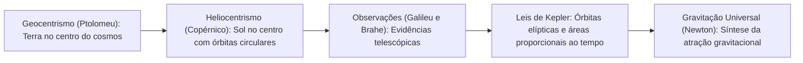
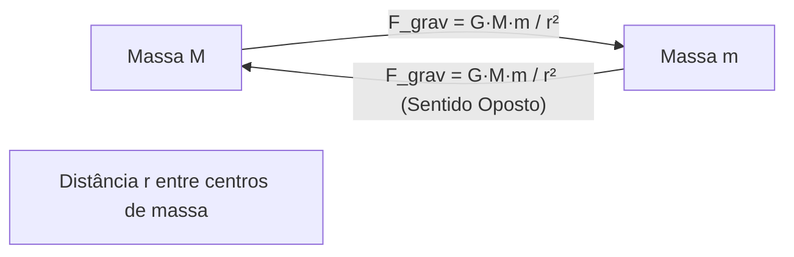
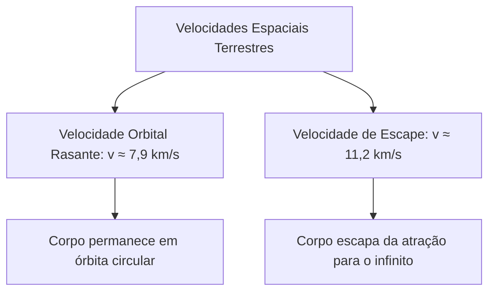
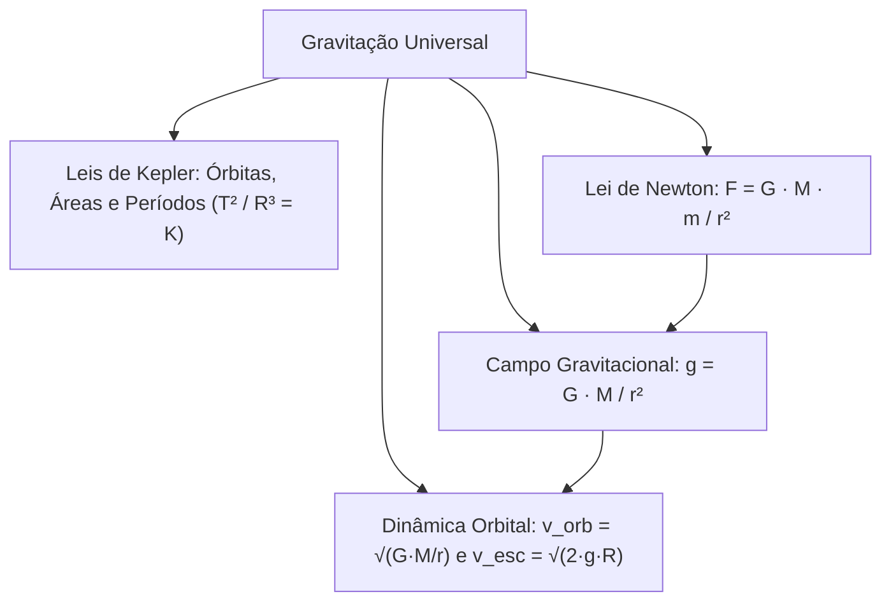

A gravitação governa o movimento dos corpos celestes no universo. Ela comanda desde a queda de maçãs até a órbita de galáxias inteiras. Historicamente, a ciência evoluiu do modelo geocêntrico para o heliocêntrico. Johannes Kepler descobriu as leis empíricas das órbitas planetárias. Ele utilizou observações precisas feitas por Tycho Brahe. Mais tarde, Isaac Newton unificou a mecânica terrestre e a celeste. Ele formulou a Lei da Gravitação Universal. Este capítulo estuda as leis orbitais, o campo gravitacional e o escape de planetas.

> [!objetivos]
> - Compreender a evolução histórica dos modelos cosmológicos geocêntrico e heliocêntrico.
> - Dominar as três leis de Kepler e suas consequências para órbitas planetárias.
> - Aplicar a Lei da Gravitação Universal de Newton na atração entre massas.
> - Calcular a aceleração da gravidade na superfície e em altitudes elevadas.
> - Determinar a velocidade de satélites em órbita circular e a velocidade de escape.

## Concepções Cosmológicas e as Leis de Kepler

Durante séculos, a astronomia adotou o sistema geocêntrico de Ptolomeu. A Terra ficava parada no centro do cosmos. Esferas celestes transparentes giravam ao seu redor. No século XVI, Nicolau Copérnico propôs o heliocentrismo. Ele colocou o Sol no centro do sistema. Mais tarde, Galileu Galilei trouxe fortes evidências telescópicas. Ele observou as luas de Júpiter e as fases de Vênus.

Tycho Brahe acumulou dados astronômicos de alta precisão. Johannes Kepler analisou esses registros minuciosos. Ele descobriu que as órbitas não eram círculos perfeitos. Kepler publicou suas três leis fundamentais entre 1609 e 1619:

### Primeira Lei de Kepler (Lei das Órbitas)

As órbitas dos planetas ao redor do Sol são elipses. O Sol ocupa um dos focos dessa figura geométrica. O outro foco permanece sempre vazio.

A elipse é uma curva fechada no plano. Nela, a soma das distâncias de cada ponto aos dois focos é constante: d1 + d2 = 2 · a, onde a é o semi-eixo maior.

### Segunda Lei de Kepler (Lei das Áreas)

O raio vetor une o centro do Sol ao centro do planeta. Esse segmento imaginário varre áreas iguais em intervalos de tempo iguais:

Área / Δt = constante

A taxa temporal da área varrida chama-se velocidade areolar. Essa lei gera consequências dinâmicas fundamentais:

- Periélio: ponto de máxima aproximação do Sol. O raio vetor é mais curto. Para compensar, o planeta desloca-se com rapidez máxima. Na Terra, ela chega a 30,3 km/s.
- Afélio: ponto de maior afastamento do Sol. O raio vetor é mais longo. O planeta desloca-se com rapidez mínima, cerca de 29,3 km/s na Terra.
- Natureza do movimento: no trajeto do afélio para o periélio, o movimento planetário é acelerado. Do periélio para o afélio, o movimento é retardado.

### Terceira Lei de Kepler (Lei dos Períodos)

O quadrado do período de translação (T) é proporcional ao cubo do raio médio (R):

T² / R³ = K

O raio médio orbital equivale à média aritmética das distâncias extremas: R = (R_afélio + R_periélio) / 2. A constante K é a mesma para todos os corpos em torno do mesmo astro central. Corpos com órbitas maiores gastam mais tempo para cumprir uma volta completa.

| Lei de Kepler | Nome Consagrado | Expressão Matemática | Implicação Física Direta |
| --- | --- | --- | --- |
| 1ª Lei | Lei das Órbitas | Órbitas elípticas | O Sol ocupa um foco; distância Sol-planeta varia |
| 2ª Lei | Lei das Áreas | Área / Δt = constante | Velocidade máxima no periélio e mínima no afélio |
| 3ª Lei | Lei dos Períodos | T² / R³ = constante | Planetas mais distantes gastam períodos mais longos |

## Lei da Gravitação Universal e Campo Gravitacional

Isaac Newton unificou a física dos céus e da Terra. Ele percebeu que a atração gravitacional causa a queda dos corpos e segura a Lua em sua órbita. Desse modo, formulou a Lei da Gravitação Universal:

Dois corpos atraem-se com força proporcional ao produto de suas massas. Essa força é inversamente proporcional ao quadrado da distância entre seus centros:

F = G · (M · m) / (r²)

A constante de gravitação universal G é expressa no SI por:

G ≈ 6,67 · 10^(-11) N · m² / kg²

A atração obedece à terceira lei de Newton. A força exercida pela massa M sobre m tem a mesma intensidade da força exercida por m sobre M. Elas formam um par de ação e reação com sentidos opostos.

### Aceleração da Gravidade em Superfície e Altitude

O campo gravitacional (g) mede a força sentida por unidade de massa. Igualando o peso à atração gravitacional:

m · g = G · (M · m) / (r²) => g = G · M / (r²)

Na superfície do planeta esférico de raio R, temos:

g0 = G · M / (R²)

A uma altitude h acima do solo, a distância ao centro vale r = R + h:

g(h) = G · M / ((R + h)²)

O campo gravitacional enfraquece depressa com a altitude. A uma altura h = R (distância 2R do centro), a gravidade cai para um quarto do valor da superfície: g = g0 / 4.

A rotação do planeta também altera o peso aparente. No equador, a inércia centrífuga atua com intensidade máxima. Isso reduz o valor da gravidade medida. Nos polos geográficos, o efeito rotacional é nulo e a gravidade é máxima. O peso varia com o local, mas a massa do corpo permanece constante.

| Localização do Objeto | Distância ao Centro (r) | Aceleração da Gravidade | Peso Relativo |
| --- | --- | --- | --- |
| Superfície nos Polos | r = R | g_máx = G · M / R² | Máximo na superfície terrestre |
| Superfície no Equador | r = R | g_mín = G · M / R² - ω² · R | Mínimo na superfície terrestre |
| Altitude h = R | r = 2 · R | g = g0 / 4 | Um quarto do peso do solo |
| Altitude h = 2 · R | r = 3 · R | g = g0 / 9 | Um nono do peso do solo |

> [!pegadinha] Peso versus Massa em Gravitação
> A massa mede a inércia do corpo e independe do local. O peso é a força de atração exercida pelo campo gravitacional (P = m · g). Na Lua, a massa do astronauta continua a mesma, mas seu peso cai para um sexto.

## Corpos em Órbita, Energia e Velocidade de Escape

Em uma órbita circular estável, a força gravitacional atua como resultante centrípeta.

### Velocidade Orbital e Satélite Geoestacionário

Igualando a atração gravitacional à força centrípeta:

F_grav = F_cp => G · (M · m) / (r²) = (m · v_orb²) / r

Cancelando a massa m e simplificando o raio r, obtém-se:

v_orb = √(G · M / r)

A velocidade do satélite depende apenas da massa central M e do raio orbital r. Quanto mais distante da Terra, menor é a velocidade linear e maior é o período. Para um satélite rasante que voa rente à superfície:

v_rasante = √(G · M / R) = √(g0 · R) ≈ 7,9 km/s

O período orbital (T) é o tempo necessário para uma volta completa:

T = 2 · π · r / v_orb = 2 · π · √(r³ / (G · M))

O satélite geoestacionário possui período orbital de 24 horas. Ele gira no plano equatorial da Terra, no mesmo sentido de rotação do planeta. Visto do solo, o satélite parece imóvel no céu.

### Energia Potencial Gravitacional e Velocidade de Escape

No espaço cósmico, adota-se potencial nulo no infinito. Assim, a energia potencial gravitacional em pontos finitos é negativa:

Ep = - G · (M · m) / r

O sinal negativo indica que o sistema está ligado. Devemos injetar energia para afastar o corpo até o infinito.

A energia mecânica total em órbita circular resulta da soma das parcelas:

Emec = Ec + Ep = - G · (M · m) / (2 · r) = Ep / 2 = - Ec

A velocidade de escape (v_esc) é a menor rapidez para vencer o campo e atingir o infinito:

Emec(inicial) = 0 => (m · v_esc²) / 2 - G · (M · m) / R = 0

v_esc = √(2 · G · M / R) = √(2 · g0 · R) = √2 · v_rasante

Na Terra, a velocidade de escape vale cerca de 11,2 km/s (alguns textos usam 11,3 km/s). Ela não depende da massa do objeto lançado nem do ângulo de lançamento.

> [!resolvido] Aceleração da Gravidade em Grande Altitude
> **Enunciado:** O raio médio da Terra é R e a gravidade na superfície é g0 = 10 m/s². Calcule a aceleração da gravidade a uma altitude h = 3 · R da superfície.
>
> **Resolução passo a passo:**
> 1. A distância ao centro do planeta vale r = R + h = R + 3 · R = 4 · R.
> 2. Pela Lei da Gravitação: g = G · M / (r²) = G · M / (16 · R²).
> 3. Como g0 = G · M / (R²), encontramos g = g0 / 16.
> 4. Substituindo o valor numérico: g = 10 / 16 = 0,625 m/s².
> 5. A gravidade nessa altitude vale 0,625 m/s².

> [!bizu] Relação Rápida entre Velocidade Orbital e Escape
> Em qualquer planeta esférico, a velocidade de escape é a velocidade orbital rasante multiplicada por raiz de 2: v_escape = √2 · v_orbital.

## Mapa do capítulo

### Para fixar

- As leis de Kepler estabelecem órbitas elípticas, velocidade areolar constante e proporção T² / R³ constante.
- No periélio a velocidade planetária é máxima; no afélio a velocidade é mínima.
- A força gravitacional diminui com o quadrado da distância: F = G · M · m / r².
- A aceleração gravitacional reduz-se com a altitude segundo g = G · M / ((R + h)²).
- A velocidade de satélites em órbita circular calcula-se por v_orb = √(G · M / r).
- Satélites geoestacionários possuem período de 24 horas e orbitam sobre a linha equatorial.
- A velocidade de escape na Terra vale cerca de 11,2 km/s e independe da massa do projétil lançado.
