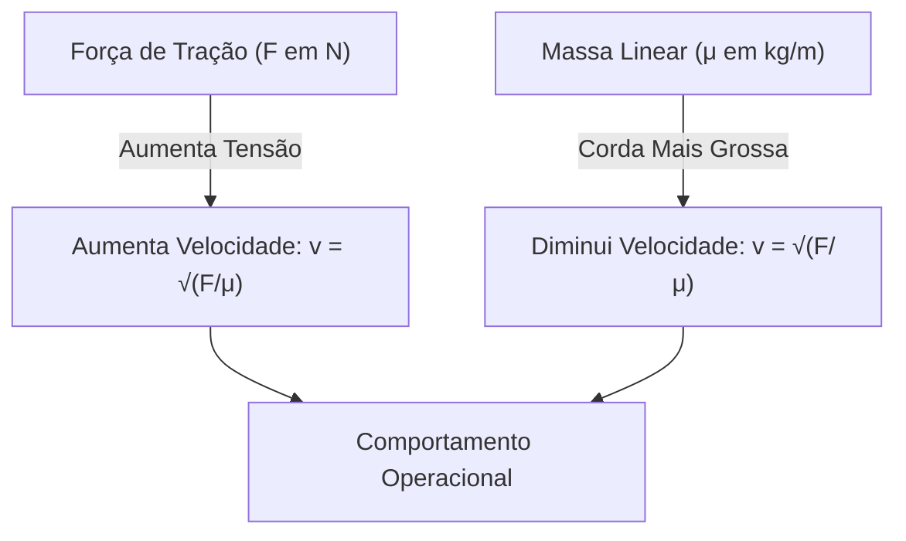
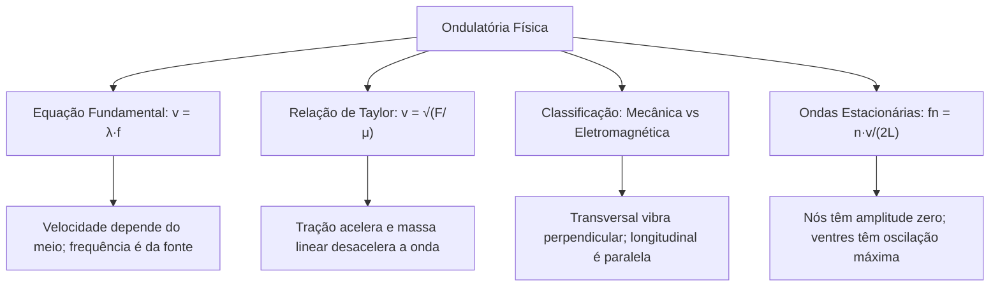

O estudo do movimento ondulatório é indispensável para as atividades operacionais do Corpo de Bombeiros e da segurança pública. As comunicações de rádio, os radares de busca e a detecção de vítimas por sonar dependem das leis físicas das ondas. Toda onda transporta energia e quantidade de movimento sem transportar matéria. Quando uma perturbação mecânica percorre um meio material, as partículas apenas vibram em torno de suas posições médias de equilíbrio. Elas não são arrastadas junto com a perturbação. Este capítulo aborda a natureza dos pulsos e ondas periódicas. Você estudará as grandezas fundamentais da oscilação, a equação de propagação, a velocidade em cordas e a formação de ondas estacionárias.

> [!objetivos]
> - Diferenciar ondas mecânicas e eletromagnéticas quanto à necessidade de meio material.
> - Relacionar período, frequência, amplitude e comprimento de onda pela equação fundamental.
> - Calcular a velocidade de propagação em cordas sob tração pela relação de Taylor.
> - Classificar as ondas quanto à direção de vibração e às dimensões espaciais.
> - Compreender a transmissão de energia e a formação de harmônicos em ondas estacionárias.

## Conceitos Fundamentais de Ondas (Ondas)

Uma onda é uma perturbação física que se propaga no espaço transportando energia mecânica ou eletromagnética. O ponto central da física ondulatória estabelece que nenhuma onda transporta matéria de um ponto a outro.

Um pulso consiste em uma perturbação única e isolada que viaja por um meio elástico. Uma sucessão contínua de pulsos regulares produzida por uma fonte periódica constitui um trem de ondas contínuo.

Quanto à natureza física da perturbação, as ondas dividem-se em dois grandes grupos:

1. Ondas mecânicas: exigem um meio material contínuo e elástico para existir. A propagação ocorre por forças de interação molecular. O som, os pulsos em cordas esticadas e as ondas em superfícies líquidas são ondas mecânicas. Nenhuma onda mecânica se propaga no vácuo.
2. Ondas eletromagnéticas: resultam da oscilação coordenada e perpendicular entre um campo elétrico e um campo magnético. Essas ondas não dependem de suporte material. Elas viajam no vácuo com velocidade c ≈ 3,0 · 10⁸ m/s. Exemplos cotidianos incluem a luz visível, os raios infravermelhos e as micro-ondas.

> [!pegadinha]
> As bancas costumam afirmar que a matéria se desloca no sentido da onda. Em uma corda esticada na horizontal, os pedaços de corda apenas sobem e descem. Eles executam oscilações na direção vertical. Apenas a forma da perturbação e a energia avançam horizontalmente.

## Grandezas de uma Onda (Pulsos e ondas)

A descrição analítica de um trem de ondas periódico utiliza grandezas espaciais e temporais bem definidas.

| Grandeza Física | Símbolo | Descrição da Propriedade | Unidade no SI |
|---|---|---|---|
| Crista | - | Ponto mais elevado da onda acima do repouso | metro (m) |
| Vale | - | Ponto mais rebaixado da onda abaixo do repouso | metro (m) |
| Amplitude | A | Afastamento máximo em relação ao eixo médio | metro (m) |
| Comprimento de onda | λ | Distância mínima entre dois pontos em fase | metro (m) |
| Período | T | Duração de um ciclo completo de oscilação | segundo (s) |
| Frequência | f | Quantidade de ciclos executados por segundo | hertz (Hz) |

O comprimento de onda (λ) mede o tamanho espacial de uma repetição completa da onda. Ele corresponde à distância horizontal entre duas cristas sucessivas. Ele também pode ser medido entre dois vales consecutivos.

O período (T) representa o intervalo de tempo necessário para que um ponto do meio realize uma oscilação inteira de vaivém. É também o tempo gasto pela onda para avançar a distância de um comprimento de onda.

A frequência (f) indica o ritmo temporal da fonte oscilatória. Ela expressa a quantidade de ciclos por unidade de tempo:

f = 1 / T

T = 1 / f

Quando a frequência é medida em ciclos por segundo, ela recebe a unidade hertz (Hz). Se uma partícula oscila 50 vezes em 10 segundos, sua frequência é de 5 Hz. O período correspondente é de 0,20 segundo.

## Velocidade de Propagação e a Equação Fundamental

A velocidade de propagação (v) mede a rapidez com que a crista da onda avança pelo espaço. Em um intervalo de tempo igual a um período (T), a onda percorre exatamente a distância de um comprimento de onda (λ).

A divisão do espaço pelo tempo fornece a expressão:

v = λ / T

Como a frequência é o inverso do período, obtém-se a equação fundamental da ondulatória:

v = λ · f

Esta equação possui validade universal na física clássica. Ela se aplica a ondas mecânicas, acústicas, sísmicas e luminosas.

Dois postulados regem o comportamento dessa relação:

1. A velocidade é determinada pelas propriedades físicas do meio. Enquanto o meio de propagação for homogêneo e mantiver suas condições termodinâmicas, a velocidade da onda permanece constante.
2. A frequência depende exclusivamente da fonte que gera a onda. Ao penetrar em um meio diferente, a onda mantém inalterada a sua frequência original. Se a velocidade mudar no novo meio, o comprimento de onda varia proporcionalmente.

> [!resolvido]
> Um equipamento de sonar subaquático de busca opera com frequência de 600 Hz. O sinal sonoro se propaga na água com velocidade de 1500 m/s. Ao atingir uma bolsa de gás no interior de uma embarcação naufragada, a velocidade do som cai para 300 m/s. Determine o comprimento de onda do sinal sonoro na água e no gás.
>
> Resolução:
> Na água, a frequência vale 600 Hz e a velocidade é 1500 m/s.
> λ_água = v_água / f = 1500 / 600 = 2,5 metros.
>
> Ao passar para o gás, a frequência permanece 600 Hz por imposição da fonte oscilatória.
> λ_gás = v_gás / f = 300 / 600 = 0,5 metro.
>
> A velocidade caiu para a quinta parte. O comprimento de onda também encolheu para a quinta parte.

## A Relação de Taylor e Propagação em Fios

Em uma corda homogênea sob tração mecânica, a velocidade dos pulsos transversais depende de duas características: a força de tração e a inércia do fio.

A densidade linear de massa (μ) representa a distribuição de massa pelo comprimento do fio:

μ = m / L

No Sistema Internacional, a massa (m) deve estar em quilogramas e o comprimento (L) em metros. A unidade resultante é o kg/m.

A relação de Taylor define a velocidade da onda transversal na corda:

v = √(F / μ)

Nesta equação, F é a força de tração medida em newtons (N) e μ é a densidade linear medida em kg/m.

A análise da fórmula de Taylor indica regras importantes para o cálculo:

- A velocidade é diretamente proporcional à raiz quadrada da tração. Para duplicar a velocidade da onda, a força de tração precisa ser multiplicada por quatro.
- A velocidade é inversamente proporcional à raiz quadrada da densidade linear. Mantida a mesma força de tração, cordas mais finas e leves transmitem a onda com maior rapidez que cordas pesadas.

> [!exemplo]
> Um cabo de aço de salvamento com 20 metros de comprimento tem massa de 5,0 kg. O cabo é tracionado com uma força de 400 N por um guincho mecânico.
> A densidade linear do cabo vale: μ = 5,0 / 20 = 0,25 kg/m.
> A velocidade dos pulsos transversais vale: v = √(400 / 0,25) = √1600 = 40 m/s.

## Classificação das Ondas nos Meios (Classificação das ondas em cordas)

As ondas são classificadas formalmente segundo a direção de vibração e as dimensões geométricas de sua propagação.

### Classificação quanto à direção de vibração

- Ondas transversais: as partículas do meio vibram em uma direção perpendicular à propagação da energia. Exemplos: ondas em cordas tensas e todas as ondas eletromagnéticas. As ondas transversais podem sofrer o fenômeno da polarização.
- Ondas longitudinais: as partículas do meio vibram na mesma direção em que a onda se propaga. A propagação ocorre por compressões e rarefações do meio elástico. Exemplo: as ondas sonoras nos fluidos (ar e água). Ondas longitudinais nunca podem ser polarizadas.
- Ondas mistas: combinam vibrações longitudinais e transversais simultâneas. As partículas materiais descrevem trajetórias circulares ou elípticas. Ocorrem nas ondas da superfície da água e em tremores sísmicos.

### Classificação quanto às dimensões de propagação

- Unidimensionais: propagam-se ao longo de uma linha reta ou fio linear. Exemplos: pulsos em cordas esticadas e molas helicoidais.
- Bidimensionais: propagam-se sobre superfícies planas em duas direções. Exemplo: ondas geradas na superfície de um reservatório de água.
- Tridimensionais: propagam-se em todas as direções espaciais a partir da fonte. As frentes de onda formam esferas expansivas concêntricas. Exemplos: ondas sonoras no ar e ondas luminosas de lâmpadas.

| Critério | Categoria | Sentido Físico | Exemplo |
|---|---|---|---|
| Vibração | Transversal | Vibração perpendicular ao avanço | Corda esticada |
| Vibração | Longitudinal | Vibração paralela ao avanço | Som no ar |
| Dimensões | Unidimensional | Linha linear simples | Cabo sob tração |
| Dimensões | Bidimensional | Plano de duas direções | Onda na água |
| Dimensões | Tridimensional | Espaço em todas as direções | Som de sirene |

Uma onda em uma corda de instrumento musical é uma onda mecânica, transversal e unidimensional.

## Energia Transmitida pelas Ondas (Energia transmitida pelas ondas)

A geração de um trem de ondas exige a realização contínua de trabalho mecânico pela fonte osciladora. A energia fornecida é transmitida de partícula para partícula por forças de coesão elásticas.

Em um meio ideal perfeitamente conservativo, a energia total permanece constante durante a viagem da onda.

A energia mecânica média associada à oscilação das partículas apresenta duas dependências fundamentais:

1. A energia é diretamente proporcional ao quadrado da amplitude da onda (E ∝ A²). Se a amplitude for dobrada, a energia associada quadruplica.
2. A energia é diretamente proporcional ao quadrado da frequência de oscilação (E ∝ f²). A elevação da frequência exige mais esforço da fonte por segundo e eleva a taxa de transferência energética.

Para uma corda homogênea com densidade linear μ, a potência média transportada pela onda sob frequência angular ω = 2πf e amplitude A é expressa por:

P_média = (1/2) · μ · v · ω² · A²

onde v representa a velocidade de propagação longitudinal da onda no fio.

> [!atencao]
> Duplicar a frequência de uma onda quadruplica a potência média necessária para sustentá-la. Esse princípio explica por que sons agudos e radiações eletromagnéticas de frequência alta demandam mais energia das fontes geradoras.

## Ondas Estacionárias em Cordas (Ondas estacionárias)

Quando uma onda periódica atinge a extremidade fixa de uma corda, ela sofre reflexão com inversão de fase. A onda incidente e a onda refletida apresentam frequências idênticas, comprimentos de onda coincidentes e igual amplitude de oscilação, propagando-se em sentidos opostos.

A superposição contínua dessas duas ondas viajantes produz uma onda estacionária.

Uma onda estacionária não transporta energia longitudinalmente. A energia fica armazenada entre os limites geométricos do sistema.

Uma onda estacionária apresenta dois tipos fundamentais de regiões:

- Nós (nodos): pontos espaciais fixos que permanecem em repouso contínuo com amplitude resultante nula por interferência destrutiva total.
- Ventres (antinodos): regiões de oscilação máxima que atingem amplitude dupla (2A) por interferência construtiva total.

A distância espacial entre dois nós consecutivos é sempre igual a meio comprimento de onda (λ / 2). A distância entre um nó e o ventre vizinho mais próximo é igual a um quarto de comprimento de onda (λ / 4).

Em uma corda de comprimento L com ambas as extremidades presas, os extremos são necessariamente nós. Para haver ressonância estacionária, o comprimento da corda deve acomodar um número inteiro de meios comprimentos de onda:

L = n · (λ / 2)

onde n = 1, 2, 3, 4, ... representa a ordem do harmônico.

Isolando o comprimento de onda do n-ésimo harmônico:

λn = 2 · L / n

Aplicando a equação fundamental da velocidade (v = λ · f), as frequências dos modos permitidos de vibração resultam em:

fn = n · v / (2 · L)

Para o primeiro harmônico (n = 1), denominado modo fundamental de vibração:

f₁ = v / (2 · L)

As frequências de todos os harmônicos superiores são múltiplos inteiros da frequência fundamental:

fn = n · f₁

| Modo Harmônico | Número de Ventres | Número de Nós | Comprimento λn | Frequência fn |
|---|---|---|---|---|
| 1º Harmônico (Fundamental) | 1 | 2 | 2·L | v / (2·L) = f₁ |
| 2º Harmônico | 2 | 3 | L | 2·v / (2·L) = 2·f₁ |
| 3º Harmônico | 3 | 4 | 2·L / 3 | 3·v / (2·L) = 3·f₁ |
| 4º Harmônico | 4 | 5 | L / 2 | 4·v / (2·L) = 4·f₁ |
| n-ésimo Harmônico | n | n + 1 | 2·L / n | n·v / (2·L) = n·f₁ |

> [!resolvido]
> Uma corda com extremidades fixas tem comprimento de 1,20 metro e densidade linear de 0,04 kg/m. Ela é esticada por uma força de tração de 144 N. Calcule a velocidade da onda na corda e as frequências dos três primeiros harmônicos de vibração.
>
> Resolução:
> 1. Velocidade de propagação pela relação de Taylor:
> v = √(F / μ) = √(144 / 0,04) = √3600 = 60 m/s.
>
> 2. Frequência fundamental (primeiro harmônico, n = 1):
> f₁ = v / (2 · L) = 60 / (2 · 1,20) = 60 / 2,40 = 25 Hz.
>
> 3. Frequências dos harmônicos superiores:
> Segundo harmônico (n = 2): f₂ = 2 · f₁ = 2 · 25 = 50 Hz.
> Terceiro harmônico (n = 3): f₃ = 3 · f₁ = 3 · 25 = 75 Hz.

## Mapa do capítulo

### Para fixar

- Ondas transportam exclusivamente energia mecânica ou eletromagnética e quantidade de movimento sem deslocar matéria.
- Ondas mecânicas dependem de meio material elástico para viajar; ondas eletromagnéticas propagam-se no vácuo com c ≈ 3,0 · 10⁸ m/s.
- Período (T) e frequência (f) são grandezas recíprocas: f = 1/T e T = 1/f, com frequência em hertz (Hz).
- A equação fundamental v = λ·f estabelece que a velocidade depende do meio e a frequência permanece constante ao mudar de meio.
- Em cordas sob tração, a velocidade depende da relação de Taylor: v = √(F/μ), com densidade linear μ = m/L em kg/m.
- Ondas em cordas são mecânicas, transversais e unidimensionais; ondas sonoras no ar são mecânicas, longitudinais e tridimensionais.
- A energia mecânica transportada é diretamente proporcional ao quadrado da amplitude (A²) e ao quadrado da frequência (f²).
- Ondas estacionárias formam nós com amplitude zero e ventres com amplitude dupla, obedecendo à lei dos harmônicos fn = n·v/(2L).
