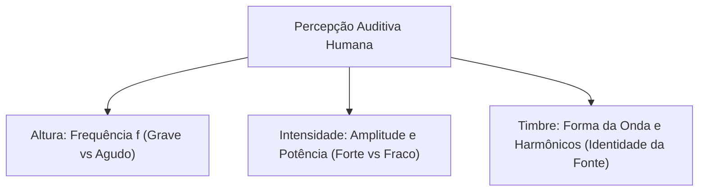
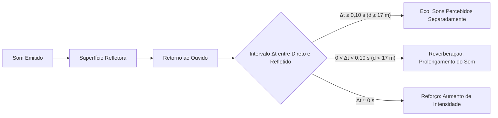
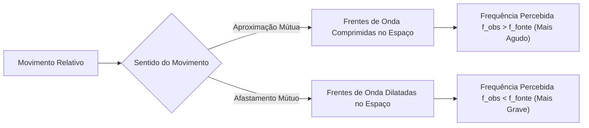
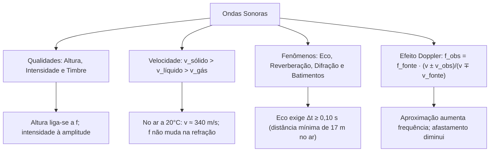

O som desempenha papel central nas comunicações humanas e nas táticas operacionais da segurança pública e do salvamento. Sirenes de viaturas de emergência, rádios comunicadores e sistemas de detecção acústica subaquática operam sob as leis da ondulatória mecânica. As ondas sonoras propagam-se por meio de variações periódicas de pressão em meios materiais elásticos. A compreensão das qualidades do som, da velocidade nos diferentes estados físicos e dos fenômenos de reflexão, refração e efeito Doppler é essencial para resolver as questões do tema. Este capítulo detalha a acústica física e aplicada. Aqui você aprenderá a relacionar intensidade, altura e timbre e a resolver questões sobre o deslocamento Doppler.

> [!objetivos]
> - Caracterizar o som como onda mecânica longitudinal e definir os limites da audição humana.
> - Diferenciar altura, intensidade e timbre como qualidades fisiológicas do som.
> - Compreender os fenômenos de eco, reverberação, reforço, refração, difração e batimentos.
> - Aplicar a equação do efeito Doppler acústico para fontes e observadores em movimento.

## Natureza e Propagação das Ondas Sonoras (Ondas sonoras)

O som é uma onda mecânica longitudinal. Sua propagação exige obrigatoriamente a presença de matéria gasosa, líquida ou sólida. O som propaga-se por meio de sucessivas regiões de compressão (onde a pressão local e a densidade aumentam) e rarefação (onde a pressão e a densidade diminuem).

Por ser uma onda puramente mecânica, o som não se propaga no vácuo. Nos filmes espaciais, as explosões estrondosas no espaço sideral violam as leis da física clássica.

O sistema auditivo humano saudável percebe ondas sonoras compreendidas em uma faixa definida de frequências:

- Infrassom: ondas com frequências abaixo de 20 Hz. São inaudíveis para o ser humano, mas percebidas por certos animais como elefantes e baleias. São geradas em abalos sísmicos e grandes erupções vulcânicas.
- Faixa audível: frequências entre 20 Hz e 20.000 Hz (20 kHz). Constitui o espectro perceptível pelo ouvido humano típico.
- Ultrassom: frequências acima de 20.000 Hz. São inaudíveis para o homem e amplamente utilizadas em exames médicos diagnósticos, sonares marítimos e sistemas de ecolocalização de morcegos.

A velocidade de propagação do som depende das propriedades de elasticidade e inércia do meio material. De maneira geral, quanto mais próximas e fortemente ligadas estiverem as moléculas, mais rápida é a transmissão da perturbação elástica.

v_sólidos > v_líquidos > v_gases

No ar seco a 20 °C, o som viaja a cerca de 340 m/s. Na água líquida, essa velocidade sobe para aproximadamente 1500 m/s. Em barras sólidas de aço, a velocidade atinge cerca de 5000 m/s.

| Meio Material | Estado Físico | Velocidade do Som (m/s) |
|---|---|---|
| Ar atmosférico (0 °C) | Gasoso | 331 |
| Ar atmosférico (20 °C) | Gasoso | 343 |
| Água doce (20 °C) | Líquido | 1482 |
| Água do mar (20 °C) | Líquido | 1522 |
| Ferro / Aço | Sólido | 5130 |
| Granito | Sólido | 6000 |

## As Três Qualidades Fisiológicas do Som (Qualidades do som)

O cérebro humano interpreta as ondas sonoras recebidas com base em três atributos fisiológicos bem definidos: altura, intensidade e timbre.

### Altura do som

A altura é a qualidade que permite classificar o som como grave ou agudo. Ela depende exclusivamente da frequência da onda sonora:

- Sons graves: possuem frequências baixas. Correspondem a oscilações lentas da fonte geradora (exemplo: contrabaixo).
- Sons agudos: possuem frequências altas. Correspondem a oscilações rápidas da fonte geradora (exemplo: apito agudo).

> [!pegadinha]
> No cotidiano, "abaixar o som" refere-se ao volume (intensidade). Na Física, abaixar o som significa torná-lo mais grave, reduzindo sua frequência. Som alto é unicamente sinônimo de som agudo (alta frequência).

### Intensidade do som

A intensidade permite classificar o som em forte ou fraco. Ela se relaciona à energia mecânica transportada por unidade de tempo e área, ligando-se à amplitude:

- Sons fortes: possuem grande amplitude de vibração e transportam muita energia.
- Sons fracos: possuem pequena amplitude de vibração e transportam pouca energia.

A intensidade física (I) de uma fonte pontual isotrópica a uma distância R vale:

I = P / (4 · π · R²)

onde P é a potência mecânica em watts (W). A unidade é W/m². Se a distância da fonte for duplicada (2·R), a intensidade sonora cai para a quarta parte (1/4).

O nível de intensidade sonora (N), medido em decibéis (dB), é expresso por:

N = 10 · log10(I / I₀)

onde I₀ = 10⁻¹² W/m² representa o limiar de audibilidade humana para 1000 Hz. O limiar da dor situa-se em 120 dB (1 W/m²).

### Timbre do som

O timbre permite ao ouvido distinguir sons de mesma frequência fundamental e mesma intensidade emitidos por fontes distintas.

Quando piano e violino tocam a nota Lá (440 Hz) na mesma intensidade, o ouvido os reconhece de imediato. Essa distinção ocorre pelas diferentes formas de onda e pelo espectro próprio de harmônicos superiores de cada instrumento.

| Qualidade Fisiológica | Grandeza Física Correspondente | Classificação Perceptiva |
|---|---|---|
| Altura | Frequência (f) | Som grave (baixa f) ou agudo (alta f) |
| Intensidade | Amplitude e Potência por Área (I) | Som forte (grande A) ou fraco (pequena A) |
| Timbre | Forma da onda e composição de harmônicos | Identificação da fonte emissora |

## A Equação Fundamental e a Refração Acústica (Equação fundamental)

Assim como em qualquer onda, o som obedece rigorosamente à equação fundamental da ondulatória:

v = λ · f

Ao passar de um meio material para outro, como do ar para a água, a frequência da onda permanece constante. A frequência é imposta pela fonte e não se altera na transição.

Como a velocidade do som varia de acordo com o meio, o comprimento de onda precisa sofrer alteração para manter o equilíbrio da equação fundamental:

λ = v / f

Na passagem do ar (v = 340 m/s) para a água (v = 1500 m/s), a velocidade do som aumenta cerca de 4,4 vezes. Consequentemente, o comprimento de onda do som na água torna-se 4,4 vezes maior que no ar.

O índice de refração acústico entre dois meios pode ser definido pela razão entre as velocidades de propagação:

n_acústico = v₁ / v₂

Na refração sonora, a mudança de velocidade provoca o desvio na direção de propagação do feixe sonoro, conforme a lei de Snell-Descartes:

sen(i) / sen(r) = v₁ / v₂

> [!exemplo]
> Durante o dia, as camadas de ar junto ao solo aquecido ficam mais quentes e menos densas que o ar em altitudes maiores. Como a velocidade do som cresce com a temperatura, as frentes de onda viajam mais depressa perto do chão. Esse gradiente de velocidade curva os feixes sonoros para cima, dificultando a audição à distância. À noite, o solo resfria e a refração curva os feixes sonoros para baixo, permitindo ouvir conversas e ruídos a distâncias muito maiores.

## Fenômenos Ondulatórios Aplicados ao Som (Fenômenos ondulatórios do som)

As ondas sonoras interagem com as fronteiras do ambiente exibindo diversos fenômenos ondulatórios.

### Reflexão sonora: eco, reverberação e reforço

Quando o som atinge um obstáculo rígido, parte de sua energia retorna ao meio inicial. O ouvido humano apresenta persistência acústica de 0,10 segundo. Intervalos menores fundem os sons em uma percepção contínua.

- Eco: ocorre quando a diferença de tempo entre o som direto e o refletido é igual ou superior a 0,10 segundo (Δt ≥ 0,10 s). O observador ouve dois sons nítidos. No ar a 340 m/s, o percurso de ida e volta exige distância mínima de 17 metros entre o emissor e o obstáculo.
- Reverberação: ocorre quando o som refletido chega com atraso inferior a 0,10 segundo (0 < Δt < 0,10 s). O som direto prolonga-se no tempo.
- Reforço: ocorre quando o som refletido chega quase no mesmo instante do direto (Δt ≈ 0 s), apenas aumentando a intensidade ouvida.

### Difração sonora

A difração é a capacidade da onda de contornar obstáculos e fendas. Ela ganha relevância quando o obstáculo tem dimensões comparáveis ao comprimento de onda do som.

As ondas sonoras audíveis possuem comprimentos de onda de 1,7 cm a 17 metros. Por isso, contornam facilmente portas, janelas e muros. Conseguimos ouvir uma pessoa atrás de um muro sem enxergá-la. A luz visível tem comprimentos de onda minúsculos (cerca de 10⁻⁷ m) e não sofre difração perceptível em cantos de prédios.

### Batimentos

O batimento resulta da interferência de duas fontes com frequências ligeiramente distintas (f₁ e f₂). A amplitude e a intensidade oscilam periodicamente:

- Frequência média ouvida: f_res = (f₁ + f₂) / 2
- Frequência de batimento: f_bat = |f₁ - f₂|

O ouvido humano percebe essas flutuações de intensidade com nitidez para diferenças de até cerca de 15 Hz.

### Ressonância acústica

A ressonância ocorre quando um corpo elástico recebe energia de uma fonte oscilatória com frequência idêntica a uma de suas frequências naturais de vibração. A absorção de energia atinge o máximo e a amplitude cresce substancialmente.

> [!atencao]
> Ondas sonoras são puramente longitudinais em gases e líquidos. Logo, o som nunca sofre polarização. A polarização é fenômeno restrito a ondas transversais, como a luz.

## O Efeito Doppler Acústico (Efeito Doppler)

O efeito Doppler é a alteração aparente na frequência percebida por um observador quando existe movimento relativo de aproximação ou afastamento entre a fonte sonora e o observador.

O fenômeno é percebido com clareza no cotidiano: quando uma ambulância se aproxima em emergência, a sirene parece emitir um som mais agudo (frequência aparente maior). Logo após passar pelo observador e afastar-se, o som torna-se nitidamente mais grave (frequência aparente menor). A fonte nunca altera a frequência real que emite; o movimento altera o ritmo com que as frentes de onda atingem o receptor.

A equação geral do efeito Doppler acústico reúne os movimentos simultâneos da fonte e do observador em relação ao meio de propagação:

f_obs = f_fonte · (v ± v_obs) / (v ∓ v_fonte)

Nesta equação:
- f_obs: frequência aparente percebida pelo observador (Hz).
- f_fonte: frequência real emitida pela fonte geradora (Hz).
- v: velocidade de propagação do som no meio (m/s).
- v_obs: módulo da velocidade do observador em relação ao ar (m/s).
- v_fonte: módulo da velocidade da fonte em relação ao ar (m/s).

A escolha correta dos sinais matemáticos obedece à lógica física do movimento:

- No numerador (referente ao observador): usa-se o sinal positivo (+) quando o observador se aproxima da fonte, elevando a frequência. Usa-se o sinal negativo (−) quando o observador se afasta da fonte.
- No denominador (referente à fonte): usa-se o sinal negativo (−) quando a fonte se aproxima do observador, comprimindo as frentes de onda e elevando a frequência. Usa-se o sinal positivo (+) quando a fonte se afasta do observador.

Se a fonte e o observador se deslocam no mesmo sentido com velocidades exatamente iguais, a velocidade relativa entre eles é nula. Nesse caso, nenhum efeito Doppler é observado.

> [!resolvido]
> Uma viatura de resgate do Corpo de Bombeiros desloca-se a uma velocidade constante de 34 m/s com sua sirene emitindo som de frequência f = 900 Hz. O som propaga-se no ar calmo a uma velocidade de 340 m/s. Um pedestre está parado na calçada.
> Calcule a frequência percebida pelo pedestre:
> a) quando a viatura se aproxima dele;
> b) após a viatura cruzar o pedestre e se afastar dele.
>
> Resolução:
> Como o pedestre está parado, sua velocidade é nula: v_obs = 0.
> A velocidade do som é v = 340 m/s e a da viatura é v_fonte = 34 m/s.
>
> a) Na aproximação da fonte:
> A fonte aproxima-se, logo usamos o sinal negativo no denominador:
> f_obs = f_fonte · [v / (v - v_fonte)]
> f_obs = 900 · [340 / (340 - 34)] = 900 · [340 / 306] = 900 · (10 / 9) = 1000 Hz.
> O som é percebido mais agudo (1000 Hz contra 900 Hz reais).
>
> b) No afastamento da fonte:
> A fonte afasta-se, logo usamos o sinal positivo no denominador:
> f_obs = f_fonte · [v / (v + v_fonte)]
> f_obs = 900 · [340 / (340 + 34)] = 900 · [340 / 374] = 900 · (10 / 11) ≈ 818,2 Hz.
> O som é percebido mais grave (818,2 Hz contra 900 Hz reais).

## Mapa do capítulo

### Para fixar

- O som é onda mecânica e longitudinal; ele necessita de meio material e não se propaga no vácuo.
- O espectro audível humano estende-se de 20 Hz a 20.000 Hz; abaixo é infrassom e acima é ultrassom.
- Altura depende da frequência (som alto é agudo; som baixo é grave); intensidade depende da amplitude e da potência por área.
- Timbre depende da composição de harmônicos e permite identificar a fonte sonora de mesma nota e intensidade.
- A velocidade do som cresce com a rigidez do meio: v_sólidos > v_líquidos > v_gases; no ar a 20 °C vale cerca de 340 m/s.
- O eco ocorre para intervalos iguais ou superiores a 0,10 s, exigindo distância mínima de 17 m do anteparo refletor no ar.
- Batimentos resultam da interferência de duas frequências próximas, com f_bat = |f₁ - f₂|.
- No efeito Doppler, a aproximação relativa aumenta a frequência recebida e o afastamento relativo a diminui.
