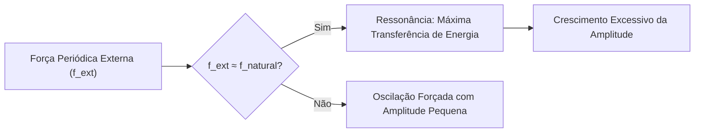
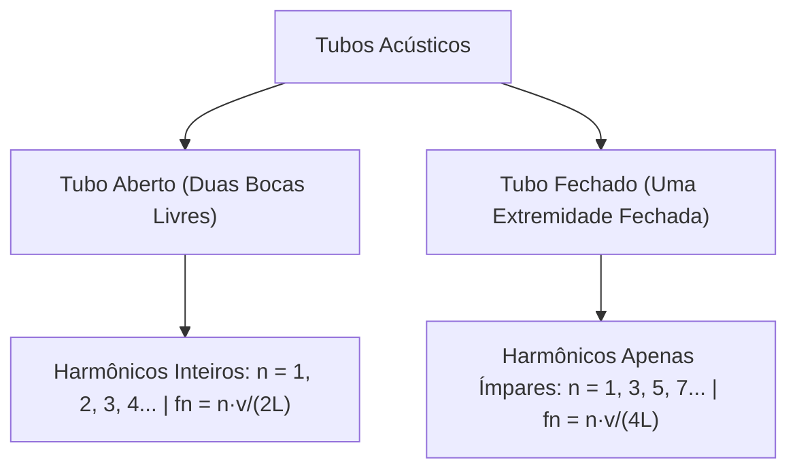
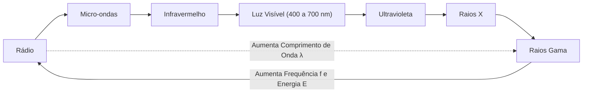
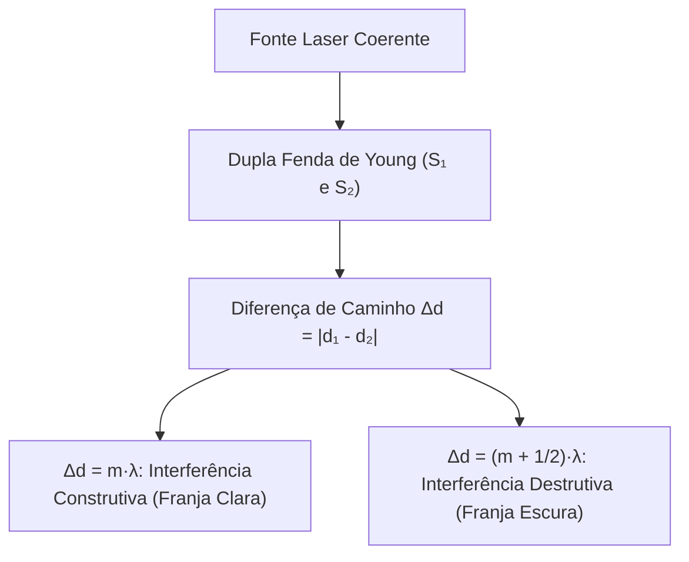
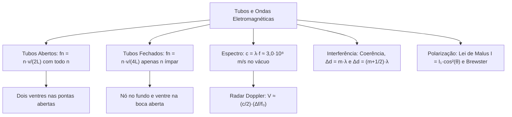

O domínio das oscilações ressonantes e das ondas eletromagnéticas é indispensável para o trabalho de engenharia, salvamento e segurança das corporações militares. A análise de estruturas civis sujeitas a vibrações de vento, o uso de sirenes, o emprego de radares de velocidade e os sistemas de comunicação óptica demandam fundamentos físicos precisos. Da formação de ondas sonoras em colunas de ar até a interferência e polarização de feixes de luz, este conteúdo une a acústica clássica à ondulatória eletromagnética moderna. Este capítulo analisa as frequências naturais e os modos harmônicos em tubos sonoros. Você estudará também a velocidade e o espectro das ondas luminosas, os critérios de interferência de Young e a lei de Malus na polarização.

> [!objetivos]
> - Compreender o conceito de frequência natural e as consequências mecânicas da ressonância.
> - Calcular frequências e harmônicos em tubos sonoros abertos e fechados.
> - Analisar o espectro eletromagnético e o funcionamento do radar Doppler.
> - Determinar as condições de interferência construtiva e destrutiva para feixes de luz coerentes.
> - Aplicar a lei de Malus e compreender a polarização por reflexão na condição de Brewster.

## Frequências Naturais e Ressonância

Todo corpo elástico livre possui um ou mais ritmos próprios de oscilação. Esses valores são denominados frequências naturais de vibração. Eles dependem unicamente da geometria, da massa e da rigidez do sistema material.

Em um sistema massa-mola ideal sem atrito, a frequência natural de oscilação é dada por:

f₀ = (1 / 2π) · √(k / m)

onde k é a constante elástica da mola (N/m) e m é a massa suspensa (kg).

A ressonância ocorre quando um sistema oscilatório é estimulado por uma força externa periódica cuja frequência coincide com uma de suas frequências naturais.

Nessa condição física, a transferência de energia da fonte externa para o sistema receptor torna-se extremamente eficiente. A amplitude de vibração do corpo cresce continuamente a cada novo ciclo de oscilação.

Se a energia acumulada superar a resistência mecânica dos materiais, o sistema pode sofrer colapso estrutural. O famoso colapso da ponte pênsil de Tacoma Narrows em 1940 ocorreu quando vórtices periódicos de vento atingiram uma das frequências naturais da estrutura suspensa. Em operações de salvamento de bombeiros, o trânsito de tropas em pontes deve ser feito sem marcha cadenciada para evitar ressonância acidental.

> [!exemplo]
> Um cantor lírico que sustenta uma nota aguda muito estável e potente com a frequência natural de uma taça de cristal fino provoca ressonância acústica no vidro. A amplitude das vibrações moleculares aumenta rapidamente até romper a estrutura quebradiça do cristal.

## Ressonância Acústica em Tubos Sonoros (Tubos Sonoros)

Os instrumentos de sopro, como flautas, clarinetes e cornetas de bombeiros, produzem som pela vibração de colunas de ar no interior de tubos metálicos ou de madeira. As condições de contorno nas extremidades definem os modos ressonantes de oscilação.

As duas regras físicas de contorno são:
- Extremidade aberta: o ar possui máxima liberdade de movimento molecular longitudinal. Na boca aberta forma-se sempre um ventre de deslocamento da onda estacionária.
- Extremidade fechada: a parede rígida do fundo bloqueia o movimento das partículas de ar. No fundo fechado forma-se sempre um nó de deslocamento da onda estacionária.

### Tubos sonoros abertos nas duas pontas

Um tubo sonoro aberto apresenta ventres de deslocamento nas duas extremidades. O comprimento do tubo (L) acomoda um número inteiro de semicomprimentos de onda (metades de λ):

L = n · (λ / 2)

onde n = 1, 2, 3, 4, ... representa qualquer número inteiro positivo.

Isolando o comprimento de onda e substituindo na equação fundamental (v = λ · f), as frequências dos modos permitidos são:

fn = n · v / (2 · L)

Para o primeiro harmônico (modo fundamental, n = 1):

f₁ = v / (2 · L)

Em tubos abertos, todos os harmônicos inteiros (pares e ímpares) são emitidos: f₁ = f₁, f₂ = 2·f₁, f₃ = 3·f₁, f₄ = 4·f₁.

### Tubos sonoros fechados em uma ponta

Um tubo fechado apresenta um ventre na extremidade aberta e um nó no fundo fechado. A distância entre um nó e um ventre consecutivo é de um quarto de comprimento de onda (λ / 4).

O comprimento da coluna de ar precisa acomodar um número ímpar de quartos de comprimento de onda:

L = n · (λ / 4)

onde n = 1, 3, 5, 7, ... assume exclusivamente valores ímpares.

As frequências ressonantes em tubos fechados são dadas por:

fn = n · v / (4 · L)   (com n = 1, 3, 5, 7, ...)

A frequência fundamental de um tubo fechado (n = 1) vale:

f₁ = v / (4 · L)

O harmônico imediatamente seguinte ao fundamental é o terceiro harmônico (n = 3), cuja frequência é f₃ = 3 · f₁. Em tubos fechados não existem harmônicos pares (não há segundo harmônico nem quarto harmônico).

> [!atencao]
> Em tubos sonoros fechados em uma das extremidades, os harmônicos pares inexistem fisicamente. O modo de vibração imediatamente acima do fundamental (f₁) é obrigatoriamente o terceiro harmônico (3·f₁). Nunca assinale segundo ou quarto harmônico para tubos fechados.

| Característica | Tubo Aberto nas Duas Pontas | Tubo Fechado em Uma Ponta |
|---|---|---|
| Extremidades | Ventre em ambas as pontas | Ventre na aberta, nó na fechada |
| Comprimento da coluna | L = n · (λ / 2) | L = n · (λ / 4) |
| Harmônicos existentes | Todos os inteiros: n = 1, 2, 3, 4... | Somente ímpares: n = 1, 3, 5, 7... |
| Frequência fundamental | f₁ = v / (2·L) | f₁ = v / (4·L) |
| Harmônico seguinte | Segundo harmônico (2·f₁) | Terceiro harmônico (3·f₁) |

> [!resolvido]
> Um tubo cilíndrico aberto nas duas pontas possui comprimento de 0,85 metro. A velocidade do som no ar ambiente é de 340 m/s.
> a) Calcule a frequência fundamental do tubo aberto.
> b) Se uma das pontas do mesmo tubo for completamente fechada, qual passará a ser a nova frequência fundamental e qual será a frequência do primeiro harmônico superior audível?
>
> Resolução:
> a) Tubo aberto nas duas pontas (n = 1):
> f₁ = v / (2 · L) = 340 / (2 · 0,85) = 340 / 1,70 = 200 Hz.
>
> b) Ao fechar uma das extremidades, o tubo torna-se fechado:
> Nova frequência fundamental (n = 1):
> f₁' = v / (4 · L) = 340 / (4 · 0,85) = 340 / 3,40 = 100 Hz.
> O tubo fechado soa uma oitava abaixo (metade da frequência) do tubo aberto.
>
> Primeiro harmônico superior emitido (tubo fechado só admite n ímpar, logo n = 3):
> f₃' = 3 · f₁' = 3 · 100 = 300 Hz.

## Espectro Eletromagnético e Radar de Velocidade (Ondas Eletromagnéticas)

As ondas eletromagnéticas consistem em oscilações mútuas entre um vetor campo elétrico (E) e um vetor campo magnético (B). Os campos são perpendiculares entre si e perpendiculares à linha de propagação da onda. Portanto, todas as ondas eletromagnéticas são transversais.

No vácuo absoluto, todas as ondas eletromagnéticas viajam com a mesma velocidade constante:

c ≈ 3,0 · 10⁸ m/s

A equação fundamental relaciona a velocidade da luz ao comprimento de onda e à frequência:

c = λ · f

Como c é constante no vácuo, comprimento de onda e frequência são grandezas estritamente inversas. Frequências mais altas correspondem a comprimentos de onda menores e maior transporte de energia fotônica.

O espectro eletromagnético organiza as radiações em ordem crescente de frequência:

1. Ondas de rádio: frequências de até 10⁹ Hz, comprimentos de onda métricos e quilométricos. Usadas em radiocomunicação militar e transmissões comerciais.
2. Micro-ondas: frequências de 10⁹ Hz a 10¹¹ Hz. Usadas em fornos residenciais, enlaces de telefonia e radares operacionais.
3. Radiação infravermelha: frequências de 10¹¹ Hz a 4 · 10¹⁴ Hz. Associada à emissão térmica de corpos aquecidos. Vital para câmeras térmicas de bombeiros em ambientes com fumaça escura.
4. Luz visível: estreita faixa de 4 · 10¹⁴ Hz a 7,5 · 10¹⁴ Hz (comprimentos de onda de 700 nm no vermelho a 400 nm no violeta).
5. Radiação ultravioleta: de 7,5 · 10¹⁴ Hz a 10¹⁶ Hz. Capaz de provocar ionizações superficiais e reações fotoquímicas na pele.
6. Raios X: de 10¹⁶ Hz a 10¹⁹ Hz. Radiação penetrante para diagnósticos médicos e inspeção de estruturas metálicas.
7. Raios gama: acima de 10¹⁹ Hz. Emitidos em transições nucleares e desintegrações radioativas.

### O radar Doppler e medição de velocidade

Os radares de trânsito policiais e os equipamentos de salvamento emitem sinais de micro-ondas com frequência f₀ em direção a um alvo em movimento. O sinal atinge o veículo e sofre reflexão em sua lataria.

Ao retornar ao detector do radar, a onda refletida apresenta uma variação na frequência (Δf = |f - f₀|) decorrente do efeito Doppler. Como a onda realiza um percurso duplo de ida e volta, a velocidade do veículo (V) em aproximação direta é calculada pela aproximação física:

V ≈ (c / 2) · (Δf / f₀)

onde c é a velocidade da luz e f₀ é a frequência original da micro-onda emitida.

## Interferência da Luz e Coerência (Interferência da luz)

A interferência é a superposição espacial de duas ou mais ondas em uma mesma região. Para que um padrão de interferência luminosa estável com franjas claras e escuras seja visível em um anteparo, as fontes de luz devem ser coerentes.

Fontes coerentes emitem ondas luminosas com frequências rigorosamente iguais e mantêm entre si uma diferença de fase perfeitamente constante ao longo do tempo. O laser é o exemplo mais clássico de fonte coerente e monocromática.

### Condições para interferência construtiva e destrutiva

Considere duas fontes pontuais luminosas S₁ e S₂ que emitem luz em fase com o mesmo comprimento de onda λ. Ao atingirem um ponto P em uma tela, as ondas percorrem trajetórias de comprimentos d₁ e d₂.

A diferença de caminho óptico (Δd) vale:

Δd = |d₁ - d₂|

As condições clássicas para fontes que emitem em concordância de fase são:

1. **Interferência construtiva** (reforço máximo de crista com crista, gerando franja clara):
   Δd = m · λ     (com m = 0, 1, 2, 3, ...)
   A diferença de caminho é um múltiplo inteiro de comprimentos de onda.
   Para m = 0 (ponto central da tela), as distâncias são iguais (Δd = 0) e forma-se o máximo central brilhante.

2. **Interferência destrutiva** (cancelamento mútuo de crista com vale, gerando franja escura):
   Δd = (m + 1/2) · λ = (2m + 1) · (λ / 2)     (com m = 0, 1, 2, 3, ...)
   A diferença de caminho é um múltiplo ímpar de meios comprimentos de onda.

> [!pegadinha]
> Se o enunciado de prova informar expressamente que as duas fontes já partem em oposição de fase (defasagem inicial de 180° ou π radianos), as condições matemáticas se invertem por completo. A diferença Δd = m · λ passa a ser destrutiva, e Δd = (m + 1/2) · λ passa a ser construtiva.

## Polarização da Luz e a Lei de Malus (Polarização da Luz)

A polarização é o processo físico que seleciona uma única direção espacial para a oscilação do vetor campo elétrico de uma onda transversal.

A luz solar natural ou a luz de uma lâmpada incandescente comum não é polarizada. O vetor campo elétrico vibra simultaneamente em todas as orientações perpendiculares à linha de propagação.

Ao atravessar um filtro polarizador ideal (como uma lente de óculos escuros de alta performance), o dispositivo permite a passagem exclusiva da componente do campo elétrico paralela ao seu eixo de transmissão. A intensidade de um feixe de luz natural não polarizada (I₀) que atravessa um primeiro filtro polarizador ideal cai rigorosamente pela metade:

I₁ = I₀ / 2

A luz emergente é classificada como linearmente polarizada.

### Lei de Malus

Se o feixe de luz linearmente polarizado de intensidade I₁ incidir sobre um segundo elemento polarizador (denominado analisador) cujo eixo de transmissão forma um ângulo θ com o eixo do primeiro filtro, a intensidade luminosa transmitida final obedece à lei de Malus:

I = I₁ · cos²(θ)

Casos operacionais fundamentais da lei de Malus:
- Eixos paralelos (θ = 0°): cos(0°) = 1, e a intensidade transmitida é máxima: I = I₁.
- Eixos cruzados a 90° (θ = 90°): cos(90°) = 0, e a intensidade transmitida é nula: I = 0. Nenhum raio luminoso atravessa o par de filtros cruzados.
- Eixos a 45° ou 60°: para θ = 60°, cos(60°) = 1/2 e cos²(60°) = 1/4, reduzindo a intensidade transmitida para I₁ / 4.

### Polarização por reflexão: a condição de Brewster

A polarização também pode ocorrer quando a luz incide sobre a fronteira de separação entre dois meios transparentes (como ar e água).

O físico David Brewster descobriu que quando o raio refletido e o raio refratado formam um ângulo de 90° entre si, a luz refletida torna-se totalmente polarizada linearmente, com vibração paralela à superfície refletora. O ângulo de incidência para o qual isso ocorre é denominado ângulo de Brewster (θ_B):

tan(θ_B) = n₂ / n₁

onde n₁ é o índice do meio incidente (geralmente ar, n₁ = 1) e n₂ é o índice do meio refletor. Óculos de sol com lentes polarizadas filtram essa luz refletida polarizada horizontalmente em pistas molhadas e espelhos de água, eliminando o ofuscamento visual do condutor.

## Mapa do capítulo

### Para fixar

- Ressonância ocorre quando a frequência excitadora coincide com uma frequência natural, elevando a amplitude.
- Tubo aberto nas duas extremidades forma ventres nas pontas e produz todos os harmônicos: fn = n·v/(2L).
- Tubo fechado em uma ponta possui nó no fundo e ventre na boca, gerando apenas harmônicos ímpares: fn = n·v/(4L).
- Ondas eletromagnéticas são transversais e viajam no vácuo com velocidade universal c ≈ 3,0 · 10⁸ m/s.
- No radar Doppler por reflexão de micro-ondas, a velocidade do alvo obedece à aproximação V ≈ (c/2)·(Δf/f₀).
- Fontes luminosas coerentes possuem a mesma frequência e diferença de fase constante no tempo.
- Para fontes em fase, Δd = m·λ gera interferência construtiva (franja clara) e Δd = (m + 1/2)·λ gera destrutiva (franja escura).
- Um polarizador ideal reduz luz natural a I₀/2; o segundo filtro transmite intensidade regida pela lei de Malus: I = I₁·cos²(θ).
