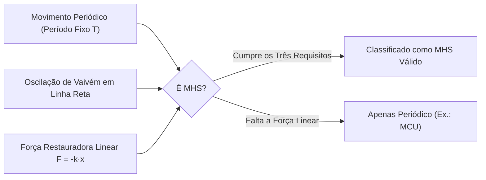
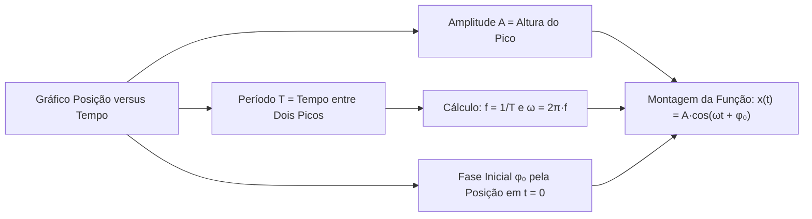
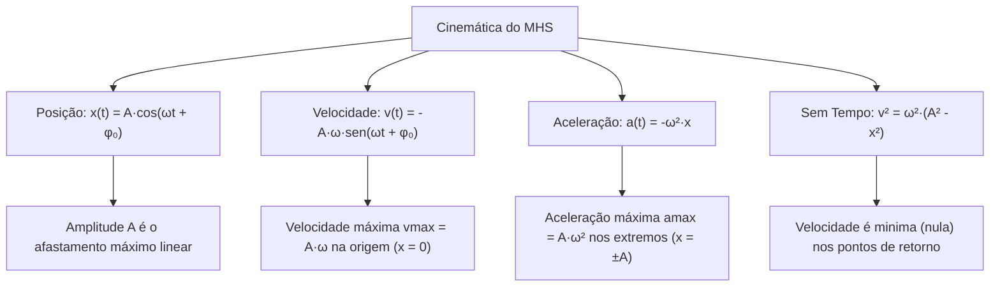

O Movimento Harmônico Simples (MHS) é a base de todas as oscilações mecânicas. Amortecedores de viaturas e cabos de resgate vibram como osciladores elásticos. O MHS é um movimento periódico em linha reta. Ele é produzido por uma força restauradora linear. Compreender a posição, a velocidade e a aceleração ao longo do tempo é essencial nas provas. Este capítulo analisa a cinemática do oscilador harmônico. Você aprenderá a interpretar as funções horárias, as fases iniciais e a leitura de gráficos.

> [!objetivos]
> - Definir os requisitos do Movimento Harmônico Simples e diferenciá-lo do MCU.
> - Interpretar a projeção do círculo de referência e a fase inicial.
> - Aplicar as funções horárias da elongação, velocidade e aceleração.
> - Calcular a velocidade vmax e aplicar a equação independente do tempo.

## Fundamentos do Movimento Harmônico Simples (Movimento Harmônico Simples)

Um movimento é periódico quando se repete em intervalos de tempo iguais. Essa duração fixa é o período (T). O movimento é oscilatório quando a partícula se move em vaivém entre dois limites. Cada ciclo completo é concluído com o móvel realizando essa oscilação de ida e volta.

Para ser MHS, o sistema precisa de uma força restauradora linear:

F = - k · x

A constante elástica é k e a elongação é x. O sinal negativo indica que a força aponta sempre para o equilíbrio central (x = 0).

> [!pegadinha]
> Todo MHS é periódico. Porém, nem todo movimento periódico é MHS. O movimento circular uniforme (MCU) é periódico, mas não é MHS.

### Conexão entre MCU e MHS

O MHS pode ser compreendido como a projeção retilínea de um MCU em um diâmetro de uma circunferencia de referência. A comparacao entre os dois movimentos dispensa demonstracoes complexas com cálculo diferencial avançado. O que é cobrado nas provas admite solução direta por funções trigonométricas. Uma análise gráfica simplificada foge de equações diferenciais complexas e foca nas variaveis essenciais.

A velocidade angular do círculo de referência é a pulsação (ω) do MHS:

ω = 2π / T = 2π · f

No SI, a pulsação vem em rad/s, o período em segundos e a frequência em hertz.

A fase inicial (φ₀), em radianos, indica a posição inicial no instante t = 0 no percurso circular:
- Partindo do extremo positivo (x = +A): o angulo vale 0 rad.
- Partindo do extremo negativo (x = -A): o angulo vale π rad (180 graus).
- Passando pelo equilíbrio (x = 0) rumo ao sentido positivo: o angulo na circunferencia é 270 graus (3π/2 rad).
- Passando pelo equilíbrio (x = 0) rumo ao sentido negativo: o angulo é 90 graus (π/2 rad).

Em um oscilador constituído por bloco e mola ideal, a posição central corresponde à mola relaxada. Quando o bloco é puxado, a mola sofre distensao máxima igual à amplitude A. Se o bloco fosse comprimido no sentido oposto, a deformação máxima seria de igual módulo. Ao longo de todo o curso do movimento, a mola exerce a força restauradora.

## Cinemática do MHS e Funções Horárias (Cinemática do MHS)

As funções horárias descrevem o estado mecânico do móvel em cada instante t ao longo de suas posicoes no espaço.

### Função horária da elongação

A posição do corpo em relação à origem de equilíbrio é expressa por:

x(t) = A · cos(ωt + φ₀)

A amplitude máxima é A, medida em metros. A fase instantânea é (ωt + φ₀). Como o cosseno varia entre -1 e +1, o corpo oscila entre -A e +A.

### Função horária da velocidade escalar

A velocidade escalar do oscilador ao longo do tempo é dada pela derivada temporal da posição:

v(t) = - A · ω · sen(ωt + φ₀)

Como a derivada da função cosseno fornece o negativo da função seno, a velocidade oscila como um seno defasado. O valor máximo em módulo da velocidade é denominado vmax. Ele é obtido na passagem pelo ponto de equilíbrio central (x = 0):

vmax = A · ω

Nos pontos extremos da trajetória (x = +A e x = -A), o móvel para para inverter o sentido. Ali a velocidade é minima e atinge o valor zero (v = 0). O móvel realmente atinge o repouso instantâneo antes de retornar.

### Função horária da aceleração escalar

A aceleração escalar do oscilador é a derivada temporal da velocidade e obedece à equação:

a(t) = - A · ω² · cos(ωt + φ₀)

Como x = A · cos(ωt + φ₀), a substituição direta revela a relação restauradora:

a(t) = - ω² · x

A aceleração aponta sempre para o centro. Seu valor máximo em módulo (amax) ocorre nos pontos extremos de afastamento (x = +A e x = -A):

amax = A · ω²

Na posição central de equilíbrio (x = 0), a aceleração atinge seu valor minimo e é identicamente nula.

| Posição do Móvel | Elongação | Módulo da Velocidade | Módulo da Aceleração |
|---|---|---|---|
| Extremo positivo | x = +A | Minima: v = 0 | Máxima: amax = A · ω² |
| Posição de equilíbrio | x = 0 | Máxima: vmax = A · ω | Minima: a = 0 |
| Extremo negativo | x = -A | Minima: v = 0 | Máxima: amax = A · ω² |

> [!atencao]
> Observe a oposição física fundamental. Onde a velocidade é máxima (na origem x = 0), a aceleração é nula. Onde a aceleração é máxima (nos extremos x = ±A), a velocidade é nula.

## Relação sem o Tempo e Roteiro de Gráficos

Quando o tempo t não é informado, relaciona-se velocidade e posição. A relação fundamental trigonométrica sen² + cos² = 1 fornece a equação independente do tempo:

v² = ω² · (A² - x²)

Esta equação permite calcular a velocidade em qualquer ponto x da oscilação.

> [!resolvido]
> Um bloco sobre trilho horizontal executa MHS com amplitude de 10cm (A = 0,10 m) e período T = 4,0 s. No instante t = 0, o bloco parte do repouso em x = +0,10 m.
> Determine a pulsação angular, a velocidade máxima vmax e a aceleração máxima amax.
>
> Resolução passo a passo:
> 1. Pulsação angular:
> ω = 2π / T = 2π / 4,0 = 0,5π rad/s ≈ 1,57 rad/s.
>
> 2. Velocidade máxima obtida na origem:
> vmax = A · ω = 0,10 · 0,5π = 0,05π m/s ≈ 0,157 m/s.
>
> 3. Aceleração máxima nos extremos:
> amax = A · ω² = 0,10 · (0,5π)² = 0,10 · 0,25π² = 0,025π² ≈ 0,247 m/s².
> A função obtida para a posição é x(t) = 0,10 · cos(0,5π · t).

Para mostrar o comportamento em gráficos, a curva azul de posição inicia no topo e desce suavemente.

## Mapa do capítulo

### Para fixar

- O MHS é oscilatório, periódico e tem força restauradora linear F = -k·x voltada para o equilíbrio.
- A pulsação angular obedece a ω = 2π/T = 2π·f e é medida em rad/s no Sistema Internacional.
- A posição é x(t) = A·cos(ωt + φ₀); partir de +A dá φ₀ = 0 rad, e partir de -A dá φ₀ = π rad.
- A velocidade escalar é v(t) = -A·ω·sen(ωt + φ₀), atingindo vmax = A·ω na posição de equilíbrio.
- Nos extremos de retorno (x = ±A), a velocidade do corpo é nula (v = 0).
- A aceleração é a(t) = -ω²·x, com valor máximo amax = A·ω² nos extremos e nula no centro.
- A equação independente do tempo do MHS é dada por v² = ω²·(A² - x²).
- No gráfico posição-tempo, o tempo entre picos consecutivos mede o período T e a altura do pico mede a amplitude A.
